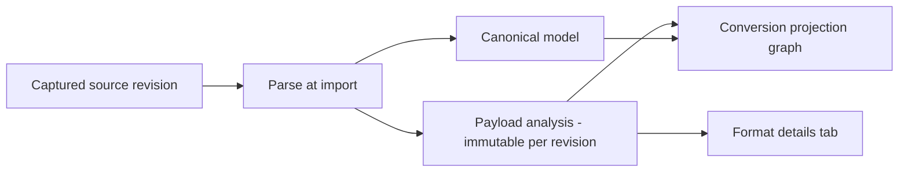

Every imported catalog item carries a **payload analysis**: a persisted, revision-scoped
record of the payload's *native* structure — X12 and UN/EDIFACT envelopes and segments,
copybook levels and PICTURE clauses — captured once at import time, in the format's own vocabulary. The
**Format details** tab renders that record. This page explains the status vocabulary,
what redaction withholds, exactly where the X12 and copybook inspectors' knowledge ends,
and — most importantly — how to read *absence*.

> **The two rules of reading format details:**
> 1. **An analysis describes an observed sample, not a specification.** An X12 record
>    shows what one interchange declared about itself; no implementation guide was
>    consulted and nothing was validated against one.
> 2. **Absence in the record is not absence in the source.** A construct the parser does
>    not model (a "parsing limit") may well be in your source; only a construct the
>    analyzer *models and did not observe* is genuinely absent. The capability panel at
>    the bottom of the tab states which is which.



---

## In the UI

1. Go to **Bring in → Catalog** and select an item. The detail page has
   eight tabs: **Overview**, **Format details**, **Source & code**, **Provenance**,
   **Conversions**, **Lint & score**, **Test bench**, **Versions**.
2. Select **Format details**. The analysis is fetched only when the tab is selected —
   opening the item alone never loads (or logs access to) the native tree.
3. Use the filter box (**Filter structure…**) and the tree's arrow keys to navigate;
   select a construct to see its evidence — kind, source location, value statement, and
   warnings — below the tree. **Link to this construct** copies a shareable deep link
   (`?tab=format&node=<id>`).
4. Where the analyzer recorded a source position, the evidence offers **View source at
   line _n_** (or **Highlight _n_ characters in the source**), which opens the
   **Source & code** tab at exactly that range.

Reading the analysis requires the `imports:view` permission, and every read is
audit-logged (`catalog.analysis.view`), as is raw-source access (`catalog.source.view`).

## The analysis record

Each analysis is **immutable for its source revision**. Re-importing the item (or an
analyzer upgrade) mints a *new* analysis with new node ids — node deep links are only
stable within one analysis, and the tab says so if a linked node is gone. The record
carries its own provenance: a `schemaVersion`, the `sha256:` hash of the exact source
analyzed, and an analyzer stamp (`edix12@1.1.0`, `edifact@1.1.0`, `tradacoms@1.0.0`, `idoc@1.0.0`, `swift-mt@1.0.0`, `nacha@1.0.0`, `dicom@1.0.0`, `ncpdp@1.0.0`, `opcua-nodeset@1.0.0`, `sparkplug@1.0.0`, `cobolcopybook@1.1.0`, or the
format-agnostic `generic@1.0.0`) with tool versions, so every claim is attributable.

## Statuses

The record declares exactly one of four statuses:

| Status | UI label | Meaning |
|---|---|---|
| `available` | **Available** | The analyzer described the whole captured source within its budget. |
| `partial` | **Partial** | The analyzer described part of the source and stated which parts it could not — what is here is real, and it is not everything. |
| `unavailable` | **Unavailable** | Nothing was analysed for this revision, so there is no native structure to show. |
| `failed` | **Analyzer failed** | The analyzer ran and errored, so no native structure was recorded. |

Any status other than `available` names a **reason**, from a closed vocabulary:

| Reason code | Meaning |
|---|---|
| `not_analyzed` | The revision predates payload analysis (imported before the analyzer existed, or the analyzer has not run). Re-import to produce one. |
| `no_source_captured` | No source material was captured for this revision — there is nothing to analyse. |
| `unsupported_format` | apiome has no native analyzer for this format. A capability boundary, not a parse failure; the source itself is unaffected. |
| `bounds_exceeded` | The analyzer hit its node or depth budget. The record is real and `partial`. |
| `analyzer_failed` | The analyzer raised. The import itself still completed. |

Analyzer **warnings** ride alongside the tree with severities `info`, `warning`, and
`error`; the tab lists them and badges the nodes they attach to.

## Values and redaction

What the record carries *about values* is governed by a **value-visibility policy**,
separate from structure (structure is never redacted):

| Visibility | What a node carries |
|---|---|
| `none` | Nothing about the value — not even whether one was there. |
| `structural` | *(default)* Whether a value was present and how long it was; never what it said. |
| `full` | Observed values, truncated to the record's preview limit (120 characters). Never a default — it must be granted. |

Practical consequences:

- At the default `structural` visibility, an X12 element renders a statement like *"A
  value of 9 characters was present."* — presence and length are facts; content is not
  carried. Withheld values show a `redacted` chip and count into the **values
  withheld** badge.
- Visibility only narrows on read: requesting `full` over a record stored `structural`
  returns the structural record. A record never held values it can later reveal.
- The structure filter searches names, constructs, and source locations — **never
  observed values**.
- X12 envelope metadata (sender/receiver ids, control numbers, dates, delimiters) is
  *structure*, not payload value, and is shown at every visibility level.
- The policy source (`default`, `tenant`, `format`, or `request`) is recorded with the
  analysis.

## Bounds: when the tree is cut

Analysis is bounded by design: at most **5000 stored nodes** and **32 levels of
depth** (with a 50000-node traversal budget). A source that exceeds them is admitted
**breadth-first** — the top of the structure survives, envelopes before leaves — and the
record is stored `partial` / `bounds_exceeded` with an exact dropped-node count. The tab
says it plainly: the missing nodes are *absent from the record, not from your source*.
A bounded record can never claim to be `available`.

## Implementation guides: what is not checked

For the EDI and vertical-messaging formats, an import that succeeds means the document was
**structurally readable** — its envelope, segments, records or elements parsed. It does **not**
mean the document conforms to an implementation guide. Apiome reads each format's syntax and
nothing above it: no implementation guide, operating rule, template or trading-partner guide is
consulted.

So that a green import is never read as a compliance verdict, the **Format details** tab shows a
**No implementation guide was consulted** banner under the status badges for every format in the
family. It names:

- A statement of what Apiome actually checks — the syntax it reads.
- **Not consulted** — the guides and rules that are not applied, by name.
- **Recorded as the sender's claim** — what the document says about itself (an X12 `ST03`
  reference, a CDA `templateId`, a NACHA SEC code…), kept as written and never checked.

The [catalog item page](./catalog.mdx#an-items-page) shows the banner on an X12 item's **Format details**
tab.

The banner reads from each format's hand-reviewed entry in the capability registry
(`implementation_guide` on `GET /v1/import/format-capabilities/{format_key}`), so the tab, the
[supported formats](./supported-formats.md#format-boundaries) page and the API say the same thing.

| Format | What is read | Not consulted | Recorded as the sender's claim |
| --- | --- | --- | --- |
| EDI X12 (`edix12`) | ASC X12 envelope and segment syntax (ISA/GS/ST) | the 4010 and 5010 implementation guides (TR3s); trading-partner companion guides | an ST03 implementation convention reference |
| UN/EDIFACT (`edifact`) | UN/EDIFACT syntax (ISO 9735) | the D.96A and D.01B message directories; EANCOM; ODETTE/VDA guides | a UNH message version, release and association code |
| TRADACOMS (`tradacoms`) | TRADACOMS syntax (STX/MHD/MTR/END envelope over EDIFACT-style segments) | the TRADACOMS manual's message specifications; trading-partner guides | an MHD message type and version |
| SAP IDoc (`idoc`) | SAP IDoc control and data record layout (EDI_DC40/EDI_DD40) and IDoc XML | the basic type's WE30 structure; standard SAP segment definitions (unless a WE60 export is supplied); qualifier code lists | the control record's IDoc type and message type |
| SWIFT MT (`swift-mt`) | SWIFT FIN block structure and the stated MT103, MT202, MT940 and MT942 field catalogue | SWIFT network-validated rules; SWIFT usage rules; the MX usage guidelines; market practice guides | a block 3 validation flag (field 119: STP, COV, REMIT) |
| HL7 v3 / CDA (`hl7v3`) | CDA R2 document structure (POCD_HD000040) | C-CDA R2.1; any other implementation guide's templates; the CDA R2 schema; terminology bindings | each templateId |
| NACHA ACH (`nacha`) | NACHA ACH record format (94-character records, types 1/5/6/7/8/9) | the NACHA Operating Rules' SEC-code requirements; IAT layouts; ODFI or bank file specifications | a batch's Standard Entry Class code |
| DICOM (`dicom`) | DICOM Part 10 and DICOM JSON attribute structure | IOD module requirements (PS3.3); SR templates (PS3.16); the sending device's conformance statement | the SOP Class UID |
| NCPDP SCRIPT / Telecom (`ncpdp`) | NCPDP SCRIPT element structure and Telecommunication D.0 segment/field syntax | the SCRIPT Implementation Guide; the Telecommunication D.0 Implementation Guide and data dictionary; payer sheets | a SCRIPT message's version and release |
| FIX Orchestra (`fix-orchestra`) | FIX Orchestra repository structure (datatypes, code sets, fields, components, groups, messages) | the FIX Latest base repository; the FIX session-layer specification; a counterparty's rules-of-engagement documents | the FIX version the repository declares |

## The X12 inspector

For EDI X12 sources the tab renders the native hierarchy — **interchange → functional
group → transaction set → segment → element**, with composite components grouped under
their element position:

- **Envelope facts**: sender (ISA06), receiver (ISA08), date/time (ISA09/ISA10),
  acknowledgment requested (ISA14), interchange version (ISA12), usage indicator
  (Production/Test), and the **declared delimiters** (element, component, repetition,
  segment terminator) each shown with its `U+XXXX` code point.
- **Control totals**: the counts the SE, GE, and IEA trailers *declared* are shown
  beside the counts actually *observed* — an interchange that disagrees with itself can
  be seen to.
- **Element presence** distinguishes five facts: *Has a value*, *Present, empty*,
  *Withheld*, *Not present*, *Not recorded*. An element position the source wrote and
  left empty is a different fact from a position the source never wrote, and the two are
  never rendered as one.
- **Conversion scope**: the canonical model (and therefore the converted OpenAPI) is
  derived from the **first functional group's first transaction set**. Every group and
  transaction set the interchange carried is in the analysis — and only there. An
  analysis of a multi-transaction interchange states explicitly which set the conversion
  was derived from (warning `x12.canonical_projection_subset`).

**Where the X12 inspector's knowledge ends** (also stated in the capability panel):

- **No implementation-guide validation.** As the inspector itself puts it: everything
  shown is what the interchange itself declared. No 4010 or 5010 implementation guide
  was consulted, no segment or element was checked against one, and an ST03
  implementation convention reference is recorded as the sender's claim rather than as
  a verified fact. For guide-level semantics, consult your licensed X12 publications.
- **HL loops** are described as the segments they are, not as the hierarchy they encode.
- **TA1 acknowledgements** are removed by the parser before analysis runs, and the
  trailer segments (SE/GE/IEA) are recorded as control totals, not tree nodes.
- A repetition separator only exists where the interchange version defines one (ISA11
  at `00501` and later — never at `00401`).

## The EDIFACT analysis

For UN/EDIFACT sources ([how to import one](./edifact-import.md)) the tab renders the native
hierarchy — **interchange → functional group → message → segment → element**, with composite
components under their element and syntax-4 repetitions under the element they repeat. An
interchange without functional groups has its messages directly under the interchange. It keeps
the X12 inspector's contract:

- **Envelope facts** on the interchange row: syntax identifier and version (`UNOC`, `3`), sender
  and recipient with their qualifiers, preparation date and time, control reference, application
  reference and test indicator — and the **service characters**, with whether a `UNA` declared them
  (**serviceStringAdviceDeclared**) or the ISO 9735 defaults applied. The `UNB` recipient password
  is never shown.
- **Message facts**: message type (`ORDERS`), version and release (`D`, `96A`), controlling agency
  and association code (`EAN008`), recorded as the sender's claim.
- **Dialect profile**: the interchange row's **profile** and **profileLabel** name the profile it was
  read with — EANCOM, ODETTE/VDA or plain UN/EDIFACT ([how each is recognised](./edifact-import.md#dialect-profiles))
  — beside **implementationGuideConsulted** `false`. Each message under a dialect shows
  **inProfileMessageSet**, and the warning `edifact.dialect_profile_applied` states the evidence.
- **Control counts**: what `UNT` (segments, `UNH` to `UNT` inclusive), `UNE` (messages) and `UNZ`
  (groups, or messages when there are none) *declared* sits beside what was *observed*, with
  **controlCountConsistent** saying whether they agree. The control reference each trailer repeats
  is checked against its header (**controlReferenceConsistent**). Each disagreement is also a
  warning — `edifact.control_count_mismatch`, `edifact.control_reference_mismatch` — so an
  interchange that disagrees with itself is visibly so.
- **Element presence** uses the same five facts as X12: *Has a value*, *Present, empty*,
  *Withheld*, *Not present*, *Not recorded*. A segment's **elementPositionCount** counts every
  position it wrote; **elementCount** counts the ones that carried a value.
- **Conversion scope**: the canonical model is derived from the **first functional group's first
  message**. An analysis of a multi-message interchange names the message it was derived from
  (warning `edifact.canonical_projection_subset`).
- **Source positions** are exact for every segment, group and message: the parser reads the text
  itself, so there is no second reading to disagree with.

**Where the EDIFACT analysis's knowledge ends** (also stated in the capability panel):

- **No implementation guide is consulted** — not D.96A, D.01B, EANCOM or ODETTE. Only the
  ISO 9735 syntax is read, so a structurally valid interchange is not claimed to be a conformant
  one.
- **Segment groups** are shown as flat segments; a directory would be needed to nest them.
- The **decimal mark** is recorded, and values are never re-read as numbers.

## The TRADACOMS analysis

For TRADACOMS sources ([how to import one](./tradacoms-import.md)) the tab renders **transmission →
file → message → segment → element**, one root per transmission in the document, with composite
components under their element. Segments and elements use the EDIFACT analysis's vocabulary and
contract:

- **The transmission row** shows the syntax (`ANAA`, `1`), **senderCode** and **recipientCode**,
  date and time, **senderReference** and **applicationReference**, the service characters (with
  **tagSeparator** `=`), and the dialect profile (**profile** `tradacoms`,
  **implementationGuideConsulted** `false`). The `STX` recipient's reference is never shown.
- **The file row** shows **headerMessageType** (`ORDHDR`), **transactionCode** and
  **transactionName** (`0430`, `ORDERS`), and the `FIL` **fileGenerationNumber** and
  **fileVersionNumber**.
- **The message row** shows **messageReference**, **messageType**, **messageVersion**, whether it is
  the file's header (**fileHeader**) and **inProfileMessageSet**.
- **Control counts**: what `MTR` (segments, `MHD` to `MTR` inclusive) and `END` (messages)
  *declared* sits beside what was *observed*, with **controlCountConsistent**; each disagreement is
  a warning (`tradacoms.control_count_mismatch`).
- **Conversion scope**: the canonical model is the first transmission's first detail message; a
  document of several says so (warning `tradacoms.canonical_projection_subset`).

## The IDoc analysis

For SAP IDoc sources ([how to import one](./idoc-import.md)) the tab renders **IDoc → segment →
field**, one root per IDoc in the file:

- **The control record is structure.** Basic type, extension, message type, ports, partners,
  direction (**Outbound**/**Inbound**), release, status and creation date and time sit on the IDoc
  row, with every non-empty `EDI_DC40` field under **controlRecord**. None of it is a value, so no
  value-visibility setting withholds what identifies the document.
- **Segments nest by number.** Each segment shows its **segmentNumber**, its
  **parentSegmentNumber** and the **depth** those numbers give. A flat record's declared `HLEVEL`
  is shown as **declaredLevel** when it disagrees (warning `idoc.hierarchy_level_disagrees`).
- **Fields are values** and follow the same five presence facts as EDI. In a flat IDoc each field
  also shows its **offset** within `SDATA`, its **recordOffset** within the 1063-character record
  and its **length**, cut from the segment definition supplied with the IDoc. A flat segment with
  no definition has one field, `SDATA`, marked **opaque** (warning `idoc.sdata_without_definition`).
- **What the byte counts assume** is stated on every flat record (warning
  `idoc.layout_assumptions`), exactly as the copybook inspector states its own: one character per
  byte, the release 4.0+ `EDI_DC40`/`EDI_DD40` layouts, trailing blanks as padding, short records
  padded back with blanks. An XML IDoc has no byte layout and claims no offsets.
- **Conversion scope**: the canonical model is the first IDoc's basic type; a file of several says
  so (warning `idoc.canonical_projection_subset`).

## The SWIFT MT analysis

For SWIFT MT sources ([how to import one](./swift-mt-import.md)) the tab renders **message → block
→ sequence → field → component**, one root per message in the file:

- **The message row** shows the message type and name (`103`, `MT202COV`), the direction (input to
  or output from SWIFT), the validation flag (`COV`, `STP`), and **mxCorrespondence** — the
  documented ISO 20022 counterpart, always with **verified** `false`.
- **Header blocks** `{1:}`, `{2:}`, `{3:}` and `{5:}` carry their parsed values as structure:
  application and service ids, LT address, session and sequence numbers, receiver or MIR,
  priority, the user header's MUR (**messageUserReference**) and UETR (**uetr**), trailer tags.
- **Fields** carry their **tag**, **option** letter, **fieldName** and **format**, and whether the
  content matched it (**wellFormed**). Their children are values: **components** (currency,
  amount, BIC, mark…), **code words** with their **qualifier** as structure, **numbered lines**
  with their **lineNumber**, and free **lines**.
- **Statement lines**: in MT940/942 each `:61:` and the `:86:` after it share a
  **statementLineIndex**.
- **Warnings**: `swift.mx_correspondence_note` states the correspondence and its disclaimer —
  it is a note, not a conversion; `swift.field_not_well_formed` and
  `swift.field_not_in_catalogue` name fields kept as lines.

## The NACHA ACH analysis

For NACHA ACH files ([how to import one](./nacha-sepa-import.md)) the tab renders **file → batch →
entry → addenda**, with the file header and file control, and each batch's header and control, as
**record** rows beside them. Every record and every field carries the exact line, offset and length
it was cut from.

- **The file row** shows the creation date and time, **fileIdModifier**, **recordSize** (`094`),
  **blockingFactor** (`10`), **batchCount**, **recordCount** and **paddingRecords**, and
  **operatingRulesConsulted** `false`.
- **The batch row** shows **batchNumber**, **serviceClassCode**, **standardEntryClassCode** (`PPD`,
  `CCD`, `WEB`…), **companyEntryDescription**, **effectiveEntryDate**, **entryCount** and
  **addendaCount**.
- **The entry row** shows **transactionCode**, **direction** (`credit` or `debit`), **prenote**,
  **addendaRecordIndicator**, **addendaCount**, **traceNumber** and **checkDigitValid** (the routing
  number's check digit, recomputed). Its fields — account number, amount, name — are values.
- **Control totals**: every total the batch control and file control declare sits as
  **declared…** beside **observed…** — entry/addenda count, entry hash, total debit, total credit,
  and for the file batch count and block count — with **controlTotalsConsistent**. Each
  disagreement is a warning (`nacha.control_total_mismatch`); the file still imports.
- **Other warnings**: `nacha.addenda_indicator_mismatch` (an entry's indicator disagrees with the
  addenda after it), `nacha.addenda_layout_not_modelled` (an addenda type other than 05, 98 or 99,
  kept whole) and `nacha.iat_layout_not_modelled` (an IAT batch, read with the domestic layouts).

## The DICOM analysis

For DICOM files ([how to import one](./dicom-import.md)) the tab renders one **dataset** row per
instance or query result, with the Part 10 **file meta information** first, then every
**attribute** in source order. A **sequence** row holds its **item** rows, and in a Structured
Report the `ContentSequence` items are **content item** rows. A Part 10 element carries its byte
offset and length; a DICOM JSON attribute carries its JSON pointer.

- **The dataset row** shows **typeName**, **sopClassUid** and **sopClassName**, **modality**,
  **form** (`part10` or `json`), the **transferSyntaxUid** and **transferSyntaxName**, and
  **pixelDataPresent** beside **pixelDataRead** `false`.
- **The attribute row** shows **tag**, **keyword**, **vr**, **vm**, **valueCount** and
  **valueForm** (`inline`, `binary`, `bulk-data-uri`, `inline-binary` or `empty`).
  **patientIdentifying** marks the attributes DICOM's de-identification profile (PS3.15 Annex E)
  lists, and every private one. The value itself follows the value-visibility policy: at the
  default you see whether it was present and how long it was, never what it said.
- **The content item row** shows the item's **valueType** (`CONTAINER`, `TEXT`, `CODE`, `NUM`…),
  **relationshipType** and its concept name (**conceptCode**, **conceptScheme**,
  **conceptMeaning**). The item's value, such as the finding text, is not an attribute.
- **The pixel data row** (**Pixel data (not read)**) shows the **tag**, **vr** and
  **declaredLength**, or **encapsulatedFragments** for a compressed image, with **read** and
  **stored** `false`. It carries no value. The record's `sourceHash` is taken over the file with
  every pixel-data value cut out, so even the hash never digests image content.
- **Warnings**: `dicom.pixel_data_not_read` (one per pixel-data element),
  `dicom.private_attributes_not_modelled`, `dicom.media_storage_sop_class_mismatch` (the file meta
  group and the dataset name different SOP classes) and `dicom.fileset_member_skipped`. All are
  informational, so the record stays **available**.

## The NCPDP analysis

For NCPDP documents ([how to import one](./ncpdp-import.md)) the tab renders what the file is:

- **SCRIPT** — one **message** row per `Message`, then its **element** rows in document order, with
  each attribute (`Qualifier`, `version`) as an **attribute** row. The message row shows
  **transactionType** (`NewRx`, `RxFill`, `RxChangeRequest`…), **recognized**, **messageId**,
  **relatesToMessageId** and **relatesToResolved** (whether the message it answers is in the same
  upload), **version** and **implementationGuideConsulted** `false`. Rows locate by element path
  only.
- **Telecommunication D.0** — one **transmission** row with the **header** (its nine positional
  fields), the patient and insurance **segment** rows, then one **transaction** row per transaction
  holding its segments (`AM07` claim, `AM11` pricing…), each with its **field** rows. The
  transmission row shows **version** (`D0`), **transactionCode** and **transactionName**,
  **declaredTransactionCount** beside **observedTransactionCount**, **transactionCountConsistent**
  and **implementationGuideConsulted** `false`. Header fields, segments and transactions carry the
  exact offset and length they were cut from.

Element, attribute and field values — names, dates of birth, drug codes, amounts — follow the
value-visibility policy: at the default you see whether a value was present and how long it was.
Warnings: `ncpdp.transaction_count_mismatch` (a B1/B2/B3 header's transaction count disagrees with
the transactions observed), `ncpdp.transaction_not_recognized` (a SCRIPT `Body` carrying an
element outside the recognised transactions) and `ncpdp.segment_not_named` (a segment id outside
`AM01`–`AM16`). All are informational, so the record stays **available**.

## The HL7 v3 / CDA analysis

For CDA documents ([how to import one](./hl7v3-cda-import.md)) the tab renders the format-blind
walk: one row per element and attribute, nested as the document nests them, located by element
path (`ClinicalDocument/component/structuredBody/component[2]/section`). The analyzer stamp is
`generic@1.0.0`, and the rows name containers and leaves rather than CDA's own vocabulary — the
header → body → section → entry hierarchy is in the item's types instead.

Each `templateId` is a conformance **claim** the document makes about itself. It is recorded as
asserted (`validated: false`) and never checked against the template's constraints; the banner
above says so. Leaf values — names, identifiers, observations — follow the value-visibility policy.

## The FIX Orchestra analysis

For FIX Orchestra repositories ([how to import one](./fix-orchestra-import.md)) the tab also
renders the format-blind walk (`generic@1.0.0`): one row per element and attribute of the
repository, located by element path (`repository/messages/message[2]/structure`). Messages, code
sets, components, groups and their presence rules are read into the item's types, not into
format-specific rows here.

The repository is read **as declared**. Nothing is compared with the FIX Latest base repository it
extends or restricts, and a rule's `when` or `assign` expression is recorded verbatim, never
evaluated. Its leaf values are specification text — names, tags, code values — and still follow
the value-visibility policy.

## The OPC UA NodeSet2 analysis

For OPC UA NodeSet2 models ([how to import one](./opcua-nodeset-import.md)) the tab renders the
whole nodeset, address space included:

- **nodeset**, the root. It lists the model URIs and the node count.
- **namespaces**, **models** (each with its required models) and **aliases**.
- One group per node class (**objectTypes**, **variableTypes**, **dataTypes**,
  **referenceTypes**, **methods**, **objects**, **variables**, **views**), each listing its nodes
  with their `nodeId`, `browseName` and **role**:
  - `type`: a type node;
  - `declaration`: a type's instance declaration;
  - `signature`: a method's argument list;
  - `instance`: the address space, which the item's types never include.
- Under each node, its data type's definition fields, then its **references** (`referenceType`,
  `target`, `isForward`).

Each node is located by the line it opens on. Variable values are never read. Because references
are the deepest level, a nodeset larger than the budget keeps every node and loses references
first, and the record is `partial`.

## The Sparkplug B analysis

For MQTT Sparkplug B payloads ([how to import them](./sparkplug-import.md)) the tab renders each
payload in Sparkplug's own terms:

- **payload**, one per file. It shows the inferred `messageType` and the reason
  (`messageTypeEvidence`), the `timestamp`, `seq`, `uuid`, metric count and size in bytes.
- **metric**, under its payload. It shows the name (or `alias:<n>` for an alias-only metric), the
  `alias`, `datatype`, its own `timestamp` and its `flags` (`historical`, `transient`, `null`).
  The metric's **value** is an observed value, so it follows the value-visibility policy: by
  default only its presence and length are kept.
- Under each metric, its **property** entries (`engUnit`, `engLow` … with their values, which are
  metadata rather than telemetry), its **metadata**, a `DataSet`'s **column** names and types, or a
  template's **member** metrics.

A namespace description renders as **namespace**: its **topics**, each with its parsed group,
message type, edge node and device, then a **node** and one **device** per catalogue, listing their
metrics. The record hashes the payload bytes themselves, and a metric is addressed by its payload
and name (`ddata.bin/Inputs/Temperature`).

## The COBOL copybook inspector

For copybook sources the tab renders the record layout — **record → group → field →
88-level condition** — plus a byte-accurate **storage map**:

- Each item shows its level number, PICTURE, USAGE (`COMP-3`, binary, display…), byte
  offset range, computed length, sign and decimal-place notes, and OCCURS bounds.
- **Variable-length tables** (`OCCURS … DEPENDING ON`) name their controller; an item
  *after* a variable table has a range of offsets rather than an offset, and carries
  none — a minimum presented as the offset would be worse than no answer.
- **REDEFINES is parsed and shown**: the **Shared storage (REDEFINES)** section lists
  each base item and the items that describe its bytes again, and warns when a
  redefining item needs more storage than its target (both lengths shown as computed;
  neither adjusted to fit).
- **88-level conditions** are listed with their values on the field they belong to.
- **Byte counts are conditional, not observed.** Offsets and lengths are computed from
  PICTURE and USAGE under assumptions the copybook does not state — a single-byte
  encoding, packed decimal at two digits per byte plus a sign nibble, the common binary
  width table, an overpunched sign, no SYNCHRONIZED slack. Every record names its
  assumptions in **What these byte counts assume**.
- **A copybook is a record layout, not data**: the analyzer observes no runtime values
  at any policy level. "No value here" is the absence of data to observe, not a
  redaction.

**Where the copybook inspector's knowledge ends**:

- **Level-66 `RENAMES`** and **`COPY … REPLACING`** are not read by the parser. They are
  detected by scanning the source, and each one found makes the record `partial` with a
  stated reason — a partial layout is never presented as a complete one.
- `VALUE` clauses, `SIGN`/`SYNCHRONIZED` clause semantics, and character-encoding
  detection are likewise declared unsupported rather than guessed at.
- An item whose PICTURE cannot be sized has no length, and nothing after it has an
  offset.

## What absence means: the capability panel

At the bottom of the tab, the **"_Format_ — what apiome records"** panel is the honest
boundary statement for the item's format: its structure/source-location/value facets,
the constructs it **models** ("if one of these is absent from an analysis, the source
did not contain it") versus **Not modelled (parsing limits)** ("their absence says
nothing about the source, which may well contain them"), its numeric budgets, and its
reviewed boundary notes. The entries for X12, EDIFACT, TRADACOMS, IDoc, SWIFT MT, HL7 v3,
NACHA, DICOM, NCPDP, FIX Orchestra, COBOL copybook and a few schema formats are hand-reviewed and
dated; other formats derive their entry from their adapter.

When a detail is missing, the panel names one of eight causes rather than letting you
guess:

| Category | UI label | What it tells you |
|---|---|---|
| `source_missing` | **Source not captured** | No source material was captured for this revision. |
| `not_analyzed` | **Not analysed yet** | The revision has not been analysed — nothing is known either way. |
| `format_unsupported` | **Format not analysed** | apiome has no native analyzer for this format. |
| `parse_limit` | **Parser limit** | apiome's analyzer does not describe this construct; the source may well contain it. |
| `analyzer_failed` | **Analysis failed** | The analyzer failed on this revision; the import completed. |
| `value_redacted` | **Value withheld** | The structure is known; the value is withheld by policy. |
| `absent_in_source` | **Not in the source** | The analyzer models this construct and did not observe it — a statement about the source. |
| `undeclared` | **No statement** | The registry makes no claim about this construct — its absence means nothing either way. |

Only `absent_in_source` is a statement about your source's content. Everything else is a
statement about what apiome recorded.

## With the REST API

```http
GET /v1/catalog/{tenant}/{item_id}/analysis?valueVisibility=structural&maxNodes=500&maxDepth=8
X-API-Key: <key with imports:view>
```

The response is the full analysis document (`status`, `statusReason`, `sourceHash`,
`analyzer`, `capabilities`, `tree`, `metrics`, `warnings`, `redaction`). `maxNodes`
(1–5000) and `maxDepth` (1–32) bound the read lazily — a read-bounded tree reports
itself `partial` / `bounds_exceeded` with the drop count, exactly like a write-bounded
one. `valueVisibility` can only narrow what the record stored.

| Purpose | Route |
|---|---|
| Analysis summary (embedded in the item detail) | `GET /v1/catalog/{tenant}/{item_id}` |
| Full payload analysis | `GET /v1/catalog/{tenant}/{item_id}/analysis` |
| Raw captured source | `GET /v1/catalog/{tenant}/{item_id}/source` |
| Capability registry, all formats | `GET /v1/import/format-capabilities` |
| Capability registry, one format | `GET /v1/import/format-capabilities/{format_key}` |

## Verify

- **UI:** import the X12 or copybook sample from the import wizard, open the item,
  select **Format details**, and confirm the status badge, the analyzer stamp, and — for
  X12 or any other format in the [implementation-guide family](#implementation-guides-what-is-not-checked)
  — the **No implementation guide was consulted** banner.
- **REST:** `GET …/analysis` and check `status`, `metrics.nodeCount`, and
  `redaction.valueVisibility` match what the tab shows.

## Related

- [Convert a catalog item to OpenAPI](./convert-to-openapi.md) — the projection graph this analysis feeds
- [Import a specification](./import-a-spec.md) — getting a payload into the catalog
- [Understand export fidelity](../ship/export-fidelity.md) — the export-side twin of this evidence model

### Authoritative format references

- [EDI X12 message hierarchy](https://docs.oracle.com/en/cloud/paas/application-integration/integration-b2b/edi-x12.html)
  (Oracle) — interchange → functional group → transaction set → segments/elements.
- [Enterprise COBOL for z/OS Language Reference](https://www.ibm.com/docs/en/SS6SG3_6.5/pdf/lrmvs.pdf)
  (IBM) — data-description levels, PICTURE, OCCURS, REDEFINES, USAGE semantics.
- [OCCURS DEPENDING ON](https://www.ibm.com/docs/en/cobol-zos/6.4.0?topic=clause-occurs-depending)
  (IBM) — variable-length table requirements and limitations.
- [COBOL copybooks](https://www.ibm.com/docs/en/cobol-zos/latest?topic=programs-copybook)
  (IBM) — what a copybook is and how programs use it.
