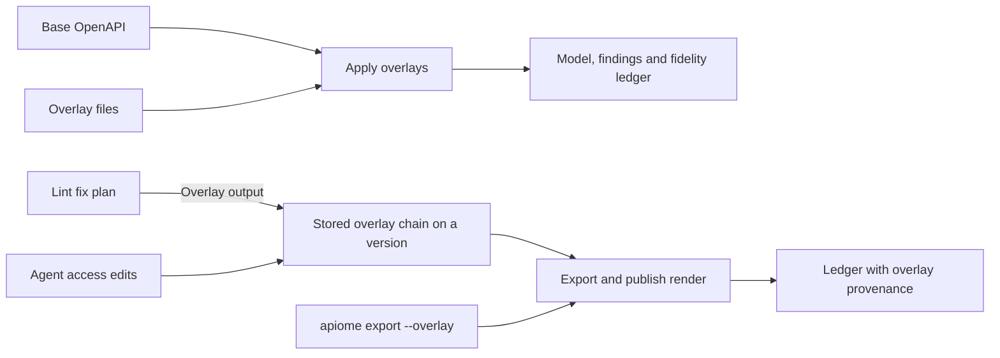

An API is rarely one file. An **Arazzo** workflow describes how its operations are called together,
and an **OpenAPI Overlay** changes a document without editing it. Apiome holds both to the same
standards as the API they sit beside: the same lint, the same fixes, the same maturity ladder and
the same export checks. This page shows how the parts fit and links to the page with the steps for
each one.

## The path an Overlay takes

An overlay is applied, never merged into the source: the version's own model, the Studio, lint and
diff stay as you wrote them, and the overlay changes what leaves the building.

## What each part does

| You want to… | Where | Details |
| --- | --- | --- |
| **Read** an Overlay 1.0, 1.1 or 1.2 document | **Import**, or `apiome import` with the overlay beside its base | [Overlays](../bring-in/overlays.md) |
| **Lint** an overlay on its own | The `overlay` rule pack; `POST /v1/lint/overlay` | [Built-in lint rules](../build/lint-rules.md#pack-overlay) |
| **Apply** overlays when you export | `apiome export --overlay FILE`, and the **Overlays** step of **Export Studio** | [Apply overlays when you export](../ship/export-a-spec.md#apply-overlays-when-you-export) |
| **Keep** overlays on a version | The **Overlays** tab of a version | [Versions](../build/versions.mdx#overlays) |
| **Lint** a workflow's structure | The `arazzo` rule pack, twelve rules checked against the declared version | [Arazzo lint rules](../build/arazzo.mdx#lint-rules) |
| **Fix** a workflow | A fix plan: repeated step ids, missing success criteria, the version marker | [Fixable Arazzo rules](../build/auto-fix.md#fixable-arazzo-rules) |
| **Grade** both with a ladder | List the `arazzo.*` and `overlay.*` rules in a level | [Arazzo and Overlay levels](./maturity-ladders.mdx#arazzo-and-overlay-levels) |

## One bar for every format

A level of a [maturity ladder](./maturity-ladders.mdx) names rules, and a finding counts toward a
level by its rule id. A finding from a workflow or an overlay therefore counts exactly like one
from OpenAPI, and a [style guide](./style-guides.mdx) can raise any `arazzo.*` or `overlay.*` rule
to an error.

The rule id `arzzo.unresolvable-operation-ref` was misspelt. It is now
`arazzo.unresolvable-operation-ref`, and the old id is an **alias**, so a style guide, stored
finding or waiver that names it keeps matching.

## What stays out

Compiling a workflow into MCP tools belongs to the agent tooling pages, not here. Where a fix could
change the meaning of a workflow, the plan reports it and leaves the document alone.

## Related

- [Arazzo in Apiome](../build/arazzo.mdx)
- [Manage overlays in Versions](../build/overlay-manager.mdx)
- [Deterministic auto-fix](../build/auto-fix.md)
- [Lint posture](./lint-posture.mdx)
