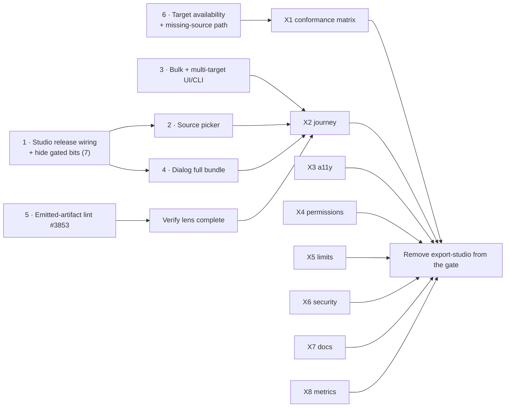

# Plan — first features to enable after the public launch

_Drafted 2026-10-23. Follows [`docs/RC6_OOE.md`](RC6_OOE.md), which launches Catalog, Projects and
sign-in/sign-up and holds back thirteen features behind `UNRELEASED_FEATURE_IDS`
(`apiome-ui/lib/feature-release.ts`)._

**Status:** E1 is tracked in the [`E1 — Catalog Exporter`](https://github.com/apiome/apiome/milestone/7)
milestone (§6). E2–E6 are a recommendation only.

## 0. Decision

After launch, turn held-back features back on **one release at a time**. Each release has a theme a
new user can feel. Each has to clear the same bar the launch did, and each restores its own docs.
Building new features waits until the code that is already written has shipped.

The **first** release, **E1: the Catalog Exporter**, lets a user export any imported catalog item to
another format: the 53 export targets, with fidelity, verification and a downloadable bundle. It goes
first for three reasons:

- **It finishes the launch story.** RC6 lets a user bring a non-OpenAPI spec into the Catalog. E1
  lets them get it back out in the format they need, without converting it to a Project first. That
  is the point of the Catalog: export is a Catalog action and must never be Projects-only.
- **It is mostly built.** Export studio (MFX-EPIC-41 and 42), the job engine, fidelity, validation,
  bundles, multi-target and batch export (MFX-39.1/39.2) are merged. REST already exports a catalog
  item straight from its captured source (`apiome-rest/src/app/export_source.py`), with no OpenAPI
  step and no publishable check. What is missing is wiring, two UI gaps and hardening (§2).
- **It depends on nothing that is still held back.** The SDK & branding tab, gateway push-back and
  push-to-registry rely on other gated features. They stay off, and E1 hides them (§2.2).

## 1. Release train

| Release | Theme | Turns on (feature ids) | Why in this order |
| --- | --- | --- | --- |
| **E1** | **Catalog Exporter** — get any imported spec out in another format | `export-studio` | Completes import → catalog → export; mostly built; no gated dependencies |
| E2 | Govern what you build | `style-guides`, `primitives` | Lint posture (released) already reads style guides; types make Projects editing stronger |
| E3 | Who owns what | `teams`, then `connectors`, `shadow-apis` | Ownership appears on every list, so it comes first; connectors bring gateway APIs into the Catalog and ship with their reports |
| E4 | How it all connects | `dependency-graph`, `schema-registry`, `catalog-entities`, `consumers` | All read ownership and connector data from E3 |
| E5 | Ship clients | `sdk-settings` (SDK & branding tab), gateway push-back, push-to-registry | Builds on E1's studio and E3's connectors |
| E6 | Agents and enterprise | `mcp`, `audit`, then Enterprise SSO (EID) and agent authorization (AAU) from the RC6 deferrals | Largest and riskiest surface, and it needs its own security review |

Only E1 is planned in detail. Re-plan E2–E6 when E1 ships, using what launch traffic shows.

## 2. E1 — Catalog Exporter

### 2.1 What exists

| Capability | State | Where |
| --- | --- | --- |
| Export from a catalog item, latest revision, no conversion | ✅ REST and dialog | `export_source.py`; `ExportDialog` from Catalog list and detail |
| Target grid from the emitter registry, with fidelity tiers (lossless / lossy / types-only) | ✅ 53 targets | `GET /export/targets`; `apiome-rest/src/app/emitter.py` |
| Fidelity dry run, per-construct report and evidence drawer, "Export anyway" for lossy | ✅ dialog and studio | `POST /export/preview` |
| Studio flow: Source → Target → Options → Verify → Review & Generate | ✅ gated | `ExportStudio.tsx`, `/ade/dashboard/export/studio` |
| Verify (validation), round-trip, mock test-drive, delivery gate and waiver | ✅ gated | `POST /export/verify`, `/roundtrip` |
| Async export job, multi-file bundle explorer, Recent export jobs, resumable deep links | ✅ gated | `/export/jobs`, MFX-41.4, MFX-43 |
| Multi-target and batch export | ✅ REST only | `export_job_engine.py`, `export_batch.py`; **no UI or CLI client** |
| CLI `apiome export <format> <artifact>` | ✅ (should take a catalog item id; untested) | `apiome-cli/.../commands/export.py` |
| Lint of the emitted artifact | ❌ verify returns `lint: null` | MFX-5.2 [#3853](https://github.com/apiome/apiome/issues/3853) |
| Dialog bundle | ⚠ zips the primary file only | `ExportDialog.tsx` (comment waits on MFX-4.2, which has landed) |
| Studio opened with no source | ⚠ dead-end "open from a source" card | `export/studio/page.tsx` |
| Catalog item with no captured source | ⚠ 422 | `export_source.py` |
| 9 toolchain-gated targets | ⚠ availability depends on the deployment | `docs/format-counts.json` |

### 2.2 Scope

**In:**

1. **Release the studio for catalog items and project versions.** Remove `export-studio` from the
   gate. Put back the cross-links the 2026-10-16 gate removed: the project facts card's **Export
   studio** button, the spec viewer's export cards and the dialog's **Open in Export Studio**.
   Catalog keeps **Export** as the quick in-place dialog and adds **Export to another format…**,
   which opens the studio with the item as its source.
2. **A source picker** for a studio opened with no source. Pick a catalog item or a project version
   instead of meeting a dead end, and support the rail and palette entry points.
3. **Bulk export from the Catalog.** The catalog bulk bar's **Export…** runs MFX-39.2 batch export
   over the selection, one target, into a zip with a manifest and per-item failures.
   **Multi-target** (MFX-39.1) in the studio's Target step. CLI flags `--targets` and
   `--items` / `--all-versions` for both.
4. **The full bundle in the dialog.** Download every file of a multi-file target, not just the
   primary document, or hand off to the studio job when a bundle is needed.
5. **Lint of the emitted artifact** (MFX-5.2, [#3853](https://github.com/apiome/apiome/issues/3853)),
   so the Verify step's lint lens is never empty.
6. **Honest target availability.** A target the deployment cannot run (toolchain-gated) is shown
   disabled with its reason, never offered and then failed. A catalog item with no captured source
   gets an explanation and a **Re-import** action instead of a bare 422. Backfill the source where
   the original upload is still stored.
7. **Hide what depends on held-back features** while they are gated:
   - the SDK & branding tab (already gated as `sdk-settings`);
   - gateway push-back to Kong and Gateway API (needs `connectors`);
   - push-to-registry delivery (MFX-4.4, needs `schema-registry`);
   - the "MCP server descriptor" agent-interface targets, if any are listed (need `mcp`).

**Out, deferred to later releases:**

- Round-trip diff view: MFX-6.4 [#3858](https://github.com/apiome/apiome/issues/3858) and
  MFX-43.4 [#4364](https://github.com/apiome/apiome/issues/4364). The round-trip summary in Verify
  is enough for E1.
- Round-trip fidelity measurement: MFX-2.6 [#3843](https://github.com/apiome/apiome/issues/3843).
- Toolchain runner reuse: MFX-8.3 [#3865](https://github.com/apiome/apiome/issues/3865).
- Delivery channels (git, webhook, object storage): MFX-EPIC-38.
- Presets, scheduled export and auto-export on publish: MFX-39.3/39.4.
- New emitters: the MFX-EPIC-10…37 long tail. E1 ships the 53 targets that exist.

### 2.3 Hardening (same bar as RC6 lane H)

| # | Check |
| --- | --- |
| X1 | **Conformance matrix:** for every import format family with a catalog fixture (the IXH corpus), export each fixture to every target it can reach. Record the result (ok, lossy with report, refused with reason) in a checked-in matrix. CI fails on any crash or on a silent loss (an emitted artifact whose fidelity report is empty while round-trip shows drift) |
| X2 | **Journey in CI:** import a non-OpenAPI spec → Catalog → **Export** (dialog) → **Export to another format…** (studio) → verify → job → download the bundle. Then select three items → bulk export → zip with manifest. Extends the RC6 H1 journey (#6208) |
| X3 | **Accessibility:** the studio, the source picker, the bulk export dialog and the target grid pass the axe gate with no exemptions; full keyboard path through all five steps |
| X4 | **Permissions:** who can export a catalog item, run batch, see Recent export jobs and download another user's job. REST and UI matrix, as in RC6 H5 (#6212) |
| X5 | **Limits:** job size and time caps, `MAX_BATCH_ITEMS`, retention of job artifacts, concurrent jobs per tenant. Each refusal names the limit. Cleanup is verified |
| X6 | **Security review:** archive output (zip-slip, path names from imported specs), served artifact content types, and that no tenant can reach another tenant's job. Run `/security-review` on the release PR |
| X7 | **Docs:** restore `ship/export-studio.mdx` and both fragments from `apiome-docs/unreleased/` (README steps). Remove its gateway section while `connectors` is gated. New **Export catalog items** page or section, with the bulk flow, CLI and a target × fidelity-tier table generated from the registry. Fresh screenshots. Release-notes post and What's new line |
| X8 | **Observability:** export job success and failure rate, per-target failure counts and p95 job time on the metrics plane. Launch dashboards show them before the gate opens |

### 2.4 Order of work

- **Week 1–2:** items 1, 5 and 6, and X1 in parallel. X1 is the long pole: it will find emitter
  bugs, and those fixes join the release.
- **Week 2–3:** items 2, 3 and 4, then X2–X5.
- **Week 4:** X6–X8, the docs restore, and a staged gate opening (below).

### 2.5 Turning it on

1. Merge everything behind the gate. Test with
   `NEXT_PUBLIC_APIOME_PREVIEW_FEATURES=export-studio`.
2. Enable it on staging and on internal tenants for a week. Watch X8.
3. Remove `export-studio` from `UNRELEASED_FEATURE_IDS`, restore docs, publish release notes (one PR).
4. Rollback is one line: put the id back. Exports already downloaded are unaffected.

### 2.6 Exit criteria

- A new user exports a catalog item of any importable family to any target it can reach, from the
  dialog, the studio, bulk select and the CLI, and always sees what was lost.
- X1 matrix: no crashes and no silent loss. Every refusal names a reason.
- X2–X8 green. No open P0/P1 bug labelled `export`.
- The rail, palette and Catalog show Export studio. SDK & branding, gateway push-back and
  push-to-registry stay hidden.

## 3. Risks

| Risk | Mitigation |
| --- | --- |
| The X1 matrix finds many emitter bugs on exotic sources (EDI, mainframe → OpenAPI or AsyncAPI) | Fix crashes and silent loss. Otherwise ship with "types-only" or "refused with reason" rather than block on every pair |
| Batch export of large catalogs overloads workers | X5 caps and per-tenant concurrency; batch runs as one job with per-item progress |
| The toolchain-gated targets differ between SaaS and self-hosted | Item 6: availability comes from the deployment's registry, never from a hard-coded list |
| Restoring studio docs brings back links into still-gated features | X7 runs `yarn docs:check` plus a grep for `unreleased/` page targets before release |

## 4. E2–E6 at a glance

| Release | Known remaining work before enabling |
| --- | --- |
| E2 | Style guides: the GOV umbrella #4423 has no MVP children open, so the work is hardening and the docs restore. Primitives: only `Future` tickets in the type-registry roadmap are open; same hardening bar |
| E3 | All CDG-1/2 tickets are merged. Hardening, the docs restore (`apiome-docs/unreleased/`), and the owner-gate policy UX |
| E4 | CDG-3/4/5 and CTG-4.1 are merged. Hardening and the docs restore; decide whether the scorecard Facts panel needs maturity ladders first |
| E5 | SDK-EPIC-4 and the SGD umbrella (#4952) remainders; gateway push-back depends on E3 connectors |
| E6 | The V2-MCP RC5 epics, AGX-EPIC-3, EID-3.1 for Access audit, then the deferred EID and AAU MVPs |

## 5. Not decided here

- Whether E1 also enables **SDK & branding** (it lives in the same studio). The recommendation is no,
  because SDK generation has its own delivery and compatibility work (SGD). It waits for E5.
- Pricing or plan limits on export volume. X5 sets technical caps only.

## 6. Issues — milestone [`E1 — Catalog Exporter`](https://github.com/apiome/apiome/milestone/7)

| Item | Issue |
| --- | --- |
| E1-1 Studio release wiring and hiding gated pieces | [#6217](https://github.com/apiome/apiome/issues/6217) |
| E1-2 Studio source picker | [#6218](https://github.com/apiome/apiome/issues/6218) |
| E1-3 Catalog bulk export and multi-target UI and CLI | [#6219](https://github.com/apiome/apiome/issues/6219) |
| E1-4 Dialog full bundle | [#6220](https://github.com/apiome/apiome/issues/6220) |
| E1-5 Emitted-artifact lint (MFX-5.2) | [#3853](https://github.com/apiome/apiome/issues/3853) (existing, moved to E1) |
| E1-6 Target availability and the missing-source path | [#6221](https://github.com/apiome/apiome/issues/6221) |
| X1 Conformance matrix | [#6222](https://github.com/apiome/apiome/issues/6222) |
| X2 Journey in CI | [#6223](https://github.com/apiome/apiome/issues/6223) |
| X3 Accessibility | [#6224](https://github.com/apiome/apiome/issues/6224) |
| X4 Permissions | [#6225](https://github.com/apiome/apiome/issues/6225) |
| X5 Limits | [#6226](https://github.com/apiome/apiome/issues/6226) |
| X6 Security review | [#6227](https://github.com/apiome/apiome/issues/6227) |
| X7 Docs | [#6228](https://github.com/apiome/apiome/issues/6228) |
| X8 Metrics | [#6229](https://github.com/apiome/apiome/issues/6229) |
| Export studio header (split from HIVE-11.11) | [#6234](https://github.com/apiome/apiome/issues/6234) |
