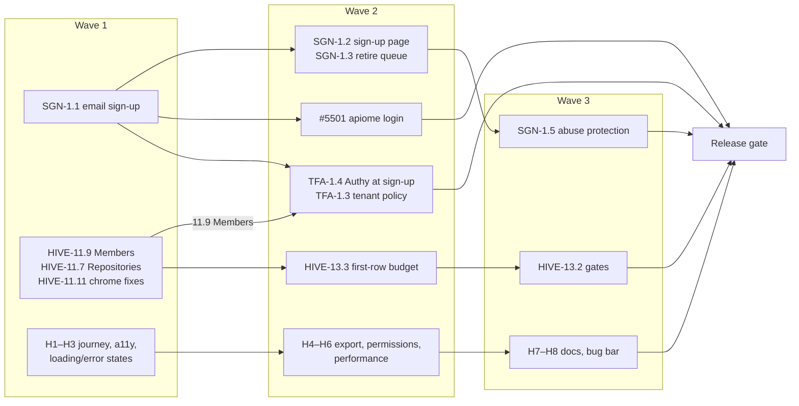

# RC6 — Order of Execution

> **Written:** 2026-10-10 · **Re-scoped:** 2026-10-23 — RC6 now ships **Catalog and Projects**, plus
> **sign-in and sign-up**, and nothing else.
> **Source:** the open issues on [`apiome/apiome`](https://github.com/apiome/apiome/issues), the
> [`RC6` milestone](https://github.com/apiome/apiome/milestone/6) and
> [`docs/PLAN_MVP_CATALOG_AND_PROJECTS.md`](PLAN_MVP_CATALOG_AND_PROJECTS.md).
> **Supersedes** the 2026-10-10 version of this file (seven lanes, 102 tickets), which is in git
> history, and [`docs/next-steps/RC6_ORDER_OF_EXECUTION.md`](next-steps/RC6_ORDER_OF_EXECUTION.md).
>
> **Status of this plan:** a recommendation. On GitHub only the lane H issues (#6208–#6215) were
> created; §6 lists the milestone moves it implies, not yet applied.

## 1. Recommendation

RC6 is **18 open tickets in five lanes**: four product lanes and a hardening lane (§2.3, lane H).

- **Only Catalog, Projects and sign-in/sign-up are in.** A stranger can sign up, secure the
  account, sign in from the browser or the CLI, and then bring specs into the Catalog, convert
  them to Projects, version, publish and export them. Nothing outside that path gets new work
  in RC6.
- **Everything else is held back in the code.** Pages that are not Catalog or Projects are left
  out of the rail, the command palette and the `G` jumps. A direct URL to one shows the
  *Not available yet* page. Panels from those features that sit inside Catalog and Projects screens
  are hidden too (§5.1). The gate is `apiome-ui/lib/feature-release.ts` → `UNRELEASED_FEATURE_IDS`.
  Their guide pages are backed up under `apiome-docs/unreleased/`.
- **Deferred tickets wait for the next plan** (§5). That covers Enterprise SSO, agent
  authorization, the format and emitter long tail, and the HIVE shell work that is not about
  Catalog or Projects. Work already merged on them stays merged, behind the gate where it has a
  page.
- **Catalog import formats stay live.** The FMT adapters that RC6 already merged (gateway configs,
  code-first types, client workspaces, EDI, IoT, mainframe) are how specs get into the Catalog, so
  they are part of the Catalog. The gateway *connectors* that pull from Kong, AWS, Azure and Apigee
  are not. They are held back as `connectors`.

| Lane | Outcome | Open | Done |
| --- | --- | --- | --- |
| **A — Sign-up** | Anyone can create an account and a workspace, under an installation sign-up policy, with abuse protection | 4 | 6 |
| **B — Two-factor** | Authy offered at sign-up, usable by OAuth-only accounts, recoverable, enforceable per tenant | 3 | 3 |
| **D — CLI sign-in** | One-line install and `apiome login` | 1 | 1 |
| **E — Catalog & Projects polish** | The HIVE quiet pass and gates on the pages RC6 ships | 2 | 12 |
| **H — Hardening** | Catalog and Projects meet the MVP hardening checklist | 8 | 0 |

Lanes C (formats), F (Enterprise SSO) and G (agent authorization) from the 2026-10-10 plan are out
(§5).

## 2. Order of execution

Lanes run in parallel. Within a lane, work top to bottom. A wave is a checkpoint, not a gate: a
lane moves on as soon as its own dependencies are merged.

### 2.1 Cross-lane rules

1. **Migrations.** Take the next free `V` number when the PR is ready to merge. Lanes A and B both
   add tables.
2. **Members before tenant policy.** HIVE-11.9 replaces the dead SSO/SCIM cards with a "Coming
   next" line. Land it before TFA-1.3, which adds the compliance column to the same page.
3. **Hardening before announcement.** #4960, #4961 and #4963 are merged. SGN-1.5 must close before
   public sign-up is switched to `open` anywhere.
4. **Nothing new behind the gate.** Do not schedule work on a held-back feature (§5.1) in RC6. A
   change on a Catalog or Projects screen must not add a link into one. If it has to touch one,
   check it with `NEXT_PUBLIC_APIOME_PREVIEW_FEATURES=all` and without it.

### 2.2 First tickets

Start these on day one; none depends on another.

1. [#5650](https://github.com/apiome/apiome/issues/5650) SGN-1.1 email and password sign-up ✅
2. [#5605](https://github.com/apiome/apiome/issues/5605) HIVE-11.9 Members — seat facts line ✅
3. [#5603](https://github.com/apiome/apiome/issues/5603) HIVE-11.7 Repositories — facts line ✅
4. [#5607](https://github.com/apiome/apiome/issues/5607) HIVE-11.11 small chrome fixes ✅
5. [#6208](https://github.com/apiome/apiome/issues/6208) H1 end-to-end journey · [#6209](https://github.com/apiome/apiome/issues/6209) H2 accessibility · [#6210](https://github.com/apiome/apiome/issues/6210) H3 loading/error states

### 2.3 Lane H — hardening

From [`PLAN_MVP_CATALOG_AND_PROJECTS.md` §3](PLAN_MVP_CATALOG_AND_PROJECTS.md#3-hardening-checklist-phase-f).
Each check is an issue in the `RC6` milestone.

| Issue | Check | Wave |
| --- | --- | --- |
| [#6208](https://github.com/apiome/apiome/issues/6208) H1 | Playwright journey in CI: import → catalog item → convert to project → edit → cut version → publish → unpublish → export | 1 |
| [#6209](https://github.com/apiome/apiome/issues/6209) H2 | Every Catalog, Projects and Versions route passes the HIVE-10.2 axe gate with no route-ledger exemptions | 1 |
| [#6210](https://github.com/apiome/apiome/issues/6210) H3 | Skeletons and `ErrorState` on every fetch on those pages; no blank screen on a slow or failed request | 1 |
| [#6211](https://github.com/apiome/apiome/issues/6211) H4 | Catalog and version export through the in-place Export dialog covers the formats RC6 promises; the dialog's fidelity report is the only fidelity surface | 2 |
| [#6212](https://github.com/apiome/apiome/issues/6212) H5 | Viewer / editor / owner matrices tested for every Catalog and Projects action (REST and UI), including bulk actions | 2 |
| [#6213](https://github.com/apiome/apiome/issues/6213) H6 | Catalog list and versions table meet the HIVE-13.3 first-row budget with 1,000 items | 2 |
| [#6214](https://github.com/apiome/apiome/issues/6214) H7 | Every Catalog, Projects and Versions page in `apiome-docs/` is current, with fresh screenshots and no links into held-back features | 3 |
| [#6215](https://github.com/apiome/apiome/issues/6215) H8 | Zero open P0/P1 bugs on Catalog, Versions or Projects | 3 |

## 3. Ticket list

The RC6 tickets in execution order. **Depends on** lists what must be merged first. "Close after"
rows are epics and umbrellas that close when their children do. Done rows are kept so each lane
reads whole.

| # | Wave | Lane | Issue | ID | Title | Depends on | Status |
| --- | --- | --- | --- | --- | --- | --- | --- |
| 1 | 1 | A | [#5653](https://github.com/apiome/apiome/issues/5653) | SGN-1.4 | Sign-up policy — open, invite-only or closed, with allowed email domains **MVP** | — | ✅ |
| 2 | 1 | A | [#4960](https://github.com/apiome/apiome/issues/4960) | OLO-7.3 follow-up | Encrypt OAuth tokens & PATs at rest | — | ✅ |
| 3 | 1 | A | [#4961](https://github.com/apiome/apiome/issues/4961) | OLO-7.3 follow-up | Public Suffix List for callback allowlist & cookie-domain derivation | — | ✅ |
| 4 | 1 | A | [#4963](https://github.com/apiome/apiome/issues/4963) | OLO-7.3 follow-up | Auth hygiene: link-route CSRF, login tenant fail-closed, identity-proxy scoping | — | ✅ |
| 5 | 1 | B | [#5006](https://github.com/apiome/apiome/issues/5006) | OLO-9.14 | 2FA — backup codes, trusted devices, lockout | — | ✅ |
| 6 | 1 | B | [#5655](https://github.com/apiome/apiome/issues/5655) | TFA-1.1 | Two-factor for accounts without a password (OAuth-only users) **MVP** | — | ✅ |
| 7 | 1 | B | [#5656](https://github.com/apiome/apiome/issues/5656) | TFA-1.2 | Admin reset of a user's two-factor, with audit **MVP** | — | ✅ |
| 8 | 1 | D | [#5500](https://github.com/apiome/apiome/issues/5500) | CLI | `get.apiome.dev` install script **MVP** | — | ✅ |
| 9 | 1 | E | [#5597](https://github.com/apiome/apiome/issues/5597) | HIVE-11.1 | StatusStrip component — one row of status chips, one open detail **MVP** | — | ✅ |
| 10 | 1 | E | [#5601](https://github.com/apiome/apiome/issues/5601) | HIVE-11.5 | FactsLine and DismissibleCallout primitives (+ hive.seen.* persistence) **MVP** | — | ✅ |
| 11 | 1 | E | [#5608](https://github.com/apiome/apiome/issues/5608) | HIVE-12.1 | Nav model — default-collapsed groups with counts **MVP** | — | ✅ |
| 12 | 1 | E | [#5612](https://github.com/apiome/apiome/issues/5612) | HIVE-12.5 | Launcher — only openable tiles; ComingNext line | — | ✅ |
| 13 | 1 | E | [#5598](https://github.com/apiome/apiome/issues/5598) | HIVE-11.2 | Versions — status strip replaces the three stacked banners **MVP** | HIVE-11.1 | ✅ |
| 14 | 1 | E | [#5599](https://github.com/apiome/apiome/issues/5599) | HIVE-11.3 | Versions header — ⋯ overflow menu and breadcrumb project switcher **MVP** | — | ✅ |
| 15 | 1 | E | [#5600](https://github.com/apiome/apiome/issues/5600) | HIVE-11.4 | Versions — one table toolbar (date popover, author menu, lifecycle, chips) | — | ✅ |
| 16 | 2 | E | [#5602](https://github.com/apiome/apiome/issues/5602) | HIVE-11.6 | Catalog — quiet list page **MVP** | HIVE-11.5 | ✅ |
| 17 | 2 | E | [#5609](https://github.com/apiome/apiome/issues/5609) | HIVE-12.2 | Re-home Tenants, Data browser · Migrations and SDK settings **MVP** | HIVE-12.1 | ✅ |
| 18 | 1 | A | [#5650](https://github.com/apiome/apiome/issues/5650) | SGN-1.1 | Email and password sign-up with email verification **MVP** | SGN-1.4 | ✅ |
| 19 | 1 | E | [#5605](https://github.com/apiome/apiome/issues/5605) | HIVE-11.9 | Members — seat facts line; Identity provider cards → “Coming next” line | HIVE-11.5, HIVE-12.5 | ✅ |
| 20 | 1 | E | [#5603](https://github.com/apiome/apiome/issues/5603) | HIVE-11.7 | Repositories and repository detail — facts line, activity chip | HIVE-11.5 | ✅ |
| 21 | 1 | E | [#5607](https://github.com/apiome/apiome/issues/5607) | HIVE-11.11 | Small chrome fixes — Import wizard height, profile hero (the Export studio header part waits for the studio) | — | ✅ |
| 22 | 2 | A | [#5651](https://github.com/apiome/apiome/issues/5651) | SGN-1.2 | Sign-up page — every enabled provider plus the email form **MVP** | SGN-1.1 | ✅ |
| 23 | 2 | A | [#5652](https://github.com/apiome/apiome/issues/5652) | SGN-1.3 | Retire the legacy sign-up request queue **MVP** | SGN-1.1 | ✅ |
| 24 | 2 | A | [#4962](https://github.com/apiome/apiome/issues/4962) | OLO-7.3 follow-up | Close account enumeration on legacy self-sign-up | closed by SGN-1.3 | ✅ |
| 25 | 2 | D | [#5501](https://github.com/apiome/apiome/issues/5501) | CLI | `apiome login` **MVP** | #5500, SGN-1.1 | ✅ |
| 26 | 2 | B | [#5658](https://github.com/apiome/apiome/issues/5658) | TFA-1.4 | Offer Authy enrolment after sign-up — skippable, re-enable from the profile **MVP** | SGN-1.1, TFA-1.1 | ✅ |
| 27 | 2 | B | [#5657](https://github.com/apiome/apiome/issues/5657) | TFA-1.3 | Tenant policy — require two-factor for members | TFA-1.1, HIVE-11.9 | ✅ |
| 28 | 2 | E | [#5616](https://github.com/apiome/apiome/issues/5616) | HIVE-13.3 | Parity harness — first-row-of-data budget per list page | HIVE-11.6 | |
| 29 | 3 | A | [#5654](https://github.com/apiome/apiome/issues/5654) | SGN-1.5 | Abuse protection for public sign-up **MVP** | SGN-1.2, #4960, #4961, #4963 | ✅ |
| 30 | 3 | A | [#5649](https://github.com/apiome/apiome/issues/5649) | SGN-EPIC-1 | Self-service sign-up — anyone can create an account and a workspace | close after SGN-1.1…1.5 | |
| 31 | 3 | B | [#2553](https://github.com/apiome/apiome/issues/2553) | TFA umbrella | Add Authy application as 2FA option | close after TFA-1.1…1.4 | |
| 32 | 3 | E | [#5615](https://github.com/apiome/apiome/issues/5615) | HIVE-13.2 | Gates — header action cap, single banner, no dead controls (on released pages) | HIVE-11.2, 11.3, 11.9, 12.5 | |

**Notes on the table**

- **#4962** has no work of its own: SGN-1.3 removes `createSignupRequest`, which closes it.
- **HIVE-13.2 and 13.3** run their gates over the pages RC6 releases. A held-back page joins the
  gates when its feature is released.
- **HIVE epics stay open.** HIVE-EPIC-11, 12 and 13 keep children deferred to the next plan (§5), so
  they are not in the table.

## 4. Lane exit criteria

| Lane | Done when |
| --- | --- |
| A | A stranger on a clean stack signs up with email and password, verifies, and onboards into their own workspace with no admin involved; `closed` stops every path |
| B | A new user is offered Authy during onboarding, an OAuth-only user can enrol, a lost phone is recoverable by backup code or admin reset, a tenant can require 2FA, and #2553 is closed |
| D | `curl -fsSL https://get.apiome.dev -o get-apiome.sh && sh ./get-apiome.sh` installs the CLI and `apiome login` signs a new account in |
| E | HIVE-11.7, 11.9, 11.11, 13.2 and 13.3 are closed, and the HIVE-13.2/13.3 gates run over every released page without allow-listed exceptions |
| H | Every check in §2.3 is green |

## 5. Not in RC6

Deferred until the next plan. Tickets already in the `RC6` milestone move out (§6).

| Work | Open tickets | Why it waits |
| --- | --- | --- |
| **HIVE shell and brand work not on Catalog/Projects pages** | [#5610](https://github.com/apiome/apiome/issues/5610) HIVE-12.3 rail footer notifications · [#5611](https://github.com/apiome/apiome/issues/5611) HIVE-12.4 Preview pill → honey dot · [#5613](https://github.com/apiome/apiome/issues/5613) HIVE-12.6 launcher "Recently shipped" · [#5614](https://github.com/apiome/apiome/issues/5614) HIVE-13.1 honey audit · [#5617](https://github.com/apiome/apiome/issues/5617) HIVE-13.4 DESIGN.md amendments and fixture re-dump · epics [#5594](https://github.com/apiome/apiome/issues/5594), [#5595](https://github.com/apiome/apiome/issues/5595), [#5596](https://github.com/apiome/apiome/issues/5596) | Shell and brand polish, not Catalog or Projects. HIVE-13.4 depends on 12.6 |
| **Export emitters** | [#4311](https://github.com/apiome/apiome/issues/4311) MFX-35.1 SQL DDL emitter · [#4312](https://github.com/apiome/apiome/issues/4312) MFX-35.2 DBML + Prisma | New export targets; the Export studio is held back |
| **Enterprise SSO MVP** (EID) | [#5012](https://github.com/apiome/apiome/issues/5012) EID-1.2 · [#5662](https://github.com/apiome/apiome/issues/5662) EID-1.4 · [#5013](https://github.com/apiome/apiome/issues/5013) EID-1.3 · [#5674](https://github.com/apiome/apiome/issues/5674) EID-3.1 · [#5675](https://github.com/apiome/apiome/issues/5675) EID-3.2 | Tenant-managed IdPs are enterprise sign-in, beyond the self-service sign-up and sign-in RC6 ships. EID-3.x is the audit export, and Access audit is held back. EID-1.1 (#5011) is merged and inert until EID-1.2 |
| **Agent authorization MVP** (AAU) | [#5694](https://github.com/apiome/apiome/issues/5694) AAU-EPIC-1 · [#5695](https://github.com/apiome/apiome/issues/5695)–[#5700](https://github.com/apiome/apiome/issues/5700) AAU-1.1…1.6 · [#5714](https://github.com/apiome/apiome/issues/5714)–[#5716](https://github.com/apiome/apiome/issues/5716) AAU-4.1…4.3 | MCP servers and Agent access are held back |
| **Format adapters** | — | All RC6 format tickets (FMT-EPIC-6…11) are merged and stay live as Catalog import formats; no new formats in RC6 |
| **Competitive-gap roadmaps** | EID and AAU remainders, XPC, RDG, SDX, GVM, ATQ, PCX, ASP, CDG remainders, APX, CVT | None is Catalog or Projects hardening |
| **`RC5` umbrellas** | 39 epics plus [#3622](https://github.com/apiome/apiome/issues/3622) | RC5 work; close them under RC5 |
| **`Future`** | The MFX/MFI long tail (incl. MFI-26.4/26.5 import dry-run and live discovery), legacy roadmap epics (incl. #1023, #1048), long-tail sign-in providers, SMS two-factor, HIVE-EPIC-9 | Not Catalog/Projects hardening |

### 5.1 Held back in the code

Merged work whose surface is not Catalog or Projects. Each id is in `UNRELEASED_FEATURE_IDS`; its
pages are gated, and its panels inside Catalog and Projects screens are hidden. Re-open a feature
for a build with `NEXT_PUBLIC_APIOME_PREVIEW_FEATURES=<id>[,<id>…]` or `all`.

| Feature id | Pages gated | Also hidden inside Catalog / Projects | From |
| --- | --- | --- | --- |
| `primitives` | Primitives & types | — | 2026-10-16 MVP gate |
| `mcp` | MCP servers, Agent access | — | 2026-10-16 MVP gate |
| `export-studio` | Export studio | Export studio links (the Export dialog stays) | 2026-10-16 MVP gate |
| `sdk-settings` | SDK & branding tab | — | 2026-10-16 MVP gate |
| `style-guides` | Style guides | — | 2026-10-16 MVP gate |
| `audit` | Access audit | Members drawer's audit link | 2026-10-16 MVP gate |
| `connectors` | Connectors, gateway environments | Refresh-runs ledger on Repositories | CDG-1.x, CDG-5.3 |
| `shadow-apis` | Shadow APIs | — | CDG-1.6 |
| `dependency-graph` | Dependency graph | Dependencies tab on catalog detail and Versions (with the catalog facts panel) | CDG-3.x, CDG-5.4 |
| `teams` | Teams | Owner column, owner filter and **Assign owner** on Projects, Catalog and Published; tenant drawer's Ownership tab; the publish dialog's owner gate (shown only when a tenant policy blocks a publish) | CDG-2.x |
| `schema-registry` | Schema registry | Subjects tab and Registry chip on Catalog | CDG-4.x |
| `catalog-entities` | `/catalog/agents`, `/models`, `/components`, `/imports` | Kinds panel and entity list on Catalog, Compass tile in the import dialog | CDG-5.1, 5.2, 5.5 |
| `consumers` | `/projects/[id]/consumers` | **Consumers** in the project row menu | CTG-4.1, RDG-1.8 |

Released, and not gated: Home, Projects (with Versions), Catalog, Repositories, Published, Sunset
timeline, Lint posture, Members, Roles, API keys, Tenants, the Tools, Profile, Linked accounts,
sign-in and sign-up. REST, CLI and MCP keep serving every held-back feature; only the app and the
guide hide them.

## 6. Milestone changes this plan implies

Not applied. Run these if the plan is accepted.

| Change | Issues |
| --- | --- |
| Move out of `RC6` (to a new `RC7`, or `Future`) | #5610, #5611, #5613, #5614, #5617, #5594, #5595, #5596, #4311, #4312 |
| Do **not** add to `RC6` (reverses the 2026-10-10 plan) | #5012, #5013, #5662, #5674, #5675, #5694–#5700, #5714–#5716 |
| Update the `RC6` milestone description | Point it at `docs/RC6_OOE.md`: Catalog, Projects, sign-in and sign-up |

## 7. Release gate

RC6 is ready to tag when:

- [ ] Lanes A, B, D, E and H are closed.
- [ ] A clean-stack journey passes: **sign up (email) → verify → onboard → enrol Authy → sign out →
      sign in with a code → `apiome login` → import a non-OpenAPI spec into the Catalog → convert it
      to a project → cut a version → publish → export through the Export dialog**.
- [ ] With no preview override, the rail, palette and `G` jumps list only released destinations;
      every held-back route shows *Not available yet*; no Catalog or Projects screen links to a
      held-back page.
- [ ] `/security-review` has run on the sign-up and two-factor changes.
- [ ] `yarn docs:check` is green, and the RC6 release-notes post is generated by tagging `RC6`.
- [ ] The What's new feed (`apiome-ui/public/WHATS_NEW.md`) is bumped to RC6.
