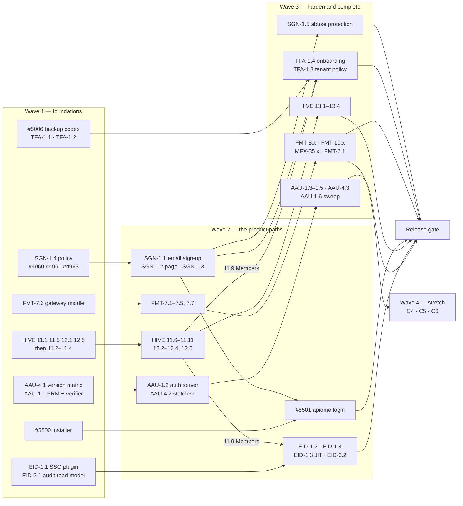

# RC6 — Order of Execution

> **Written:** 2026-10-10 · **Source:** all 1,100 open issues on
> [`apiome/apiome`](https://github.com/apiome/apiome/issues) — 86 in the
> [`RC6` milestone](https://github.com/apiome/apiome/milestone/6), 40 in `RC5`, 650 in `Future` and 324 with
> no milestone (the ten competitive-gap roadmaps, #5660–#5983).
> **Supersedes** [`docs/next-steps/RC6_ORDER_OF_EXECUTION.md`](next-steps/RC6_ORDER_OF_EXECUTION.md)
> (2026-10-07), which was written before those 324 issues existed. No RC6 ticket has closed since then.
>
> **Status of this plan:** a recommendation. Nothing on GitHub was changed. §6 lists the milestone
> moves it implies.

## 1. Recommendation

RC6 is **102 tickets: 81 core and 21 stretch.**

- **Keep all 86 tickets already in the milestone.** Sign-up, two-factor, formats, CLI onboarding and
  the HIVE quiet pass still make one coherent release: *a stranger can sign up, secure the account
  and bring any spec in.*
- **Add 16 tickets** — the MVP slices of the two roadmaps the October market analysis ranks first
  and marks "start now":
  - **Enterprise SSO MVP (6):** EID-1.1…1.4 and EID-3.1/3.2. RC6 already opens up the auth
    surface (Better Auth config, sign-in and sign-up pages, members list, tenant policy). Doing
    SSO in the same release touches those files once, and SSO is the top-ranked gap.
  - **Agent authorization MVP (10):** AAU-EPIC-1 and AAU-4.1…4.3. The MCP 2026-07-28 revision is
    already in force, and this protects the agent runtime shipped in RC5. It only touches
    `apiome-mcp` and `apiome-rest`, so it runs beside everything else.
- **Make the format cut line the plan.** Gateways, code-first types, client workspaces, the
  data-platform emitters and UN/EDIFACT are core (23 tickets). The rest of EDI/vertical, IoT and
  mainframe (21 tickets) are stretch: they ship in RC6 only as whole waves, and otherwise move to
  RC7. This is what pays for the 16 additions.
- **Leave everything else out** (§5): the other eight new roadmaps, the non-MVP parts of EID and
  AAU, and the `Future` backlog. No open issue is labelled as a bug, so there is no fix queue to
  pull in.

| Lane | Outcome | Tickets | Tier |
| --- | --- | --- | --- |
| **A — Sign-up** | Anyone can create an account and a workspace, under an installation sign-up policy, with abuse protection | 10 | Core |
| **B — Two-factor** | Authy offered at sign-up, usable by OAuth-only accounts, recoverable, enforceable per tenant | 6 | Core |
| **C1–C3 + FMT-6.1 — Formats** | Gateway configs, code-first types, client workspaces, SQL DDL / DBML / Prisma emit, UN/EDIFACT | 23 | Core |
| **C4–C6 — Format long tail** | Remaining EDI/vertical, industrial/IoT/semantic web, mainframe | 21 | Stretch |
| **D — CLI onboarding** | One-line install and `apiome login` | 2 | Core |
| **E — HIVE quiet pass** | List-page density, shell and launcher fit, brand gates | 24 | Core |
| **F — Enterprise SSO MVP** *(new)* | A tenant registers its own SAML/OIDC IdP, verifies a domain, users are JIT-provisioned; audit export with retention | 6 | Core |
| **G — Agent authorization MVP** *(new)* | `/agent/mcp` accepts OAuth 2.1 tokens beside agent keys and serves 2026-07-28 clients statelessly | 10 | Core |

## 2. Order of execution

Seven lanes run in parallel. Within a lane, work top to bottom. A wave is a checkpoint, not a
gate: a lane moves to its next wave as soon as its own dependencies are merged.

### Cross-lane rules

1. **Migrations.** The next free number is V274. Lanes A, B, F and G all add tables, and the EID
   and AAU roadmaps both pencil in V274. Take the next free number when the PR is ready to merge.
2. **Sign-in and sign-up pages.** SGN-1.2 builds `/signup`; EID-1.2/1.3 add domain routing on the
   sign-in page. Land SGN-1.2 first so SSO routing goes onto the finished page.
3. **Members page.** HIVE-11.9 replaces the dead SSO/SCIM cards with a "Coming next" line. Land it
   before TFA-1.3 (compliance column) and EID-1.3 (the "SSO · provider" marker), and have EID-1.2
   drop SSO from that line.
4. **Launcher.** HIVE-12.5 and 12.6 go in before sign-up is announced, because new accounts land
   on the launcher.
5. **Hardening before announcement.** #4960, #4961 and #4963 must be merged before SGN-1.5 closes
   and before public sign-up is switched to `open` anywhere.
6. **Formats one wave at a time.** Finish C1 before C2/C3. Before C1 starts, confirm the
   `pending-adapter` corpus entries cover every format in the table; each adapter ticket flips its
   entries live.
7. **Spikes first in lane G.** AAU-4.1 decides SDK upgrade versus an ASGI shim. Do not start
   AAU-4.2 before that decision is recorded.

### First ten tickets

Start these on day one; none depends on another.

1. [#5653](https://github.com/apiome/apiome/issues/5653) SGN-1.4 sign-up policy ✅
2. [#4960](https://github.com/apiome/apiome/issues/4960) encrypt OAuth tokens and PATs at rest (`sev:high`) ✅
3. [#5006](https://github.com/apiome/apiome/issues/5006) backup-code redemption at login ✅
4. [#5655](https://github.com/apiome/apiome/issues/5655) TFA-1.1 two-factor for OAuth-only accounts ✅
5. [#5460](https://github.com/apiome/apiome/issues/5460) FMT-7.6 shared gateway middle
6. [#5597](https://github.com/apiome/apiome/issues/5597) HIVE-11.1 StatusStrip
7. [#5601](https://github.com/apiome/apiome/issues/5601) HIVE-11.5 FactsLine and DismissibleCallout
8. [#5011](https://github.com/apiome/apiome/issues/5011) EID-1.1 SSO plugin foundation
9. [#5714](https://github.com/apiome/apiome/issues/5714) AAU-4.1 protocol version matrix and SDK decision
10. [#5500](https://github.com/apiome/apiome/issues/5500) `get.apiome.dev` installer

## 3. Ticket list

All 102 tickets in execution order. **Wave** and **Lane** match §2. **Depends on** lists what
must be merged first; "close after" rows are epics and umbrellas that close when their children
do. Lane C rows are in pick-up order within their wave.

| # | Wave | Lane | Issue | ID | Title | Depends on | Tier |
| --- | --- | --- | --- | --- | --- | --- | --- |
| 8 | 1 | C1 | [#5460](https://github.com/apiome/apiome/issues/5460) | FMT-7.6 | Shared GatewayConfigDocument middle for the whole family | — | Core |
| 9 | 1 | D | [#5500](https://github.com/apiome/apiome/issues/5500) | CLI | `get.apiome.dev` install script **MVP** | — | Core |
| 10 | 1 | E | [#5597](https://github.com/apiome/apiome/issues/5597) | HIVE-11.1 | StatusStrip component — one row of status chips, one open detail **MVP** | — | Core |
| 11 | 1 | E | [#5601](https://github.com/apiome/apiome/issues/5601) | HIVE-11.5 | FactsLine and DismissibleCallout primitives (+ hive.seen.* persistence) **MVP** | — | Core |
| 12 | 1 | E | [#5608](https://github.com/apiome/apiome/issues/5608) | HIVE-12.1 | Nav model — default-collapsed groups with counts **MVP** | — | Core |
| 13 | 1 | E | [#5612](https://github.com/apiome/apiome/issues/5612) | HIVE-12.5 | Launcher — only openable tiles; ComingNext line | — | Core |
| 14 | 1 | E | [#5598](https://github.com/apiome/apiome/issues/5598) | HIVE-11.2 | Versions — status strip replaces the three stacked banners **MVP** | HIVE-11.1 | Core |
| 15 | 1 | E | [#5599](https://github.com/apiome/apiome/issues/5599) | HIVE-11.3 | Versions header — ⋯ overflow menu and breadcrumb project switcher **MVP** | — | Core |
| 16 | 1 | E | [#5600](https://github.com/apiome/apiome/issues/5600) | HIVE-11.4 | Versions — one table toolbar (date popover, author menu, lifecycle, chips) | — | Core |
| 17 | 1 | F | [#5011](https://github.com/apiome/apiome/issues/5011) | EID-1.1 | SAML 2.0 / OIDC SSO plugin foundation (was OLO-9.10) **MVP** | — | Core |
| 18 | 1 | F | [#5674](https://github.com/apiome/apiome/issues/5674) | EID-3.1 | Unified audit read model & export endpoint **MVP** | — | Core |
| 19 | 1 | G | [#5714](https://github.com/apiome/apiome/issues/5714) | AAU-4.1 | Protocol version matrix, SDK posture decision and self-conformance gate **MVP** | — | Core |
| 20 | 1 | G | [#5695](https://github.com/apiome/apiome/issues/5695) | AAU-1.1 | Protected Resource Metadata and bearer-token verification on `/agent/mcp` **MVP** | — | Core |
| 21 | 2 | A | [#5650](https://github.com/apiome/apiome/issues/5650) | SGN-1.1 | Email and password sign-up with email verification **MVP** | SGN-1.4 | Core |
| 22 | 2 | A | [#5651](https://github.com/apiome/apiome/issues/5651) | SGN-1.2 | Sign-up page — every enabled provider plus the email form **MVP** | SGN-1.1 | Core |
| 23 | 2 | A | [#5652](https://github.com/apiome/apiome/issues/5652) | SGN-1.3 | Retire the legacy sign-up request queue **MVP** | SGN-1.1 | Core |
| 24 | 2 | A | [#4962](https://github.com/apiome/apiome/issues/4962) | OLO-7.3 follow-up | Close account enumeration on legacy self-sign-up | closed by SGN-1.3 | Core |
| 25 | 2 | C1 | [#5455](https://github.com/apiome/apiome/issues/5455) | FMT-7.1 | AWS API Gateway import (REST and HTTP APIs) **MVP** | FMT-7.6 | Core |
| 26 | 2 | C1 | [#5456](https://github.com/apiome/apiome/issues/5456) | FMT-7.2 | Azure API Management import (definitions and policies) | FMT-7.6 | Core |
| 27 | 2 | C1 | [#5457](https://github.com/apiome/apiome/issues/5457) | FMT-7.3 | Apigee proxy bundle import | FMT-7.6 | Core |
| 28 | 2 | C1 | [#5458](https://github.com/apiome/apiome/issues/5458) | FMT-7.4 | Envoy xDS and Istio VirtualService import | FMT-7.6 | Core |
| 29 | 2 | C1 | [#5459](https://github.com/apiome/apiome/issues/5459) | FMT-7.5 | Traefik, NGINX, HAProxy, Consul and Tyk import | FMT-7.6 | Core |
| 30 | 2 | C1 | [#5461](https://github.com/apiome/apiome/issues/5461) | FMT-7.7 | Gateway emit modes for the new sources | FMT-7.1–7.5 | Core |
| 31 | 2 | D | [#5501](https://github.com/apiome/apiome/issues/5501) | CLI | `apiome login` **MVP** | #5500, SGN-1.1 | Core |
| 32 | 2 | E | [#5602](https://github.com/apiome/apiome/issues/5602) | HIVE-11.6 | Catalog — quiet list page **MVP** | HIVE-11.5 | Core |
| 33 | 2 | E | [#5609](https://github.com/apiome/apiome/issues/5609) | HIVE-12.2 | Re-home Tenants, Data browser · Migrations and SDK settings **MVP** | HIVE-12.1 | Core |
| 34 | 2 | E | [#5610](https://github.com/apiome/apiome/issues/5610) | HIVE-12.3 | Rail footer — Notifications count and order | — | Core |
| 35 | 2 | E | [#5611](https://github.com/apiome/apiome/issues/5611) | HIVE-12.4 | “Preview” rail pill → honey dot | — | Core |
| 36 | 2 | E | [#5603](https://github.com/apiome/apiome/issues/5603) | HIVE-11.7 | Repositories and repository detail — facts line, activity chip | HIVE-11.5 | Core |
| 37 | 2 | E | [#5604](https://github.com/apiome/apiome/issues/5604) | HIVE-11.8 | Primitives & types — facts line over the registry | HIVE-11.5 | Core |
| 38 | 2 | E | [#5605](https://github.com/apiome/apiome/issues/5605) | HIVE-11.9 | Members — seat facts line; Identity provider cards → “Coming next” line | HIVE-11.5, HIVE-12.5 | Core |
| 39 | 2 | E | [#5606](https://github.com/apiome/apiome/issues/5606) | HIVE-11.10 | Style guides, Sunset timeline, Lint posture — standing notes → links; lint stat rows → facts | HIVE-11.5 | Core |
| 40 | 2 | E | [#5607](https://github.com/apiome/apiome/issues/5607) | HIVE-11.11 | Small chrome fixes — Export studio header, Import wizard height, profile hero | — | Core |
| 41 | 2 | E | [#5613](https://github.com/apiome/apiome/issues/5613) | HIVE-12.6 | Launcher — “Recently shipped” from What’s new; build string to the footer | HIVE-12.5 | Core |
| 42 | 2 | F | [#5012](https://github.com/apiome/apiome/issues/5012) | EID-1.2 | Per-tenant IdP registration & domain verification (was OLO-9.11) **MVP** | EID-1.1 | Core |
| 43 | 2 | F | [#5662](https://github.com/apiome/apiome/issues/5662) | EID-1.4 | IdP presets: Okta, Entra ID, Auth0, Keycloak, Generic **MVP** | EID-1.1 | Core |
| 44 | 2 | F | [#5013](https://github.com/apiome/apiome/issues/5013) | EID-1.3 | Tenant linking & JIT provisioning (was OLO-9.12) **MVP** | EID-1.2, EID-1.4, HIVE-11.9 | Core |
| 45 | 2 | F | [#5675](https://github.com/apiome/apiome/issues/5675) | EID-3.2 | Retention policy & finalized-day prune **MVP** | EID-3.1 | Core |
| 46 | 2 | G | [#5696](https://github.com/apiome/apiome/issues/5696) | AAU-1.2 | Apiome authorization server: auth-code + PKCE and client-credentials grants **MVP** | AAU-1.1 | Core |
| 47 | 2 | G | [#5715](https://github.com/apiome/apiome/issues/5715) | AAU-4.2 | Stateless requests and `server/discover` **MVP** | AAU-4.1 | Core |
| 48 | 3 | A | [#5654](https://github.com/apiome/apiome/issues/5654) | SGN-1.5 | Abuse protection for public sign-up **MVP** | SGN-1.2, #4960, #4961, #4963 | Core |
| 49 | 3 | A | [#5649](https://github.com/apiome/apiome/issues/5649) | SGN-EPIC-1 | Self-service sign-up — anyone can create an account and a workspace | close after SGN-1.1…1.5 | Core |
| 50 | 3 | B | [#5658](https://github.com/apiome/apiome/issues/5658) | TFA-1.4 | Offer Authy enrolment after sign-up — skippable, re-enable from the profile **MVP** | SGN-1.1, TFA-1.1 | Core |
| 51 | 3 | B | [#5657](https://github.com/apiome/apiome/issues/5657) | TFA-1.3 | Tenant policy — require two-factor for members | TFA-1.1, HIVE-11.9 | Core |
| 52 | 3 | B | [#2553](https://github.com/apiome/apiome/issues/2553) | TFA umbrella | Add Authy application as 2FA option | close after TFA-1.1…1.4 | Core |
| 53 | 3 | C1 | [#5407](https://github.com/apiome/apiome/issues/5407) | FMT-EPIC-7 | Gateway & infrastructure route sources | close after FMT-7.1…7.7 | Core |
| 60 | 3 | C2 | [#5408](https://github.com/apiome/apiome/issues/5408) | FMT-EPIC-8 | Code-first & type-system sources | close after FMT-8.1…8.6 | Core |
| 64 | 3 | C3 | [#5479](https://github.com/apiome/apiome/issues/5479) | FMT-10.4 | Client-workspace emit modes | FMT-10.1–10.3 | Core |
| 65 | 3 | C3 | [#5410](https://github.com/apiome/apiome/issues/5410) | FMT-EPIC-10 | Client workspace long tail | close after FMT-10.1…10.4 | Core |
| 66 | 3 | C3 | [#4311](https://github.com/apiome/apiome/issues/4311) | MFX-35.1 | SQL DDL emitter (ANSI + PostgreSQL/MySQL dialects) | — | Core |
| 67 | 3 | C3 | [#4312](https://github.com/apiome/apiome/issues/4312) | MFX-35.2 | DBML + Prisma output modes | MFX-35.1 | Core |
| 68 | 3 | C4 | [#5445](https://github.com/apiome/apiome/issues/5445) | FMT-6.1 | UN/EDIFACT import adapter **MVP** | — | Core |
| 69 | 3 | E | [#5614](https://github.com/apiome/apiome/issues/5614) | HIVE-13.1 | Honey audit — saved-search chip, gitlike flags, token gate | — | Core |
| 70 | 3 | E | [#5615](https://github.com/apiome/apiome/issues/5615) | HIVE-13.2 | Gates — header action cap, single banner, no dead controls | HIVE-11.2, 11.3, 11.9, 12.5 | Core |
| 71 | 3 | E | [#5616](https://github.com/apiome/apiome/issues/5616) | HIVE-13.3 | Parity harness — first-row-of-data budget per list page | HIVE-11.6 | Core |
| 72 | 3 | E | [#5617](https://github.com/apiome/apiome/issues/5617) | HIVE-13.4 | DESIGN.md amendments, mockup promotion and fixture re-dump **MVP** | last — HIVE-11.2, 11.3, 11.6, 12.1, 12.2, 12.5, 12.6 | Core |
| 73 | 3 | E | [#5594](https://github.com/apiome/apiome/issues/5594) | HIVE-EPIC-11 | List-page density — the “quiet pass” | close after HIVE-11.1…11.11 | Core |
| 74 | 3 | E | [#5595](https://github.com/apiome/apiome/issues/5595) | HIVE-EPIC-12 | Shell & launcher fit | close after HIVE-12.1…12.6 | Core |
| 75 | 3 | E | [#5596](https://github.com/apiome/apiome/issues/5596) | HIVE-EPIC-13 | Brand discipline, gates & design docs | close after HIVE-13.1…13.4 | Core |
| 76 | 3 | G | [#5697](https://github.com/apiome/apiome/issues/5697) | AAU-1.3 | CIMD-first client registration, gated DCR fallback, `iss` validation **MVP** | AAU-1.2 | Core |
| 77 | 3 | G | [#5698](https://github.com/apiome/apiome/issues/5698) | AAU-1.4 | Token lifecycle: audience binding, refresh, revocation, signing-key rotation **MVP** | AAU-1.2 | Core |
| 78 | 3 | G | [#5699](https://github.com/apiome/apiome/issues/5699) | AAU-1.5 | Agent access UI: OAuth clients, grants and connect instructions **MVP** | AAU-1.2 | Core |
| 79 | 3 | G | [#5716](https://github.com/apiome/apiome/issues/5716) | AAU-4.3 | `Mcp-Method` / `Mcp-Name` header plane for quotas, rails and audit **MVP** | AAU-1.1, AAU-4.2 | Core |
| 80 | 3 | G | [#5700](https://github.com/apiome/apiome/issues/5700) | AAU-1.6 | Abuse controls and security sweep for the authorization surface **MVP** | AAU-1.3, AAU-1.4 | Core |
| 81 | 3 | G | [#5694](https://github.com/apiome/apiome/issues/5694) | AAU-EPIC-1 | Inbound OAuth 2.1 for the agent runtime | close after AAU-1.1…1.6 | Core |
| 82 | 4 | C4 | [#5449](https://github.com/apiome/apiome/issues/5449) | FMT-6.5 | TRADACOMS, ODETTE/VDA and EANCOM dialect profiles | FMT-6.1 | Stretch |
| 83 | 4 | C4 | [#5446](https://github.com/apiome/apiome/issues/5446) | FMT-6.2 | SAP IDoc import and emit | — | Stretch |
| 84 | 4 | C4 | [#5447](https://github.com/apiome/apiome/issues/5447) | FMT-6.3 | SWIFT MT import with MT↔MX projection notes | — | Stretch |
| 85 | 4 | C4 | [#5450](https://github.com/apiome/apiome/issues/5450) | FMT-6.6 | NACHA ACH and SEPA payment-file import | — | Stretch |
| 86 | 4 | C4 | [#5453](https://github.com/apiome/apiome/issues/5453) | FMT-6.9 | FIX Orchestra import | — | Stretch |
| 87 | 4 | C4 | [#5448](https://github.com/apiome/apiome/issues/5448) | FMT-6.4 | HL7 v3 / CDA import | — | Stretch |
| 88 | 4 | C4 | [#5452](https://github.com/apiome/apiome/issues/5452) | FMT-6.8 | NCPDP SCRIPT and Telecom import | — | Stretch |
| 89 | 4 | C4 | [#5451](https://github.com/apiome/apiome/issues/5451) | FMT-6.7 | DICOM SOP class and structured-report import | — | Stretch |
| 90 | 4 | C4 | [#5454](https://github.com/apiome/apiome/issues/5454) | FMT-6.10 | Implementation-guide capability statements for every EDI family | FMT-6.1…6.9 | Stretch |
| 91 | 4 | C4 | [#5406](https://github.com/apiome/apiome/issues/5406) | FMT-EPIC-6 | B2B / EDI / vertical depth | close after FMT-6.1…6.10 | Stretch |
| 97 | 4 | C5 | [#5409](https://github.com/apiome/apiome/issues/5409) | FMT-EPIC-9 | Industrial, IoT & semantic web | close after FMT-9.1…9.5 | Stretch |
| 98 | 4 | C6 | [#5484](https://github.com/apiome/apiome/issues/5484) | FMT-11.3 | VSAM catalog and CICS BMS map import | — | Stretch |
| 99 | 4 | C6 | [#5486](https://github.com/apiome/apiome/issues/5486) | FMT-11.4 | Natural / ADABAS DDM import | — | Stretch |
| 100 | 4 | C6 | [#5480](https://github.com/apiome/apiome/issues/5480) | FMT-11.1 | PL/I `%INCLUDE` structure import | — | Stretch |
| 101 | 4 | C6 | [#5482](https://github.com/apiome/apiome/issues/5482) | FMT-11.2 | IMS DBD and PSB import | — | Stretch |
| 102 | 4 | C6 | [#5411](https://github.com/apiome/apiome/issues/5411) | FMT-EPIC-11 | Mainframe long tail | close after FMT-11.1…11.4 | Stretch |

**Notes on the table**

- **Lane C parallelism.** C1: FMT-7.1 first (MVP), then 7.2 ∥ 7.3, then 7.4 ∥ 7.5, then 7.7.
  C2: FMT-8.6 first, then 8.4 ∥ 8.2, 8.1, 8.3, 8.5. C3: FMT-10.2 ∥ 10.1, 10.3, 10.4, with the
  MFX-35 emitters alongside. C4: FMT-6.7 DICOM is XL, so start it early in the wave. C5: FMT-9.1
  OPC UA is XL and goes last.
- **Lane F.** EID-1.1…1.3 are the former OLO-9.10…9.12, absorbed by
  [EID-EPIC-1 #5661](https://github.com/apiome/apiome/issues/5661). Their prerequisites (the
  Better Auth migration, #4997 and #5002) are closed. The EID-1.3 dependency on HIVE-11.9 is a
  sequencing choice (rule 3), not a hard block.
- **Epics that stay open after RC6.** EID-EPIC-1 #5661, EID-EPIC-3 #5673 and AAU-EPIC-4 #5713
  keep non-MVP children, so they are not in the table.
- **#4962** has no work of its own: SGN-1.3 removes `createSignupRequest`, which closes it.

## 4. Lane exit criteria

| Lane | Done when |
| --- | --- |
| A | A stranger on a clean stack signs up with email and password, verifies, and onboards into their own workspace with no admin involved; `closed` stops every path |
| B | A new user is offered Authy during onboarding, an OAuth-only user can enrol, a lost phone is recoverable by backup code or admin reset, a tenant can require 2FA, and #2553 is closed |
| C (core) | FMT-EPIC-7, 8 and 10 are closed, FMT-6.1 and MFX-35.1/35.2 are merged, and the Supported formats page and format counts are regenerated |
| C (stretch) | Each of C4, C5 and C6 is either fully merged or moved to RC7 whole — no half waves |
| D | `curl … get.apiome.dev \| sh` installs the CLI and `apiome login` signs a new account in |
| E | HIVE-EPIC-11, 12 and 13 are closed and the HIVE-13 gates run without allow-listed exceptions |
| F | An owner registers an OIDC and a SAML IdP from presets, verifies a domain by DNS TXT, a new user in that domain signs in and is provisioned with the default role, and the audit export returns those events under the retention policy |
| G | A CIMD-registered host and a 2026-07-28 stateless client connect to `/agent/mcp` with no pasted secret, an existing agent key still works unchanged, and an over-quota request is refused from headers alone |

## 5. Not in RC6

| Roadmap | Open issues left out | Why it waits | Earliest start |
| --- | --- | --- | --- |
| [EID — Enterprise identity #5660](https://github.com/apiome/apiome/issues/5660) (rest) | 30 | SCIM, SIEM streaming, enterprise policy and reader SSO are licence-gated follow-ons to the MVP. EID-EPIC-4 needs TFA-1.3 from RC6 | RC7, first |
| [AAU — Agent authorization #5693](https://github.com/apiome/apiome/issues/5693) (rest) | 24 | Enterprise-managed authorization needs EID-1.2; delegated upstream OAuth, MRTR, Tasks and the registry epic are v2 | RC7 |
| [XPC — Cross-protocol contracts #5727](https://github.com/apiome/apiome/issues/5727) | 30 | Independent of RC6 but large (new mock and runner adapters for GraphQL, Kafka, gRPC) | RC7 |
| [RDG — Runtime drift governance #5757](https://github.com/apiome/apiome/issues/5757) | 33 | New ingest plane; nothing in RC6 needs it | RC7 |
| [SDX — SDK breadth & migration #5790](https://github.com/apiome/apiome/issues/5790) | 33 | 15 MVP tickets on their own; continues SDK-EPIC-4, which is still open in RC5 | RC7 |
| [GVM — Governance maturity #5852](https://github.com/apiome/apiome/issues/5852) | 35 | Low risk, but no tie to the RC6 theme | RC7 |
| [ATQ — Agent tool quality #5823](https://github.com/apiome/apiome/issues/5823) | 29 | Starts after AAU-4.2 | After lane G |
| [PCX — Portal consumer experience #5887](https://github.com/apiome/apiome/issues/5887) | 30 | Reader access needs EID-EPIC-5 | After EID-5 |
| [ASP — API security posture #5917](https://github.com/apiome/apiome/issues/5917) | 33 | Security score is a GVM ladder dimension | After GVM-1 |
| [CDG — Catalog discovery graph #5950](https://github.com/apiome/apiome/issues/5950) | 34 | Needs RDG-1 and XPC-4. Its Kong and AWS connectors reuse FMT-7 from lane C1 | After RDG-1 |

Also out:

- **`RC5` (40 open, due 2026-10-31).** 39 umbrella epics plus
  [#3622](https://github.com/apiome/apiome/issues/3622), the RC1 performance and accessibility pass.
  Closing them is RC5 work.
- **`Future` (650 open).** The MFX/MFI long tail, the legacy roadmap epics, the long-tail sign-in
  providers (OLO-9.x), SMS two-factor ([#5071](https://github.com/apiome/apiome/issues/5071)) and
  the admin-console redesign (HIVE-EPIC-9). Only #5011–#5013 come out of `Future`, as lane F.

## 6. Milestone changes this plan implies

Not applied. Run these if the plan is accepted.

| Change | Issues |
| --- | --- |
| Add to `RC6` | #5011, #5012, #5013 (from `Future`), #5662, #5674, #5675, #5694–#5700, #5714–#5716 |
| Label `mvp` to match the EID roadmap | #5011, #5012, #5013 |
| Mark as stretch (label or note) | #5406, #5409, #5411, #5446–#5454, #5468–#5472, #5480, #5482, #5484, #5486 |
| Give the other 311 new issues a milestone | `Future`, or a new `RC7` for EID and AAU remainders plus XPC, RDG, SDX and GVM |
| Update the `RC6` milestone description | Point it at `docs/RC6_OOE.md` and name lanes F and G |

## 7. Release gate

RC6 is ready to tag when:

- [ ] Lanes A, B, D, E, F and G are closed, and lane C is closed down to the core line with each
      stretch wave either complete or moved to RC7.
- [ ] A clean-stack journey passes: **sign up (email) → verify → onboard → enrol Authy → sign out →
      sign in with a code → `apiome login` → import an AWS API Gateway export and a Zod schema →
      export to Kong**.
- [ ] A second journey passes: **register an IdP → verify a domain → SSO sign-in provisions a
      member → connect an MCP host to `/agent/mcp` over OAuth → call a tool → find the sign-in and
      the tool call in the audit export**.
- [ ] `/security-review` has run on the sign-up, SSO and authorization-server changes (AAU-1.6
      requires it for lane G).
- [ ] `yarn docs:check` is green, and the RC6 release-notes post is generated by tagging `RC6`.
- [ ] The What's new feed (`apiome-ui/public/WHATS_NEW.md`) is bumped to RC6.
