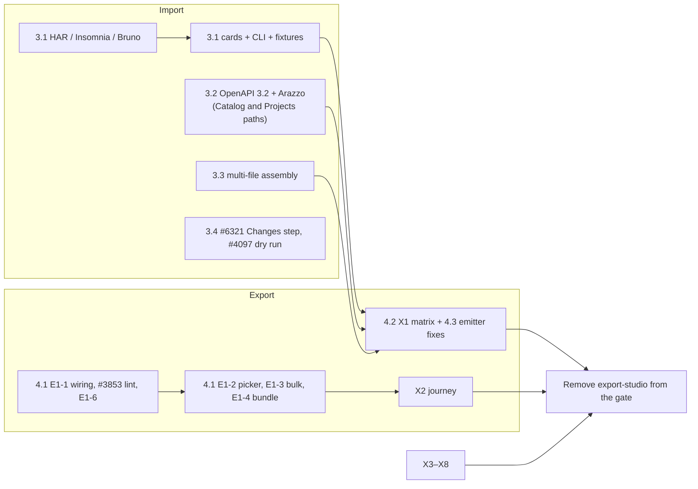

# RC7 — Catalog and Project import and export (plan of action)

_Drafted 2026-10-25; progress updated 2026-10-28. Follows [`docs/RC6_OOE.md`](RC6_OOE.md) and
[`docs/PLAN_POST_LAUNCH_ENABLEMENT.md`](PLAN_POST_LAUNCH_ENABLEMENT.md) (E1 — Catalog Exporter)._

**Status:** plan only. Nothing in this document has been enabled, disabled or moved. The code, the
feature gate (`apiome-ui/lib/feature-release.ts`) and the GitHub milestones are unchanged; §8 lists
the milestone moves this plan proposes.

## 0. Decision

RC7 is the next release. It has one theme: **getting specs into and out of the Catalog and
Projects.** It contains exactly two things, and nothing else:

1. **Complete import for the Catalog** — every import format and capability that is not yet coded
   (§3).
2. **Export studio for Catalog items and Project versions** — the E1 Catalog Exporter, including the
   hardening that lets its gate open (§4).

Everything else stays where RC6 left it (§2.2).

## 0.1 Ticket status (2026-10-28)

> **Superseded as the working checklist by [`RC7_SHIP_PLAN.md`](RC7_SHIP_PLAN.md)** (2026-10-28), which
> adds the export loss report, the per-target correctness audit and the complete RC7 ticket list.
> The status below is kept as the record of that day.

Every issue this plan cites, checked against GitHub on 2026-10-28 (`main` @ `9918614ea`): 253 issues,
79 closed, 174 open. No pull request is open against any of them.

### Closed (79)

Everything in §3 (import) and §4.1–§4.3 (export studio, hardening, emitter fixes) is closed:
[#3465](https://github.com/apiome/apiome/issues/3465), [#3497](https://github.com/apiome/apiome/issues/3497), [#3498](https://github.com/apiome/apiome/issues/3498), [#3500](https://github.com/apiome/apiome/issues/3500), [#3501](https://github.com/apiome/apiome/issues/3501), [#3502](https://github.com/apiome/apiome/issues/3502), [#3503](https://github.com/apiome/apiome/issues/3503), [#3505](https://github.com/apiome/apiome/issues/3505), [#3754](https://github.com/apiome/apiome/issues/3754), [#3758](https://github.com/apiome/apiome/issues/3758), [#3776](https://github.com/apiome/apiome/issues/3776), [#3778](https://github.com/apiome/apiome/issues/3778), [#3779](https://github.com/apiome/apiome/issues/3779), [#3780](https://github.com/apiome/apiome/issues/3780), [#3782](https://github.com/apiome/apiome/issues/3782), [#3785](https://github.com/apiome/apiome/issues/3785), [#3786](https://github.com/apiome/apiome/issues/3786), [#3789](https://github.com/apiome/apiome/issues/3789), [#3790](https://github.com/apiome/apiome/issues/3790), [#3791](https://github.com/apiome/apiome/issues/3791), [#3792](https://github.com/apiome/apiome/issues/3792), [#3794](https://github.com/apiome/apiome/issues/3794), [#3796](https://github.com/apiome/apiome/issues/3796), [#3797](https://github.com/apiome/apiome/issues/3797), [#3798](https://github.com/apiome/apiome/issues/3798), [#3799](https://github.com/apiome/apiome/issues/3799), [#3800](https://github.com/apiome/apiome/issues/3800), [#3801](https://github.com/apiome/apiome/issues/3801), [#3802](https://github.com/apiome/apiome/issues/3802), [#3806](https://github.com/apiome/apiome/issues/3806), [#3808](https://github.com/apiome/apiome/issues/3808), [#3810](https://github.com/apiome/apiome/issues/3810), [#3811](https://github.com/apiome/apiome/issues/3811), [#3812](https://github.com/apiome/apiome/issues/3812), [#3853](https://github.com/apiome/apiome/issues/3853), [#3979](https://github.com/apiome/apiome/issues/3979), [#3981](https://github.com/apiome/apiome/issues/3981), [#3984](https://github.com/apiome/apiome/issues/3984), [#3992](https://github.com/apiome/apiome/issues/3992), [#4079](https://github.com/apiome/apiome/issues/4079), [#4080](https://github.com/apiome/apiome/issues/4080), [#4097](https://github.com/apiome/apiome/issues/4097), [#4098](https://github.com/apiome/apiome/issues/4098), [#4099](https://github.com/apiome/apiome/issues/4099), [#4100](https://github.com/apiome/apiome/issues/4100), [#4152](https://github.com/apiome/apiome/issues/4152), [#4179](https://github.com/apiome/apiome/issues/4179), [#4371](https://github.com/apiome/apiome/issues/4371), [#4374](https://github.com/apiome/apiome/issues/4374), [#4386](https://github.com/apiome/apiome/issues/4386), [#4398](https://github.com/apiome/apiome/issues/4398), [#4399](https://github.com/apiome/apiome/issues/4399), [#4400](https://github.com/apiome/apiome/issues/4400), [#4401](https://github.com/apiome/apiome/issues/4401), [#4402](https://github.com/apiome/apiome/issues/4402), [#4404](https://github.com/apiome/apiome/issues/4404), [#4405](https://github.com/apiome/apiome/issues/4405), [#4406](https://github.com/apiome/apiome/issues/4406), [#4407](https://github.com/apiome/apiome/issues/4407), [#4408](https://github.com/apiome/apiome/issues/4408), [#5434](https://github.com/apiome/apiome/issues/5434), [#5436](https://github.com/apiome/apiome/issues/5436), [#5468](https://github.com/apiome/apiome/issues/5468), [#6217](https://github.com/apiome/apiome/issues/6217), [#6218](https://github.com/apiome/apiome/issues/6218), [#6219](https://github.com/apiome/apiome/issues/6219), [#6220](https://github.com/apiome/apiome/issues/6220), [#6221](https://github.com/apiome/apiome/issues/6221), [#6222](https://github.com/apiome/apiome/issues/6222), [#6223](https://github.com/apiome/apiome/issues/6223), [#6224](https://github.com/apiome/apiome/issues/6224), [#6225](https://github.com/apiome/apiome/issues/6225), [#6226](https://github.com/apiome/apiome/issues/6226), [#6227](https://github.com/apiome/apiome/issues/6227), [#6228](https://github.com/apiome/apiome/issues/6228), [#6229](https://github.com/apiome/apiome/issues/6229), [#6234](https://github.com/apiome/apiome/issues/6234), [#6278](https://github.com/apiome/apiome/issues/6278), [#6321](https://github.com/apiome/apiome/issues/6321).

### Needs review — open, but the work looks done (76)

- **Verify against the acceptance criteria and close** — the §6 list, whose work the audit found
  already in the code (75): [#568](https://github.com/apiome/apiome/issues/568), [#760](https://github.com/apiome/apiome/issues/760), [#2775](https://github.com/apiome/apiome/issues/2775), [#2776](https://github.com/apiome/apiome/issues/2776), [#3748](https://github.com/apiome/apiome/issues/3748), [#3777](https://github.com/apiome/apiome/issues/3777), [#3781](https://github.com/apiome/apiome/issues/3781), [#3783](https://github.com/apiome/apiome/issues/3783), [#3787](https://github.com/apiome/apiome/issues/3787), [#3788](https://github.com/apiome/apiome/issues/3788), [#3793](https://github.com/apiome/apiome/issues/3793), [#3795](https://github.com/apiome/apiome/issues/3795), [#3803](https://github.com/apiome/apiome/issues/3803), [#3804](https://github.com/apiome/apiome/issues/3804), [#3805](https://github.com/apiome/apiome/issues/3805), [#3807](https://github.com/apiome/apiome/issues/3807), [#3809](https://github.com/apiome/apiome/issues/3809), [#3816](https://github.com/apiome/apiome/issues/3816), [#3843](https://github.com/apiome/apiome/issues/3843), [#3870](https://github.com/apiome/apiome/issues/3870), [#3871](https://github.com/apiome/apiome/issues/3871), [#3872](https://github.com/apiome/apiome/issues/3872), [#3873](https://github.com/apiome/apiome/issues/3873), [#3889](https://github.com/apiome/apiome/issues/3889), [#3890](https://github.com/apiome/apiome/issues/3890), [#3892](https://github.com/apiome/apiome/issues/3892), [#3893](https://github.com/apiome/apiome/issues/3893), [#3894](https://github.com/apiome/apiome/issues/3894), [#3896](https://github.com/apiome/apiome/issues/3896), [#3898](https://github.com/apiome/apiome/issues/3898), [#3900](https://github.com/apiome/apiome/issues/3900), [#3901](https://github.com/apiome/apiome/issues/3901), [#3902](https://github.com/apiome/apiome/issues/3902), [#3904](https://github.com/apiome/apiome/issues/3904), [#3905](https://github.com/apiome/apiome/issues/3905), [#3906](https://github.com/apiome/apiome/issues/3906), [#3908](https://github.com/apiome/apiome/issues/3908), [#3915](https://github.com/apiome/apiome/issues/3915), [#3917](https://github.com/apiome/apiome/issues/3917), [#3982](https://github.com/apiome/apiome/issues/3982), [#3983](https://github.com/apiome/apiome/issues/3983), [#3985](https://github.com/apiome/apiome/issues/3985), [#3986](https://github.com/apiome/apiome/issues/3986), [#3987](https://github.com/apiome/apiome/issues/3987), [#3988](https://github.com/apiome/apiome/issues/3988), [#3989](https://github.com/apiome/apiome/issues/3989), [#3990](https://github.com/apiome/apiome/issues/3990), [#3991](https://github.com/apiome/apiome/issues/3991), [#3993](https://github.com/apiome/apiome/issues/3993), [#3994](https://github.com/apiome/apiome/issues/3994), [#3995](https://github.com/apiome/apiome/issues/3995), [#3996](https://github.com/apiome/apiome/issues/3996), [#4127](https://github.com/apiome/apiome/issues/4127), [#4128](https://github.com/apiome/apiome/issues/4128), [#4130](https://github.com/apiome/apiome/issues/4130), [#4133](https://github.com/apiome/apiome/issues/4133), [#4137](https://github.com/apiome/apiome/issues/4137), [#4140](https://github.com/apiome/apiome/issues/4140), [#4147](https://github.com/apiome/apiome/issues/4147), [#4153](https://github.com/apiome/apiome/issues/4153), [#4158](https://github.com/apiome/apiome/issues/4158), [#4163](https://github.com/apiome/apiome/issues/4163), [#4164](https://github.com/apiome/apiome/issues/4164), [#4165](https://github.com/apiome/apiome/issues/4165), [#4166](https://github.com/apiome/apiome/issues/4166), [#4169](https://github.com/apiome/apiome/issues/4169), [#4173](https://github.com/apiome/apiome/issues/4173), [#4178](https://github.com/apiome/apiome/issues/4178), [#4289](https://github.com/apiome/apiome/issues/4289), [#4290](https://github.com/apiome/apiome/issues/4290), [#4301](https://github.com/apiome/apiome/issues/4301), [#4302](https://github.com/apiome/apiome/issues/4302), [#4304](https://github.com/apiome/apiome/issues/4304), [#4345](https://github.com/apiome/apiome/issues/4345), [#4409](https://github.com/apiome/apiome/issues/4409). Close [#568](https://github.com/apiome/apiome/issues/568) as superseded (OA1 [#3498](https://github.com/apiome/apiome/issues/3498)).
- [#6384](https://github.com/apiome/apiome/issues/6384) MFI-31.3a: send the catalog drift email. The opt-in is stored ([#4400](https://github.com/apiome/apiome/issues/4400)), but nothing sends
  the email yet. Check whether it belongs in RC7 (P2, no milestone) or moves to a follow-up.
- Built, but a sign-off is still owed on a closed ticket: [#6223](https://github.com/apiome/apiome/issues/6223) X2 (first green CI run of the
  exporter journey), [#6227](https://github.com/apiome/apiome/issues/6227) X6 (`/security-review` on the release PR) and [#6229](https://github.com/apiome/apiome/issues/6229) X8 (a week
  watching the export-health alert on staging).

### Still open and needs work for RC7

None of these has a ticket yet. Each blocks the §4.4 exit criteria:

1. **Silent loss (X1).** 628 pairs remain in `tests/export_conformance_ledger.py` (was 637). The exit
   criterion is *no silent loss*. Ticket the remaining pairs per target (fix the emitter, or name the
   loss in its rule pack) — the §4.3 "new tickets from X1" row.
2. **Scalar names leaking into IDL output** (same bug as [#6278](https://github.com/apiome/apiome/issues/6278)) in asn1, corbaidl, flatbuffers,
   typespec, wsdl and xsd, and Avro narrowing `int64` to `int`. The §4.3 follow-up.
3. **Re-import failures by target** (wadl, asn1, asyncapi, postman, oncrpc, protobuf, connectrpc,
   corbaidl): triage each into a fix, a types-only pair, or a refusal with a reason.
4. **Verify validators** for 14 targets that report "not applicable" (§4.3). Not a gate blocker:
   each must show as "not validated".
5. **Open the gate:** remove `export-studio` from `UNRELEASED_FEATURE_IDS` once 1–3 are done and the
   owed sign-offs above are in (§2.1).
6. **Apply the §8 milestone triage**, which is still not applied: move [#4311](https://github.com/apiome/apiome/issues/4311) and [#4312](https://github.com/apiome/apiome/issues/4312) to
   Future, and the issues that are not import or export out of RC7 ([#5594](https://github.com/apiome/apiome/issues/5594), [#5595](https://github.com/apiome/apiome/issues/5595), [#5596](https://github.com/apiome/apiome/issues/5596), [#5610](https://github.com/apiome/apiome/issues/5610), [#5611](https://github.com/apiome/apiome/issues/5611), [#5613](https://github.com/apiome/apiome/issues/5613), [#5614](https://github.com/apiome/apiome/issues/5614), [#5617](https://github.com/apiome/apiome/issues/5617), [#6263](https://github.com/apiome/apiome/issues/6263), [#6274](https://github.com/apiome/apiome/issues/6274), [#6317](https://github.com/apiome/apiome/issues/6317)).

### Open by design — not RC7 work

- [#3715](https://github.com/apiome/apiome/issues/3715) is the MFI umbrella epic (milestone *Future*) and stays open.
- Deferred export targets, Appendix A (44): [#795](https://github.com/apiome/apiome/issues/795), [#3876](https://github.com/apiome/apiome/issues/3876), [#3897](https://github.com/apiome/apiome/issues/3897), [#3914](https://github.com/apiome/apiome/issues/3914), [#4134](https://github.com/apiome/apiome/issues/4134), [#4135](https://github.com/apiome/apiome/issues/4135), [#4139](https://github.com/apiome/apiome/issues/4139), [#4141](https://github.com/apiome/apiome/issues/4141), [#4145](https://github.com/apiome/apiome/issues/4145), [#4146](https://github.com/apiome/apiome/issues/4146), [#4157](https://github.com/apiome/apiome/issues/4157), [#4159](https://github.com/apiome/apiome/issues/4159), [#4161](https://github.com/apiome/apiome/issues/4161), [#4174](https://github.com/apiome/apiome/issues/4174), [#4182](https://github.com/apiome/apiome/issues/4182), [#4183](https://github.com/apiome/apiome/issues/4183), [#4291](https://github.com/apiome/apiome/issues/4291), [#4295](https://github.com/apiome/apiome/issues/4295), [#4296](https://github.com/apiome/apiome/issues/4296), [#4297](https://github.com/apiome/apiome/issues/4297), [#4298](https://github.com/apiome/apiome/issues/4298), [#4299](https://github.com/apiome/apiome/issues/4299), [#4306](https://github.com/apiome/apiome/issues/4306), [#4307](https://github.com/apiome/apiome/issues/4307), [#4308](https://github.com/apiome/apiome/issues/4308), [#4309](https://github.com/apiome/apiome/issues/4309), [#4311](https://github.com/apiome/apiome/issues/4311), [#4312](https://github.com/apiome/apiome/issues/4312), [#4313](https://github.com/apiome/apiome/issues/4313), [#4314](https://github.com/apiome/apiome/issues/4314), [#4315](https://github.com/apiome/apiome/issues/4315), [#4317](https://github.com/apiome/apiome/issues/4317), [#4318](https://github.com/apiome/apiome/issues/4318), [#4319](https://github.com/apiome/apiome/issues/4319), [#4320](https://github.com/apiome/apiome/issues/4320), [#4321](https://github.com/apiome/apiome/issues/4321), [#4323](https://github.com/apiome/apiome/issues/4323), [#4324](https://github.com/apiome/apiome/issues/4324), [#4325](https://github.com/apiome/apiome/issues/4325), [#4326](https://github.com/apiome/apiome/issues/4326), [#4342](https://github.com/apiome/apiome/issues/4342), [#4343](https://github.com/apiome/apiome/issues/4343), [#4344](https://github.com/apiome/apiome/issues/4344), [#4346](https://github.com/apiome/apiome/issues/4346).
- Other deferred export work, Appendix B (42): [#3851](https://github.com/apiome/apiome/issues/3851), [#3858](https://github.com/apiome/apiome/issues/3858), [#3865](https://github.com/apiome/apiome/issues/3865), [#3891](https://github.com/apiome/apiome/issues/3891), [#3895](https://github.com/apiome/apiome/issues/3895), [#3899](https://github.com/apiome/apiome/issues/3899), [#3903](https://github.com/apiome/apiome/issues/3903), [#3907](https://github.com/apiome/apiome/issues/3907), [#3912](https://github.com/apiome/apiome/issues/3912), [#3916](https://github.com/apiome/apiome/issues/3916), [#4129](https://github.com/apiome/apiome/issues/4129), [#4136](https://github.com/apiome/apiome/issues/4136), [#4142](https://github.com/apiome/apiome/issues/4142), [#4148](https://github.com/apiome/apiome/issues/4148), [#4154](https://github.com/apiome/apiome/issues/4154), [#4160](https://github.com/apiome/apiome/issues/4160), [#4170](https://github.com/apiome/apiome/issues/4170), [#4180](https://github.com/apiome/apiome/issues/4180), [#4328](https://github.com/apiome/apiome/issues/4328), [#4329](https://github.com/apiome/apiome/issues/4329), [#4330](https://github.com/apiome/apiome/issues/4330), [#4331](https://github.com/apiome/apiome/issues/4331), [#4335](https://github.com/apiome/apiome/issues/4335), [#4336](https://github.com/apiome/apiome/issues/4336), [#4337](https://github.com/apiome/apiome/issues/4337), [#4339](https://github.com/apiome/apiome/issues/4339), [#4340](https://github.com/apiome/apiome/issues/4340), [#4341](https://github.com/apiome/apiome/issues/4341), [#4364](https://github.com/apiome/apiome/issues/4364), [#4366](https://github.com/apiome/apiome/issues/4366), [#4367](https://github.com/apiome/apiome/issues/4367), [#4368](https://github.com/apiome/apiome/issues/4368), [#4369](https://github.com/apiome/apiome/issues/4369), [#4370](https://github.com/apiome/apiome/issues/4370), [#4372](https://github.com/apiome/apiome/issues/4372), [#4373](https://github.com/apiome/apiome/issues/4373), [#4375](https://github.com/apiome/apiome/issues/4375), [#4376](https://github.com/apiome/apiome/issues/4376), [#4377](https://github.com/apiome/apiome/issues/4377), [#4379](https://github.com/apiome/apiome/issues/4379), [#4381](https://github.com/apiome/apiome/issues/4381), [#4382](https://github.com/apiome/apiome/issues/4382).

## 1. Where things stand (audited 2026-10-25 against `main` @ `4ef81ad33`)

**Progress at 2026-10-28 (`main` @ `745bae201`):** the **import half of RC7 is done.** Every ticket
in §3 is built and closed: the formats (§3.1), the OpenAPI 3.2 and Arazzo gaps (§3.2), format depth
(§3.3), the import flow (§3.4) and per-artifact refresh (§3.5). The epic for §3.5, [#4386](https://github.com/apiome/apiome/issues/4386), has no
open children left. **The export tickets (§4.1, §4.2, §4.3) are built and closed too**, but the gate
has not opened: see §0.1 for what is left. The audit as written on 2026-10-25 follows.

**Import.** The format-matrix roadmap is built: about 99 import adapters are registered in
`apiome-rest/src/app/*_import_source.py`. Every adapter gets a source card in the import picker
(from `GET /v1/import/sources`), the generic CLI (`apiome import <format>`), and corpus fixtures
(1,468 entries in `apiome-ui/examples/corpus.manifest.json`). The corpus's two remaining
`(pending #…)` labels (RELAX NG [#5434](https://github.com/apiome/apiome/issues/5434), OPC UA [#5468](https://github.com/apiome/apiome/issues/5468)) are stale; both adapters exist. Schematron is
imported as a style guide, not a catalog format, by design (FMT-4.3 [#5436](https://github.com/apiome/apiome/issues/5436)). What is left is
three missing formats, OpenAPI 3.2 gaps, per-format depth (lint, breaking rules, multi-file,
discovery) and some import-flow work. Import is not behind a feature gate.

**Export.** 54 emitters are registered (`emitter.py:load_builtin_emitters`); the target list drops
`sample`, leaving the **53 targets** RC6 promised. Every target has a fidelity pack, a target card,
a CLI command and round-trip support. Export studio exists but is gated (`export-studio`). No E1
work has landed since the E1 plan was written on 2026-10-23. Two facts matter most:

- **The conformance matrix is the long pole.** `tests/golden/roundtrip/matrix.json` (105 sources ×
  53 targets = 5,565 cells) passes **54 cells**; 5,511 are expected failures in
  `tests/roundtrip_xfails.py`. About 1,595 fail to emit (some legitimate refusals, some crashes),
  754 emit output that does not re-import (wadl 105, asn1 85, asyncapi 78, postman 76, oncrpc 70,
  protobuf 67, connectrpc 67, corbaidl 56), and about 3,000 show unexplained diffs (silent loss).
- **Eight targets only re-export their own format** (`required_source_extras`): idoc,
  cobolcopybook, edix12, fix, iso20022, iso8583, hl7v2, zosconnect. They work for a source imported
  in that format and refuse anything else.

## 2. Services to re-enable

### 2.1 Re-enable at the end of RC7

Only one feature id:

| Feature id | What it turns on | Condition |
| --- | --- | --- |
| `export-studio` | Export studio (`/ade/dashboard/export/studio`) for Catalog items and Project versions; the rail item; the studio links from Catalog, the Export dialog, the project facts card, the spec viewer and the Versions overflow | §4.4 exit criteria met |

Turning it on is the procedure in PLAN_POST_LAUNCH_ENABLEMENT §2.5: merge everything behind the
gate, test with `NEXT_PUBLIC_APIOME_PREVIEW_FEATURES=export-studio`, run on staging and internal
tenants for a week, then remove the id and restore the docs in one PR. Rollback is putting the id
back.

The places that check `export-studio` today (all flip together when the id is removed):

| File | What it gates |
| --- | --- |
| `apiome-ui/lib/feature-release.ts` | The id in `UNRELEASED_FEATURE_IDS` |
| `src/app/ade/dashboard/export/studio/layout.tsx` | The whole studio route |
| `lib/platform-nav.ts` (rail item) | Rail, command palette, `G` jump |
| `src/app/ade/dashboard/catalog/CatalogClient.tsx` | Catalog's export verb opens the studio (otherwise the dialog) |
| `src/app/ade/dashboard/catalog/[id]/CatalogItemDetailClient.tsx` | Same, on an item's page |
| `src/app/components/ade/dashboard/export/ExportDialog.tsx` | **Open in Export Studio** |
| `src/app/components/ade/versions/ProjectFactsCard.tsx` | **Export studio** button |
| `src/app/components/ade/versions/SpecViewerDialog.tsx` | Export panel deep links |
| `src/app/ade/dashboard/versions/page.tsx` → `versionsHeader.tsx` | Versions overflow item |
| `apiome-ui/src/app/components/ade/help/helpCatalog.ts` | Export studio and Export catalog items guides in `GUIDE_ENTRIES` (moved with the docs restore, X7) |

### 2.2 Stays gated — not part of RC7

These are related to export or import but belong to other features. RC7 does not enable them, and
the studio must keep hiding them:

| Feature id | Why it stays off | Where it touches export/import |
| --- | --- | --- |
| `sdk-settings` | SDK generation is its own release (E5) | The studio's **SDK & branding** tab (`exportStudioTabs.ts`) is filtered by this id |
| `connectors` | Discovery/ownership release (E3) | Gateway **Push back** into the studio (`GatewayConfigClient.tsx`); the whole route is gated by `connectors` |
| `schema-registry` | E4 | Push-to-registry delivery (MFX-4.4) — no UI exists yet |
| `catalog-entities` | E4 | The **Compass export** source tile in **Import to catalog** |
| `mcp` | E6 | No MCP/agent export target exists; nothing to hide |
| `primitives`, `style-guides`, `audit`, `shadow-apis`, `dependency-graph`, `teams`, `consumers` | Not import or export | — |

## 3. Import — outstanding work

Priority: **P1** must ship in RC7; **P2** ships in RC7 if the schedule allows, otherwise it is the
first follow-up. Status is from the 2026-10-25 audit.

### 3.1 Formats not yet coded (P1)

None outstanding. HAR, Insomnia and Bruno import ([#4404](https://github.com/apiome/apiome/issues/4404), [#4405](https://github.com/apiome/apiome/issues/4405), [#4406](https://github.com/apiome/apiome/issues/4406)), the secret-scrub gate ([#4407](https://github.com/apiome/apiome/issues/4407))
and their source cards, CLI verbs and fixtures ([#4408](https://github.com/apiome/apiome/issues/4408)) are built.

### 3.2 OpenAPI 3.2 and Arazzo import gaps (P1)

Two import paths exist: the Catalog (REST normalizer) and Projects (the UI importer). Both must
handle these.

Epic ([#3497](https://github.com/apiome/apiome/issues/3497)) is built and closed.

OA3 ([#3500](https://github.com/apiome/apiome/issues/3500)) is built on the Projects path: `itemSchema` elements of JSON Lines, JSON text
sequences and SSE import as classes tagged `x-apiome-stream-kind`, and **Analyze** lists the
streaming media types. The Catalog (REST normalizer) side was outside that issue's scope.

OA4 ([#3501](https://github.com/apiome/apiome/issues/3501)) is done on both paths: the Projects importer now walks `query` and
`additionalOperations`, imports their schemas and keeps each method token, and OpenAPI 3.1
export writes them to `x-apiome-query-operation` / `x-apiome-additional-operations`.

OA5 ([#3502](https://github.com/apiome/apiome/issues/3502)) is built on the Projects path: tags keep summary / parent / kind / externalDocs on
the project (`x-apiome-tag-taxonomy`), the parent tree is cycle-checked, and classes list their
declared tags. The Catalog side still has no tree or cycle check; that was outside the issue's scope.

OA6 ([#3503](https://github.com/apiome/apiome/issues/3503)) is built on the Projects path: `$ref`s resolve against a declared `$self`
(same-document references import as local, others are kept and warned about), and `$ref` sibling
summary/description are kept as local overrides. The Catalog (REST normalizer) side was outside
that issue's scope.

AZ2 ([#3505](https://github.com/apiome/apiome/issues/3505)) is built on the Projects path: `lib/importers/arazzo.ts` validates
`sourceDescriptions` and resolves step `operationId` / `operationPath` against the documents
supplied with the import (`sourceDocuments`), returning `arazzoResolution` on the import job. The
Import dialog and repository-file imports do not supply source documents yet.

### 3.3 Format depth (P2 unless noted)

Every format imports today. These tickets make specific formats complete.

**Multi-file assembly (P1):** every ticket below is built; a set now resolves across its files.

MFI-15.1 ([#3799](https://github.com/apiome/apiome/issues/3799)) is built: RAML parses through AMF when the runtime has it, so `!include` files
and `uses` libraries resolve into the imported model (library types as `alias.Type`); without AMF,
a set that includes or uses files is refused with `ADAPTER_UNAVAILABLE`.

MFI-15.2 ([#3800](https://github.com/apiome/apiome/issues/3800)) is built: resource types and traits are applied to every operation (AMF's resolved
model, or `app.raml_traits` for a self-contained document without AMF), with headers, bodiless
responses, response `status_code`s and `raml_resource_type` / `raml_traits` provenance in the
canonical model.

MFI-19.3 ([#3981](https://github.com/apiome/apiome/issues/3981)) is built: a Thrift file set resolves `include`s across files (`app.thrift_fileset`),
with a field-id-aware breaking-change classifier (`app.thrift_breaking`) and a native `thrift` lint
pack (`app.thrift_lint`).

MFI-17.1 ([#3808](https://github.com/apiome/apiome/issues/3808)) is built: a Smithy set with several model files is assembled by `smithy ast` into one JSON
AST (`app.smithy_ast`, `app.smithy_ast_mapper`), a JSON AST imports directly, and the model's `$version`,
namespaces, AST hash and source files are recorded. Without the Smithy CLI a multi-file set is
`ADAPTER_UNAVAILABLE`.

MFI-14.1 ([#3794](https://github.com/apiome/apiome/issues/3794)) is built: a TypeSpec set with several `.tsp` files compiles through `tsp` to OpenAPI
(`app.typespec_compile`), normalized by the OpenAPI normalizer; the image now ships `@typespec/http`, `rest`,
`openapi3` and `versioning`. MFI-14.5 ([#3798](https://github.com/apiome/apiome/issues/3798)) is built too: a `tspconfig.yaml` beside the root is honored for its
safe settings (`app.typespec_config`), and `apiome import typespec <dir>` packs a project folder.
Archive intake now has root candidates for `.raml`, `.smithy`, `.thrift` and `.tsp`.

**Input variants:** both tickets are built.

MFI-17.5 ([#3812](https://github.com/apiome/apiome/issues/3812)) is built: Smithy JSON AST input (from [#3808](https://github.com/apiome/apiome/issues/3808)) has a corpus fixture (`smithy/07-json-ast-weather.json`),
and `apiome import smithy` takes a model file, JSON AST, archive or directory.

MFI-11.1 ([#3776](https://github.com/apiome/apiome/issues/3776)) is built: OData CSDL JSON input (`app.odata_csdl_json`) and OASIS CSDL schema validation of every
v4 document (`app.odata_csdl_schema`; violations recorded and linted as `odata.csdl-schema`, not refused).

**Live discovery:** all three tickets are built.

MFI-19.1 ([#3979](https://github.com/apiome/apiome/issues/3979)) is built: `OpenRpcImportSource.discover` calls `rpc.discover` on a JSON-RPC endpoint
(`app.openrpc_discovery`, SSRF-guarded POST via `app.live_fetch.guarded_post_json`); content-descriptor `$ref`s
resolve; an `openrpc` breaking-change classifier (`app.openrpc_breaking`, parameter position / name / requiredness
against `paramStructure`) and lint pack (`app.openrpc_lint`, V323); the CLI has `apiome import openrpc --discover`.

MFI-11.3 ([#3778](https://github.com/apiome/apiome/issues/3778)) is built: `ODataImportSource.discover` fetches `$metadata` and the service document
(`app.odata_discovery`, SSRF-guarded) and records the service document and unlisted entity sets; the CLI has
`apiome import odata --discover`.

MFI-13.3 ([#3790](https://github.com/apiome/apiome/issues/3790)) is built: `WsdlImportSource.discover` fetches `?singleWsdl` (else `?wsdl`) and inlines every
remote `wsdl:import` / `xs:import` / `xs:include` (`app.wsdl_fetch`); the parser follows `wsdl:import` in filesets;
`.wsdl` archives resolve their root; the CLI has `apiome import wsdl --discover`.

MFI-11.4 ([#3779](https://github.com/apiome/apiome/issues/3779)) is built: the OData lint pack is complete — v4 CSDL XML is validated against the vendored OASIS
EDMX / EDM XML schemas (`app.odata_csdl_xsd`, `odata.csdl-xsd`), and every reference and entity key of v2/v3/v4
metadata is resolved (`app.odata_resolution`, blocking `odata.unresolved-reference` / `odata.entity-key`, V324).

MFI-12.5 ([#3786](https://github.com/apiome/apiome/issues/3786)) is built: the Avro lint pack (`app.avro_lint`, eight `avro.*` rules, V325) checks `.avsc` and IDL
schemas as written (`app.avro_hygiene`): defaults, nested/repeated union branches, optional-union order and
defaults, aliases and ignored docs.

MFI-13.4 ([#3791](https://github.com/apiome/apiome/issues/3791)) is built: the WS-I lint pack (`app.wsdl_lint`, eight `wsi.*` rules, V326) checks WSDL bindings
(literal use, consistent style, document-/rpc-literal parts and namespaces, unique operation signatures and
soapActions) and the import graph (`app.wsdl_wsi`, run by the import source with the fileset / live-fetch members).

MFI-14.3 ([#3796](https://github.com/apiome/apiome/issues/3796)) is built: every TypeSpec compile enables the built-in `@typespec/http/all` linter ruleset, keeps
the warnings of a successful compile (`TypeSpecCompiled.diagnostics`, extras `typespec_diagnostics`), and the
`typespec` lint pack (`app.typespec_lint`, `typespec.compiler-diagnostic`, V327) reports them.

MFI-15.3 ([#3801](https://github.com/apiome/apiome/issues/3801)) is built: with AMF, every RAML import is also run through `amf validate` (`app.raml_amf`,
JSON-LD SHACL report); a self-contained document AMF refuses imports through the YAML reader with its violations as
findings. The `raml` lint pack (`app.raml_lint`, seven rules, V328) reports `raml.shacl-*` plus hygiene
(`app.raml_hygiene`: undeclared security schemes, unused base-URI / URI parameters, methods without responses).

MFI-16.3 ([#3806](https://github.com/apiome/apiome/issues/3806)) is built: with the bundled drafter, every API Blueprint import is also run through `drafter -f json`
(`app.apiblueprint_drafter`, best effort — the built-in reader still does the import), and the `apiblueprint` lint
pack (`app.apiblueprint_lint`, V329) reports drafter's annotations as `apiblueprint.drafter-warning` /
`apiblueprint.drafter-error`.

MFI-17.3 ([#3810](https://github.com/apiome/apiome/issues/3810)) is built: with the Smithy CLI, every Smithy import is also run through `smithy validate --format csv`
with nine `smithy-linters` validators switched on (`app.smithy_ast.validate_smithy_members`); the linters resolve from
an offline Maven folder baked into the image (`lib/smithy-m2`). The `smithy` lint pack (`app.smithy_lint`, V330)
reports `smithy.linter` / `smithy.validation-error` / `-warning` / `-note`.

**Lint packs:** every planned native pack has shipped (`format_lint_capabilities.RELATED_FORMAT_LINT_ISSUES` is empty).

MFI-11.5 ([#3780](https://github.com/apiome/apiome/issues/3780)) is built: the `odata` breaking-change classifier (`app.odata_breaking`) grades diffs by OData 4.01
§5.2 Model Versioning (properties, keys, navigation properties, annotations) and notes on every breaking grade whether
the schema's `Core.SchemaVersion` (`$schemaversion`) moved.

MFI-13.2 ([#3789](https://github.com/apiome/apiome/issues/3789)) is built: the WSDL canonical model records each port as a named server with its binding's protocol
(soap11 / soap12 / http) and the WSDL service / binding / port type / transport, faults as `error` messages, and
multi-part messages as synthesized record types; the WSDL emitter writes all of them back.

MFI-13.5 ([#3792](https://github.com/apiome/apiome/issues/3792)) is built: the WSDL importer records soapAction / rpc style per operation and each element's occurs,
nillable, default and simple-type facets (written back by the WSDL emitter), and the `wsdl` breaking-change classifier
(`app.wsdl_breaking`) grades MEP / soapAction / style and XSD occurs / facet moves with strict-receiver rules.

MFI-14.4 ([#3797](https://github.com/apiome/apiome/issues/3797)) is built: a `@versioned` TypeSpec service compiles to one OpenAPI document per version
(`output-file: openapi.{version}.json`); the catalog item is the newest version and records every version plus each
step's OpenAPI compatibility grade (`app.typespec_versioning`, `typespec_version_changes`).

MFI-15.4 ([#3802](https://github.com/apiome/apiome/issues/3802)) is built: the `raml` breaking-change classifier (`app.raml_breaking`) grades parameter, property and
enum moves and applied resource-type / trait changes with a custom ruleset (RAML has no official one).

MFI-12.1 ([#3782](https://github.com/apiome/apiome/issues/3782)) is built: `app.avro_fingerprint` computes the Parsing Canonical Form of every named Avro type
(references inlined at first use; CRC-64-AVRO and SHA-256, matching fastavro on the corpus) and a semantic SHA-256
that keeps `doc` / `default` / `aliases` / `order` / `logicalType`. They are recorded in extras `avro_pcf` and
`avro_semantic_hashes`; the latter is in `fingerprint.UNHASHED_EXTRAS`, so a doc-only edit mints no version.
`AvroPcfHasher` fills `FingerprintResult.format_hash` with the root's PCF SHA-256 (none for an IDL protocol). The
schema registry still keys on the canonical-model fingerprint.

MFI-12.4 ([#3785](https://github.com/apiome/apiome/issues/3785)) is built: `app.avro_compatibility` applies Avro schema resolution as Java `SchemaCompatibility`
does (same incompatibility types and locations) and Confluent's levels on top (newest version first, stop at the first
that fails; Confluent's verbose messages). It matches 112 verdicts recorded from Confluent Schema Registry 7.7.1
(`tests/fixtures/avro_compatibility`, `scripts/record_avro_compatibility_fixtures.py`). AVRO is in
`schema_registry.COMPATIBILITY_RULES_SHIPPED`: registration refuses an incompatible version with 409 and
`/compatibility` answers with real verdicts. The `avro` breaking-change classifier (`app.avro_breaking`, id
`avro-compatibility`) grades BACKWARD failures breaking and FORWARD-only failures dangerous.

MFI-19.6 ([#3984](https://github.com/apiome/apiome/issues/3984)) is built: `app.rest_conventions` tags REST artifacts by the hypermedia conventions their media
types declare (JSON:API, HAL, HAL-FORMS, JSON-LD, Hydra) and normalizes resource types / link relations / templates /
`@type`s; the revision records them (`format_metadata.restConventions`), the catalog list and facets take
`convention`, the Catalog screen has a **Convention** filter, and the `rest-conventions` REST paradigm lint pack
(nine warnings, V331) checks conformance. JTD keeps its own adapter; a test pins that it lands as the same record as
its JSON Schema equivalent.

MFI-21.2 ([#3992](https://github.com/apiome/apiome/issues/3992)) is built: a z/OS Connect descriptor records its binding (`format_metadata.zosConnectBinding`) and a
copybook every 01-level record (`cobolRecords`); identity suggestions pair descriptor ↔ copybooks (shared COBOL
structures) and descriptor ↔ OpenAPI (target API title, shared operations); `GET …/zosconnect-binding` and the
catalog item's **z/OS Connect binding** panel show each operation's structures, copybooks and OpenAPI
(`app.zosconnect_binding`).

MFI-17.4 ([#3811](https://github.com/apiome/apiome/issues/3811)) is built: the `smithy` breaking-change classifier (`app.smithy_breaking`, id `smithy-diff`) runs
`smithy diff --format csv` (`app.smithy_ast.run_smithy_diff`) and maps ERROR / DANGER / WARNING / NOTE to breaking /
dangerous / dangerous / safe on the change each finding's shape joins; findings that join no change land in the new
`ClassificationResult.unattributed` and count toward the overall severity. A single `.smithy` file is now assembled
through `smithy ast` when the CLI is available (built-in reader as fallback), and a multi-file set keeps its
assembled AST on `raw["smithy_ast"]` so the diff compares whole models.

**Breaking-change rules:** every planned format classifier has shipped.

### 3.4 Import flow (Catalog and Projects)

Every ticket here is built and closed.

IXH-3.7 ([#6321](https://github.com/apiome/apiome/issues/6321)) is built: importing a new version into a project stops at a **Changes** step that
compares the incoming spec with the latest version (added, changed, removed and breaking counts)
before **Import**.

MFI-7.3 ([#3758](https://github.com/apiome/apiome/issues/3758)) is built: format and protocol are backfilled onto existing rows.

MFI-6.2 ([#3754](https://github.com/apiome/apiome/issues/3754)) is built: cross-protocol full-text search over the normalized model.

The epics MFI-EPIC-26 ([#4079](https://github.com/apiome/apiome/issues/4079)) and MFI-EPIC-27 ([#4080](https://github.com/apiome/apiome/issues/4080)) are closed. The umbrella [#3715](https://github.com/apiome/apiome/issues/3715) stays open
until its remaining children, outside RC7, close.

MFI-26.4 ([#4097](https://github.com/apiome/apiome/issues/4097)) is built: **Import to catalog** has a **Dry run** on the Options step. It runs the
import pre-flight (`POST /api/import/preflight`, the commit's own importer with `dry_run` forced) for
the candidate the commit would send (`buildCatalogPreflightRequest`, shared with the quality step) and
shows the predicted format, routing and reason, catalog name/slug, counts, lint and fingerprint
(`CatalogImportDryRunPanel`). No import job and no catalog write; Continue still commits.

MFI-26.5 ([#4098](https://github.com/apiome/apiome/issues/4098)) is built as the registry hook: `ImportSource.alternate_intake` /
`ImportSourceDescriptor.alternate_intake` (`kind`, `label`, `description`, `icon`) names an intake a format offers
beyond File / URL / Clipboard, and **Import to catalog** draws it as a card (`alternateIntakeTiles`) only when a panel
is registered for its kind (`CATALOG_ALTERNATE_INTAKE_PANELS`). Both are still empty. Since [#4399](https://github.com/apiome/apiome/issues/4399), GraphQL
introspection and gRPC reflection run through the import pipeline, but only for **live refresh** of an existing item
(§3.5), not as an intake in **Import to catalog**. A live-discovery card is still a server flag plus one panel, with no
dialog change.

MFI-27.1 ([#4099](https://github.com/apiome/apiome/issues/4099)) is built: the conversion preview's confirm button reads **Convert & create Project**, or
**Re-convert** when the item already has a conversion (`convertCommitLabel`; `ConversionPreviewDialog` takes the
item's `conversion` from the detail page and the Catalog list). The detail header's primary Convert / Re-convert CTA
(25.1) opens it; the acknowledgement gate and preview are unchanged.

MFI-27.2 ([#4100](https://github.com/apiome/apiome/issues/4100)) is built: the Catalog search placeholder reads **Search name, slug, format, protocol…  ( / )**
(`CatalogClient`; the mockup `sources/catalog.html` matches), in a box widened to 21rem (`.cat-search`) so the text
and the `/` hint fit. Average quality already read "letter · score" (`catalogModel.ts`).

Not in RC7: [#3465](https://github.com/apiome/apiome/issues/3465) (OpenAPI components → Primitives) is built and
closed, but it belongs to the gated `primitives` feature and stays hidden.

### 3.5 Refresh of imported specs (P2)

Imports that come from a URL or discovery can be refreshed. Connector-driven refresh is part of
`connectors` (§2.2); these tickets are the per-artifact part that RC7 can ship without it. All five
are built and closed, and the epic MFI-EPIC-31 ([#4386](https://github.com/apiome/apiome/issues/4386)) has no open children: close it.

| Ticket | Work | Status |
| --- | --- | --- |
| [#4398](https://github.com/apiome/apiome/issues/4398) MFI-31.1 | Per-artifact refresh cadence | ✅ Built: per-item cadence (GraphQL / gRPC live source), sweep with concurrency cap, per-host delay and backoff, tenant kill switch; **Live refresh** card, `apiome catalog refresh` |
| [#4399](https://github.com/apiome/apiome/issues/4399) MFI-31.2 | Re-discovery through the import pipeline for discovery adapters (gRPC reflection, GraphQL introspection) | ✅ Built: a check imports the discovered SDL / descriptor set through the import pipeline; `decide_version()` adds a version only when the source changed, with lint score, change report and `refreshTrigger` provenance |
| [#4400](https://github.com/apiome/apiome/issues/4400) MFI-31.3 | Drift badge and breaking-change notification | ✅ Built: drift graded safe / dangerous / breaking (V334); badge, banner, **What changed** on Versions; `catalog.drift.detected` webhook and owner inbox; **Drift alerts** settings with daily digest. Drift email is stored as an opt-in only — sending is [#6384](https://github.com/apiome/apiome/issues/6384) |
| [#4401](https://github.com/apiome/apiome/issues/4401) MFI-31.4 | Crawl checkpoint for resume | ✅ Built: crawl budgets (`requestsPerSecond`, `maxRequests`, `maxPages`, `maxBytes`), checkpoint resume (V335) and schema-id incremental passes for the schema-registry connector |
| [#4402](https://github.com/apiome/apiome/issues/4402) MFI-31.5 | Version retention and pruning | ✅ Built: per-item **Keep versions** (V336, default 50); tagged, conversion-source, breaking-drift, locked and newest versions always kept; pruned versions answer 410 `version-pruned` |

## 4. Export — outstanding work

The scope is PLAN_POST_LAUNCH_ENABLEMENT §2.2 (E1) with the 53 targets that exist. New emitters are
**not** in RC7 (appendix A).

### 4.1 Studio for Catalog items and Project versions (milestone `E1 — Catalog Exporter`)

| Ticket | Work | Status |
| --- | --- | --- |
| [#6217](https://github.com/apiome/apiome/issues/6217) E1-1 | Release wiring; keep `sdk-settings` / `connectors` pieces hidden | ✅ Built: Catalog **Export** (dialog) and **Export to another format…** (studio, row menu and item ⋯) verbs; facts card and Versions ⋯ open the studio scoped to the head revision; the gateway-config back link falls back while `connectors` is gated |
| [#6218](https://github.com/apiome/apiome/issues/6218) E1-2 | Source picker (studio opened from the rail or palette today lands on a dead end) | ✅ Built: the Source step lists catalog items (search, format/protocol pills) and project → version (catalog items never listed as projects); choosing opens the resumable deep link at Target |
| [#6219](https://github.com/apiome/apiome/issues/6219) E1-3 | Bulk export from the Catalog bulk bar; multi-target in the studio; CLI `--targets`, `--items`, `--all-versions` | ✅ Built: REST `items` batch (several artifacts, one zip, per-item failures, 100-pair cap); Catalog bulk **Export…** (one target, one batch job); studio **Several targets** (Options skipped, one combined dry-run Verify, one zip); CLI `apiome export <format> --targets` / `--items` (outcome table, exit 7 on partial). `--all-versions` not in [#6219](https://github.com/apiome/apiome/issues/6219)'s scope |
| [#6220](https://github.com/apiome/apiome/issues/6220) E1-4 | Export dialog downloads the full multi-file bundle | ✅ Built: a multi-file target's **Download all files (.zip)** runs the export as a job and downloads its MFX-4.2 bundle (every file + `manifest.json`); single-file targets keep the client-built zip |
| [#3853](https://github.com/apiome/apiome/issues/3853) MFX-5.2 | Lint of the emitted artifact (REST verify returns `lint: null`; the UI lens is ready) | ✅ Built: verify reads the emitted artifact back through its import adapter and lints it with the MFI rule packs for its format (advisory; `applicable: false` + `reason` when it cannot be read back) |
| [#6221](https://github.com/apiome/apiome/issues/6221) E1-6 | Honest target availability; typed missing-source error, **Re-import** action, source backfill | ✅ Built: `422 {code: source-not-captured \| source-withheld, reimport}` on every export route + job context; dialog/studio **Re-import** notice (`?open=import-catalog`); `ensure_target_available` refuses unavailable targets up front, CLI **Why not** column + pre-job refusal; `scripts/backfill_captured_sources.py` (sibling revision or linked repo file, fingerprint-proven) |
| [#6234](https://github.com/apiome/apiome/issues/6234) HIVE-11.11b | Studio header: crumbs, ghost **Back to Versions** | ✅ Built: crumbs `<workspace> › Ship › Export studio`, icon in the title row, **Back to Versions/Catalog** as a ghost header action; fixtures re-dumped, header gate green |

### 4.2 Hardening (the gate opens only when these pass)

| Ticket | Work | Status |
| --- | --- | --- |
| [#6222](https://github.com/apiome/apiome/issues/6222) X1 | Conformance matrix: no crashes, no silent loss; every refusal named. **Long pole** — see §4.3 | ✅ Built: `tests/test_export_conformance_matrix.py` (108 families × 53 targets, catalog export path) — 0 crashes (870 became reasons via `requires_source`, ~70 emitter bugs fixed in GraphQL/Avro/ASN.1/Kafka Connect); 637 silent-loss pairs tracked in a shrinking ledger (`tests/export_conformance_ledger.py`); CI `export-conformance.yml` |
| [#6223](https://github.com/apiome/apiome/issues/6223) X2 | Journey in CI: import → Catalog → dialog → studio → verify → job → bundle; bulk export | ✅ Built: `e2e/journey/catalog-exporter-journey.spec.ts`, `exporter` job in `e2e-catalog-journey.yml` (preview follows the release gate); green on its first CI run still to be confirmed |
| [#6224](https://github.com/apiome/apiome/issues/6224) X3 | Accessibility: studio, source picker, bulk dialog, target grid; full keyboard path | ✅ Built: every step, the source picker, the bulk **Export…** dialog and the target grid are in the axe gate ledger (`export-studio` + `export-e1`) with no file exempt; keyboard-only export end to end (one target, several targets, the source picker, the bulk dialog) and focus back on the trigger when the dialog closes, pinned in the jsdom suites |
| [#6225](https://github.com/apiome/apiome/issues/6225) X4 | Permission matrix: batch, recent jobs, another user's job download | ✅ Built: `docs/export-permission-matrix.json` — every export action is a member action (viewer, editor and owner alike; jobs belong to the workspace, so another member's job is listed, downloaded and cancelled like one's own); pytest over all 23 export calls (each role reaches each, non-members and other tenants' keys 403, anonymous 401, another tenant's job 404 even to a member of both, every mounted route tabled); Jest renders the Catalog, Studio Verify/Review, generate progress, test drive and Recent export jobs as each role |
| [#6226](https://github.com/apiome/apiome/issues/6226) X5 | Limits: size, time, batch, retention, per-tenant concurrency (not found); documented refusals | ✅ Built: new per-tenant concurrency cap (`APIOME_EXPORT_MAX_CONCURRENT_JOBS_PER_TENANT`, 5, `429`, counted across instances) and job time cap (`APIOME_EXPORT_JOB_TIMEOUT_SECONDS`, 30 min, `EXPORT_JOB_TIMED_OUT`); expired artifacts reclaimed on every submit and list; size (32 MiB), batch (100 / 50 / 16) and retention (24 h, `410`) documented on Export a spec → **Limits**; `tests/test_export_limits.py` has a test per limit |
| [#6227](https://github.com/apiome/apiome/issues/6227) X6 | Security review — check `zip_bundle.write_zip_entry` callers sanitize entry names | ✅ Built: one HIGH (zip slip via Avro namespaces), one MEDIUM (non-Latin-1 download names → 500), one LOW (no `nosniff`) — all fixed with tests, none open; see §4.5. `/security-review` on the release PR (`export-studio` leaves the gate) is still owed |
| [#6228](https://github.com/apiome/apiome/issues/6228) X7 | Restore and extend the export docs from `apiome-docs/unreleased/` | ✅ Built: `ship/export-studio.mdx`, its five fragments, nine screenshots and help entry restored (gateway push-back and SDK & branding left out while `connectors` / `sdk-settings` are gated); new `ship/export-catalog-items.mdx` (dialog vs studio, bulk, CLI) with a target × fidelity-tier table generated by `scripts/generate_export_target_tiers_doc.py` and drift-tested; release-notes post and What's new line. `export-studio` stays in `UNRELEASED_FEATURE_IDS` until X8 closes |
| [#6229](https://github.com/apiome/apiome/issues/6229) X8 | Metrics dashboards and alert thresholds (in-process metrics exist) | ✅ Built: `app/export_job_health.py` — success/failure rate, per-target failures with codes, whole-job p95 (buckets to the 30-min cap) and a rolling-window failure-rate alert (20% of 10+ jobs in 15 min, `APIOME_EXPORT_FAILURE_ALERT_*`, logs `export.failure_rate_alert`); `export_health` on `/v1/ops/metrics`, `/status`, `/import-export`; **Export health** card on `/v1/ops/dashboard`; threshold documented on Operating Apiome → *Watch exports*. Watching it on staging during the internal week is still owed |

### 4.5 Security review (X6, [#6227](https://github.com/apiome/apiome/issues/6227), 2026-10-28)

Scope: zip output (paths from imported specs, zip slip), served content types, job isolation across
tenants and users, the BFF export proxies. Method: read every archive writer and download route, then
ran all 54 registered emitters over hostile names (`../../x`, `/abs`, `C:\x`, `a\..\b`, control
characters, non-Latin-1, quotes) and extracted each bundle as a naive tool would.

| # | Severity | Finding | Fix | Tests |
| --- | --- | --- | --- | --- |
| 1 | **High** | Zip slip: the Avro emitter (`.avsc` and `.avdl`) turned a namespace from the imported schema or the `namespace` option into folders verbatim — `/abs/evil` became an absolute member, `C:\x` a drive path, `..\x` a backslash path. No archive writer validated member names. | `EmittedFile.path` is normalised by `zip_bundle.safe_bundle_path` (relative, `/`-separated, no `..`, drive prefix or control characters); `write_zip_entry` refuses any unsafe name; Avro builds folders from sanitised namespace parts. | `test_export_security.py`: path rules, writer refusal, Avro/Avro IDL, every emitter × 6 hostile names extracted under a temp root |
| 2 | Medium | A download name outside Latin-1 (an API titled `注文 API`, exported to JTD, Arazzo or ODCS) made `POST …/document` and `GET …/jobs/{id}/download` a **500**; the document route did not strip quotes or control characters. | `download_headers.attachment_headers`: ASCII `filename` + RFC 6266 `filename*=UTF-8''…`; the Studio and dialog read `filename*` first. | `test_export_security.py` (both routes, a Japanese name); `export-download-security.test.ts` |
| 3 | Low | No `X-Content-Type-Options: nosniff` on export downloads (REST or the BFF passthrough). | Sent by REST on both download routes and by the BFF (`lib/export-download-headers.ts`). | both suites above |

Reviewed, no finding: tenant isolation (auth binds the URL slug to the caller; every job, artifact
and mock lookup also matches the tenant — [#6225](https://github.com/apiome/apiome/issues/6225) proves it route by route); jobs are shared within a
workspace by design ([#6225](https://github.com/apiome/apiome/issues/6225)); downloads are always `attachment`, and no emitter declares an HTML or
SVG media type; target and batch folder names were already sanitised (`safe_bundle_segment`); the
BFF takes the tenant from the session, URL-encodes ids, and the mock **try** proxy keeps only the
path of a user-supplied URL (`resolveMockRequestUrl`), so it cannot reach another host.

Out of scope, noted: GraphQL refuses a type named `../../evil` (its sanitised name starts with
`__`), a clean validation failure rather than a security issue.

### 4.3 Emitter correctness found so far (feeds X1)

| Ticket | Work |
| --- | --- |
| [#6278](https://github.com/apiome/apiome/issues/6278) ✅ | Protobuf and Thrift from OpenAPI don't compile: JSON Schema scalar names reach the IDL; Thrift field ids are all `1` (`thrift_emitter.py`), see also MFX-25.2 [#4152](https://github.com/apiome/apiome/issues/4152) ✅ (Thrift ids now persisted per item like Protobuf's). Fixed emitter-side (`app/scalar_aliases.py`); stored canonical models unchanged. Same leak still in asn1, corbaidl, flatbuffers, typespec, wsdl, xsd (and Avro narrows `int64` to `int`) — follow-up needed |
| [#4179](https://github.com/apiome/apiome/issues/4179) ✅ MFX-30.2 | Cap'n Proto: every slot was `@0` and no file `@0x` id was generated (`capnproto_emitter.py`) — same class of bug as [#6278](https://github.com/apiome/apiome/issues/6278). Fixed: the schema compiles under `capnp` from any source, with ordinals and the file id persisted per item; `capnp` re-validates each export when installed |
| _new tickets from X1_ | Re-import failures by target: wadl 105, asn1 85, asyncapi 78, postman 76, oncrpc 70, protobuf 67, connectrpc 67, corbaidl 56 cells; emitter crashes (e.g. "LossKind has no DROP", "'Type' object has no attribute 'scalar'"). Triage per target: fix, or downgrade the pair to types-only / refused with a reason |

Validators missing in **Verify** (it reports "not applicable" today) for 14 targets (capnproto
gained one in [#4179](https://github.com/apiome/apiome/issues/4179)): thrift, connectrpc, flatbuffers, wsdl, raml, wadl, openrpc, xmlrpc, xsd, postman, cloudevents,
smithy, apiblueprint, kafka-connect. Not a gate blocker; record each as "not validated" in the
matrix and the target card so the studio never implies a check that did not run.

### 4.4 Exit criteria (PLAN_POST_LAUNCH_ENABLEMENT §2.6)

- A user exports a Catalog item of any importable family, or a Project version, to any target it can
  reach — from the dialog, the studio, bulk select and the CLI — and always sees what was lost.
- X1: no crashes and no silent loss; every refusal names its reason.
- X2–X8 green; no open P0/P1 `export` bug.
- Export studio in the rail, palette and Catalog; SDK & branding and gateway push-back still hidden.

## 5. Order of work

- **Weeks 1–2:** X1 triage starts on day one (it finds the emitter work); E1-1, [#3853](https://github.com/apiome/apiome/issues/3853), E1-6;
  HAR/Insomnia/Bruno adapters; OpenAPI 3.2 on the Catalog path.
- **Weeks 2–3:** E1-2, E1-3, E1-4; OpenAPI 3.2 and Arazzo on the Projects path; multi-file assembly;
  [#6321](https://github.com/apiome/apiome/issues/6321), [#4097](https://github.com/apiome/apiome/issues/4097). New import formats join the X1 matrix as they land.
- **Week 4:** X2–X8, docs restore, staged gate opening (§2.1).
- **P2 items** (§3.3 depth, §3.4 P2, §3.5) run alongside where capacity allows; whatever is not done
  moves to the first follow-up without blocking the gate.
- **Status 2026-10-28:** the whole import column is done (§3). What remains is the export column:
  E1-1 to E1-6, [#3853](https://github.com/apiome/apiome/issues/3853), the X1 matrix and §4.3 fixes, then X2–X8 and the gate.

## 6. Stale tickets to verify and close

The audit found the work these describe already in the code (often delivered later under FMT-/IXH-
numbers). Verify each against its acceptance criteria and close; none blocks RC7.

**Import:** [#760](https://github.com/apiome/apiome/issues/760), [#2775](https://github.com/apiome/apiome/issues/2775), [#2776](https://github.com/apiome/apiome/issues/2776), [#3748](https://github.com/apiome/apiome/issues/3748), [#3777](https://github.com/apiome/apiome/issues/3777), [#3781](https://github.com/apiome/apiome/issues/3781), [#3783](https://github.com/apiome/apiome/issues/3783), [#3787](https://github.com/apiome/apiome/issues/3787), [#3788](https://github.com/apiome/apiome/issues/3788), [#3793](https://github.com/apiome/apiome/issues/3793), [#3795](https://github.com/apiome/apiome/issues/3795), [#3803](https://github.com/apiome/apiome/issues/3803),
[#3804](https://github.com/apiome/apiome/issues/3804), [#3805](https://github.com/apiome/apiome/issues/3805), [#3807](https://github.com/apiome/apiome/issues/3807), [#3809](https://github.com/apiome/apiome/issues/3809), [#3982](https://github.com/apiome/apiome/issues/3982), [#3983](https://github.com/apiome/apiome/issues/3983), [#3985](https://github.com/apiome/apiome/issues/3985)–[#3991](https://github.com/apiome/apiome/issues/3991), [#3993](https://github.com/apiome/apiome/issues/3993)–[#3996](https://github.com/apiome/apiome/issues/3996), [#4409](https://github.com/apiome/apiome/issues/4409). **[#568](https://github.com/apiome/apiome/issues/568)** — close as
superseded (OA1 [#3498](https://github.com/apiome/apiome/issues/3498) accepts 2.x–3.2). Already closed since the audit: [#3789](https://github.com/apiome/apiome/issues/3789), [#3505](https://github.com/apiome/apiome/issues/3505).

**Export:** [#3816](https://github.com/apiome/apiome/issues/3816) (epic, all children done), [#3843](https://github.com/apiome/apiome/issues/3843), [#3870](https://github.com/apiome/apiome/issues/3870)–[#3873](https://github.com/apiome/apiome/issues/3873), [#3889](https://github.com/apiome/apiome/issues/3889), [#3890](https://github.com/apiome/apiome/issues/3890), [#3892](https://github.com/apiome/apiome/issues/3892), [#3893](https://github.com/apiome/apiome/issues/3893), [#3894](https://github.com/apiome/apiome/issues/3894),
[#3896](https://github.com/apiome/apiome/issues/3896), [#3898](https://github.com/apiome/apiome/issues/3898), [#3900](https://github.com/apiome/apiome/issues/3900), [#3901](https://github.com/apiome/apiome/issues/3901), [#3902](https://github.com/apiome/apiome/issues/3902), [#3904](https://github.com/apiome/apiome/issues/3904), [#3905](https://github.com/apiome/apiome/issues/3905), [#3906](https://github.com/apiome/apiome/issues/3906), [#3908](https://github.com/apiome/apiome/issues/3908), [#3915](https://github.com/apiome/apiome/issues/3915), [#3917](https://github.com/apiome/apiome/issues/3917), [#4127](https://github.com/apiome/apiome/issues/4127), [#4128](https://github.com/apiome/apiome/issues/4128), [#4130](https://github.com/apiome/apiome/issues/4130),
[#4133](https://github.com/apiome/apiome/issues/4133), [#4137](https://github.com/apiome/apiome/issues/4137), [#4140](https://github.com/apiome/apiome/issues/4140), [#4147](https://github.com/apiome/apiome/issues/4147), [#4153](https://github.com/apiome/apiome/issues/4153), [#4158](https://github.com/apiome/apiome/issues/4158), [#4163](https://github.com/apiome/apiome/issues/4163)–[#4166](https://github.com/apiome/apiome/issues/4166), [#4169](https://github.com/apiome/apiome/issues/4169), [#4173](https://github.com/apiome/apiome/issues/4173), [#4178](https://github.com/apiome/apiome/issues/4178), [#4289](https://github.com/apiome/apiome/issues/4289), [#4290](https://github.com/apiome/apiome/issues/4290), [#4301](https://github.com/apiome/apiome/issues/4301),
[#4302](https://github.com/apiome/apiome/issues/4302), [#4304](https://github.com/apiome/apiome/issues/4304), [#4345](https://github.com/apiome/apiome/issues/4345).

## 7. Risks

| Risk | Mitigation |
| --- | --- |
| X1 finds far more emitter work than four weeks allow (5,511 expected failures) | Gate on *no crash and no silent loss*, not on every pair passing: downgrade a pair to types-only or refused-with-reason rather than block |
| New import formats (HAR, Insomnia, Bruno) add matrix rows late | Land them in weeks 1–2 so X1 covers them |
| OpenAPI 3.2 has two importers that drift | One shared fixture set run against both paths; [#3501](https://github.com/apiome/apiome/issues/3501)/[#3502](https://github.com/apiome/apiome/issues/3502) are the template |
| Re-export-only targets look broken for other sources | E1-6 shows them disabled with the reason ("only re-exports a source imported as …") |
| Restored export docs link into gated features | X7 runs `yarn docs:check` and greps for `unreleased/` targets |

## 8. Milestone `RC7` — proposed triage (not applied)

Current RC7 issues and where this plan puts them. Applying it is a separate step.

| Issue | Proposal |
| --- | --- |
| [#6321](https://github.com/apiome/apiome/issues/6321) IXH-3.7 Import a new version | ✅ Done and closed (§3.4) |
| [#6278](https://github.com/apiome/apiome/issues/6278) Proto/Thrift export doesn't compile | **Keep** (§4.3) |
| [#4311](https://github.com/apiome/apiome/issues/4311) MFX-35.1 SQL DDL emitter, [#4312](https://github.com/apiome/apiome/issues/4312) MFX-35.2 DBML + Prisma | **Move to Future** — new emitters are out of RC7 (appendix A). Keep only if RC7 should add export targets |
| [#6317](https://github.com/apiome/apiome/issues/6317) HIVE-14, [#6274](https://github.com/apiome/apiome/issues/6274) Monaco theme contrast, [#6263](https://github.com/apiome/apiome/issues/6263) first-row allowances, [#5617](https://github.com/apiome/apiome/issues/5617) HIVE-13.4, [#5614](https://github.com/apiome/apiome/issues/5614) HIVE-13.1, [#5613](https://github.com/apiome/apiome/issues/5613) HIVE-12.6, [#5611](https://github.com/apiome/apiome/issues/5611) HIVE-12.4, [#5610](https://github.com/apiome/apiome/issues/5610) HIVE-12.3, [#5596](https://github.com/apiome/apiome/issues/5596) / [#5595](https://github.com/apiome/apiome/issues/5595) / [#5594](https://github.com/apiome/apiome/issues/5594) HIVE epics | **Move out** — not import or export |

To **add** to RC7: every P1 ticket in §3 and all of §4 (the E1 milestone's 15 issues can move to RC7
or stay in E1 with RC7 as the release that ships them), plus the new Cap'n Proto ticket and the X1
triage tickets.

## Appendix A — export targets not built (deferred, not RC7)

- **Data:** SQL DDL ([#4311](https://github.com/apiome/apiome/issues/4311)), DBML / Prisma ([#4312](https://github.com/apiome/apiome/issues/4312)), Liquibase / Flyway ([#4313](https://github.com/apiome/apiome/issues/4313), [#795](https://github.com/apiome/apiome/issues/795)), SQL pack and
  validation ([#4314](https://github.com/apiome/apiome/issues/4314), [#4315](https://github.com/apiome/apiome/issues/4315)), Parquet / Arrow ([#4317](https://github.com/apiome/apiome/issues/4317)), BigQuery / Spark ([#4318](https://github.com/apiome/apiome/issues/4318)), Iceberg ([#4319](https://github.com/apiome/apiome/issues/4319)),
  packs and cards ([#4320](https://github.com/apiome/apiome/issues/4320), [#4321](https://github.com/apiome/apiome/issues/4321)).
- **Industry:** FIX Orchestra ([#4323](https://github.com/apiome/apiome/issues/4323)–[#4326](https://github.com/apiome/apiome/issues/4326)), UN/EDIFACT ([#4146](https://github.com/apiome/apiome/issues/4146)), UBL / Peppol ([#4346](https://github.com/apiome/apiome/issues/4346)), ISO 20022
  profile on XSD ([#4135](https://github.com/apiome/apiome/issues/4135)).
- **Schema:** RELAX NG and DTD output ([#4134](https://github.com/apiome/apiome/issues/4134)), PL/I mode ([#4141](https://github.com/apiome/apiome/issues/4141)).
- **REST / RPC:** Google Discovery ([#4174](https://github.com/apiome/apiome/issues/4174)), WSDL 2.0 option ([#4182](https://github.com/apiome/apiome/issues/4182)), OpenAPI 3.2 output ([#4342](https://github.com/apiome/apiome/issues/4342)),
  AsyncAPI 3.0 ([#3876](https://github.com/apiome/apiome/issues/3876)), gRPC-Gateway options ([#4343](https://github.com/apiome/apiome/issues/4343)), GraphQL federation mode ([#4344](https://github.com/apiome/apiome/issues/4344)), CSDL JSON
  ([#3897](https://github.com/apiome/apiome/issues/3897)), Smithy JSON AST ([#3914](https://github.com/apiome/apiome/issues/3914)).
- **Collections:** Insomnia / Bruno output ([#4291](https://github.com/apiome/apiome/issues/4291)).
- **Agent and event:** MCP tool definitions ([#4295](https://github.com/apiome/apiome/issues/4295)), A2A Agent Card ([#4296](https://github.com/apiome/apiome/issues/4296)), agents.json / llms.txt
  ([#4297](https://github.com/apiome/apiome/issues/4297)), packs and cards ([#4298](https://github.com/apiome/apiome/issues/4298), [#4299](https://github.com/apiome/apiome/issues/4299)), xRegistry ([#4306](https://github.com/apiome/apiome/issues/4306)–[#4309](https://github.com/apiome/apiome/issues/4309)), multi-format registry subjects
  ([#4183](https://github.com/apiome/apiome/issues/4183)).
- **Healthcare:** FHIR R5 ([#4157](https://github.com/apiome/apiome/issues/4157), [#4161](https://github.com/apiome/apiome/issues/4161)).
- **Generate-from-any-source** for the eight re-export-only targets (copybook [#4139](https://github.com/apiome/apiome/issues/4139), X12 [#4145](https://github.com/apiome/apiome/issues/4145),
  HL7 v2 [#4159](https://github.com/apiome/apiome/issues/4159), …).

## Appendix B — other export work deferred

Delivery channels (MFX-EPIC-38: [#4328](https://github.com/apiome/apiome/issues/4328)–[#4331](https://github.com/apiome/apiome/issues/4331), [#4381](https://github.com/apiome/apiome/issues/4381)), push-to-registry ([#3851](https://github.com/apiome/apiome/issues/3851), [#3912](https://github.com/apiome/apiome/issues/3912)), presets,
schedules and auto-export ([#4335](https://github.com/apiome/apiome/issues/4335)–[#4337](https://github.com/apiome/apiome/issues/4337), [#4382](https://github.com/apiome/apiome/issues/4382)), MCP export tools ([#4339](https://github.com/apiome/apiome/issues/4339)–[#4341](https://github.com/apiome/apiome/issues/4341)), test-drive tooling
([#4366](https://github.com/apiome/apiome/issues/4366)–[#4372](https://github.com/apiome/apiome/issues/4372)), visualizations ([#4373](https://github.com/apiome/apiome/issues/4373)–[#4377](https://github.com/apiome/apiome/issues/4377)), export history screen ([#4379](https://github.com/apiome/apiome/issues/4379)), round-trip Monaco diff
([#3858](https://github.com/apiome/apiome/issues/3858), [#4364](https://github.com/apiome/apiome/issues/4364)), toolchain-backed validators ([#3865](https://github.com/apiome/apiome/issues/3865), [#3895](https://github.com/apiome/apiome/issues/3895), [#3899](https://github.com/apiome/apiome/issues/3899), [#3903](https://github.com/apiome/apiome/issues/3903), [#3907](https://github.com/apiome/apiome/issues/3907), [#3916](https://github.com/apiome/apiome/issues/3916), [#4129](https://github.com/apiome/apiome/issues/4129),
[#4136](https://github.com/apiome/apiome/issues/4136), [#4142](https://github.com/apiome/apiome/issues/4142), [#4148](https://github.com/apiome/apiome/issues/4148), [#4154](https://github.com/apiome/apiome/issues/4154), [#4160](https://github.com/apiome/apiome/issues/4160), [#4170](https://github.com/apiome/apiome/issues/4170), [#4180](https://github.com/apiome/apiome/issues/4180)), WSDL multi-file output ([#3891](https://github.com/apiome/apiome/issues/3891)).
