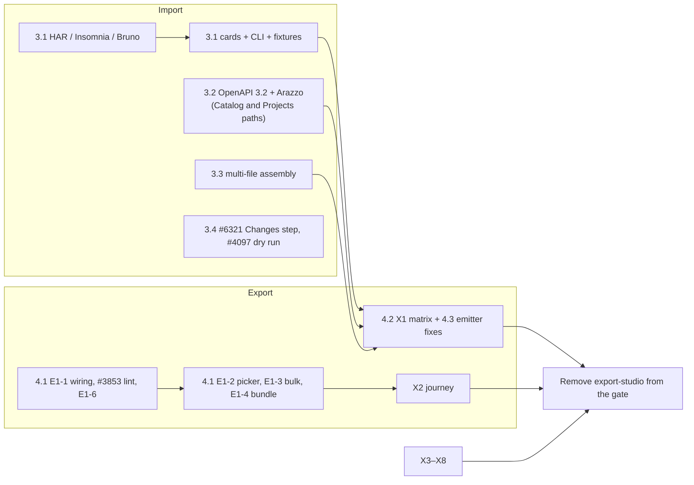

# RC7 — Catalog and Project import and export (plan of action)

_Drafted 2026-10-25. Follows [`docs/RC6_OOE.md`](RC6_OOE.md) and
[`docs/PLAN_POST_LAUNCH_ENABLEMENT.md`](PLAN_POST_LAUNCH_ENABLEMENT.md) (E1 — Catalog Exporter)._

**Status:** plan only. Nothing in this document has been enabled, disabled or moved. The code, the
feature gate (`apiome-ui/lib/feature-release.ts`) and the GitHub milestones are unchanged; §8 lists
the milestone moves this plan proposes.

## 0. Decision

RC7 is the next release. It has one theme: **getting specs into and out of the Catalog and
Projects.** It contains exactly two things, and nothing else:

1. **Complete import for the Catalog** — every import format and capability that is not yet coded
   (§3).
2. **Export studio for Catalog items and Project versions** — the E1 Catalog Exporter, including the
   hardening that lets its gate open (§4).

Everything else stays where RC6 left it (§2.2).

## 1. Where things stand (audited 2026-10-25 against `main` @ `4ef81ad33`)

**Import.** The format-matrix roadmap is built: about 99 import adapters are registered in
`apiome-rest/src/app/*_import_source.py`. Every adapter gets a source card in the import picker
(from `GET /v1/import/sources`), the generic CLI (`apiome import <format>`), and corpus fixtures
(1,468 entries in `apiome-ui/examples/corpus.manifest.json`). The corpus's two remaining
`(pending #…)` labels (RELAX NG #5434, OPC UA #5468) are stale; both adapters exist. Schematron is
imported as a style guide, not a catalog format, by design (FMT-4.3 #5436). What is left is
three missing formats, OpenAPI 3.2 gaps, per-format depth (lint, breaking rules, multi-file,
discovery) and some import-flow work. Import is not behind a feature gate.

**Export.** 54 emitters are registered (`emitter.py:load_builtin_emitters`); the target list drops
`sample`, leaving the **53 targets** RC6 promised. Every target has a fidelity pack, a target card,
a CLI command and round-trip support. Export studio exists but is gated (`export-studio`). No E1
work has landed since the E1 plan was written on 2026-10-23. Two facts matter most:

- **The conformance matrix is the long pole.** `tests/golden/roundtrip/matrix.json` (105 sources ×
  53 targets = 5,565 cells) passes **54 cells**; 5,511 are expected failures in
  `tests/roundtrip_xfails.py`. About 1,595 fail to emit (some legitimate refusals, some crashes),
  754 emit output that does not re-import (wadl 105, asn1 85, asyncapi 78, postman 76, oncrpc 70,
  protobuf 67, connectrpc 67, corbaidl 56), and about 3,000 show unexplained diffs (silent loss).
- **Eight targets only re-export their own format** (`required_source_extras`): idoc,
  cobolcopybook, edix12, fix, iso20022, iso8583, hl7v2, zosconnect. They work for a source imported
  in that format and refuse anything else.

## 2. Services to re-enable

### 2.1 Re-enable at the end of RC7

Only one feature id:

| Feature id | What it turns on | Condition |
| --- | --- | --- |
| `export-studio` | Export studio (`/ade/dashboard/export/studio`) for Catalog items and Project versions; the rail item; the studio links from Catalog, the Export dialog, the project facts card, the spec viewer and the Versions overflow | §4.4 exit criteria met |

Turning it on is the procedure in PLAN_POST_LAUNCH_ENABLEMENT §2.5: merge everything behind the
gate, test with `NEXT_PUBLIC_APIOME_PREVIEW_FEATURES=export-studio`, run on staging and internal
tenants for a week, then remove the id and restore the docs in one PR. Rollback is putting the id
back.

The places that check `export-studio` today (all flip together when the id is removed):

| File | What it gates |
| --- | --- |
| `apiome-ui/lib/feature-release.ts` | The id in `UNRELEASED_FEATURE_IDS` |
| `src/app/ade/dashboard/export/studio/layout.tsx` | The whole studio route |
| `lib/platform-nav.ts` (rail item) | Rail, command palette, `G` jump |
| `src/app/ade/dashboard/catalog/CatalogClient.tsx` | Catalog's export verb opens the studio (otherwise the dialog) |
| `src/app/ade/dashboard/catalog/[id]/CatalogItemDetailClient.tsx` | Same, on an item's page |
| `src/app/components/ade/dashboard/export/ExportDialog.tsx` | **Open in Export Studio** |
| `src/app/components/ade/versions/ProjectFactsCard.tsx` | **Export studio** button |
| `src/app/components/ade/versions/SpecViewerDialog.tsx` | Export panel deep links |
| `src/app/ade/dashboard/versions/page.tsx` → `versionsHeader.tsx` | Versions overflow item |
| `apiome-ui/src/app/components/ade/help/helpCatalog.ts` | Export studio guide sits in `UNRELEASED_GUIDE_ENTRIES` (moved with the docs restore, X7) |

### 2.2 Stays gated — not part of RC7

These are related to export or import but belong to other features. RC7 does not enable them, and
the studio must keep hiding them:

| Feature id | Why it stays off | Where it touches export/import |
| --- | --- | --- |
| `sdk-settings` | SDK generation is its own release (E5) | The studio's **SDK & branding** tab (`exportStudioTabs.ts`) is filtered by this id |
| `connectors` | Discovery/ownership release (E3) | Gateway **Push back** into the studio (`GatewayConfigClient.tsx`); the whole route is gated by `connectors` |
| `schema-registry` | E4 | Push-to-registry delivery (MFX-4.4) — no UI exists yet |
| `catalog-entities` | E4 | The **Compass export** source tile in **Import to catalog** |
| `mcp` | E6 | No MCP/agent export target exists; nothing to hide |
| `primitives`, `style-guides`, `audit`, `shadow-apis`, `dependency-graph`, `teams`, `consumers` | Not import or export | — |

## 3. Import — outstanding work

Priority: **P1** must ship in RC7; **P2** ships in RC7 if the schedule allows, otherwise it is the
first follow-up. Status is from the 2026-10-25 audit.

### 3.1 Formats not yet coded (P1)

None outstanding. HAR, Insomnia and Bruno import (#4404, #4405, #4406), the secret-scrub gate (#4407)
and their source cards, CLI verbs and fixtures (#4408) are built.

### 3.2 OpenAPI 3.2 and Arazzo import gaps (P1)

Two import paths exist: the Catalog (REST normalizer) and Projects (the UI importer). Both must
handle these.

| Ticket | Work | Status |
| --- | --- | --- |
| [#3497](https://github.com/apiome/apiome/issues/3497) | Epic for the above | All five are built on the Projects path; the Catalog side of OA3, OA5 and OA6 is still open (notes below) |

OA3 (#3500) is built on the Projects path: `itemSchema` elements of JSON Lines, JSON text
sequences and SSE import as classes tagged `x-apiome-stream-kind`, and **Analyze** lists the
streaming media types. The Catalog (REST normalizer) side was outside that issue's scope.

OA4 (#3501) is done on both paths: the Projects importer now walks `query` and
`additionalOperations`, imports their schemas and keeps each method token, and OpenAPI 3.1
export writes them to `x-apiome-query-operation` / `x-apiome-additional-operations`.

OA5 (#3502) is built on the Projects path: tags keep summary / parent / kind / externalDocs on
the project (`x-apiome-tag-taxonomy`), the parent tree is cycle-checked, and classes list their
declared tags. The Catalog side still has no tree or cycle check; that was outside the issue's scope.

OA6 (#3503) is built on the Projects path: `$ref`s resolve against a declared `$self`
(same-document references import as local, others are kept and warned about), and `$ref` sibling
summary/description are kept as local overrides. The Catalog (REST normalizer) side was outside
that issue's scope.

AZ2 (#3505) is built on the Projects path: `lib/importers/arazzo.ts` validates
`sourceDescriptions` and resolves step `operationId` / `operationPath` against the documents
supplied with the import (`sourceDocuments`), returning `arazzoResolution` on the import job. The
Import dialog and repository-file imports do not supply source documents yet.

### 3.3 Format depth (P2 unless noted)

Every format imports today. These tickets make specific formats complete.

**Multi-file assembly (P1 — today only the root file of a set is parsed):**

| Ticket | Work |
| --- | --- |
| [#3799](https://github.com/apiome/apiome/issues/3799) MFI-15.1 / [#3800](https://github.com/apiome/apiome/issues/3800) MFI-15.2 | RAML `!include` / `uses` / libraries; traits and resourceTypes resolved into the model |
| [#3981](https://github.com/apiome/apiome/issues/3981) MFI-19.3 | Thrift `include` across files |
| [#3808](https://github.com/apiome/apiome/issues/3808) MFI-17.1 | Smithy multi-file sets and JSON AST input |
| [#3794](https://github.com/apiome/apiome/issues/3794) MFI-14.1 | TypeSpec multi-file sets (and `tspconfig`, [#3798](https://github.com/apiome/apiome/issues/3798)) |

**Input variants:**

| Ticket | Work |
| --- | --- |
| [#3776](https://github.com/apiome/apiome/issues/3776) MFI-11.1 | OData CSDL JSON input and OASIS schema validation |
| [#3812](https://github.com/apiome/apiome/issues/3812) MFI-17.5 | Smithy JSON AST input (with #3808) |

**Live discovery:**

| Ticket | Work |
| --- | --- |
| [#3778](https://github.com/apiome/apiome/issues/3778) MFI-11.3 | OData service-document discovery |
| [#3790](https://github.com/apiome/apiome/issues/3790) MFI-13.3 | WSDL `?singleWsdl` and inlining of remote imports |
| [#3979](https://github.com/apiome/apiome/issues/3979) MFI-19.1 | OpenRPC `rpc.discover` |

**Lint packs** (only the cross-format pack applies today; `format_lint_capabilities.RELATED_FORMAT_LINT_ISSUES` already names these):
OData [#3779](https://github.com/apiome/apiome/issues/3779), Avro [#3786](https://github.com/apiome/apiome/issues/3786),
WS-I [#3791](https://github.com/apiome/apiome/issues/3791), TypeSpec [#3796](https://github.com/apiome/apiome/issues/3796),
RAML [#3801](https://github.com/apiome/apiome/issues/3801), API Blueprint [#3806](https://github.com/apiome/apiome/issues/3806),
Smithy [#3810](https://github.com/apiome/apiome/issues/3810).

**Breaking-change rules** (the generic classifier applies today):
OData [#3780](https://github.com/apiome/apiome/issues/3780), WSDL/XSD [#3792](https://github.com/apiome/apiome/issues/3792) (needs soapAction captured, [#3789](https://github.com/apiome/apiome/issues/3789)),
TypeSpec versioning [#3797](https://github.com/apiome/apiome/issues/3797), RAML [#3802](https://github.com/apiome/apiome/issues/3802),
Smithy [#3811](https://github.com/apiome/apiome/issues/3811).

**Avro:** PCF fingerprint [#3782](https://github.com/apiome/apiome/issues/3782) and the
compatibility engine [#3785](https://github.com/apiome/apiome/issues/3785)
(`schema_registry.COMPATIBILITY_RULES_SHIPPED` is empty).

**Other:** JSON:API / HAL / Hydra convention tagging and lint
[#3984](https://github.com/apiome/apiome/issues/3984); z/OS Connect ↔ copybook linking
[#3992](https://github.com/apiome/apiome/issues/3992).

### 3.4 Import flow (Catalog and Projects)

| Ticket | Work | Priority |
| --- | --- | --- |
| [#6321](https://github.com/apiome/apiome/issues/6321) IXH-3.7 | Import a new version into a project: a **Changes** step comparing the incoming spec with the latest version | P1 |
| [#4097](https://github.com/apiome/apiome/issues/4097) MFI-26.4 | Explicit **Dry run** in **Import to catalog** (Projects and CLI have one) | P1 |
| [#4098](https://github.com/apiome/apiome/issues/4098) MFI-26.5 | Live-discovery intake tiles, driven by the registry | P2 |
| [#4099](https://github.com/apiome/apiome/issues/4099) MFI-27.1 | Convert CTA copy and wiring | P2 |
| [#4100](https://github.com/apiome/apiome/issues/4100) MFI-27.2 | Cross-surface polish (remaining: catalog search placeholder) | P2 |
| [#3758](https://github.com/apiome/apiome/issues/3758) MFI-7.3 | Backfill format/protocol on existing rows | P2 |
| [#3754](https://github.com/apiome/apiome/issues/3754) MFI-6.2 | Cross-protocol full-text search over the normalized model | P2 |
| [#4079](https://github.com/apiome/apiome/issues/4079), [#4080](https://github.com/apiome/apiome/issues/4080), [#3715](https://github.com/apiome/apiome/issues/3715) | Epics — close when their open children close | — |

Not in RC7: [#3465](https://github.com/apiome/apiome/issues/3465) (OpenAPI components → Primitives)
belongs to the gated `primitives` feature.

### 3.5 Refresh of imported specs (P2)

Imports that come from a URL or discovery can be refreshed. Connector-driven refresh is part of
`connectors` (§2.2); these tickets are the per-artifact part that RC7 can ship without it.

| Ticket | Work | Status |
| --- | --- | --- |
| [#4398](https://github.com/apiome/apiome/issues/4398) MFI-31.1 | Per-artifact refresh cadence | Partly built (connector cadence only) |
| [#4399](https://github.com/apiome/apiome/issues/4399) MFI-31.2 | Re-discovery through the import pipeline for discovery adapters (gRPC reflection, GraphQL introspection) | Partly built |
| [#4400](https://github.com/apiome/apiome/issues/4400) MFI-31.3 | Drift badge and breaking-change notification | Partly built (change report only) |
| [#4401](https://github.com/apiome/apiome/issues/4401) MFI-31.4 | Crawl checkpoint for resume | Partly built |
| [#4402](https://github.com/apiome/apiome/issues/4402) MFI-31.5 | Version retention and pruning | Not built |

## 4. Export — outstanding work

The scope is PLAN_POST_LAUNCH_ENABLEMENT §2.2 (E1) with the 53 targets that exist. New emitters are
**not** in RC7 (appendix A).

### 4.1 Studio for Catalog items and Project versions (milestone `E1 — Catalog Exporter`)

| Ticket | Work | Status |
| --- | --- | --- |
| [#6217](https://github.com/apiome/apiome/issues/6217) E1-1 | Release wiring; keep `sdk-settings` / `connectors` pieces hidden. Remaining: separate **Export** (dialog) and **Export to another format…** (studio) verbs in Catalog | Partly built — links exist behind the gate |
| [#6218](https://github.com/apiome/apiome/issues/6218) E1-2 | Source picker (studio opened from the rail or palette today lands on a dead end) | Not built |
| [#6219](https://github.com/apiome/apiome/issues/6219) E1-3 | Bulk export from the Catalog bulk bar; multi-target in the studio; CLI `--targets`, `--items`, `--all-versions` | REST built; no UI or CLI |
| [#6220](https://github.com/apiome/apiome/issues/6220) E1-4 | Export dialog downloads the full multi-file bundle | Not built |
| [#3853](https://github.com/apiome/apiome/issues/3853) MFX-5.2 | Lint of the emitted artifact (REST verify returns `lint: null`; the UI lens is ready) | Not built |
| [#6221](https://github.com/apiome/apiome/issues/6221) E1-6 | Honest target availability; typed missing-source error, **Re-import** action, source backfill | Partly built |
| [#6234](https://github.com/apiome/apiome/issues/6234) HIVE-11.11b | Studio header: crumbs, ghost **Back to Versions** | Not built |

### 4.2 Hardening (the gate opens only when these pass)

| Ticket | Work | Status |
| --- | --- | --- |
| [#6222](https://github.com/apiome/apiome/issues/6222) X1 | Conformance matrix: no crashes, no silent loss; every refusal named. **Long pole** — see §4.3 | Harness built; 54 / 5,565 cells pass |
| [#6223](https://github.com/apiome/apiome/issues/6223) X2 | Journey in CI: import → Catalog → dialog → studio → verify → job → bundle; bulk export | Not built |
| [#6224](https://github.com/apiome/apiome/issues/6224) X3 | Accessibility: studio, source picker, bulk dialog, target grid; full keyboard path | Partly built |
| [#6225](https://github.com/apiome/apiome/issues/6225) X4 | Permission matrix: batch, recent jobs, another user's job download | Partly built |
| [#6226](https://github.com/apiome/apiome/issues/6226) X5 | Limits: size, time, batch, retention, per-tenant concurrency (not found); documented refusals | Partly built |
| [#6227](https://github.com/apiome/apiome/issues/6227) X6 | Security review — check `zip_bundle.write_zip_entry` callers sanitize entry names | Not built |
| [#6228](https://github.com/apiome/apiome/issues/6228) X7 | Restore and extend the export docs from `apiome-docs/unreleased/` | Not built |
| [#6229](https://github.com/apiome/apiome/issues/6229) X8 | Metrics dashboards and alert thresholds (in-process metrics exist) | Partly built |

### 4.3 Emitter correctness found so far (feeds X1)

| Ticket | Work |
| --- | --- |
| [#6278](https://github.com/apiome/apiome/issues/6278) | Protobuf and Thrift from OpenAPI don't compile: JSON Schema scalar names reach the IDL; Thrift field ids are all `1` (`thrift_emitter.py`), see also MFX-25.2 [#4152](https://github.com/apiome/apiome/issues/4152) |
| _new ticket needed_ | Cap'n Proto: every slot is `@0` and no file `@0x` id is generated (`capnproto_emitter.py`) — same class of bug as #6278 (MFX-30.2 [#4179](https://github.com/apiome/apiome/issues/4179)) |
| _new tickets from X1_ | Re-import failures by target: wadl 105, asn1 85, asyncapi 78, postman 76, oncrpc 70, protobuf 67, connectrpc 67, corbaidl 56 cells; emitter crashes (e.g. "LossKind has no DROP", "'Type' object has no attribute 'scalar'"). Triage per target: fix, or downgrade the pair to types-only / refused with a reason |

Validators missing in **Verify** (it reports "not applicable" today) for 15 targets: thrift,
connectrpc, flatbuffers, capnproto, wsdl, raml, wadl, openrpc, xmlrpc, xsd, postman, cloudevents,
smithy, apiblueprint, kafka-connect. Not a gate blocker; record each as "not validated" in the
matrix and the target card so the studio never implies a check that did not run.

### 4.4 Exit criteria (PLAN_POST_LAUNCH_ENABLEMENT §2.6)

- A user exports a Catalog item of any importable family, or a Project version, to any target it can
  reach — from the dialog, the studio, bulk select and the CLI — and always sees what was lost.
- X1: no crashes and no silent loss; every refusal names its reason.
- X2–X8 green; no open P0/P1 `export` bug.
- Export studio in the rail, palette and Catalog; SDK & branding and gateway push-back still hidden.

## 5. Order of work

- **Weeks 1–2:** X1 triage starts on day one (it finds the emitter work); E1-1, #3853, E1-6;
  HAR/Insomnia/Bruno adapters; OpenAPI 3.2 on the Catalog path.
- **Weeks 2–3:** E1-2, E1-3, E1-4; OpenAPI 3.2 and Arazzo on the Projects path; multi-file assembly;
  #6321, #4097. New import formats join the X1 matrix as they land.
- **Week 4:** X2–X8, docs restore, staged gate opening (§2.1).
- **P2 items** (§3.3 depth, §3.4 P2, §3.5) run alongside where capacity allows; whatever is not done
  moves to the first follow-up without blocking the gate.

## 6. Stale tickets to verify and close

The audit found the work these describe already in the code (often delivered later under FMT-/IXH-
numbers). Verify each against its acceptance criteria and close; none blocks RC7.

**Import:** #760, #2775, #2776, #3748, #3777, #3781, #3783, #3787, #3788, #3789 (except soapAction —
see #3792), #3793, #3795, #3798 (except `tspconfig`), #3803, #3804, #3805, #3807, #3809, #3982,
#3983, #3985–#3991, #3993–#3996, #4409; #3505 once the Projects importer is done. **#568** —
close as superseded (OA1 #3498 accepts 2.x–3.2).

**Export:** #3816 (epic, all children done), #3843, #3870–#3873, #3889, #3890, #3892, #3893, #3894,
#3896, #3898, #3900, #3901, #3902, #3904, #3905, #3906, #3908, #3915, #3917, #4127, #4128, #4130,
#4133, #4137, #4140, #4147, #4153, #4158, #4163–#4166, #4169, #4173, #4178, #4289, #4290, #4301,
#4302, #4304, #4345.

## 7. Risks

| Risk | Mitigation |
| --- | --- |
| X1 finds far more emitter work than four weeks allow (5,511 expected failures) | Gate on *no crash and no silent loss*, not on every pair passing: downgrade a pair to types-only or refused-with-reason rather than block |
| New import formats (HAR, Insomnia, Bruno) add matrix rows late | Land them in weeks 1–2 so X1 covers them |
| OpenAPI 3.2 has two importers that drift | One shared fixture set run against both paths; #3501/#3502 are the template |
| Re-export-only targets look broken for other sources | E1-6 shows them disabled with the reason ("only re-exports a source imported as …") |
| Restored export docs link into gated features | X7 runs `yarn docs:check` and greps for `unreleased/` targets |

## 8. Milestone `RC7` — proposed triage (not applied)

Current RC7 issues and where this plan puts them. Applying it is a separate step.

| Issue | Proposal |
| --- | --- |
| #6321 IXH-3.7 Import a new version | **Keep** (§3.4 P1) |
| #6278 Proto/Thrift export doesn't compile | **Keep** (§4.3) |
| #4311 MFX-35.1 SQL DDL emitter, #4312 MFX-35.2 DBML + Prisma | **Move to Future** — new emitters are out of RC7 (appendix A). Keep only if RC7 should add export targets |
| #6317 HIVE-14, #6274 Monaco theme contrast, #6263 first-row allowances, #5617 HIVE-13.4, #5614 HIVE-13.1, #5613 HIVE-12.6, #5611 HIVE-12.4, #5610 HIVE-12.3, #5596 / #5595 / #5594 HIVE epics | **Move out** — not import or export |

To **add** to RC7: every P1 ticket in §3 and all of §4 (the E1 milestone's 15 issues can move to RC7
or stay in E1 with RC7 as the release that ships them), plus the new Cap'n Proto ticket and the X1
triage tickets.

## Appendix A — export targets not built (deferred, not RC7)

- **Data:** SQL DDL (#4311), DBML / Prisma (#4312), Liquibase / Flyway (#4313, #795), SQL pack and
  validation (#4314, #4315), Parquet / Arrow (#4317), BigQuery / Spark (#4318), Iceberg (#4319),
  packs and cards (#4320, #4321).
- **Industry:** FIX Orchestra (#4323–#4326), UN/EDIFACT (#4146), UBL / Peppol (#4346), ISO 20022
  profile on XSD (#4135).
- **Schema:** RELAX NG and DTD output (#4134), PL/I mode (#4141).
- **REST / RPC:** Google Discovery (#4174), WSDL 2.0 option (#4182), OpenAPI 3.2 output (#4342),
  AsyncAPI 3.0 (#3876), gRPC-Gateway options (#4343), GraphQL federation mode (#4344), CSDL JSON
  (#3897), Smithy JSON AST (#3914).
- **Collections:** Insomnia / Bruno output (#4291).
- **Agent and event:** MCP tool definitions (#4295), A2A Agent Card (#4296), agents.json / llms.txt
  (#4297), packs and cards (#4298, #4299), xRegistry (#4306–#4309), multi-format registry subjects
  (#4183).
- **Healthcare:** FHIR R5 (#4157, #4161).
- **Generate-from-any-source** for the eight re-export-only targets (copybook #4139, X12 #4145,
  HL7 v2 #4159, …).

## Appendix B — other export work deferred

Delivery channels (MFX-EPIC-38: #4328–#4331, #4381), push-to-registry (#3851, #3912), presets,
schedules and auto-export (#4335–#4337, #4382), MCP export tools (#4339–#4341), test-drive tooling
(#4366–#4372), visualizations (#4373–#4377), export history screen (#4379), round-trip Monaco diff
(#3858, #4364), toolchain-backed validators (#3865, #3895, #3899, #3903, #3907, #3916, #4129,
#4136, #4142, #4148, #4154, #4160, #4170, #4180), WSDL multi-file output (#3891).
