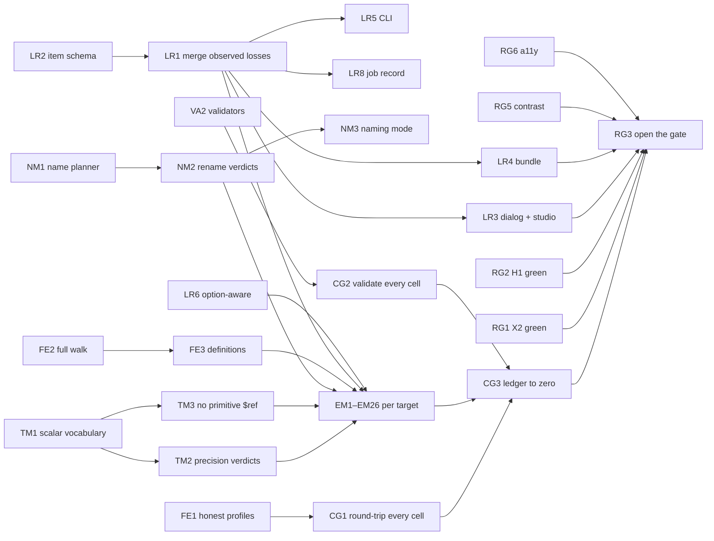

# RC7 — Ship plan: Projects, Catalog and Export studio (MVP → V2)

_Drafted 2026-10-28 against `main` @ `844cb2240`. This is the working checklist that ships RC7. It
builds on [`RC7_CATALOG_IMPORT_EXPORT.md`](RC7_CATALOG_IMPORT_EXPORT.md) (the original plan and its
history) and replaces that document's §0.1 as the list of what is left._

**Status: RC7 cannot ship today.** Import is complete and every original E1/X ticket is closed, but
an audit of all 53 export targets on 2026-10-28 found that exports routinely **lose or change data
without telling the user**, and that many targets **write files their own format rejects**. The
export studio gate is still closed, and the exporter journey has never passed in CI.

**Progress (2026-10-29):** ✅ done — R7-EM12 (Smithy), R7-EM13 (TypeSpec), R7-FG5 (Smithy JSON AST).
◐ partly done — R7-EM5 (RAML: valid output shipped; [#3902](https://github.com/apiome/apiome/issues/3902) open),
R7-EM14 (OpenRPC shipped; XML-RPC open), R7-EM17 (OData and FHIR shipped;
[#4161](https://github.com/apiome/apiome/issues/4161) open). Rows are marked ✅ / ◐ below; everything unmarked is open.

**The requirement this plan is built around:** every export tells the user, before and after it
runs, everything the conversion from the catalog item to the target format loses or changes —
**type precision** (`int64` → `int`), **definitions** (descriptions, defaults, constraints,
examples, errors, security), **naming conventions** (`firstName` → `FIRST-NAME`, `active` →
`STATUS_ACTIVE`, `get-pet` → `getPet`), **structure** (flattened unions, maps as lists) and
**invented values** (field numbers, ids, placeholder hosts). That report is part of the RC7
shipment — in the product, in the API, in the CLI and inside every downloaded bundle (§3).

---

## 0. Summary

| Area | State on 2026-10-28 | What ships RC7 |
| --- | --- | --- |
| Import into Catalog and Projects | ✅ Done (RC7 plan §3); 100 formats, 0 parity gaps | Parity fix for OpenAPI 3.2 on the Catalog path, Bruno/Zod currency (§9, §10) |
| Export studio, dialog, bulk, CLI | ✅ Built ([#6217](https://github.com/apiome/apiome/issues/6217)–[#6221](https://github.com/apiome/apiome/issues/6221), [#6234](https://github.com/apiome/apiome/issues/6234), [#3853](https://github.com/apiome/apiome/issues/3853)) | Open the `export-studio` gate (§8) |
| Hardening X1–X8 | ✅ Tickets closed, ❌ X1 and X2 not actually met | Redefine X1 (§6), make X2 green (§8) |
| **What the user is told is lost** | ❌ A *prediction* only; real emit-time losses are discarded; no report in the download | **One loss report everywhere (§3)** |
| **Correctness of emitted files** | ❌ Broken output in ≥ 20 targets (dangling `$ref`s, undeclared prefixes, invalid identifiers, type names leaked) | Per-target fixes (§5) |
| Conformance matrix | 628 tracked silent-loss pairs, but the gate never round-trips a "lossy" cell, so the true number is higher | Every cell round-tripped and validated; ledger at zero (§6) |
| Open tickets in scope | 318 open; 74 already done, 104 partial or folded | Close or finish in RC7 (§11); the rest move to [RC8](RC8_PLAN.md) |

**Ticket count for RC7: 85 new `R7-` tickets** (60 MVP — gate blockers, 25 V2 — ship in RC7 after the
gate), **74 existing tickets to close** as already done, and **104 existing tickets (epics included)
finished through the R7 tickets.** Index in §12.

### How this was checked

Six read-only audits ran on 2026-10-28, each against `main`:

- three loss audits covering all 53 emitters, with a probe model run through every emitter and its
  fidelity report;
- a check of the 190 open MFX tickets against the code;
- a check of the 137 other in-scope tickets and the product surface;
- a format gap analysis.

The headline claims were re-verified by hand:

- OpenAPI export writes a dangling `$ref` to `#/components/schemas/int64` for `01-simple-user.proto`.
- `emitter.py:985` writes `$ref` for any non-JSON-Schema scalar.
- Avro, Kafka Connect and XSD map `integer` to 32-bit (`avro_emitter.py:89`,
  `kafka_connect_emitter.py:119`, `xsd_emitter.py:51`).
- `EmitResult.losses` is read by no export route.
- The exporter journey failed 8 of 8 completed runs.

Where an audit only read code rather than ran a compiler, the ticket says so. Audit reports with
file:line evidence for every finding are attached to the RC7 tracking issue (see §13).

---

## 1. Definition of shipped (replaces RC7 plan §4.4)

RC7 ships when all of these hold on `main`:

1. **Every export carries a complete loss report** (§3): predicted before the run, final after it,
   grouped by category, present in the dialog, the studio, REST, the CLI and the downloaded bundle.
2. **No silent loss:** across the conformance matrix (108 source families × 53 targets), every
   exported cell is round-tripped, and every difference between the source and the re-imported
   artifact is explained by an item in that export's report (§6). The ledger is empty.
3. **No invalid output:** every exported cell whose target has a validator passes it; targets
   without one say "not validated" (§7).
4. **No crashes;** every refusal names its reason (already true).
5. **X2 journeys green** and required on pull requests and `main` (§8).
6. **X3–X8 green**, including the owed X6 `/security-review` and X8 staging week (§8).
7. **The gate is open:** `export-studio` is removed from `UNRELEASED_FEATURE_IDS`; SDK & branding
   and gateway push-back stay hidden (§8).
8. **No open MVP ticket** in §12, and every V2 ticket closed or moved to RC8 with a reason
   ([`RC8_PLAN.md`](RC8_PLAN.md) §1).

---

## 2. Where things stand

### 2.1 Conformance matrix today (`tests/golden/export_conformance/matrix.json`)

108 families × 53 targets = 5,724 cells: **98 ok · 3,170 lossy · 628 silent-loss · 1,828 refused ·
0 crash.**

The gate (`tests/export_conformance.py:102-104`) only round-trips a cell whose fidelity report is
**empty**. Two things hide the real number:

- 25 targets declare `field_identity=True` without writing field numbers, which puts a false
  "field number synthesized" item in almost every report.
- An artifact that cannot be read back counts as `ok`: all 22 WADL "ok" cells and all 14 ASN.1
  "ok" cells are re-import failures.

The 3,170 "lossy" cells are therefore **unchecked**. Expect the silent-loss count to rise when R7-CG1
lands, then fall as §3–§5 land.

### 2.2 How the loss report works today

- **What the user sees** is `export_fidelity.build_export_fidelity` → `compute_lossiness_for_emitter`
  → the target's rule pack (`fidelity_rulepack.CapabilityRulePack`). That is a **prediction** from the
  canonical model and the target's capability profile.
- **What the emitters record** while writing (`EmitResult.losses`: renames, unmapped types, cycle
  cuts, synthesized ids, placeholder hosts, downgrade losses) is **read by no export route**. Only
  `conversion_projection.py` and three `*_roundtrip.py` modules use it. The real record of what the
  export did is thrown away.
- The prediction ignores emit options (`export_fidelity.py:250`), so OpenAPI 3.0/2.0 downgrades,
  AsyncAPI 2.6, Avro IDL output and gateway naming options change the output without changing the
  report.
- The rule-pack walk (`fidelity_rulepack.py:338-349`) visits types, fields, operations and channels
  only. It never sees enum values, union variants, services, parameters, responses, errors, servers,
  security, descriptions, defaults, examples or extensions, so it cannot report losing them.
- **Downloads carry nothing.** A single-target bundle's `manifest.json` has no fidelity data
  (`export_job_engine.py:1546-1553`). A batch manifest has only `tier` and `preserved_percent`
  (`export_batch.py:207`).
- Only Cap'n Proto reports identifier renames ([#4179](https://github.com/apiome/apiome/issues/4179)). Every other target that renames does so
  silently.

### 2.3 Release gate and CI

- `export-studio` is still in `UNRELEASED_FEATURE_IDS` (`apiome-ui/lib/feature-release.ts:33`).
  The studio docs and in-app help are already live, so users are sent to buttons they cannot see
  (`getting-started/browse-and-export.mdx:29-42`, `build/versions.mdx`, `bring-in/catalog.mdx:179`,
  `helpCatalog.ts:171-185`).
- **X2 exporter journey: 0 green of 8 completed runs** since [#6223](https://github.com/apiome/apiome/issues/6223). It fails with a strict-mode
  violation at `catalog-exporter-journey.spec.ts:153`: `getByTestId('export-ack')` matches 2
  elements (`FidelityWarningPanel.tsx:249`).
- **RC6-H1 Catalog → Project journey** is red on 5 of the last 7 PR runs. The converted-project
  link never appears, and an Export-dialog download was not a readable zip. Its workflow runs only
  on `pull_request`, so `main` gets no signal.
- `export-conformance.yml` is green, but it only enforces the shrinking ledger.

---

## 3. The export loss report (headline requirement)

### 3.1 What every report contains

One report per export, built from two sources and reconciled:

- **predicted** — the rule pack, before anything runs (dry run, studio Review, the dialog);
- **observed** — what the emitter actually did (`EmitResult.losses`), plus the round-trip check
  where a validator or importer exists.

Each item says **what** (the construct key and a JSON Pointer into the output), **which category**,
**from → to** values, **severity** (info / warn / critical) and **whether it was predicted or
observed**.

| Category | What it covers | Examples |
| --- | --- | --- |
| **Naming** | Any identifier the target writes differently from the source: case convention, sanitized characters, reserved-word escapes, length truncation, de-duplication suffixes, qualification | `first_name` → `firstName` (Cap'n Proto); `firstName` → `FIRST-NAME` (COBOL); `active` → `STATUS_ACTIVE` (Protobuf, idiomatic mode); `get-pet` → `getPet`; `Address` → `BillingAddress` (dedupe); route `GET /pets/{petId}` → `get-pets-petid` (gateways) |
| **Type precision** | Narrowing, widening, sign, decimal → float, float width, formats with no native type, nullability, big integers | `integer`+`int64` → Avro `int` (32-bit); `uint64` → Thrift `i64`; `decimal` → `double`; `date-time` → `string`; nullable `T` → required `T` |
| **Definitions** | Documentation and rules the target cannot carry or that are not written | descriptions, `deprecated`, defaults, examples, constraints (min/max/pattern/length), `x-` extensions, enum value descriptions |
| **Structure** | The shape changed | union → struct with a `union` group or a discriminator field; map → list of entries; inline/anonymous types lifted or flattened; recursion cut; field order changed; `allOf` merged |
| **Behaviour** | API surface not carried | operations, error responses, status codes, path/query/header parameters, streaming modes, channels/events, servers, security schemes, callbacks, links |
| **Identity** | Values invented so the target is valid | Protobuf/Thrift/Cap'n Proto field numbers, the Cap'n Proto file id, OData `$Key`, CloudEvents `source`/`type`, Kubernetes group/kind/plural |
| **Placeholders** | Values that must be replaced before the artifact is used | invented upstream hosts, ports and backends in gateway configs, placeholder integrations |

### 3.2 Where it appears

| Surface | Before the run | After the run |
| --- | --- | --- |
| Export dialog | Summary by category with counts, worst first, plus the "may lose fidelity" acknowledgement (exists) | Final report; differences from the prediction are highlighted |
| Export studio | **Review** step: full report, filter by category and severity, a **Naming changes** table (before → after, rule applied), a **Type changes** table | **Verify** step: final report, validator verdict, round-trip result |
| REST | `POST …/preview`, dry-run jobs: `fidelity.report` (exists, gains categories) | export and job results: `fidelity.report` is the final reconciled report; `GET …/jobs/{id}` keeps it |
| CLI | `apiome export … --dry-run`: table grouped by category (exists, ungrouped) | after the write: final table; `--json` returns the full report; exit code unchanged (lossy is non-zero) |
| **Downloaded bundle** | — | `fidelity-report.json` (machine-readable) and `LOSSES.md` (readable) in every zip, single-target and batch, listed in `manifest.json` with tier and counts per category; a single-file download offers the report next to it |
| Docs | Per-target page section "What this target cannot carry", generated from the rule packs | Release notes and Export a spec explain the categories |

### 3.3 Tickets — loss report (R7-LR)

| ID | Tier | Title | Scope |
| --- | --- | --- | --- |
| R7-LR1 | MVP | Merge observed emit-time losses into the export report | After every emit (dispatch, job, batch), fold `EmitResult.losses` into `fidelity.report`, de-duplicated against predicted items by construct + category; mark each item `predicted` / `observed`. Dry runs stay predicted-only and say "estimated". `export_dispatch.py`, `export_job_engine.py`, `export_batch.py`, `export_fidelity.py` |
| R7-LR2 | MVP | Loss item schema: category, from/to, output pointer, origin | `LossItem` gains `category` (§3.1), `source_value`, `target_value`, `rule` (e.g. "UPPER_SNAKE", "NCName", "≤ 30 chars"), `output_pointer`, `origin`. `LossTracker.record` gains the same fields; every emitter's `losses.record` call is categorized. Bump OpenAPI; CLI and UI read the new fields |
| R7-LR3 | MVP | Report in the Export dialog and studio, grouped by category | Dialog summary by category; studio Review and Verify get category and severity filters plus **Naming changes** and **Type changes** tables. Uses existing `FidelityWarningPanel`, `FidelityLossHeatmapPanel` and `EvidenceDrawer`; CSS classes only; axe-clean (X3); screenshots |
| R7-LR4 | MVP | Report inside every downloaded bundle | `fidelity-report.json` + `LOSSES.md` in single-target and batch zips; `manifest.json` lists them and carries tier and per-category counts; batch items carry their own report; the single-file download offers **Download loss report**. Security review of the generated Markdown (names come from imported specs) |
| R7-LR5 | MVP | CLI: category-grouped loss table and full `--json` report | `apiome export` prints the final report grouped by category after the write, the predicted one with `--dry-run`; `--report <path>` writes `fidelity-report.json` |
| R7-LR6 | MVP | Option-aware report | Pass the validated emit options to `fidelity_rule_pack` / `compute_lossiness_for_emitter` (`export_fidelity.py:250`), so `openapi_version`, `asyncapi_version`, Avro `output_syntax`, gateway `service_naming`, http-file dialect, JSON Schema dialect and the naming mode (R7-NM3) change the prediction |
| R7-LR7 | MVP | Reconciliation check: no observed loss without a predicted verdict | CI test over the corpus: for each target, every `losses.record` subject observed on a family appears as a predicted item for that family (or is on an explicit allow-list with a reason). Keeps the dialog's pre-run report honest |
| R7-LR8 | MVP | Report kept with the job and shown in Recent export jobs | The final report is stored with the job record and returned by `GET …/jobs/{id}`; **Recent export jobs** links to it; retention follows the artifact (24 h) and the summary (tier and counts) is kept with the job |
| R7-LR9 | V2 | Docs: "What an export tells you" and per-target "cannot carry" lists | New Ship page on the loss report categories; generate a per-target "what this target cannot carry" table from the rule packs (extend `scripts/generate_export_target_tiers_doc.py`), drift-tested |

---

## 4. Shared fixes behind the report (one fix, many targets)

These come before the per-target work in §5: most per-target findings are instances of them.

### 4.1 Type precision (R7-TM)

| ID | Tier | Title | Scope |
| --- | --- | --- | --- |
| R7-TM1 | MVP | One scalar vocabulary for every emitter | Extend `app/scalar_aliases.py` (today used by protobuf, thrift, capnproto only) with a `*_SCALAR_FOR_KIND` table per target: avro, kafka-connect, xsd, wsdl, wadl, asn1, flatbuffers, json-schema, jtd, cddl, corbaidl, oncrpc, graphql, smithy, typespec, wit, odata, fhir, xmlrpc, raml, apiblueprint and the shared `SchemaEmitter`. Each reads the field's `format`. **No emitter writes a canonical spelling (`integer`, `number`, `boolean`, `int64`, `uint64`, `decimal`) as a type name.** Fixes the [#6278](https://github.com/apiome/apiome/issues/6278) class of bug everywhere |
| R7-TM2 | MVP | Precision verdicts with from → to values | One helper in `fidelity_rulepack.py`, driven by the same per-target table so prediction equals emission: narrowing (`int64` → 32-bit), widening, sign loss (`uint64` → signed), `decimal` → float, float width, format → string (`date`, `date-time`, `uuid`, `uri`, `email`, `byte`), unknown → `string`/`Text`/`any`. Category **Type precision** |
| R7-TM3 | MVP | Schema writer never emits a `$ref` to a primitive | `emitter.py:888, 981-985` (`SchemaEmitter.type_ref`): resolve scalar names through `canonical_json_schema.CANONICAL_SCALAR_SCHEMAS`/R7-TM1; keep description, default and deprecated next to `$ref` (3.1 allows siblings; reverse the pin in `test_emitter.py:296`). Corpus test "every `$ref` resolves" for openapi, aws-apigateway, azure-apim, asyncapi, openrpc, llm-tools, cloudevents, postman. **Fixes broken OpenAPI for 50 source families** |
| R7-TM4 | MVP | Nullability kept or reported | OpenAPI 3.1 keeps `type: [T, "null"]` (`emitter.py:957`); XSD writes `minOccurs="0"`/`nillable`; IDL targets report nullable → required; native emitters stop reporting false "becomes optional" items |
| R7-TM5 | V2 | Native logical types where the target has them | Avro `logicalType` (timestamp, date, uuid, decimal), XSD `xs:date`/`xs:dateTime`/`xs:decimal`, CDDL `tdate`/`uri`/uuid tags, ASN.1 `DATE`/`TIME`, Kafka Connect `Decimal`/`Timestamp`, JTD `timestamp`, Protobuf well-known types as an option |

### 4.2 Naming conventions (R7-NM)

| ID | Tier | Title | Scope |
| --- | --- | --- | --- |
| R7-NM1 | MVP | Shared export name planner | Lift `capnproto_names.py` into `app/export_names.py`: per-target rules for character set, case convention, reserved words, length limits and scoped de-duplication. **The writer and the rule pack call the same planner**, so the report names exactly what was written (fixes Cap'n Proto's `firstName2` written / `firstName` reported mismatch) |
| R7-NM2 | MVP | Rename verdicts for every renamed construct | Category **Naming**, with before → after and the rule. Covers types, fields, enum values, union variants, operations, services, parameters, component keys, routes and file names. Targets that rename today without saying so: avro (`-` → `_`), cddl, asn1, flatbuffers, xsd/wsdl/wadl (NCName), k8s-crd (kind/plural/group), protobuf (illegal characters → `_`), graphql, wit (kebab-case), llm-tools (truncate/dedupe), smithy, typespec, odata, openapi (component keys, synthesized operationIds and paths), azure-apim (operationId), the six gateways (route/flow names from `slug_name(operation.key)`, `dns_label`, 255-char truncation), http-file (camelCase request and variable names), client collections, arazzo (workflowId/stepId) |
| R7-NM3 | V2 | Naming mode option: preserve or idiomatic | New emit option `naming: preserve \| idiomatic` (default `preserve`: change only what the target requires). `idiomatic` applies the target's style guide: Protobuf `snake_case` fields and `UPPER_SNAKE` enum values prefixed with the enum name; GraphQL `camelCase` fields, `PascalCase` types and `SCREAMING_CASE` enum values; COBOL `UPPER-HYPHEN` (≤ 30 chars); Avro; WIT kebab-case; Smithy; OData. Every change is reported by R7-NM2, and the report is option-aware (R7-LR6) |
| R7-NM4 | MVP | Legal identifiers in every target | The shared part of the §5 fixes: OpenAPI component keys with `/` or `:` (from wsdl, xsd, wit, k8s-crd sources); WSDL, XSD and WADL NCNames; Thrift and CORBA (`get-pet` left as is); ASN.1 module and type case (`myapiv2` is rejected); FlatBuffers (`legacy-code:`); TypeSpec backtick escaping; Smithy shape names; OData identifiers |

### 4.3 An honest fidelity engine (R7-FE)

| ID | Tier | Title | Scope |
| --- | --- | --- | --- |
| R7-FE1 | MVP | Capability profiles that match what each emitter writes | `field_identity` is false for asn1, cddl, flatbuffers, json-schema, jtd, xsd, cobolcopybook, corbaidl, oncrpc, typespec, openrpc, xmlrpc, odata, fhir, apiblueprint, raml, wadl, wsdl, arazzo. `operations` is false for odata and fhir unless they write Actions/OperationDefinitions. Set `constraints`, `nullability` and `unions` to what each writes. Re-baseline the matrix (expected to unmask silent loss) |
| R7-FE2 | MVP | Rule-pack walk covers the whole model | New optional hooks in `FidelityRulePack.evaluate` (`fidelity_rulepack.py:338-349`), defaulting to no verdict: enum values, union variants, services, agents, parameters, messages and responses, errors, servers, security schemes, and per-construct documentation |
| R7-FE3 | MVP | Report dropped definitions, or write them | Shared verdicts for description, deprecated, default, example and `x-` extensions, driven by new per-target capabilities. Where the target supports them, write them instead: doc comments (FlatBuffers `///`, ASN.1 `--`, Smithy/TypeSpec docs, XSD `xs:annotation`), JTD metadata, GraphQL `@deprecated`, Smithy `@default` |
| R7-FE4 | MVP | Remove false and misleading verdicts | "constraints → doc comment" when no comment is written (every IDL target, Postman, RAML, API Blueprint); protobuf "nullable → optional", "Any", "Struct" texts (pinned at `test_fidelity_rulepack.py:828`); backwards nullability verdicts on all-mandatory targets; false nullability items on the 8 native emitters; Kong "OK" for every operation; XML-RPC "OK" for operations it does not write; OData/FHIR operation claims; the Avro operation DROP when `output_syntax=avdl` keeps them |
| R7-FE5 | V2 | Rule-pack hygiene | Delete dead `event_verdict`/`field_verdict` hooks (7 packs, including Cap'n Proto) and shadowed `target_label` attributes |

---

## 5. Correct output, target by target (R7-EM)

Every ticket here is **MVP** unless marked: wrong or unreadable output is a silent loss by
definition. Each fix comes with a validator-backed test (§7) and at least one foreign-source golden
(R7-CG4).

### 5.1 REST, document and gateway targets

| ID | Tier | Targets | Title and scope | Existing tickets finished |
| --- | --- | --- | --- | --- |
| R7-EM1 | MVP | openapi, aws-apigateway, azure-apim | **OpenAPI schema fidelity.** Keep nullability, `$ref` siblings, the scalar base type, union discriminators and enum names (`emitter.py:957-1092`, `openapi_emitter.py:979`); depends on R7-TM3/TM4 | — |
| R7-EM2 | MVP | openapi | **Same-format export keeps what import absorbed.** OpenAPI → OpenAPI reports 0 losses on 33 corpus files but loses data on 32: `examples`, `const`, `allOf`, `discriminator`, `if/then/else`, `prefixItems`, `x-*`, `securitySchemes`, `externalDocs`, tag descriptions. Wire `preservation_envelope.apply_envelope` into the OpenAPI emit path, or report every unabsorbed pointer | — |
| R7-EM3 | MVP | openapi | **Collisions are reported, not overwritten.** Two operations with the same method and path (`openapi_emitter.py:579`) and two responses with the same status (`:785`); reuse `record_method_path_collisions`. Gateway `ANY` routes become real operations, not only `x-apiome-*` | — |
| R7-EM4 | MVP | wadl, wsdl | **Valid WADL and WSDL.** Declare `xmlns:tns` (`wadl_emitter.py:171`, `wsdl_emitter.py:172`); arrays as `maxOccurs="unbounded"`, not `xsd:string`; WADL root-path resources (today every operation on `/` is dropped); WSDL parameters; NCNames (R7-NM4). **Fix the WADL importer's detection** (`wadl_parser.py:94` looks for a literal `<application`), which rejects every WADL export: 108/108 round trips fail | [#3889](https://github.com/apiome/apiome/issues/3889), [#4173](https://github.com/apiome/apiome/issues/4173) |
| R7-EM5 | MVP | raml | ◐ **Partly done** — the RAML 1.0 emitter ships ([#6408](https://github.com/apiome/apiome/pull/6408)); the RAML fidelity pack [#3902](https://github.com/apiome/apiome/issues/3902) is open. **Valid RAML.** `#%RAML 1.0` on the first line, no `any:` method, escaped title and version | [#3901](https://github.com/apiome/apiome/issues/3901) |
| R7-EM6 | MVP | apiblueprint, raml, wadl, wsdl | **Document emitters carry the HTTP surface.** Status codes from `message.status_code` (today only `extras["http_status"]`, so 200 everywhere); error responses; query and header parameters; operations with no HTTP binding are DROPped with a verdict (today they silently become `GET /`) | [#3905](https://github.com/apiome/apiome/issues/3905), [#3906](https://github.com/apiome/apiome/issues/3906) |
| R7-EM7 | MVP | postman | **Real Postman requests.** Bodies are examples, not `{"$ref": …}`; responses are written; a types-only source is refused with a reason (today an empty collection with an empty report). Rebase request planning on `client_collection_emit.plan_collection` and its pack. Auth mapping | [#4289](https://github.com/apiome/apiome/issues/4289), [#4290](https://github.com/apiome/apiome/issues/4290) |
| R7-EM8 | MVP | arazzo | **Arazzo from a non-Arazzo source.** Today the document has no `sourceDescriptions` and dangling operationIds. Refuse with a reason, or synthesize the source description, with a root DROP for types, parameters and responses and the "captures workflows only" advisory | [#3871](https://github.com/apiome/apiome/issues/3871) |
| R7-EM9 | MVP | kong, gateway-api, envoy-xds, istio, traefik, apigee | **Gateway paths and placeholders.** An exact source path stays exact (`gateway_config_emitter.py:314` widens it to a prefix); params, bodies, auth and plugins dropped are reported; invented upstreams, hosts, ports and backends (portless Gateway API `backendRef`) are **Placeholder** items marked "replace before applying" | — |

### 5.2 RPC, IDL and event targets

| ID | Tier | Targets | Title and scope | Existing tickets finished |
| --- | --- | --- | --- | --- |
| R7-EM10 | MVP | protobuf, connectrpc | **Protobuf correctness.** Prefer the 2xx response over the error body as the rpc response (`proto_emitter.py:1252`); import the root-package file; resolve scalar union members, aliases and scalar types; maps whose values are lists or messages; enum values scoped per enum; dropped HTTP parameters reported (R7-EM15) | — |
| R7-EM11 | MVP | thrift, corbaidl, oncrpc | **IDL targets valid for foreign sources.** Thrift/CORBA: integer enum values (not `active = active`), unions from members, typedefs for alias/scalar/map, throws only of exception types with unique ids, CORBA `bytes` → `sequence<octet>`. ONC RPC: emit every record (today only `oncrpc_kind == "struct"`, `oncrpc_emitter.py:180`), `<>` lists and `opaque<>`, unique procedure numbers. Gate with `rpcgen`, `thrift`, `omniidl` where available | [#4151](https://github.com/apiome/apiome/issues/4151), [#4168](https://github.com/apiome/apiome/issues/4168) |
| R7-EM12 | MVP | smithy | ✅ **Done** ([#6416](https://github.com/apiome/apiome/pull/6416), [#6417](https://github.com/apiome/apiome/pull/6417)). **Valid Smithy IDL.** Sanitized names, a derived namespace, lists, union members, aliases as simple shapes, int64 → `Long`, `@default`/`@deprecated`/constraint/`@http`/`errors` traits; today it records no losses at all | [#3914](https://github.com/apiome/apiome/issues/3914), [#3915](https://github.com/apiome/apiome/issues/3915) |
| R7-EM13 | MVP | typespec | ✅ **Done** ([#6418](https://github.com/apiome/apiome/pull/6418), [#6419](https://github.com/apiome/apiome/pull/6419)). **TypeSpec declares every referenced type.** MAP → `Record<>`, union/alias/scalar declarations, `number` → `float64`, backtick escapes, route/verb/optional parameters, enum values, defaults, `#deprecated`; today it never records a loss | [#3893](https://github.com/apiome/apiome/issues/3893), [#3894](https://github.com/apiome/apiome/issues/3894) |
| R7-EM14 | MVP | openrpc, xmlrpc | ◐ **Partly done** — OpenRPC done ([#6420](https://github.com/apiome/apiome/pull/6420), [#6421](https://github.com/apiome/apiome/pull/6421)); XML-RPC open. **OpenRPC and XML-RPC tell the truth.** OpenRPC: component keys match the `$ref`s, `errors[]`, deprecated, parameters. XML-RPC: write every operation or DROP each one (today one call is written and every operation reported OK); params from the request payload; lists, `dateTime.iso8601`, `base64`; recursion guard | [#4301](https://github.com/apiome/apiome/issues/4301), [#4302](https://github.com/apiome/apiome/issues/4302) |
| R7-EM15 | MVP | protobuf, connectrpc, capnproto, thrift, corbaidl, oncrpc, graphql, smithy, typespec | **RPC targets report the dropped HTTP surface.** Path, query and header parameters, extra and error responses, the method/path binding — reported as **Behaviour** items, or mapped into the request message (option) | — |
| R7-EM16 | MVP | graphql | **GraphQL keeps more and says more.** Honour `deprecated` (`@deprecated`); report dropped error responses; map scalars through R7-TM1 instead of `String` for everything | — |
| R7-EM17 | MVP | odata, fhir | ◐ **Partly done** — OData ([#6422](https://github.com/apiome/apiome/pull/6422), [#6423](https://github.com/apiome/apiome/pull/6423)) and FHIR ([#6424](https://github.com/apiome/apiome/pull/6424), [#6425](https://github.com/apiome/apiome/pull/6425)) emitters and fidelity packs done; the HL7 validator run and [#4161](https://github.com/apiome/apiome/issues/4161) (target cards, CLI, fixtures) are open. **OData and FHIR rendered from the canonical model.** Stop replaying stale import extras. OData: Edm type mapping, legal identifiers, integer enum ordinals, a synthesized `<Key>` flagged as **Identity**, declared union and map types, the right EntitySet binding. FHIR: every type, `max "*"` for arrays, FHIR type codes | [#3897](https://github.com/apiome/apiome/issues/3897), [#3898](https://github.com/apiome/apiome/issues/3898), [#4157](https://github.com/apiome/apiome/issues/4157), [#4158](https://github.com/apiome/apiome/issues/4158) |
| R7-EM18 | MVP | cloudevents, llm-tools | **Stop fabricating.** CloudEvents: write `data`/`dataschema`, deterministic `id`, SYNTH verdicts for `source`/`type`, refuse instead of inventing a fallback event. LLM tools: no invented "submit record" tools when filtering leaves none (`tool_projection.py:1396`); report deprecated operations it excludes | — |
| R7-EM19 | MVP | asyncapi | **AsyncAPI report gaps.** Key renames and the 2.6 downgrade are reported as predicted items (today only emit-losses); scalar `$ref`s fixed by R7-TM3 | — |

### 5.3 Data-schema targets

| ID | Tier | Targets | Title and scope | Existing tickets finished |
| --- | --- | --- | --- | --- |
| R7-EM20 | MVP | xsd | **XSD structural correctness.** Declare the `tns` namespace (xmlschema rejects the file today); lists → `maxOccurs="unbounded"`; nullable → `minOccurs="0"`/`nillable`; unions (`xs:choice`), maps and aliases emitted or DROPped; facets (pattern, length, range); a mapping module shared with WSDL | [#4132](https://github.com/apiome/apiome/issues/4132), [#4133](https://github.com/apiome/apiome/issues/4133) |
| R7-EM21 | MVP | json-schema, jtd | **JSON Schema and JTD keep what they support.** JSON Schema: `format`, constraints, `default`, `deprecated`, `x-*`, MAP → `additionalProperties`, nullable `$ref`; no `"type":"uint64"` or `"type":"acme.billing.Address"`. JTD: numbers are not `"type":"string"` (int8–uint32, float32/64), `timestamp`, `values` for maps, `metadata.description` | [#4126](https://github.com/apiome/apiome/issues/4126), [#4127](https://github.com/apiome/apiome/issues/4127), [#4128](https://github.com/apiome/apiome/issues/4128) |
| R7-EM22 | MVP | cddl, json-schema, jtd, xsd, asn1, flatbuffers, k8s-crd | **Reference types by key; de-duplicate same-named types.** Two `Address` types overwrite each other (`$defs`) or fail validation (CDDL). Qualify or de-duplicate the emitted names and report each as a rename. Clears the 60+ cddl/json-schema/jtd/xsd ledger entries | — |
| R7-EM23 | MVP | asn1, flatbuffers, avro | **Valid identifiers and literals.** ASN.1: module/type/identifier case, CHOICE names, `name(int)` enums, `DEFAULT` vs `OPTIONAL`, literals (`OPTIONAL DEFAULT True` today). FlatBuffers: identifiers, integer enum values, defaults, declared map/alias/scalar types. Avro: a non-null default puts the value branch first. Validator-backed tests (asn1tools; flatc where available) | [#4163](https://github.com/apiome/apiome/issues/4163), [#4164](https://github.com/apiome/apiome/issues/4164), [#4178](https://github.com/apiome/apiome/issues/4178) |
| R7-EM24 | MVP | avro, kafka-connect, xsd | **int64 is never narrowed silently.** `integer` + `format: int64` → `long`/`int64`/`xs:long`; bare `integer` stays 32-bit with a precision verdict (R7-TM2). Today `avro_emitter.py:89`, `kafka_connect_emitter.py:119` and `xsd_emitter.py:51` ignore the format; `test_kafka_connect_emitter.py:283` pins the bare case | — |
| R7-EM25 | MVP | odcs, k8s-crd | **No dropped root types.** ODCS skips any record that references itself (the probe's main `Customer` vanished; `odcs_emitter.py:956-968`). K8s CRD picks the first type by key as the root (a map in the probe). Pick sensible roots, name them in a root verdict, DROP verdicts for unreachable types; report kind/plural/group/version synthesis as **Identity** | — |
| R7-EM26 | MVP | cobolcopybook, edix12, fix, hl7v2, idoc, iso20022, iso8583, zosconnect | **Native passthrough emitters honour edits.** They rewrite the import-time extras tree, so after a field rename or removal in the catalog the output is byte-identical. Detect divergence between the canonical model and the extras tree; refuse with a reason, or project the edits and report them. Fix COBOL fixed `OCCURS` and numeric 88 `VALUE` | [#4139](https://github.com/apiome/apiome/issues/4139), [#4140](https://github.com/apiome/apiome/issues/4140) |
| R7-EM27 | V2 | cddl, kafka-connect, odcs | **Field order kept** (alphabetical today for foreign sources), or reported as **Structure** | — |
| R7-EM28 | V2 | edix12, zosconnect, iso8583 | **Report synthesized envelope defaults** (ISA ids, control numbers, 15-char truncation; name/version/codepage; `ans`) as **Identity** items | [#4147](https://github.com/apiome/apiome/issues/4147) |

---

## 6. The conformance gate (X1, redefined) — R7-CG

| ID | Tier | Title | Scope |
| --- | --- | --- | --- |
| R7-CG1 | MVP | Round-trip every exported cell; lossy passes only when explained | `tests/export_conformance.py:102-113`: round-trip every cell that exported, not only cells with an empty report. A cell passes only when every `canonical_diff` entry maps to an item in that export's final report (the round-trip matrix already computes "unexplained"). "Re-import failed" becomes its own failing status, not `ok`. Re-baseline the ledger (it will grow first) |
| R7-CG2 | MVP | Validate every exported cell | The matrix runs each target's validator (`export_validation._VALIDATORS` and R7-VA2); invalid output is its own failing status. The CI image carries the toolchains (`buf`, `capnp`, `tsp`, `smithy`, `drafter`, `amf` are bundled; add `thrift`/thriftpy2, `xmlschema`, `rpcgen`, `omniidl` where available) |
| R7-CG3 | MVP | Burn the silent-loss ledger to zero | After CG1, the ledger is the RC7 burn-down list. Track per target (openapi 52, apiblueprint/arazzo/fhir/odata 49, raml 45, typespec 40, openrpc 31, thrift 26, wsdl 22, postman 21… before re-baseline). The gate opens at zero; CI fails on any new entry (exists) **and** on any remaining entry once the RC7 release branch is cut |
| R7-CG4 | MVP | Foreign-source goldens for every target | Targets tested only on their own fixtures: thrift (no `test_thrift_emitter.py`), smithy, typespec, openrpc, xmlrpc, corbaidl, oncrpc, asn1, flatbuffers, xsd (no emitter tests), connectrpc (no emitter test). At least one OpenAPI- and one Protobuf-sourced golden each, validator-checked |
| R7-CG5 | V2 | Scale fixtures in the corpus | No format has a scale fixture (corpus parity Scale = 0 everywhere); add a large-spec fixture per paradigm and a time budget per target |

---

## 7. Validation — "Verify" checks what it claims (R7-VA)

Today 14 targets have no export validator (wsdl, xsd, raml, smithy, apiblueprint, thrift, postman,
openrpc, flatbuffers, wadl, cloudevents, connectrpc, kafka-connect, xmlrpc), and most existing ones
only re-parse with Apiome's own importer.

| ID | Tier | Title | Scope | Existing tickets finished |
| --- | --- | --- | --- | --- |
| R7-VA1 | MVP | "Not validated" is shown, never implied | The target card, Verify step, report and CLI say "not validated" when no validator ran (plan §4.3) | — |
| R7-VA2 | MVP | Validators for every target with a pure-Python or bundled tool | xsd (`xmlschema`), wsdl and wadl (`xmlschema` + the WSDL 1.1 / WADL schemas), postman (v2.1 collection JSON Schema), openrpc (meta-schema), json-schema (meta-schema per dialect), thrift (thriftpy2 / compiler), cloudevents (spec schema), connectrpc (`buf`, bundled), typespec (`tsp compile`, bundled), smithy (`smithy build`, bundled), apiblueprint (`drafter`, bundled), raml (`amf`, bundled), kafka-connect, xmlrpc (structural) | [#3891](https://github.com/apiome/apiome/issues/3891), [#3895](https://github.com/apiome/apiome/issues/3895), [#3903](https://github.com/apiome/apiome/issues/3903), [#3907](https://github.com/apiome/apiome/issues/3907), [#3916](https://github.com/apiome/apiome/issues/3916), [#4129](https://github.com/apiome/apiome/issues/4129), [#4136](https://github.com/apiome/apiome/issues/4136), [#4154](https://github.com/apiome/apiome/issues/4154), [#4292](https://github.com/apiome/apiome/issues/4292), [#4303](https://github.com/apiome/apiome/issues/4303), [#3865](https://github.com/apiome/apiome/issues/3865) |
| R7-VA3 | V2 | Validators that need new tools | flatbuffers (`flatc`), odata (OASIS CSDL schema), fhir (HL7 validator, R4/R5), corbaidl (`idlc`/`omniidl`), cobolcopybook (cb2xml) | [#3899](https://github.com/apiome/apiome/issues/3899), [#4160](https://github.com/apiome/apiome/issues/4160), [#4170](https://github.com/apiome/apiome/issues/4170), [#4142](https://github.com/apiome/apiome/issues/4142), [#4180](https://github.com/apiome/apiome/issues/4180) |

---

## 8. Release gate, journeys and sign-offs (R7-RG)

| ID | Tier | Title | Scope | Existing tickets |
| --- | --- | --- | --- | --- |
| R7-RG1 | MVP | X2 exporter journey green and required | Fix the duplicate `export-ack` test id (`FidelityWarningPanel.tsx:249` rendered twice; strict-mode violation at `catalog-exporter-journey.spec.ts:153`); make the job a required check | follow-up to [#6223](https://github.com/apiome/apiome/issues/6223) |
| R7-RG2 | MVP | RC6-H1 Catalog → Project journey green; run on `main` | Converted-project link after **Convert** (`catalog-project-journey.spec.ts:197`); Export-dialog download is a readable zip (`:261`); add `push: main` to `e2e-catalog-journey.yml` | — |
| R7-RG3 | MVP | Open the `export-studio` gate | Per PLAN_POST_LAUNCH_ENABLEMENT §2.5: preview env with `NEXT_PUBLIC_APIOME_PREVIEW_FEATURES=export-studio`, then a staging and internal-tenant week, then remove the id. Checklist: X6 `/security-review` on the release PR (includes R7-LR4's generated files); X8 week of watching the export-health alert on staging; update the RC7 plan §2.1 table (it misses `catalogModel.ts:990`, `catalogItemView.ts:214`, `exportStudioTabs.ts`, `exportStudioLink.ts:79`) | [#6227](https://github.com/apiome/apiome/issues/6227), [#6229](https://github.com/apiome/apiome/issues/6229) sign-offs |
| R7-RG4 | MVP | Docs and help match the gate until it opens | Live docs send users to studio buttons they cannot see. Until R7-RG3, mark those passages as preview (or move them back under `unreleased/`); R7-RG3 removes the markers | — |
| R7-RG5 | MVP | Monaco Hive theme contrast | Keep [#6274](https://github.com/apiome/apiome/issues/6274) in RC7 (against the RC7 plan §8): the Hive theme is used by `ReadOnlyCodeViewer` in the released Catalog import dialog and in the studio, so it fails X3 when the gate opens | [#6274](https://github.com/apiome/apiome/issues/6274) |
| R7-RG6 | MVP | Accessibility of the new report UI | The R7-LR3 panels and tables join the axe gate ledger (`export-studio` + `export-e1`) with keyboard paths pinned | extends [#6224](https://github.com/apiome/apiome/issues/6224) |

---

## 9. Projects and Catalog surface (R7-PC)

| ID | Tier | Title | Scope | Existing tickets |
| --- | --- | --- | --- | --- |
| R7-PC1 | MVP | Export every version of a project | REST has `all_versions` ([#4334](https://github.com/apiome/apiome/issues/4334)); add `apiome export <fmt> --all-versions` (`commands/export.py:117-170`) and **Export all versions…** on Versions and the studio Source step | — |
| R7-PC2 | MVP | OpenAPI 3.2 parity on the Catalog normalizer | The Projects importer has `itemSchema` streams, `$self` resolution and a tag tree with cycle check; the Catalog normalizer has none (`openapi_normalizer.py:204`). One shared fixture set for both paths (RC7 plan §7) | follows [#3500](https://github.com/apiome/apiome/issues/3500), [#3502](https://github.com/apiome/apiome/issues/3502), [#3503](https://github.com/apiome/apiome/issues/3503) |
| R7-PC3 | V2 | Arazzo import passes its source documents | `sourceDocuments` reaches the importer only via `lib/db/import-helper.ts:101,1217`; no Import-dialog or repository caller passes them, so `arazzoResolution` never has its sources | — |
| R7-PC4 | V2 | Import into an existing version: conflicts | The conflict and merge code (`schema-merge.ts`, `reference-conflict-detection.ts`, `class-import-actions.ts`, `ImportSchemaConflictDialog.tsx`) has had no caller since `e1260035c`. Wire it into **Import a new version** ([#6321](https://github.com/apiome/apiome/issues/6321) Changes step) or delete it, then close the tickets | [#579](https://github.com/apiome/apiome/issues/579), [#583](https://github.com/apiome/apiome/issues/583), [#584](https://github.com/apiome/apiome/issues/584), [#590](https://github.com/apiome/apiome/issues/590), [#591](https://github.com/apiome/apiome/issues/591), [#592](https://github.com/apiome/apiome/issues/592), [#595](https://github.com/apiome/apiome/issues/595) |
| R7-PC5 | V2 | Versions merge applies conflict resolutions | `MergeBranchesDialog.tsx:94` collects resolutions; `versions/page.tsx:2951` refuses them ("the server does not yet accept resolution choices") | part of [#3485](https://github.com/apiome/apiome/issues/3485) |
| R7-PC6 | V2 | Catalog card: compute technical debt or remove the orb | `CatalogCard.tsx:260` always shows "Technical debt (not yet computed)" on a released surface | — |
| R7-PC7 | V2 | Retire the legacy Postman → Project path | The legacy `PostmanImportPanel` is reachable only inside the gated **Add MCP server** flow; Postman → Catalog works through the SPI. Retire it behind a flag (the [#4409](https://github.com/apiome/apiome/issues/4409) acceptance criterion), then close [#4409](https://github.com/apiome/apiome/issues/4409) | [#4409](https://github.com/apiome/apiome/issues/4409) |
| R7-PC8 | V2 | Send the catalog drift email | Drift email is stored as an opt-in but nothing sends it (no mailer in apiome-rest); "not sent yet" copy in the UI, docs and CLI. Ship the sender, or keep the copy and move the ticket out with a reason | [#6384](https://github.com/apiome/apiome/issues/6384) |
| R7-PC9 | V2 | Refresh URL-sourced imports and reconcile uploads | ETag/conditional-GET refresh of URL imports (the `url` connector source is named but never registered, `catalog_connector_sync.py:42`); a staleness hint for one-shot uploads; webhook refresh that targets only the changed files | [#3538](https://github.com/apiome/apiome/issues/3538), [#3539](https://github.com/apiome/apiome/issues/3539), [#3540](https://github.com/apiome/apiome/issues/3540) |
| R7-PC10 | V2 | FHIR R5 / R6 fixtures | [#3985](https://github.com/apiome/apiome/issues/3985) promises R4/R5/R6; every fixture is R4. Add R5 (and R6 if published) fixtures, then close | [#3985](https://github.com/apiome/apiome/issues/3985) |
| R7-PC11 | V2 | CLI browse and schema parity | [#3182](https://github.com/apiome/apiome/issues/3182)'s children are closed, but the CLI has no `browse tenants\|projects\|versions` or `schema fetch\|swagger` (`api_paths.browse_tenants()` is unused) | [#3182](https://github.com/apiome/apiome/issues/3182) |
| R7-PC12 | V2 | Round-trip Monaco text diff | The structured model diff exists (`RoundtripComparisonPanel`); add a Monaco `DiffEditor` text diff for same-format round trips | [#4364](https://github.com/apiome/apiome/issues/4364) |
| R7-PC13 | V2 | Overlays on import and export | Overlay 1.1/1.2 and an `overlay` rule pack on import; `--overlay` and job `overlays` on export | [#5876](https://github.com/apiome/apiome/issues/5876), [#5877](https://github.com/apiome/apiome/issues/5877) |

---

## 10. Format gap analysis

### 10.1 Already covered (the gap was not real)

- OpenAPI writes **3.1, 3.0 and Swagger 2.0** (`openapi_version`).
- AsyncAPI writes **3.1 and 2.6** (`asyncapi_version`).
- Avro writes **`.avsc` and Avro IDL** (`output_syntax`).
- AWS API Gateway and Azure APIM already write OpenAPI 3.0.
- **47 formats are import-only.** An item imported in one of them exports to any target through the
  canonical model, just not back to its own format.

### 10.2 Real gaps found

- **JSON Schema's `schema_uri` only changes the `$schema` string.** A "draft-07" export still uses
  2020-12 keywords, so the file is wrongly labelled. That is a correctness bug, not a missing feature.
- **Protobuf Editions are read but written as proto3.** The lost Editions features are reported.
- **Bruno:** only `bruno.json` + `.bru` is read, while Bruno 3.x made OpenCollection YAML its default.
- **Zod:** only Zod 3 is read; Zod 4 is current. A fixture still has to confirm what fails.
- The Catalog's OpenAPI 3.2 import gaps are covered by R7-PC2.

### 10.3 Add to RC7 (R7-FG)

| ID | Tier | Title | Extends | Effort | Why |
| --- | --- | --- | --- | --- | --- |
| R7-FG1 | MVP | JSON Schema dialect option with real keyword downgrade (draft-07, 2019-09) | `jsonschema_emitter.py` `schema_uri`; reuse `openapi_downgrade.py`; [#4126](https://github.com/apiome/apiome/issues/4126)/#4127 | S | Wrongly labelled output today; draft-07 is the Confluent serializer and AJV default. Downgrade losses reported (R7-LR6) |
| R7-FG2 | V2 | OpenAPI 3.2 output option | [#4342](https://github.com/apiome/apiome/issues/4342) | M | 3.2 imports leave as 3.1 + `x-apiome-*`; Swagger tooling supports 3.2 since April 2026 |
| R7-FG3 | V2 | AsyncAPI 3.0.0 output pin | [#3876](https://github.com/apiome/apiome/issues/3876) | S | Finishes the multi-version ticket (3.1 and 2.6 exist) |
| R7-FG4 | V2 | MCP tool-definition dialect on `llm-tools` (`mode=mcp`) | `llm_tools_emitter.py` / `tool_projection.py`; carved from [#4295](https://github.com/apiome/apiome/issues/4295) | S | MCP manifests already import; closes the round trip |
| R7-FG5 | V2 | ✅ **Done** ([#6416](https://github.com/apiome/apiome/pull/6416)). Smithy JSON AST output mode | [#3914](https://github.com/apiome/apiome/issues/3914) | S | AWS publishes models in this form and import reads it |
| R7-FG6 | V2 | Bruno OpenCollection YAML import | follow-up to [#4406](https://github.com/apiome/apiome/issues/4406) | M | Bruno 3.x default; "complete import" is RC7's theme |
| R7-FG7 | V2 | Zod 4 import | Zod adapter | S | Zod 4 is current; confirm with a fixture first |

Also for RC7, no ticket needed: review gateway defaults so AWS API Gateway exports OpenAPI 3.0.3 by
default (AWS accepts 2.0 and 3.0; Azure only partly processes 3.1).

### 10.4 Beyond RC7

The ranked list of new targets and output modes for the next release, and the formats considered
and not planned, are in [`RC8_PLAN.md`](RC8_PLAN.md) §2 and §4. The SQL DDL ([#4311](https://github.com/apiome/apiome/issues/4311)) and
DBML/Prisma ([#4312](https://github.com/apiome/apiome/issues/4312)) tickets currently in the RC7 milestone move there.

---

## 11. Existing tickets: close, finish, keep, move

318 open issues touch Projects, Catalog, import or export. Each is accounted for below.

### 11.1 Close — verified done (74)

Verify each against its acceptance criteria while closing. Spot-check one per group.

- **Export (MFX), 23:**
  - [#3843](https://github.com/apiome/apiome/issues/3843), [#3858](https://github.com/apiome/apiome/issues/3858), [#3870](https://github.com/apiome/apiome/issues/3870), [#3872](https://github.com/apiome/apiome/issues/3872), [#3873](https://github.com/apiome/apiome/issues/3873), [#3892](https://github.com/apiome/apiome/issues/3892), [#3896](https://github.com/apiome/apiome/issues/3896), [#3900](https://github.com/apiome/apiome/issues/3900), [#3904](https://github.com/apiome/apiome/issues/3904), [#3908](https://github.com/apiome/apiome/issues/3908), [#3917](https://github.com/apiome/apiome/issues/3917), [#4345](https://github.com/apiome/apiome/issues/4345), [#4137](https://github.com/apiome/apiome/issues/4137),
    [#4155](https://github.com/apiome/apiome/issues/4155), [#4165](https://github.com/apiome/apiome/issues/4165), [#4166](https://github.com/apiome/apiome/issues/4166), [#4171](https://github.com/apiome/apiome/issues/4171), [#4181](https://github.com/apiome/apiome/issues/4181), [#4304](https://github.com/apiome/apiome/issues/4304).
  - Epics: [#3816](https://github.com/apiome/apiome/issues/3816) and [#3818](https://github.com/apiome/apiome/issues/3818) (all children closed); [#3815](https://github.com/apiome/apiome/issues/3815) and [#3819](https://github.com/apiome/apiome/issues/3819) (once [#3843](https://github.com/apiome/apiome/issues/3843) and [#3858](https://github.com/apiome/apiome/issues/3858) close).
  - Note: the "target card + CLI + fixtures" tickets are met by the generic target card and
    `apiome export <key>`.
- **Import (MFI and legacy), 47:**
  - [#568](https://github.com/apiome/apiome/issues/568) (superseded by [#3498](https://github.com/apiome/apiome/issues/3498)), [#731](https://github.com/apiome/apiome/issues/731), [#760](https://github.com/apiome/apiome/issues/760), [#2747](https://github.com/apiome/apiome/issues/2747), [#2775](https://github.com/apiome/apiome/issues/2775), [#2776](https://github.com/apiome/apiome/issues/2776), [#3487](https://github.com/apiome/apiome/issues/3487), [#3494](https://github.com/apiome/apiome/issues/3494), [#3719](https://github.com/apiome/apiome/issues/3719), [#3721](https://github.com/apiome/apiome/issues/3721), [#3722](https://github.com/apiome/apiome/issues/3722),
    [#3748](https://github.com/apiome/apiome/issues/3748), [#3777](https://github.com/apiome/apiome/issues/3777), [#3781](https://github.com/apiome/apiome/issues/3781), [#3783](https://github.com/apiome/apiome/issues/3783), [#3787](https://github.com/apiome/apiome/issues/3787), [#3788](https://github.com/apiome/apiome/issues/3788), [#3793](https://github.com/apiome/apiome/issues/3793), [#3795](https://github.com/apiome/apiome/issues/3795), [#3803](https://github.com/apiome/apiome/issues/3803), [#3804](https://github.com/apiome/apiome/issues/3804), [#3805](https://github.com/apiome/apiome/issues/3805), [#3807](https://github.com/apiome/apiome/issues/3807), [#3809](https://github.com/apiome/apiome/issues/3809),
    [#3982](https://github.com/apiome/apiome/issues/3982), [#3983](https://github.com/apiome/apiome/issues/3983), [#3986](https://github.com/apiome/apiome/issues/3986), [#3987](https://github.com/apiome/apiome/issues/3987), [#3988](https://github.com/apiome/apiome/issues/3988), [#3990](https://github.com/apiome/apiome/issues/3990), [#3991](https://github.com/apiome/apiome/issues/3991), [#3993](https://github.com/apiome/apiome/issues/3993), [#3994](https://github.com/apiome/apiome/issues/3994), [#3995](https://github.com/apiome/apiome/issues/3995), [#3996](https://github.com/apiome/apiome/issues/3996).
  - Epics: [#3726](https://github.com/apiome/apiome/issues/3726)–[#3732](https://github.com/apiome/apiome/issues/3732), [#3971](https://github.com/apiome/apiome/issues/3971)–[#3973](https://github.com/apiome/apiome/issues/3973) and [#4387](https://github.com/apiome/apiome/issues/4387), once their children close.
  - Caveats: [#2775](https://github.com/apiome/apiome/issues/2775) (its `x-graphql-directive` criterion was dropped by design); [#3989](https://github.com/apiome/apiome/issues/3989) (Peppol/UBL
    is covered only as XSD). [#3985](https://github.com/apiome/apiome/issues/3985) and [#4409](https://github.com/apiome/apiome/issues/4409) close via R7-PC10 and R7-PC7.
- **Out of scope but done, 4:** [#3177](https://github.com/apiome/apiome/issues/3177), [#3237](https://github.com/apiome/apiome/issues/3237), [#3708](https://github.com/apiome/apiome/issues/3708), [#5725](https://github.com/apiome/apiome/issues/5725).

### 11.2 Finish — existing tickets folded into R7 tickets

Close each one when the R7 ticket that finishes it closes; link both ways.

| R7 ticket | Existing tickets it finishes |
| --- | --- |
| R7-EM4 | [#3889](https://github.com/apiome/apiome/issues/3889), [#4173](https://github.com/apiome/apiome/issues/4173), [#3891](https://github.com/apiome/apiome/issues/3891) |
| R7-EM5 ◐ | [#3901](https://github.com/apiome/apiome/issues/3901) ✅, [#3902](https://github.com/apiome/apiome/issues/3902) (REST-only advisory) |
| R7-EM6 | [#3905](https://github.com/apiome/apiome/issues/3905), [#3906](https://github.com/apiome/apiome/issues/3906) |
| R7-EM7 | [#4289](https://github.com/apiome/apiome/issues/4289), [#4290](https://github.com/apiome/apiome/issues/4290), [#4293](https://github.com/apiome/apiome/issues/4293) (legacy reconciliation) |
| R7-EM8 | [#3871](https://github.com/apiome/apiome/issues/3871) |
| R7-EM11 | [#4151](https://github.com/apiome/apiome/issues/4151), [#4153](https://github.com/apiome/apiome/issues/4153), [#4168](https://github.com/apiome/apiome/issues/4168), [#4169](https://github.com/apiome/apiome/issues/4169) |
| R7-EM12 ✅ | [#3914](https://github.com/apiome/apiome/issues/3914) ✅, [#3915](https://github.com/apiome/apiome/issues/3915) ✅ |
| R7-EM13 ✅ | [#3893](https://github.com/apiome/apiome/issues/3893) ✅, [#3894](https://github.com/apiome/apiome/issues/3894) ✅ |
| R7-EM14 ◐ | [#4301](https://github.com/apiome/apiome/issues/4301) ✅, [#4302](https://github.com/apiome/apiome/issues/4302) ✅ (XML-RPC part open) |
| R7-EM17 ◐ | [#3897](https://github.com/apiome/apiome/issues/3897) ✅ (CSDL JSON and XML), [#3898](https://github.com/apiome/apiome/issues/3898) ✅, [#4157](https://github.com/apiome/apiome/issues/4157) ✅ (R4 and R5), [#4158](https://github.com/apiome/apiome/issues/4158) ✅, [#4161](https://github.com/apiome/apiome/issues/4161) |
| R7-EM20 | [#4132](https://github.com/apiome/apiome/issues/4132), [#4133](https://github.com/apiome/apiome/issues/4133) |
| R7-EM21 / R7-FG1 | [#4126](https://github.com/apiome/apiome/issues/4126), [#4127](https://github.com/apiome/apiome/issues/4127), [#4128](https://github.com/apiome/apiome/issues/4128), [#4130](https://github.com/apiome/apiome/issues/4130) |
| R7-EM23 | [#4163](https://github.com/apiome/apiome/issues/4163), [#4164](https://github.com/apiome/apiome/issues/4164), [#4178](https://github.com/apiome/apiome/issues/4178) |
| R7-EM26 | [#4139](https://github.com/apiome/apiome/issues/4139), [#4140](https://github.com/apiome/apiome/issues/4140), [#4143](https://github.com/apiome/apiome/issues/4143) |
| R7-EM28 | [#4147](https://github.com/apiome/apiome/issues/4147), [#4148](https://github.com/apiome/apiome/issues/4148), [#4149](https://github.com/apiome/apiome/issues/4149) |
| R7-VA2 | [#3865](https://github.com/apiome/apiome/issues/3865), [#3895](https://github.com/apiome/apiome/issues/3895), [#3903](https://github.com/apiome/apiome/issues/3903), [#3907](https://github.com/apiome/apiome/issues/3907), [#3916](https://github.com/apiome/apiome/issues/3916), [#4129](https://github.com/apiome/apiome/issues/4129), [#4136](https://github.com/apiome/apiome/issues/4136), [#4154](https://github.com/apiome/apiome/issues/4154), [#4292](https://github.com/apiome/apiome/issues/4292), [#4303](https://github.com/apiome/apiome/issues/4303) |
| R7-VA3 | [#3899](https://github.com/apiome/apiome/issues/3899), [#4142](https://github.com/apiome/apiome/issues/4142), [#4160](https://github.com/apiome/apiome/issues/4160), [#4170](https://github.com/apiome/apiome/issues/4170), [#4180](https://github.com/apiome/apiome/issues/4180) |
| R7-FG2 / R7-FG3 / R7-FG5 | [#4342](https://github.com/apiome/apiome/issues/4342), [#3876](https://github.com/apiome/apiome/issues/3876), [#3914](https://github.com/apiome/apiome/issues/3914) (JSON AST) |
| R7-PC4, PC5, PC7, PC8, PC9, PC10, PC11, PC12, PC13 | [#579](https://github.com/apiome/apiome/issues/579), [#583](https://github.com/apiome/apiome/issues/583), [#584](https://github.com/apiome/apiome/issues/584), [#590](https://github.com/apiome/apiome/issues/590), [#591](https://github.com/apiome/apiome/issues/591), [#592](https://github.com/apiome/apiome/issues/592), [#595](https://github.com/apiome/apiome/issues/595) · [#3485](https://github.com/apiome/apiome/issues/3485) (merge part) · [#4409](https://github.com/apiome/apiome/issues/4409) · [#6384](https://github.com/apiome/apiome/issues/6384) · [#3538](https://github.com/apiome/apiome/issues/3538), [#3539](https://github.com/apiome/apiome/issues/3539), [#3540](https://github.com/apiome/apiome/issues/3540), [#3511](https://github.com/apiome/apiome/issues/3511) · [#3985](https://github.com/apiome/apiome/issues/3985) · [#3182](https://github.com/apiome/apiome/issues/3182) · [#4364](https://github.com/apiome/apiome/issues/4364) · [#5876](https://github.com/apiome/apiome/issues/5876), [#5877](https://github.com/apiome/apiome/issues/5877) |
| R7-RG3 / RG5 | [#6227](https://github.com/apiome/apiome/issues/6227) and [#6229](https://github.com/apiome/apiome/issues/6229) sign-offs · [#6274](https://github.com/apiome/apiome/issues/6274) |

Epics closing with them: [#3813](https://github.com/apiome/apiome/issues/3813) (umbrella), [#3821](https://github.com/apiome/apiome/issues/3821), [#3823](https://github.com/apiome/apiome/issues/3823), [#3824](https://github.com/apiome/apiome/issues/3824), [#3827](https://github.com/apiome/apiome/issues/3827)–[#3833](https://github.com/apiome/apiome/issues/3833), [#4125](https://github.com/apiome/apiome/issues/4125), [#4131](https://github.com/apiome/apiome/issues/4131), [#4138](https://github.com/apiome/apiome/issues/4138),
[#4144](https://github.com/apiome/apiome/issues/4144), [#4150](https://github.com/apiome/apiome/issues/4150), [#4156](https://github.com/apiome/apiome/issues/4156), [#4162](https://github.com/apiome/apiome/issues/4162), [#4167](https://github.com/apiome/apiome/issues/4167), [#4172](https://github.com/apiome/apiome/issues/4172), [#4177](https://github.com/apiome/apiome/issues/4177), [#4288](https://github.com/apiome/apiome/issues/4288), [#4300](https://github.com/apiome/apiome/issues/4300), [#4360](https://github.com/apiome/apiome/issues/4360).

### 11.3 Everything else moves to RC8

Every other in-scope ticket moves to [`RC8_PLAN.md`](RC8_PLAN.md):

- deferred new targets and modes, delivery, presets and schedules, the MCP export surface,
  test-drive, visualizations, enterprise ops UX and cross-format breaking semantics (RC8 §3);
- formats considered and not planned, with the reason to close their tickets (RC8 §4);
- the issues in the RC7 milestone that are not import or export (RC8 §5);
- the other open features the audit found outside RC7's scope (RC8 §6);
- the MFI umbrella [#3715](https://github.com/apiome/apiome/issues/3715) (RC8 §7).

One ticket is split between the releases: [#4295](https://github.com/apiome/apiome/issues/4295) (the MCP tool-definition dialect
in RC7 as R7-FG4; the server manifest in RC8). [#4157](https://github.com/apiome/apiome/issues/4157) and
[#3897](https://github.com/apiome/apiome/issues/3897) were planned as splits but shipped whole in RC7: FHIR R4 **and** R5
([#6424](https://github.com/apiome/apiome/pull/6424)), and OData CSDL JSON (the default) **and** CSDL XML
([#6422](https://github.com/apiome/apiome/pull/6422)).

---

## 12. Ticket index

MVP = blocks the gate. V2 = ships in RC7 after the gate opens. All go into the **RC7** milestone.

| Area | MVP | V2 |
| --- | --- | --- |
| Loss report (§3) | LR1–LR8 | LR9 |
| Type precision (§4.1) | TM1–TM4 | TM5 |
| Naming (§4.2) | NM1, NM2, NM4 | NM3 |
| Fidelity engine (§4.3) | FE1–FE4 | FE5 |
| Correct output (§5) | EM1–EM26 | EM27, EM28 |
| Conformance gate (§6) | CG1–CG4 | CG5 |
| Validation (§7) | VA1, VA2 | VA3 |
| Release gate (§8) | RG1–RG6 | — |
| Projects & Catalog (§9) | PC1, PC2 | PC3–PC13 |
| Formats (§10) | FG1 | FG2–FG7 |
| **Total: 85** | **60** (LR 8, TM 4, NM 3, FE 4, EM 26, CG 4, VA 2, RG 6, PC 2, FG 1) | **25** (LR 1, TM 1, NM 1, FE 1, EM 2, CG 1, VA 1, PC 11, FG 6) |

Housekeeping (no code):

- **R7-HK1:** close the §11.1 list.
- **R7-HK2:** link the §11.2 tickets to their R7 tickets.
- **R7-HK3:** add every R7 ticket to the RC7 milestone; the moves out of RC7 are R8-HK1–HK3 in
  [`RC8_PLAN.md`](RC8_PLAN.md) §8.
- **R7-HK4:** point the RC7 plan §0.1 here.

### Dependencies

### Order of work

- **Week 1 — foundations:**
  - LR2 → LR1, TM1, NM1, FE1, FE2.
  - RG1 and RG2 (the journeys) and RG4 (docs match the gate).
  - CG1 lands behind a flag, so the re-baselined ledger is visible without failing CI.
- **Weeks 2–3 — shared fixes, then per-target:**
  - TM2–TM4, NM2, NM4, FE3, FE4, LR6, LR7, then EM1–EM26 in parallel by target family.
  - Order the family work by ledger size: openapi; then apiblueprint, arazzo, fhir and odata; then
    raml, typespec, openrpc, thrift, wsdl and postman.
  - VA2 and CG4 alongside, since each EM ticket brings its validator test.
- **Week 4 — surfaces and gate:**
  - LR3, LR4, LR5, LR8, VA1, RG5, RG6; CG2 and CG3 to zero; PC1, PC2, FG1.
  - Then RG3: preview env, staging week, gate removed.
- **V2 alongside and after the gate:** the PC, FG and V2-tier tickets. Anything not done at release
  moves to RC8 with a reason (§1 item 8, [`RC8_PLAN.md`](RC8_PLAN.md) §1).

### Risks

| Risk | Mitigation |
| --- | --- |
| CG1 makes the ledger jump (thousands of "lossy" cells were never checked) | Land it flagged in week 1 so the true size is known early; the shared fixes (TM, NM, FE, LR1) clear most cells at once rather than per target |
| Zero silent loss is not reachable for every pair in four weeks | A pair that cannot be made faithful is **refused with a reason** or downgraded to types-only — that counts as passing. The bar is "never lose data without saying so", not "every pair converts" |
| The report becomes too long to read | Category grouping, counts first, worst first, collapsed by default; full detail in the studio, CLI `--json` and the bundle |
| Native passthrough targets (8) cannot project edits | Refusing on divergence (R7-EM26) is acceptable for RC7 |
| Toolchains missing in CI | `buf`, `capnp`, `tsp`, `smithy`, `drafter`, `amf` are already bundled; R7-VA3 tools are V2 |

---

## 13. Evidence

The six audit reports (per-emitter tables with file:line evidence, probe scripts and outputs) were
produced on 2026-10-28 and are attached to the RC7 tracking issue when the R7 tickets are filed. The
matrix figures in §2 come from `apiome-rest/tests/golden/export_conformance/matrix.json` and
`apiome-rest/tests/export_conformance_ledger.py` at `844cb2240`.
