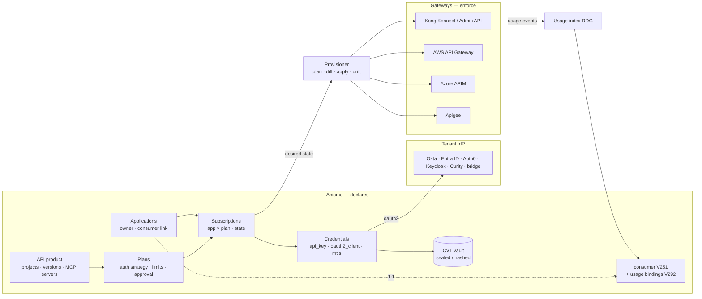
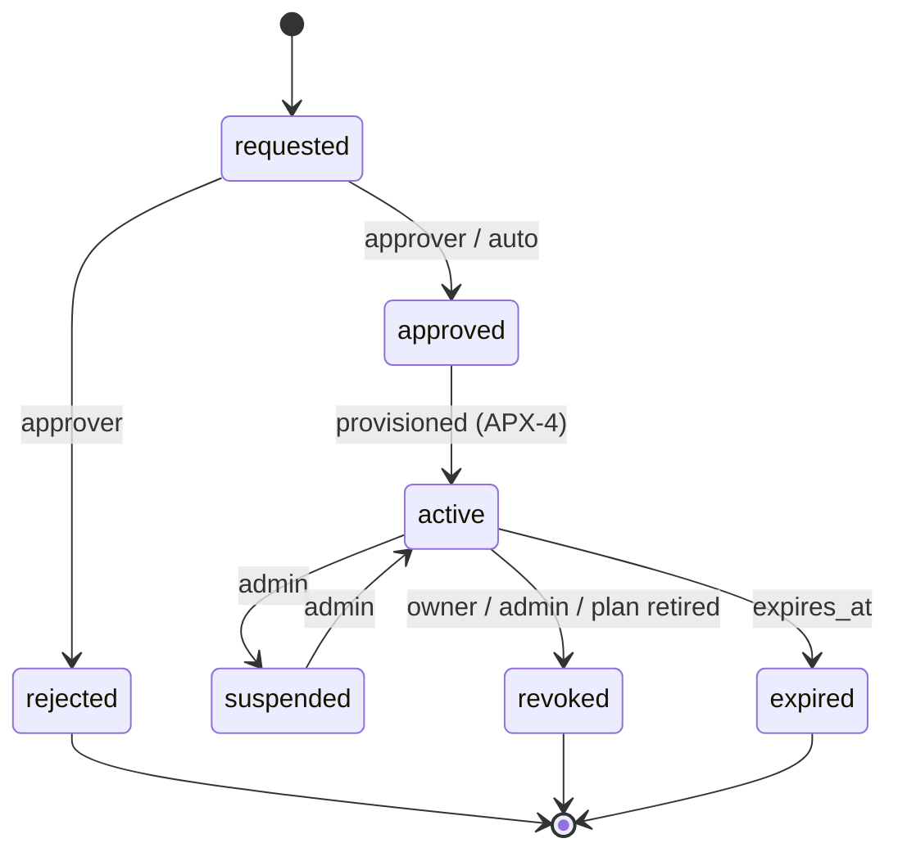
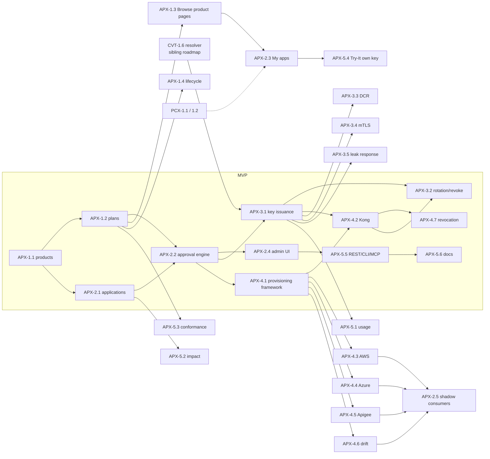

# Roadmap — API Products & Application Access (APX)

**Umbrella:** [#6096](https://github.com/apiome/apiome/issues/6096) · issues #6096–#6128 filed 2026-10-21 (labels: `roadmap-application-access`).

## 0. Roadmap request

> Create roadmaps for features that Kong provides that Apiome does not (yet) if there's a good fit. If Kong
> provides a feature that is not appropriate for Apiome, or is not a direct competitive feature, skip it. Things
> like managing credentials and keys for live traffic was a request from someone at a meetup recently, so this
> would be a good candidate for a roadmap feature - to store credentials and keys, similar to a Vault store. A
> roadmap for a connector store might make sense, but Apiome is not an API gateway, it's an API Cataloging
> system, so it may not be a good fit for the application. Use your judgement to determine the best path forward.

This roadmap answers the **“credentials and keys for live traffic”** part of the request in a way that fits a
catalog: **Apiome becomes the system of record for who may call which API, under which plan, with which
credential — and provisions that decision onto the gateways that enforce it.** Apiome never sits in the request
path. Secrets it issues are stored through the sibling roadmap
[`ROADMAP_CREDENTIAL_VAULT.md`](./ROADMAP_CREDENTIAL_VAULT.md) (CVT).

### 0.1 Kong parity — what is being matched, and what is not

| Kong capability | Kong source | Fit for Apiome | Disposition |
| --- | --- | --- | --- |
| **Dev Portal applications** — a developer registers an app against published APIs; approval optional | [Konnect Dev Portal DCR](https://developer.konghq.com/dev-portal/dynamic-client-registration/) | **Yes.** Apiome already publishes APIs to a portal (apiome-browse) and models consumers (V251) | APX-EPIC-2 |
| **Dynamic Client Registration** (RFC 7591) to Okta, Entra ID, Auth0, Curity, Kong Identity, or a custom HTTP DCR bridge | [DCR overview](https://docs.konghq.com/konnect/dev-portal/applications/dynamic-client-registration), [Okta](https://developer.konghq.com/how-to/okta-dcr/), [Entra ID](https://developer.konghq.com/how-to/azure-ad-dcr/), [Auth0](https://developer.konghq.com/how-to/auth0-dcr/), [Curity](https://developer.konghq.com/how-to/curity-dcr/) | **Yes** — the IdP issues the credential, Apiome records and governs it | APX-3.3 |
| **Consumers, consumer groups and key-auth credentials** on the gateway | Kong Gateway entities | **Yes, as provisioning** — Apiome declares, Kong enforces | APX-EPIC-4 |
| **API products / auth strategies / tiered access** | Konnect API products, [Metering & Billing](https://konghq.com/products/kong-konnect/features/usage-based-metering-and-billing) (tiering, subscriptions) | **Products and plans: yes** (they are catalog metadata). **Metering, invoicing, payments: no** | APX-EPIC-1; billing skipped |
| Rate-limit and quota **enforcement** | Kong plugins | **No** — runtime | Plans *declare* limits; APX-4.x provisions them; APX-5.3 checks the gateway matches |
| Analytics per application | Konnect Analytics | **Partly** — the usage index (RDG) already counts per consumer | APX-5.1 reuses it; no new pipeline |

### 0.2 Current state (measured 2026-10-21, `main` @ 499ecc2c1)

| Area | What exists | Gap |
| --- | --- | --- |
| Consumers | `consumer` + `consumer_contract` (V251, sources `pact`/`manual`/`agent`), `usage_consumer_binding` (V292: `header`, `api_key`, `jwt_claim`, `user_agent`, stored as `value_hmac`), suggested consumers (V293), agents as consumers (V297) | A consumer is a *label for observed traffic*; nobody **requests**, **is granted** or **is issued** anything |
| Keys | Workspace `api_keys` (V006, scopes V177), agent keys (V269, quotas V272), `mcp_api_keys` (V094) | All are keys **to Apiome**; none are keys to the tenant's own APIs |
| Plans | `tenant_licenses` (Apiome's own licensing), mock RPS limits, agent-key quotas | No API product or plan concept |
| Gateways | Connectors for Kong (Konnect + Admin API), AWS API Gateway, Azure APIM, Apigee; `catalog_gateway_configs.posture` (V298) records auth schemes and rate limits **read** from gateways; push back of a catalog item to decK | Nothing is ever **written** to a gateway except the decK export file |
| Portal | apiome-browse: public, unauthenticated; Try-It with reader-typed credentials; PCX roadmap adds reader identity (PCX-1.1 #5889), access policy (PCX-1.2 #5890) and an agent-key request queue (PCX-4.3 #4542) | No “register an app / get a key” flow |

### 0.3 Prior art — existing GitHub issues to reconcile (do **not** duplicate)

| Issue | Title | State | Disposition |
| --- | --- | --- | --- |
| [#1072](https://github.com/apiome/apiome/issues/1072) | [Epic] Developer Portal & Monetization (private-suite #856–#860, #502) | OPEN · Future | **Partly superseded.** API Key Self-Service (#858) → APX-EPIC-3; Quota Management (#860) → APX-1.2 (declared) + APX-5.3 (verified). Auto-generated portal (#856) and Try-It (#857) are already shipped/covered by browse + SIM; Usage dashboards (#502) → APX-5.1 over RDG. **Billing (#859) stays out of scope** of this roadmap. |
| [#1327](https://github.com/apiome/apiome/issues/1327) | [Epic] Pricing Tiers & Plan Management | OPEN · Future | **Not the same thing** — that epic is Apiome's *own* SaaS tiers (`tenant_licenses`). APX plans are tiers a tenant offers *its* consumers. Cross-link to avoid confusion; no overlap. |
| [#5887](https://github.com/apiome/apiome/issues/5887) | [PCX] Portal Consumer Experience | OPEN | **Dependency.** PCX-1.1 reader identity (#5889) and PCX-1.2 access policy (#5890) are prerequisites for *external* developers in APX-2.3. PCX-4.3 (#4542) agent-key request queue should be built **on** APX-2.2's generic access-request engine — amend #4542's scope note. PCX-5.4 branding (#5914) styles APX product pages. |
| [#5770](https://github.com/apiome/apiome/issues/5770) / [#5763](https://github.com/apiome/apiome/issues/5763) | [RDG-2.4] Consumer impact with runtime share / [RDG-1.5] Gateway access-log parsers | OPEN | **Reused.** APX-3.1 auto-creates `usage_consumer_binding` rows so RDG attribution works the moment a key is issued. |
| [#5940](https://github.com/apiome/apiome/issues/5940) | [ASP-4.2] Probe catalog v1 (auth-scheme, rate-limit) | OPEN | **Complementary.** ASP probes the live API; APX-5.3 compares gateway config to the declared plan. |
| [#5931](https://github.com/apiome/apiome/issues/5931) | [ASP-EPIC-3] Secret and PII scanning | OPEN | **Reused** by APX-3.5 (issued-key pattern registration). |
| [#5661](https://github.com/apiome/apiome/issues/5661) | [EID-EPIC-1] SSO foundation | OPEN | **Pattern source** for APX-3.3 IdP configuration (issuer discovery); separate purpose (DCR, not sign-in). |
| [#1591](https://github.com/apiome/apiome/issues/1591) | Access Request Workflow | CLOSED | Workspace membership requests; different object. Approver UX patterns reused in APX-2.2. |
| [#1282](https://github.com/apiome/apiome/issues/1282) | [Epic] Environment Promotion & Drift Detection | OPEN · Future | **Adjacent.** APX-4.1's per-environment provisioning is compatible; no overlap. |

---

## 1. MVP Definition

**MVP = an API owner bundles published projects into an API product with a “Standard” plan (key-auth, 100
requests/minute, manual approval); an internal developer (workspace member) registers an application in apiome-ui,
requests the plan, an approver approves it, the developer receives an API key shown once, and within one minute
Apiome has provisioned the consumer, its consumer-group rate limit and its key-auth credential on a connected Kong
gateway — and the key's traffic is attributed to that application in the usage index and dependency graph.
Revoking the application removes the credential from Kong.**

### 1.1 MVP scope (in)

| Epic | Issues | Why it is load-bearing |
| --- | --- | --- |
| APX-EPIC-1 Products & plans | 1.1, 1.2 | Something to request access *to* |
| APX-EPIC-2 Applications & access | 2.1, 2.2, 2.4 | The requester, the approval, and the admin view |
| APX-EPIC-3 Credentials | 3.1, 3.2 | The meetup request: issue, rotate, revoke keys |
| APX-EPIC-4 Provisioning | 4.1, 4.2, 4.7 | Kong first, because a Kong connector exists and is the competitive comparison |
| APX-EPIC-5 Surfaces | 5.5, 5.6 | REST/CLI and the docs page |

### 1.2 Post-MVP

1.3, 1.4, 2.3, 2.5, 3.3–3.5, 4.3–4.6, 5.1–5.4.

### 1.3 Out of scope (skipped on purpose)

- **Enforcement** of any kind: rate limiting, quota counting, key validation at request time. Gateways do this.
- **Metering, invoicing and payments** (Kong Metering & Billing, #1072 child #859). Plans may carry a free-text
  `pricing` note and an external `billing_ref`; Apiome does not bill.
- Being an **OAuth authorization server**: Apiome registers clients at the tenant's IdP (DCR) but never mints tokens.
- A credential store for **arbitrary** applications — only credentials issued through APX.

### 1.4 MVP exit criteria

- [ ] Kong integration test (compose, `kong:3.x` DB-less is not enough — use DB mode Admin API) shows the consumer,
      consumer group with `rate-limiting-advanced` / `rate-limiting` config, and `key-auth` credential appear after
      approval, and disappear after revocation.
- [ ] The issued key is displayed once; no subsequent API, CLI, UI or MCP response contains it (secret sweep test).
- [ ] A call through Kong with the key, reported to `/usage/ingest` with the key's HMAC as `consumer_hint`, is
      attributed to the application's consumer without manual binding.
- [ ] A dry run of provisioning shows the exact Kong changes before they are applied; a failed apply is retried and
      visible on the application page.

---

## 2. Architecture



**Desired state, not imperative calls.** Every subscription renders to a provider-neutral desired state:

```
consumer      app:acme-checkout            (custom_id = apx application id)
group         plan:payments-standard       limits: 100/min, 50 000/day
credential    key-auth  fp 7c1e…  (value from vault, provisioner use only)
routes        payments-api@2 → service payments, routes /v2/payments/**
```

Each provisioner diffs that against the gateway and applies the difference idempotently — the same model as decK.

---

## 3. Epics

### APX-EPIC-1 (#6097) — API products and plans

| # | Title | Summary | Labels | Parallel | MVP | Complexity | Modules |
| --- | --- | --- | --- | --- | --- | --- | --- |
| APX-1.1 · #6098 | API product model | `api_products` bundling projects/versions, MCP servers and event channels, with owner team and visibility; a catalog kind and graph node | `catalog`, `data-model`, `rest` | N | Y | M | apiome-db, apiome-rest, apiome-ui |
| APX-1.2 · #6099 | Plans | Tiers per product: auth strategy, declared limits, approval mode, environments, terms | `catalog`, `api-keys`, `rest` | N | Y | M | apiome-db, apiome-rest, apiome-ui |
| APX-1.3 · #6100 | Product pages in Browse | Product landing page listing its APIs and plans, with a Request access action | `portal`, `browser` | Y | N | M | apiome-browse |
| APX-1.4 · #6101 | Product and plan lifecycle | Deprecate/retire plans, migrate subscriptions, tie to sunset timeline and changelog | `governance`, `versions` | Y | N | M | apiome-rest, apiome-ui |

#### APX-1.1 (#6098) — API product model

- **Problem Statement:** Access is granted to *a thing a consumer understands* (“Payments API”), which is usually
  several projects and versions, possibly MCP servers and event channels. Apiome has projects and catalog items but
  no bundle.
- **Solution/Scope:** Migration **V311** (after CVT's V308–V310) `api_products` — `tenant_id`, `slug`, `name`,
  `summary`, `owner_team_id`, `visibility` (`private` | `workspace` | `portal`), `state` (`draft` | `published` |
  `deprecated` | `retired`); `api_product_members` — `product_id`, `member_kind` (`project_version`,
  `project_latest`, `mcp_server`, `catalog_item`), `member_ref`, `environment` (nullable). New catalog kind
  `api_product` with `includes` edges in `catalog_edges` so the dependency graph and blast radius see products.
  REST `/v1/tenants/{t}/products[/{slug}]` CRUD, members sub-resource. UI: Ship → **Products** list and editor.
  Bump OpenAPI version.
- **Acceptance Criteria:** a product including `payments@latest` follows new publishes; blast radius of a breaking
  change in a member lists the product; visibility `portal` requires every member to be published.
- **Parallelism/Dependencies:** Foundation of APX. Independent of CVT.
- **Technical Stack:** PostgreSQL, FastAPI, Next.js (apiome-ui Ship section).
- **Documentation (Docusaurus):** new `ship/api-products.mdx`; screenshot `api-products-list`, `api-product-editor`;
  REST regen; release-notes entry.

```
API product "Payments"
 ├── payments-api      @latest   (project)
 ├── refunds-api       @2.x      (project)
 ├── payments-events   @latest   (AsyncAPI project)
 └── payments-mcp                (MCP server)
 Plans: Sandbox (auto, 10/min) · Standard (manual, 100/min) · Partner (manual, mTLS, 1 000/min)
```

#### APX-1.2 (#6099) — Plans

- **Problem Statement:** A gateway holds rate limits per consumer group, but the *intent* (what the Standard tier
  promises) lives in wikis and contracts.
- **Solution/Scope:** `api_plans` — `product_id`, `slug`, `name`, `description`, `auth_strategy` (`key_auth` |
  `oauth2_client_credentials` | `mtls` | `none`), `auth_config` (header name, IdP config id, scopes), `limits`
  (`[{window: second|minute|hour|day|month, requests}]`, optional `concurrency`), `approval` (`auto` | `manual`),
  `environments` (which gateway configs this plan is provisioned to, e.g. `kong:prod-cp`, `kong:staging-cp`),
  `credential_ttl_days` (optional max key age), `terms_url`, `pricing_note`, `billing_ref`, `state`. Plans render
  into OpenAPI as `x-apiome-plans` on export (fidelity: dropped for formats without an equivalent) and their auth
  strategy must match a security scheme declared by every member (validation warning otherwise).
- **Acceptance Criteria:** a plan whose environments reference a gateway config without a provisioning-capable
  connector is saved as *declared only* with a visible notice; limits validate (positive, windows unique).
- **Parallelism/Dependencies:** After 1.1.
- **Documentation (Docusaurus):** “Plans” section in `ship/api-products.mdx`; screenshot `api-plan-editor`.

#### APX-1.3 (#6100) — Product pages in Browse

- **Solution/Scope:** `apiome-browse` route `/{tenant}/products/{slug}`: summary, member APIs (links into existing
  version pages), plan cards (auth strategy, limits, approval), **Request access** (requires PCX-1.1 sign-in; for
  anonymous readers shows “Sign in to request access”). Products with `visibility=portal` appear in tenant pages and
  search. Branding from PCX-5.4 when present.
- **Acceptance Criteria:** product page renders without sign-in; plan cards never show `billing_ref`; axe clean.
- **Parallelism/Dependencies:** After 1.2; request flow after 2.3.
- **Documentation (Docusaurus):** update `ship/browse-published-specs.md`; screenshot `browse-product-page`.

#### APX-1.4 (#6101) — Product and plan lifecycle

- **Solution/Scope:** Deprecating a plan blocks new subscriptions, notifies subscribed application owners and
  offers a **migrate to plan** action (re-provisions consumers into the new group without new keys). Retiring a
  plan after its date revokes provisioning. Product deprecation appears on the sunset timeline
  (`ship/sunset-timeline.mdx`) and in the changelog.
- **Acceptance Criteria:** migration between plans re-provisions without credential change; owners notified once.
- **Documentation (Docusaurus):** lifecycle section; update `ship/sunset-timeline.mdx`.

---

### APX-EPIC-2 (#6102) — Applications and access requests

| # | Title | Summary | Labels | Parallel | MVP | Complexity | Modules |
| --- | --- | --- | --- | --- | --- | --- | --- |
| APX-2.1 · #6103 | Application model linked to consumers | `applications` owned by a user or team, each 1:1 with a `consumer` so contracts, graph and usage line up | `data-model`, `contracts`, `rest` | N | Y | M | apiome-db, apiome-rest |
| APX-2.2 · #6104 | Access request and approval engine | Subscription requests with auto/manual approval, approver role, reasons, expiry; reusable by PCX-4.3 | `governance`, `roles`, `rest` | N | Y | L | apiome-rest, apiome-db, apiome-ui |
| APX-2.3 · #6105 | My apps for portal developers | Signed-in portal readers register apps, request plans and manage keys in Browse | `portal`, `browser` | Y | N | L | apiome-browse, apiome-rest |
| APX-2.4 · #6106 | Applications admin in apiome-ui | Workspace view of all applications, requests queue, suspend/revoke, owners | `ui`, `governance` | Y | Y | M | apiome-ui |
| APX-2.5 · #6107 | Shadow consumers | Gateway consumers Apiome did not provision, surfaced beside Shadow APIs, with Adopt as application | `gateway`, `governance`, `catalog` | Y | N | M | apiome-rest, apiome-ui |

#### APX-2.1 (#6103) — Application model linked to consumers

- **Problem Statement:** Apiome's `consumer` is inferred from traffic or declared for contracts; to grant access,
  something must *own* a credential and be accountable.
- **Solution/Scope:** `applications` — `tenant_id`, `slug`, `name`, `description`, `owner_kind` (`user` | `team` |
  `portal_reader`), `owner_id`, `consumer_id` (FK V251, created automatically, `source='application'`),
  `redirect_uris` (for OAuth plans), `state` (`active` | `suspended` | `revoked`), `metadata jsonb` (external
  ids). Creating an application creates its consumer; contracts (Pact) attached to that consumer now belong to an
  accountable owner. REST `/v1/tenants/{t}/applications`. Agents (V297) can own applications later — out of MVP.
- **Acceptance Criteria:** deleting an application revokes credentials and marks the consumer `retired` but keeps
  history; graph shows `application → consumes → product`.
- **Parallelism/Dependencies:** After 1.1.
- **Documentation (Docusaurus):** new `govern/applications.mdx`; update `govern/dependency-graph.mdx` (new node kind).

#### APX-2.2 (#6104) — Access request and approval engine

- **Problem Statement:** Approval flows exist ad hoc (PCX-4.3 plans an agent-key queue; #1591 handled workspace
  joins). A generic engine avoids three more.
- **Solution/Scope:** `api_subscriptions` — `application_id`, `plan_id`, `state` (`requested` → `approved` |
  `rejected`; `approved` → `active` (after provisioning) → `suspended` | `revoked` | `expired`), `requested_by`,
  `decided_by`, `reason`, `expires_at`, `use_case` (free text the requester enters). `auto` plans approve
  immediately. Approver = new RBAC action `products:approve` scoped to the product's owner team by default.
  Notifications to approvers and requesters (COL inbox now; PCX-3 channels when shipped). Audit
  `apx.subscription.*`. The engine exposes a small internal interface (`request`, `decide`, `on_approved` hook)
  that PCX-4.3 (#4542) uses for agent-key requests.
- **Acceptance Criteria:** state machine tests (no approve after reject without a new request); an approver from
  another team gets `403`; expiring subscriptions warn 14/3 days before.
- **Parallelism/Dependencies:** After 2.1, 1.2.
- **Documentation (Docusaurus):** “Requesting and approving access” section; screenshot `apx-request-queue`.



#### APX-2.3 (#6105) — My apps for portal developers

- **Problem Statement:** The Kong Dev Portal equivalent is external developers self-serving; MVP covers internal
  developers only.
- **Solution/Scope:** In apiome-browse, behind PCX-1.1 reader sign-in: **My apps** (create, edit, delete),
  **Request access** from product pages, request status, **Credentials** (create/rotate/revoke keys, show-once
  dialog, DCR client details). PCX-1.2 access policy decides which readers may request which products; PCX-1.4
  segments can scope products per customer.
- **Acceptance Criteria:** a reader from a disallowed email domain cannot request; show-once dialog requires an
  explicit “I have copied this key” before closing; rate-limited key creation.
- **Parallelism/Dependencies:** After 2.2, 3.1, and PCX-1.1 (#5889) / PCX-1.2 (#5890).
- **Documentation (Docusaurus):** new `ship/developer-self-service.mdx`; screenshots `browse-my-apps`,
  `browse-key-show-once`.

#### APX-2.4 (#6106) — Applications admin in apiome-ui

- **Solution/Scope:** Govern → **Applications**: list (owner, products, plan, state, last seen from usage),
  **Requests** queue with approve/reject, application detail (subscriptions, credentials metadata, provisioning
  status per environment, usage sparkline once 5.1 lands), suspend/revoke. Internal developers create applications
  here in MVP.
- **Acceptance Criteria:** approve from the queue triggers provisioning and shows progress; axe clean; light/dark.
- **Parallelism/Dependencies:** After 2.2.
- **Documentation (Docusaurus):** screenshots `apx-applications-list`, `apx-application-detail`.

#### APX-2.5 (#6107) — Shadow consumers

- **Problem Statement:** Gateways already hold consumers created by hand. Like shadow APIs, they run but nobody can
  govern them.
- **Solution/Scope:** Connector sync records gateway consumers/apps/keys **metadata** (Kong consumers + groups,
  AWS API keys + usage plans, APIM subscriptions, Apigee developer apps) — names, ids, group/plan membership,
  never key values. Govern → Shadow APIs gains a **Consumers** section: unmanaged, matched (by `custom_id` or
  name), drifted. **Adopt** creates an application + subscription marked `adopted` and takes over management
  without re-keying (credential recorded as `external`, value unknown; rotation re-keys).
- **Acceptance Criteria:** adoption does not change the gateway until the first rotation or plan change; drift
  from manual edits on Kong is flagged within one sync.
- **Parallelism/Dependencies:** After 4.1.
- **Documentation (Docusaurus):** update `govern/shadow-apis.mdx`; screenshot `shadow-consumers`.

---

### APX-EPIC-3 (#6108) — Credential issuance

| # | Title | Summary | Labels | Parallel | MVP | Complexity | Modules |
| --- | --- | --- | --- | --- | --- | --- | --- |
| APX-3.1 · #6109 | API key issuance | Generate keys with a tenant prefix, show once, store hash + vault seal for provisioning, auto-create usage binding | `api-keys`, `security`, `rest` | N | Y | M | apiome-rest, apiome-db |
| APX-3.2 · #6110 | Key rotation, expiry and revocation | Multiple active keys, grace overlap, max age from plan, revoke propagates to gateways | `api-keys`, `security` | Y | Y | M | apiome-rest, apiome-ui |
| APX-3.3 · #6111 | OAuth2 client credentials via DCR | RFC 7591 registration at Okta, Entra ID, Auth0, Keycloak, Curity or an HTTP bridge | `auth`, `security`, `integrations` | Y | N | L | apiome-rest, apiome-ui |
| APX-3.4 · #6112 | mTLS client certificates | Register client certificates (or CSRs signed by a tenant CA in the vault) per application | `security`, `auth` | Y | N | M | apiome-rest |
| APX-3.5 · #6113 | Leaked-key response | Issued-key prefix registered with ASP-3 scanning; detection triggers notify, suspend or rotate | `security`, `governance` | Y | N | M | apiome-rest |

#### APX-3.1 (#6109) — API key issuance

- **Problem Statement:** The meetup request: one place that issues and tracks keys for live traffic.
- **Solution/Scope:** Key format `<tenant_prefix>_<env>_<32 bytes base62>` with a CRC suffix (detectable by
  scanners, like GitHub tokens); prefix configurable per tenant. Stored as (a) SHA-256 hash with per-tenant pepper
  for verification and display fingerprint, (b) `usage_consumer_binding` (`kind=api_key`, `value_hmac`) so RDG
  attribution is automatic, and (c) **sealed in the CVT vault** (`kind=api_key`, path
  `apx/<app>/<credential-id>`, `allowed_hosts` = the plan's gateway admin hosts, use restricted to
  `apx_provisioner`) because gateways need the plaintext to enforce key-auth and reconcile after drift. Tenants may
  choose **hash-only mode** per plan: nothing is sealed, the key is pushed at issuance only, and any re-provisioning
  requires rotation. `api_credentials` table — `subscription_id` (or application-wide), `kind`, `fingerprint`,
  `vault_ref`, `state`, `expires_at`, `last_used_at` (from usage).
- **Acceptance Criteria:** key returned only in the create response; secret sweep test passes; hash-only mode
  creates no vault secret; binding HMAC matches what `apiome-rest` computes for an ingested `consumer_hint`.
- **Parallelism/Dependencies:** After 2.2 and **CVT-1.6**.
- **Technical Stack:** `secrets` module, CVT resolver, V292 binding helpers.
- **Documentation (Docusaurus):** “Credentials” section in `govern/applications.mdx`, including the hash-only trade-off.

#### APX-3.2 (#6110) — Key rotation, expiry and revocation

- **Solution/Scope:** Up to two active keys per credential slot; **Rotate** issues a new key, provisions it,
  and schedules revocation of the old one after a grace period (default 24 h, plan-configurable) — CVT-4.2 pattern.
  Plan `credential_ttl_days` forces expiry with reminders. **Revoke** is immediate and propagates (4.7). Usage
  shows which key is still in use during the grace window.
- **Acceptance Criteria:** both keys work on Kong during grace (integration test); old key removed at window end;
  owner notified 14/3/1 days before expiry.
- **Parallelism/Dependencies:** After 3.1, 4.2.
- **Documentation (Docusaurus):** rotation section; screenshot `apx-rotate-key`.

#### APX-3.3 (#6111) — OAuth2 client credentials via DCR

- **Problem Statement:** Larger tenants do not want static keys; Kong's portal registers OAuth clients at the
  tenant's IdP via RFC 7591 (§0.1).
- **Solution/Scope:** `apx_idp_configs` — issuer URL (discovery via `/.well-known/openid-configuration`), DCR
  endpoint, initial access token or management credentials **as a CVT reference**, provider kind (`okta`,
  `entra`, `auth0`, `keycloak`, `curity`, `generic-rfc7591`, `http-bridge`). On approval of an
  `oauth2_client_credentials` plan: register the client with the plan's scopes, return client id + secret once
  (never stored unless the plan's provisioning needs it — it does not: gateways validate JWTs, not secrets),
  store `client_id` and the registration access token (RFC 7592) in the vault for later update/delete. Rotation =
  RFC 7592 secret regeneration or delete + re-register. Provisioning (4.x) configures the gateway's OIDC/JWT plugin
  to accept the issuer and maps `client_id` → consumer.
- **Acceptance Criteria:** integration test against Keycloak (compose) for register/rotate/delete; mocked tests for
  Okta/Entra/Auth0 quirks; HTTP bridge contract documented and tested.
- **Parallelism/Dependencies:** After 3.1; CVT-1.6.
- **Documentation (Docusaurus):** new `govern/oauth-client-registration.mdx` with per-IdP setup.

#### APX-3.4 (#6112) — mTLS client certificates

- **Solution/Scope:** Application uploads a client certificate (or a CSR that Apiome signs with a tenant CA held
  in the vault as a `certificate` secret). Fingerprint and subject are recorded; provisioning pushes the CA /
  certificate binding (Kong `mtls-auth` CA certificates + consumer `custom_id`/subject mapping; AWS truststore note).
  Expiry feeds CVT-4.3.
- **Acceptance Criteria:** issued cert chains to the tenant CA; expiry alerts reach the application owner.
- **Documentation (Docusaurus):** mTLS section in `govern/applications.mdx`.

#### APX-3.5 (#6113) — Leaked-key response

- **Solution/Scope:** Register each tenant's key prefix + CRC with ASP-3.1 `app.sensitive_data` so a leaked key in
  an imported spec, captured payload or connected repository is matched to its credential by hash. Plan setting
  `on_leak`: `notify` | `suspend` | `rotate`. Optional: publish the prefix pattern for GitHub secret scanning
  partner format (documented, not automated).
- **Acceptance Criteria:** a key pasted into a spec example is detected on import and the credential is suspended
  when the plan says so.
- **Parallelism/Dependencies:** After 3.1 and ASP-3.1.
- **Documentation (Docusaurus):** leak response section; update `govern/secret-posture.mdx` (CVT-4.4).

---

### APX-EPIC-4 (#6114) — Gateway provisioning

| # | Title | Summary | Labels | Parallel | MVP | Complexity | Modules |
| --- | --- | --- | --- | --- | --- | --- | --- |
| APX-4.1 · #6115 | Provisioning framework | Desired-state rendering, provider interface, dry run, idempotent apply, retries, per-environment status | `gateway`, `integrations`, `rest` | N | Y | L | apiome-rest, apiome-db |
| APX-4.2 · #6116 | Kong provisioner | Consumers, consumer groups with rate limits, key-auth / OIDC / mTLS credentials via Admin API and Konnect | `gateway`, `integrations` | N | Y | L | apiome-rest |
| APX-4.3 · #6117 | AWS API Gateway provisioner | API keys and usage plans (throttle + quota) per stage | `gateway`, `integrations` | Y | N | M | apiome-rest |
| APX-4.4 · #6118 | Azure API Management provisioner | Products, subscriptions and keys | `gateway`, `integrations` | Y | N | M | apiome-rest |
| APX-4.5 · #6119 | Apigee provisioner | Developers, developer apps, API products and quota | `gateway`, `integrations` | Y | N | M | apiome-rest |
| APX-4.6 · #6120 | Provisioning drift detection | Each sync compares gateway state to desired state; drift shown and optionally auto-corrected | `gateway`, `governance` | Y | N | M | apiome-rest, apiome-ui |
| APX-4.7 · #6121 | Revocation propagation and audit | Revoke/suspend reaches every environment within an SLA; failures escalate | `gateway`, `security` | Y | Y | S | apiome-rest |

#### APX-4.1 (#6115) — Provisioning framework

- **Problem Statement:** Connectors today only **read**. Writing to a production gateway needs dry runs,
  idempotency, ownership markers and an audit trail, or nobody will grant Apiome write credentials.
- **Solution/Scope:**
  - Connector gains capability `provision` and a separate **write credential** (CVT reference) so read-only sync can
    keep a read-only token. Provisioning is opt-in per connector *and* per environment.
  - `apx_provisioning_runs` + `apx_provisioned_objects` (provider object ids, last applied hash, owner marker).
  - Ownership: every object Apiome creates is tagged (`apiome-managed`, `apiome-app:<id>`, Kong `tags`, AWS tags,
    APIM/Apigee attributes). Apiome never modifies or deletes untagged objects.
  - Flow: subscription change → render desired state → provider `plan()` (diff) → `apply()` → record → status
    event. Retries with backoff; dead-letter visible on the application page. `POST …/provisioning/dry-run`.
- **Acceptance Criteria:** applying the same desired state twice makes no calls the second time; an untagged Kong
  consumer with the same username is reported as a conflict, not overwritten; every apply is audited with a diff
  summary (no secrets).
- **Parallelism/Dependencies:** After 2.2; blocks 4.2–4.7.
- **Technical Stack:** existing connector provider classes, job runner.
- **Documentation (Docusaurus):** new `govern/gateway-provisioning.mdx` (safety model, ownership tags, dry run);
  update `bring-in/connectors.mdx` (write credential, provision capability).

#### APX-4.2 (#6116) — Kong provisioner

- **Solution/Scope:** For `kong-admin` and `kong-konnect` connectors: `consumers` (`username` = app slug,
  `custom_id` = application id, `tags`), `consumer_groups` per plan with `rate-limiting-advanced` (Enterprise /
  Konnect) or per-consumer `rate-limiting` (OSS fallback), `key-auth` credentials (`/consumers/{id}/key-auth`),
  `jwt`/`openid-connect` consumer mapping for DCR plans, `mtls-auth` for mTLS plans; ensure the plan's auth plugin
  is enabled on the member services/routes **only if** the plan says Apiome manages route auth (default: verify and
  warn, don't enable). Konnect via its control-plane Admin API. Kong vault references (CVT-5.5) used for any secret
  Kong itself must hold when a shared backend exists.
- **Acceptance Criteria:** compose test with Kong Gateway (Postgres mode): approve → consumer, group and key appear;
  `curl` with the key gets `200`, without gets `401`, the 101st call/min gets `429`; revoke → `401`. Konnect path
  covered by recorded-response tests.
- **Parallelism/Dependencies:** After 4.1, 3.1.
- **Documentation (Docusaurus):** Kong section in `govern/gateway-provisioning.mdx`, with the minimal Kong RBAC
  role for the write token.

```
Apiome subscription                       Kong (tags: apiome-managed, apiome-app:7f3c…)
 app acme-checkout ── plan Standard  ──▶  consumer acme-checkout (custom_id 7f3c…)
                                          ├─ consumer_group payments-standard
                                          │    rate-limiting-advanced 100/min
                                          └─ key-auth  key=<from vault, apx_provisioner use>
```

#### APX-4.3 / 4.4 / 4.5 (#6117 / #6118 / #6119) — AWS, Azure and Apigee provisioners

- **AWS API Gateway:** usage plan per (plan, stage) with throttle (rate/burst) and quota; API key imported with
  Apiome's value (`value` param) or generated by AWS and returned once; usage-plan keys. Tagging per 4.1.
- **Azure APIM:** APIM *product* per APX plan (or mapped to an existing product), *subscription* per
  subscription, keys generated by APIM and returned once (stored hash-only unless the tenant enables sealing);
  `rate-limit-by-key`/`quota-by-key` policy fragments generated from plan limits.
- **Apigee:** developer per application owner, developer app per application, Apigee API product per plan with
  quota attributes; consumer key imported (custom key) or generated.
- **Acceptance Criteria (each):** recorded-response tests for create/update/delete; ownership markers honoured;
  limits mapping documented with any approximation shown in the dry run (e.g. AWS has no per-minute quota → mapped
  to rate limit, flagged).
- **Parallelism/Dependencies:** After 4.1; mutually parallel.
- **Documentation (Docusaurus):** one section each in `govern/gateway-provisioning.mdx`, with a limits-mapping table.

#### APX-4.6 (#6120) — Provisioning drift detection

- **Solution/Scope:** Each connector sync reads Apiome-tagged objects and compares to the last applied hash:
  missing, changed (e.g. someone raised the limit by hand), extra credentials. Application page and Govern →
  Applications show drift; plan setting `drift`: `report` | `correct`. Feeds APX-2.5 for untagged objects.
- **Acceptance Criteria:** a hand-edited Kong rate limit is reported on the next sync and restored when `correct`.
- **Documentation (Docusaurus):** drift section.

#### APX-4.7 (#6121) — Revocation propagation and audit

- **Solution/Scope:** Revoke/suspend/expire triggers immediate high-priority provisioning runs for every
  environment; target SLA 60 s; failures retry every 30 s and raise `apx.revocation.failed` to the product owner
  team and workspace admins until resolved. Audit trail shows request, approval, issuance, every provisioning
  apply and revocation per application — exportable as CSV for access reviews.
- **Acceptance Criteria:** fault-injection test (gateway down) shows escalation and eventual convergence.
- **Documentation (Docusaurus):** “Access reviews and audit” section in `govern/applications.mdx`.

---

### APX-EPIC-5 (#6122) — Usage, governance and surfaces

| # | Title | Summary | Labels | Parallel | MVP | Complexity | Modules |
| --- | --- | --- | --- | --- | --- | --- | --- |
| APX-5.1 · #6123 | Per-application usage | Application and plan views over the usage index: calls, errors, latency, observed vs declared limits | `analytics`, `observability` | Y | N | M | apiome-rest, apiome-ui |
| APX-5.2 · #6124 | Breaking-change impact by application | Classified diffs and blast radius name the subscribed applications and notify their owners | `diff`, `contracts`, `governance` | Y | N | M | apiome-rest |
| APX-5.3 · #6125 | Plan conformance checks | Gateway posture (V298) vs declared plan: auth scheme and limits; lint findings and scorecard signal | `governance`, `linting`, `gateway` | Y | N | M | apiome-rest |
| APX-5.4 · #6126 | Try-It with the developer's own key | Signed-in developers try APIs with their application credential injected server-side | `portal`, `browser`, `security` | Y | N | S | apiome-browse, apiome-rest |
| APX-5.5 · #6127 | REST, CLI and MCP surfaces | `apiome products`, `apiome apps`, `apiome subscriptions`; MCP metadata tools | `cli`, `mcp`, `rest` | Y | Y | M | apiome-cli, apiome-mcp, apiome-rest |
| APX-5.6 · #6128 | Documentation and overview | Overview page, safety model, Kong walkthrough, release notes | `documentation` | Y | Y | S | apiome-docs |

#### APX-5.1 (#6123) — Per-application usage

- **Solution/Scope:** Because 3.1 creates usage bindings, the usage index already counts per application's consumer.
  Add application and plan aggregations: calls, error rate, p95 latency, top operations, and **observed peak vs
  declared limit** (from the hourly counters; minute-level precision only when the source reports it). Keys
  unused for N days surface as revocation candidates.
- **Acceptance Criteria:** numbers match the usage index for the consumer; no request-level data stored.
- **Parallelism/Dependencies:** After 3.1; RDG ingest sources.
- **Documentation (Docusaurus):** update `govern/runtime-usage.mdx`; screenshot `apx-application-usage`.

#### APX-5.2 (#6124) — Breaking-change impact by application

- **Solution/Scope:** CTG classified diff + blast radius already walk consumers; with applications they name an
  **owner** and **plan**. Publishing a breaking change to a product member notifies subscribed application owners
  (PCX delivery when present) and the breaking-publish guardrail (CTG-3.4) can require acknowledgement when
  active subscriptions with recent usage exist.
- **Acceptance Criteria:** a breaking publish lists affected applications with last-seen traffic.
- **Documentation (Docusaurus):** update `ship/compare-published-versions.md` and dependency-graph page.

#### APX-5.3 (#6125) — Plan conformance checks

- **Solution/Scope:** For each plan environment, compare `catalog_gateway_configs.posture` (auth schemes, rate
  limits read from the gateway) with the plan: missing auth plugin, looser or absent limits, consumers on the wrong
  group. Findings appear as lint-style results on the product (`plan-auth-not-enforced`,
  `plan-limit-exceeds-declared`, `plan-limit-missing`) and as a scorecard signal.
- **Acceptance Criteria:** Kong fixture with a route lacking `key-auth` for a key-auth plan yields
  `plan-auth-not-enforced`.
- **Documentation (Docusaurus):** rules added to `build/lint-rules.md`; update `govern/scorecards.mdx`.

#### APX-5.4 (#6126) — Try-It with the developer's own key

- **Solution/Scope:** Uses CVT-2.7 injection with the signed-in reader's own active credential for the plan whose
  environment matches the selected server. Hash-only credentials cannot be injected (panel explains).
- **Acceptance Criteria:** browser never receives the key; calls show up in the application's usage.
- **Parallelism/Dependencies:** After CVT-2.7, 2.3.
- **Documentation (Docusaurus):** update `ship/mock-try-out.mdx`.

#### APX-5.5 (#6127) — REST, CLI and MCP surfaces

- **Solution/Scope:** REST resources from 1.1–4.7 completed and consistent; CLI `apiome products
  list|create|add-member`, `apiome plans …`, `apiome apps create|list|describe|delete`, `apiome subscriptions
  request|approve|reject|revoke`, `apiome credentials create|rotate|revoke` (key printed once to stdout, with
  `--output-file` and `0600` permissions); MCP read-only tools `products.list`, `applications.list`,
  `subscriptions.pending` (metadata only). Bump OpenAPI version.
- **Acceptance Criteria:** CLI reference regenerated; secret sweep covers CLI `--json` output.
- **Documentation (Docusaurus):** regenerate REST, CLI and MCP references.

#### APX-5.6 (#6128) — Documentation and overview

- **Solution/Scope:** Overview `ship/api-products.mdx` (what products, plans, applications and subscriptions are;
  how Apiome differs from a gateway: *Apiome decides, the gateway enforces*), `govern/applications.mdx`,
  `govern/gateway-provisioning.mdx` (safety model), an end-to-end **Kong walkthrough**, and release notes.
- **Acceptance Criteria:** `yarn docs:check` passes; pages in Ship and Govern sidebars.

---

## 4. Work to be done, in order



1. **APX-1.1** (can start before CVT) → **APX-1.2 ∥ APX-2.1**.
2. **APX-2.2** → **APX-2.4 ∥ APX-4.1**; **APX-3.1** once CVT-1.6 is merged.
3. **APX-4.2** (Kong) → **APX-3.2 ∥ APX-4.7** → **APX-5.5 → APX-5.6**. **MVP done** — demo: create product *Payments*
   with plan *Standard* (key-auth, 100/min, manual), register *acme-checkout*, request, approve, copy the key,
   `curl` through Kong (`200`, then `429` on call 101), see the call in usage under *acme-checkout*, revoke, `401`.
4. v2 tracks in parallel: **1.3 → 2.3** (after PCX-1.1/1.2) → **5.4**; **1.4**; **3.3 ∥ 3.4 ∥ 3.5**;
   **4.3 ∥ 4.4 ∥ 4.5 ∥ 4.6 → 2.5**; **5.1 ∥ 5.2 ∥ 5.3**.

## 5. Labels

Existing: `catalog`, `data-model`, `rest`, `api-keys`, `portal`, `browser`, `governance`, `roles`, `ui`,
`contracts`, `gateway`, `integrations`, `security`, `auth`, `analytics`, `observability`, `diff`, `linting`, `cli`,
`mcp`, `documentation`, `versions`, `mvp`, `epic`, `v2`.
New: **`roadmap-application-access`** (applied to every APX issue).
