# Roadmap — Browse retail discovery and search (BDX)

> **Recommendation document for the Browse release candidate.** Written 2026-10-25 after the browse retail search shipped (apiome-browse 0.40.0: the query language, the faceted results page, the ⌘K palette, deep links, the home *Browse by* tiles — see `apiome-docs/release-notes/2026-10-25-browse-catalog-search.mdx`). This file follows the `create-roadmap` conventions: an MVP definition, epics, an issue table per epic, a detailed description per issue, and the order of work. Issues are created on [`apiome/apiome`](https://github.com/apiome/apiome/issues) with the label `roadmap-browse-discovery`; their numbers are noted in the tables.

## 0. Description

Modify the look and feel of the browse application to make it more user-friendly to accommodate a more complete search engine rather than just a top-level search. It should be more comprehensive, as it is the window into the public and private APIs of Apiome, and is the "retail" view into the application. It should be as feature-rich and functional as possible. Any additional features for the browser should be recommended as an RC document for the app, and issues should be created to support the new features.

## 1. What shipped as the baseline (apiome-browse 0.40.0)

| Area | Delivered |
|---|---|
| Engine | One parameterized statement (`lib/search/sql.ts`) over each project's latest published public version (or every version with `all=1`): ten union members — organizations, projects, version notes, tags, operations, parameters, request bodies, responses, schemas, properties — ranked exact › prefix › contains plus a kind weight; facets (kind, org, method, format, paradigm, top projects), totals and a 25-row page in one round trip; capped at 5,000 rows. Removed the old 150-row `searchPublishedPublicCatalog`. |
| Query language | `lib/search/query.ts`: words (AND), `"phrases"`, `-exclusions`, `type:`, `method:`, `path:`, `org:`, `project:`, `version:`, `format:`, `paradigm:`, `tag:`, `after:`, `before:`, with aliases; round-trips through `stringifyQuery` so chips rewrite the box. |
| URL state | `lib/search/params.ts`: `q`, `scope`, `type`, `org`, `method`, `format`, `paradigm`, `after`, `before`, `sort`, `all`, `page`; rail filters and inline operators merge; shareable links. |
| Results page | Scope tabs with counts (All · Operations · Schemas · Projects & orgs · MCP servers), filter rail (versions, kind, method, organization, paradigm, format, dates), active-filter chips, grouped/flat, sort, pagination, *Top projects*, syntax card, keyboard (`/`, `j`/`k`, `↵`), copy link, mobile filter drawer, landing and no-results states. |
| Deep links | Operation hits open `#op-…`, schema/property hits `#schema-…`; the version page now scrolls to a hash after the spec loads; anchor ids are shared from `lib/search/anchors.ts`. |
| Palette | `⌘K` / `Ctrl+K` / `/` on every page; live suggestions from `GET /api/search/suggest`, *see all N operations* rows, recent searches, jump links; on the results page the keys focus the primary box. |
| Home | Hero `SearchBox` with example searches and operator chips; *Browse by* tiles (operations by method, schemas, versions) and paradigm/format chips that open filter-only searches. |
| Tests | 51 new vitest cases over the parser, URL codec, SQL builder, anchors, highlighting and hit links (482 total). |
| Docs | `ship/browse-published-specs.md` *Search the public catalog* section; release-notes post; README and FEATURE_ROADMAP updated. Screenshots: not possible until BDX-3.5 (the pipeline captures apiome-ui only). |

## 2. MVP definition — the Browse RC

The Browse release candidate is the baseline above plus the **MVP (Y)** issues below. Together they make Browse a retail front that a stranger can search, trust and share, that an operator can gate, and that the docs can show:

- **BDX-1.1** Full-text index and ranking over the normalized public model (#6285) — tsvector + GIN over operations/schemas/properties/notes; `websearch_to_tsquery`; `ts_rank` replaces the ILIKE tiers
- **BDX-1.3** Search within a version (#6287) — An in-page find over one version's operations, schemas and properties, with the same query language and highlighting in the viewer
- **BDX-1.6** Public search API, CLI command and shared contract (#6290) — `GET /v1/browse/search` in REST with the Browse engine's contract; `apiome browse search`; Browse calls REST or shares the builder
- **BDX-2.2** Project and version cards that answer the retail questions (#6294) — Operation/schema counts, quality grade, mock and SDK availability, formats and last-published on every card and project hit
- **BDX-2.6** Compare from search and version quick-switch on hits (#6298) — Select two version hits to open `/compare`; a hit's version chip opens a switcher to other published versions
- **BDX-3.2** Accessibility gate for Browse routes (#6302) — axe CI over a Browse route ledger (home, search landing/results, palette, org, project, version, compare, MCP) with keyboard checks
- **BDX-3.3** Performance budgets and server paging for directory pages (#6303) — First-row budgets for home and search; the organization directory and tenant project lists page on the server; indexes for the search joins
- **BDX-3.4** SEO, sharing metadata and OpenSearch (#6304) — `sitemap.xml`, `robots.txt`, JSON-LD (`WebAPI`, `Organization`), Open Graph images, canonical URLs, and `opensearch.xml`
- **BDX-3.5** Docs screenshots for the Browse app (#6305) — Extend `apiome-docs/scripts/screenshots.ts` with a Browse target so the guide can show home, search, the palette and a version page
- **BDX-3.6** Browse guide page set and in-app help links (#6306) — A *Browse app* overview and a *Search the catalog* page under Ship; empty states and the syntax card link to them
- **BDX-4.3** API-key scoped browsing (#6310) — Paste an in-scope API key to browse and search the private versions it can read — the lightweight path before reader sessions

Everything marked **v2** is recommended for the releases after it, in the order of §5.

## 3. Epics

| Epic | Title | Issue | Children |
|---|---|---|---|
| BDX-EPIC-1 | Search engine depth | #6280 | BDX-1.1, BDX-1.2, BDX-1.3, BDX-1.4, BDX-1.5, BDX-1.6, BDX-1.7, BDX-1.8 |
| BDX-EPIC-2 | Discovery and retail surfaces | #6281 | BDX-2.1, BDX-2.2, BDX-2.3, BDX-2.4, BDX-2.5, BDX-2.6, BDX-2.7, BDX-2.8 |
| BDX-EPIC-3 | Retail polish, quality gates and docs | #6282 | BDX-3.1, BDX-3.2, BDX-3.3, BDX-3.4, BDX-3.5, BDX-3.6, BDX-3.7 |
| BDX-EPIC-4 | Private APIs in Browse | #6283 | BDX-4.1, BDX-4.2, BDX-4.3, BDX-4.4 |
| BDX-EPIC-5 | Machine and agent access to Browse search | #6284 | BDX-5.1, BDX-5.2, BDX-5.3 |

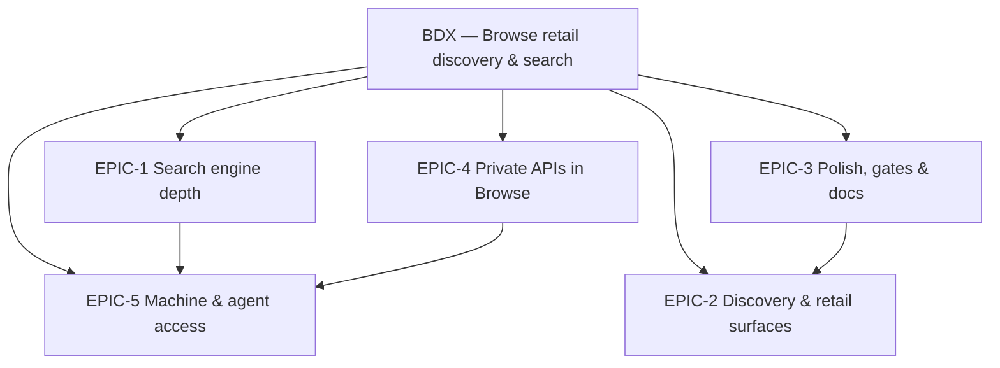

### BDX-EPIC-1 — Search engine depth (#6280)

**Problem.** The browse search shipped in October 2026 ranks substring matches over the normalized public model in one SQL statement. That is honest and fast on today's corpus, but it has no linguistic model (no stemming, no typo tolerance), no in-page search, no changelog surface, and no API — so the CLI, MCP hosts and partners cannot run the same search.

**Scope.** Grow the engine from substring matching to a ranked, forgiving, API-exposed search that Browse, the CLI and agents share.

| Issue | Title | Summary | Labels | Parallel | MVP | Complexity | Affected modules |
|---|---|---|---|---|---|---|---|
| #6285 | **BDX-1.1** Full-text index and ranking over the normalized public model | tsvector + GIN over operations/schemas/properties/notes; `websearch_to_tsquery`; `ts_rank` replaces the ILIKE tiers | `enhancement`, `browser`, `database`, `rest`, `mvp`, `roadmap-browse-discovery` | N | Y | L | apiome-db (migration), apiome-browse/lib/search/sql.ts, apiome-rest (MFI-6.2) |
| #6286 | **BDX-1.2** Typo tolerance and “Did you mean” suggestions | pg_trgm similarity over names and paths; a suggestion row when a search finds nothing | `enhancement`, `browser`, `database`, `v2`, `roadmap-browse-discovery` | Y | N | M | apiome-db (pg_trgm), apiome-browse/lib/search, src/app/search/SearchClient.tsx |
| #6287 | **BDX-1.3** Search within a version | An in-page find over one version's operations, schemas and properties, with the same query language and highlighting in the viewer | `enhancement`, `browser`, `ui`, `mvp`, `roadmap-browse-discovery` | Y | Y | M | apiome-browse/src/app/tenant/[tenantSlug]/[projectSlug]/[versionSlug], components/SpecSidebar.tsx, SpecViewer.tsx, lib/search |
| #6288 | **BDX-1.4** Changelog and release-notes search | Search classified changelog entries (`type:change`, `severity:breaking`) and version notes across the catalog | `enhancement`, `browser`, `diff`, `versions`, `v2`, `roadmap-browse-discovery` | Y | N | M | apiome-browse/lib/search/sql.ts, kinds.ts, src/app/components/search/HitRow.tsx |
| #6289 | **BDX-1.5** Semantic search and “Ask the catalog” | Embeddings over operations and schemas; hybrid lexical + vector ranking; a natural-language mode in the palette | `enhancement`, `browser`, `ai`, `database`, `v2`, `roadmap-browse-discovery` | N | N | L | apiome-db (pgvector columns), apiome-rest (embedding job), apiome-browse/lib/search, SearchPalette.tsx |
| #6290 | **BDX-1.6** Public search API, CLI command and shared contract | `GET /v1/browse/search` in REST with the Browse engine's contract; `apiome browse search`; Browse calls REST or shares the builder | `enhancement`, `browser`, `rest`, `cli`, `mvp`, `roadmap-browse-discovery` | N | Y | L | apiome-rest/src/app/browse_public_routes.py, apiome-cli, apiome-browse/lib/search, apiome-docs reference |
| #6291 | **BDX-1.7** Saved searches and search alerts | Save a search in the browser; subscribe to it by email/feed once PCX-2.2 subscriptions exist | `enhancement`, `browser`, `portal`, `v2`, `roadmap-browse-discovery` | Y | N | M | apiome-browse/src/app/search, lib/search, (later) apiome-rest subscriptions |
| #6292 | **BDX-1.8** Search analytics and zero-result log | Privacy-preserving counters for top queries, zero-result queries and click-through; an admin report | `enhancement`, `browser`, `analytics`, `database`, `v2`, `roadmap-browse-discovery` | Y | N | M | apiome-browse/lib/db, apiome-db (counters), apiome-ui admin report |

### BDX-EPIC-2 — Discovery and retail surfaces (#6281)

**Problem.** Browse is the retail window on Apiome, but a project card today says a name and a description. Visitors cannot tell from a listing how big an API is, how good it is, whether it has a mock or an SDK, who publishes it, or what else is like it. There is no editorial layer (featured, curated) and no facet-first exploration beyond the home chips.

**Scope.** Make every listing surface answer the retail questions — what is this, how big, how good, who, what else — and add the explore and editorial pages a directory needs.

| Issue | Title | Summary | Labels | Parallel | MVP | Complexity | Affected modules |
|---|---|---|---|---|---|---|---|
| #6293 | **BDX-2.1** Explore pages by format, paradigm and organization | `/explore/formats`, `/explore/paradigms`, `/explore/organizations` — indexable facet listings with counts and canonical URLs | `enhancement`, `browser`, `portal`, `ui`, `v2`, `roadmap-browse-discovery` | Y | N | M | apiome-browse/src/app/explore/**, lib/db/helper.ts, lib/browseFacets.ts |
| #6294 | **BDX-2.2** Project and version cards that answer the retail questions | Operation/schema counts, quality grade, mock and SDK availability, formats and last-published on every card and project hit | `enhancement`, `browser`, `portal`, `ui`, `mvp`, `roadmap-browse-discovery` | Y | Y | M | apiome-browse/lib/db/helper.ts, components/SpecCard.tsx, EntityHeader.tsx, search/HitRow.tsx, HomeClient.tsx, TenantClient.tsx |
| #6295 | **BDX-2.3** Organization profiles: logo, links, verified badge | Tenant settings gain a public profile; Browse shows it in the organization header and search hits | `enhancement`, `browser`, `portal`, `ui`, `rest`, `database`, `tenancy`, `v2`, `roadmap-browse-discovery` | Y | N | M | apiome-db (tenant profile columns), apiome-rest tenants API, apiome-ui tenant settings, apiome-browse EntityHeader/HitRow/SpecCard |
| #6296 | **BDX-2.4** Curated collections and featured APIs | Admin-curated lists shown as a *Featured* rail on home and as `/collections/{slug}` pages; version tags become browse facets | `enhancement`, `browser`, `portal`, `ui`, `rest`, `database`, `v2`, `roadmap-browse-discovery` | Y | N | M | apiome-db (collections), apiome-rest, apiome-ui admin, apiome-browse home + collections pages |
| #6297 | **BDX-2.5** Related APIs and “more from this organization” | On project and version pages: other projects by the org, projects sharing schema names, and (after BDX-1.5) nearest by embedding | `enhancement`, `browser`, `portal`, `ui`, `v2`, `roadmap-browse-discovery` | Y | N | M | apiome-browse/lib/db/helper.ts, ProjectClient.tsx, VersionClient.tsx |
| #6298 | **BDX-2.6** Compare from search and version quick-switch on hits | Select two version hits to open `/compare`; a hit's version chip opens a switcher to other published versions | `enhancement`, `browser`, `diff`, `versions`, `mvp`, `roadmap-browse-discovery` | Y | Y | S | apiome-browse/src/app/search/SearchClient.tsx, components/search/HitRow.tsx |
| #6299 | **BDX-2.7** Popularity signals: views, downloads and “Popular this week” | Consent-aware view/download counters feed a popularity sort and a home rail | `enhancement`, `browser`, `portal`, `analytics`, `database`, `v2`, `roadmap-browse-discovery` | N | N | M | apiome-browse/lib/db, apiome-db counters, HomeClient.tsx, lib/search/sql.ts (sort) |
| #6300 | **BDX-2.8** Mobile and touch pass | Bottom navigation, swipeable rails, a filter sheet, 44 px targets, and a mobile-safe spec viewer | `enhancement`, `browser`, `portal`, `ui`, `a11y`, `v2`, `roadmap-browse-discovery` | Y | N | M | apiome-browse/src/app/components/**, search/SearchClient.tsx, SpecViewer.tsx |

### BDX-EPIC-3 — Retail polish, quality gates and docs (#6282)

**Problem.** apiome-ui has token, accessibility, copy, first-row and docs gates (HIVE-10.x, 13.x, DOCS-1.13). Browse has none of them: its tokens are a parallel zinc override, no axe run covers its routes, the docs screenshot pipeline cannot capture it, and the guide describes it in one section.

**Scope.** Bring Browse under the same quality bar as apiome-ui: one token system, an a11y gate, performance budgets, SEO and sharing metadata, docs screenshots and a page set.

| Issue | Title | Summary | Labels | Parallel | MVP | Complexity | Affected modules |
|---|---|---|---|---|---|---|---|
| #6301 | **BDX-3.1** Share the Hive token layer with Browse | Replace Browse's parallel zinc/sky overrides with apiome-ui's `@theme` contract and primitives so both apps are one brand system | `enhancement`, `browser`, `ui`, `v2`, `roadmap-browse-discovery` | N | N | L | apiome-browse/src/app/globals.css, components/**, apiome-ui/src/app/globals.css (extract), a shared package or copied contract |
| #6302 | **BDX-3.2** Accessibility gate for Browse routes | axe CI over a Browse route ledger (home, search landing/results, palette, org, project, version, compare, MCP) with keyboard checks | `enhancement`, `browser`, `a11y`, `testing`, `mvp`, `roadmap-browse-discovery` | Y | Y | M | apiome-browse/e2e/**, .github/workflows/apiome-browse-a11y.yml |
| #6303 | **BDX-3.3** Performance budgets and server paging for directory pages | First-row budgets for home and search; the organization directory and tenant project lists page on the server; indexes for the search joins | `enhancement`, `browser`, `database`, `testing`, `mvp`, `roadmap-browse-discovery` | Y | Y | M | apiome-browse/lib/db/helper.ts, HomeClient.tsx, TenantClient.tsx, lib/search/sql.ts, apiome-db indexes |
| #6304 | **BDX-3.4** SEO, sharing metadata and OpenSearch | `sitemap.xml`, `robots.txt`, JSON-LD (`WebAPI`, `Organization`), Open Graph images, canonical URLs, and `opensearch.xml` | `enhancement`, `browser`, `portal`, `mvp`, `roadmap-browse-discovery` | Y | Y | M | apiome-browse/src/app/sitemap.ts, robots.ts, opengraph-image routes, layout metadata, public/opensearch.xml |
| #6305 | **BDX-3.5** Docs screenshots for the Browse app | Extend `apiome-docs/scripts/screenshots.ts` with a Browse target so the guide can show home, search, the palette and a version page | `enhancement`, `documentation`, `browser`, `mvp`, `roadmap-browse-discovery` | Y | Y | S | apiome-docs/scripts/screenshots.ts, screens.json, scripts/lib (staleness sources), apiome-docs/docs/ship/* |
| #6306 | **BDX-3.6** Browse guide page set and in-app help links | A *Browse app* overview and a *Search the catalog* page under Ship; empty states and the syntax card link to them | `enhancement`, `documentation`, `browser`, `mvp`, `roadmap-browse-discovery` | Y | Y | S | apiome-docs/docs/ship/browse-app.mdx, search-the-catalog.mdx, sidebars; apiome-browse empty states |
| #6307 | **BDX-3.7** Copy gate and i18n-ready strings for Browse | Run the HIVE-10.4 copy scanner over Browse and move UI strings behind a message catalog in preparation for PCX-5.5 | `enhancement`, `browser`, `localization`, `v2`, `roadmap-browse-discovery` | Y | N | M | apiome-browse/src/app/**, scripts (copy scanner), a messages module |

### BDX-EPIC-4 — Private APIs in Browse (#6283)

**Problem.** Browse is public-only. The REST browse routes already honour an in-scope API key for private versions, and the portal roadmap (PCX-1, EID-5) defines reader identity, but nothing in Browse lets a signed-in reader or a key holder see the private half of the catalog in the same search and pages.

**Scope.** Let a reader who is allowed to see private versions use the same Browse search and pages for them — first with an API key, then with a portal session, then per-tenant portals.

| Issue | Title | Summary | Labels | Parallel | MVP | Complexity | Affected modules |
|---|---|---|---|---|---|---|---|
| #6308 | **BDX-4.1** Reader session in Browse | Browse recognizes a portal reader session (PCX-1.1) and shows *Signed in as* with sign-in/out, without changing what public visitors see | `enhancement`, `browser`, `portal`, `auth`, `security`, `v2`, `roadmap-browse-discovery` | N | N | L | apiome-browse/src/app/components/Navbar.tsx, lib/auth (new), middleware, apiome-rest session validation |
| #6309 | **BDX-4.2** Private versions in search and pages for signed-in readers | The scope CTE admits the private versions a reader may see; hits and pages carry a *Private* badge; `visibility:` filter | `enhancement`, `browser`, `portal`, `security`, `rest`, `v2`, `roadmap-browse-discovery` | N | N | L | apiome-browse/lib/search/sql.ts, lib/db/*, components/search/HitRow.tsx, version/project pages |
| #6310 | **BDX-4.3** API-key scoped browsing | Paste an in-scope API key to browse and search the private versions it can read — the lightweight path before reader sessions | `enhancement`, `browser`, `portal`, `security`, `api-keys`, `mvp`, `roadmap-browse-discovery` | Y | Y | M | apiome-browse/src/app/components/Navbar.tsx, lib/db/*, lib/search/sql.ts, apiome-rest key validation |
| #6311 | **BDX-4.4** Tenant-scoped portal mode | An `?org=` lock or a custom domain shows one organization's catalog with its branding, search included | `enhancement`, `browser`, `portal`, `tenancy`, `enterprise`, `v2`, `roadmap-browse-discovery` | N | N | M | apiome-browse middleware, layout, HomeClient, lib/search/params.ts (locked org), apiome-rest domain lookup |

### BDX-EPIC-5 — Machine and agent access to Browse search (#6284)

**Problem.** The search engine answers HTML only. Agents, feed readers and scripts cannot ask Browse the question a visitor can, and the agent-readable-portal work (PCX-EPIC-4) needs a search surface to point at.

**Scope.** Expose the catalog search as JSON, as a feed, and as an MCP tool, with one contract shared with the REST endpoint from BDX-1.6.

| Issue | Title | Summary | Labels | Parallel | MVP | Complexity | Affected modules |
|---|---|---|---|---|---|---|---|
| #6312 | **BDX-5.1** JSON search results, llms.txt and per-page Markdown | `Accept: application/json` on `/search` (or `/api/search`) with the BDX-1.6 contract; `/llms.txt`; Markdown rendering of version pages | `enhancement`, `browser`, `portal`, `ai`, `v2`, `roadmap-browse-discovery` | N | N | M | apiome-browse/src/app/api/search/route.ts, llms.txt route, version page content negotiation |
| #6313 | **BDX-5.2** Atom feed for a search | `/search.atom?…` lists new hits (by published date) for any search URL, reusing the changelog feed builder | `enhancement`, `browser`, `portal`, `v2`, `roadmap-browse-discovery` | Y | N | S | apiome-browse/src/app/search.atom/route.ts, lib/feed/changelog-feed.ts |
| #6314 | **BDX-5.3** `browse_search` MCP tool | apiome-mcp exposes the public catalog search as a tool over the BDX-1.6 endpoint, with golden toolset entries | `enhancement`, `ai`, `browser`, `portal`, `v2`, `roadmap-browse-discovery` | N | N | M | apiome-mcp (tool + goldens), apiome-docs MCP reference |

## 4. Detailed issue descriptions

### BDX-EPIC-1 — Search engine depth

#### BDX-1.1 — Full-text index and ranking over the normalized public model (#6285)

**Problem statement.** `lib/search/sql.ts` matches with `ILIKE '%word%'` over `concat_ws` haystacks and ranks exact › prefix › contains. It cannot stem (`orders` ≠ `order`), cannot weight a title above a description, and scans every row of every union member on every search. It is fine at thousands of rows and wrong at millions.

**Solution / scope.**
- Add a `search_tsv` tsvector column (generated or trigger-maintained) with weights A–D on `path_operation(_description)`, `classes`, `class_properties`, `shared_path_parameter`, `shared_path_request_body`, `shared_path_response`, `versions` (notes), `version_tags`, `projects` and `tenants`, with GIN indexes, sharing the vocabulary MFI-6.2 (#3754) defines for the REST side so both read one index.
- Replace the text predicate in the SQL builder with `search_tsv @@ websearch_to_tsquery('english', $q)` and the rank with `ts_rank_cd` plus the kind weight; keep the ILIKE path for `path:` and `version:` substring filters, and for phrases when the parser's quoted tokens need exactness.
- Keep the builder pure and tested; add a test that every member's haystack columns are covered by the index definition (a drift gate).
- Measure before/after on a seeded corpus (RC6-H6's 1,000-item fixture) and record p95 in the PR.

**Acceptance criteria.**
- [ ] `orders` finds `order`, `ordering`; `createOrder` finds `create order` (both tokenized).
- [ ] A title match outranks a description match for the same word.
- [ ] p95 search latency on the 1,000-item fixture is under 150 ms server-side.
- [ ] `lib/search/__tests__/sql.test.ts` still passes with the new predicate; a new drift test fails when a member reads a column the index does not cover.

**Parallelism / dependencies.** Coordinates with MFI-6.2 (#3754) — the REST-side index; do them as one migration. After the October 2026 browse search (this roadmap's baseline).

**Technical stack.** PostgreSQL 16 FTS (tsvector, GIN, websearch_to_tsquery), Flyway migration in apiome-db, TypeScript SQL builder, vitest.

**Documentation (Docusaurus).** Pages: `apiome-docs/docs/ship/browse-published-specs.md` — update the *Query language* table (stemming, phrase exactness). Screenshots: n/a — no UI change. Reference: n/a unless MFI-6.2 ships a REST endpoint in the same PR. Release notes: release-notes post: *Search understands word forms*.

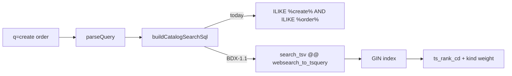

#### BDX-1.2 — Typo tolerance and “Did you mean” suggestions (#6286)

**Problem statement.** `paymnt` finds nothing and the page says so. A directory should answer *did you mean payment?* — the names and paths it holds are a small, high-value vocabulary.

**Solution / scope.**
- Enable `pg_trgm`; add trigram indexes on `classes.name`, `class_properties.name`, `version_path.pathname`, `path_operation_description.operation_id`, `projects.name`, `tenants.name`.
- Add `suggestCorrections(term)` to the engine: the top three vocabulary entries by `similarity()` above 0.35 that would return results.
- On zero results, the `NoResults` panel offers *Did you mean …?* as links that rewrite the query; the palette shows the same row.
- Unit-test the suggestion ranking and the query rewrite (one word swapped, operators kept).

**Acceptance criteria.**
- [ ] `paymnt` offers `payment` when a schema or path contains it.
- [ ] A correction never suggests a term with zero results.
- [ ] Suggestions appear within the existing search round trip or one extra query, never more.

**Parallelism / dependencies.** After BDX-1.1 (shares the vocabulary tables). Parallel with everything else.

**Technical stack.** PostgreSQL pg_trgm, TypeScript, vitest.

**Documentation (Docusaurus).** Pages: `browse-published-specs.md` — *Results page* bullet on corrections. Screenshots: n/a (the docs screenshot pipeline captures `apiome-ui` only until BDX-3.5 lands; until then write the Browse pages without screenshots and note it in the PR). Reference: n/a. Release notes: release-notes line.

```text
"paymnt"  ──▶ 0 results ──▶ similarity("paymnt", vocabulary) ──▶ [payment 0.71, payments 0.64] ──▶ "Did you mean payment?"
```

#### BDX-1.3 — Search within a version (#6287)

**Problem statement.** A visitor who lands on a 400-operation spec from a search result has only the browser's find. The sidebar filters by tag; nothing searches a path, a summary, a schema property or a response code inside the page.

**Solution / scope.**
- Add a find box at the top of the version page (`/` focuses it when the page is the primary surface) that filters the sidebar and the overview to matching operations and schemas, using `parseQuery` for words, phrases, `method:`, `path:` and `type:`.
- Highlight matches in the overview rows and schema cards with the shared `Highlight` component; count matches; `↵` jumps to the next match.
- Carry the query in the URL (`?find=`) so a search result can deep-link with the query pre-filled (`#op-…` plus `?find=`).
- Run the matching in the browser over the loaded spec (no server round trip); keep the matcher pure and tested.

**Acceptance criteria.**
- [ ] Typing `method:DELETE pets` narrows the sidebar and overview to DELETE operations on pet paths with the words highlighted.
- [ ] A search result link that includes `?find=` opens the version page already narrowed.
- [ ] No match: the page says so and offers to clear.
- [ ] The matcher has unit tests for words, phrases, `method:`, `path:`, `type:`.

**Parallelism / dependencies.** Parallel. Reuses `lib/search/query.ts` and `Highlight`.

**Technical stack.** React client components, TypeScript, vitest.

**Documentation (Docusaurus).** Pages: `browse-published-specs.md` — new *Find inside a version* section. Screenshots: n/a (the docs screenshot pipeline captures `apiome-ui` only until BDX-3.5 lands; until then write the Browse pages without screenshots and note it in the PR). Reference: n/a. Release notes: release-notes line; What's new.

```text
┌ Version page ───────────────────────────────────────────────┐
│ [ find in this version: method:DELETE pets          3 ↵ ]   │
│ Sidebar (3 of 42)  │ Overview: DELETE /pets/{petId} …       │
└─────────────────────────────────────────────────────────────┘
```

#### BDX-1.4 — Changelog and release-notes search (#6288)

**Problem statement.** Version notes are searchable; the classified changelog (CTG-3.2, `version_changelogs.changelog_json`) is not. *Which APIs removed a field called `status` this year?* is unanswerable.

**Solution / scope.**
- Add a `change` kind: one hit per classified entry (path, severity, summary) from `version_changelogs`, joined through the scope CTE; rank by severity then text.
- Add a `severity:` filter (`breaking`, `warning`, `info`) to the query language and the rail; `type:change` selects the kind.
- Hit row shows the severity pill (reuse `lib/changelog/group.ts` classes) and links to the version's *Changes* tab.
- Extend the SQL builder tests for the new member and filter.

**Acceptance criteria.**
- [ ] `severity:breaking status after:2026` lists breaking entries mentioning `status` in versions published this year.
- [ ] Change hits open the Changes tab of the right version.
- [ ] A version without a classification row contributes no change hits and no error.

**Parallelism / dependencies.** Parallel; needs the CTG-3.2 changelog rows (already on main).

**Technical stack.** PostgreSQL JSONB (`jsonb_array_elements`), TypeScript, vitest.

**Documentation (Docusaurus).** Pages: `browse-published-specs.md` — query-language rows for `type:change`, `severity:`. Screenshots: n/a. Reference: n/a. Release notes: release-notes line.

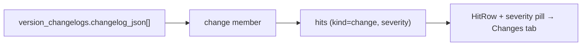

#### BDX-1.5 — Semantic search and “Ask the catalog” (#6289)

**Problem statement.** `how do I refund a charge` matches nothing lexical. The MCP catalog already stores `mcp_public_embedding vector(1536)` on versions; the REST/schema side has no embeddings and Browse has no semantic path.

**Solution / scope.**
- Embed operation summaries/descriptions and schema descriptions at publish time (REST job, reusing the MCP embedding pipeline and model choice); store on new vector columns with HNSW indexes.
- Add a hybrid mode to the engine: reciprocal-rank fusion of the FTS rank (BDX-1.1) and cosine similarity, enabled when the query reads as a question or when lexical results are empty.
- Palette: an *Ask* row (`?` prefix) that runs the hybrid search and labels results *semantic match*.
- Guard cost: embeddings computed once per published revision, never per query; fall back to lexical when the embedding service is unavailable.

**Acceptance criteria.**
- [ ] `how do I refund a charge` returns the refund operation first on a payments spec with no literal *refund* in the words typed… when the description says so.
- [ ] Lexical-only searches are unchanged in latency.
- [ ] A missing embedding service degrades to lexical with a notice, never to an error.

**Parallelism / dependencies.** After BDX-1.1 (fusion needs a lexical rank). Coordinate with AGX/MCAT embedding work.

**Technical stack.** pgvector (HNSW), the existing embedding client in apiome-rest, TypeScript.

**Documentation (Docusaurus).** Pages: `browse-published-specs.md` — *Ask the catalog*. Screenshots: n/a (the docs screenshot pipeline captures `apiome-ui` only until BDX-3.5 lands; until then write the Browse pages without screenshots and note it in the PR). Reference: REST: bump OpenAPI version if a job endpoint is added. Release notes: release-notes post.

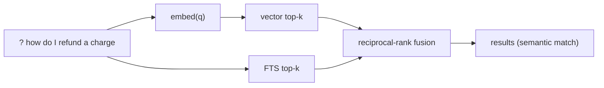

#### BDX-1.6 — Public search API, CLI command and shared contract (#6290)

**Problem statement.** The engine lives in a Next.js app. Partners, the CLI and the MCP tool (BDX-5.3) cannot search the catalog without scraping HTML, and two engines would drift.

**Solution / scope.**
- Define the search contract once (request: `q`, `scope`, `type`, `org`, `method`, `format`, `paradigm`, `after`, `before`, `sort`, `all`, `page`; response: rows, facets, totals — the shape of `CatalogSearchResponse`) as an OpenAPI schema in apiome-rest.
- Implement `GET /v1/browse/search` in REST over the same SQL (port the builder or generate it from one source; MFI-6.2's index from BDX-1.1); public, no auth, rate-limited like the other browse routes.
- Add `apiome browse search <query> [--type --org --method --json]` to the CLI, printing a table or JSON.
- Browse keeps its in-process engine for SSR (one hop fewer) but a contract test asserts REST and Browse return the same rows for a golden query set.

**Acceptance criteria.**
- [ ] `curl /v1/browse/search?q=method:POST+orders` returns the same hits as `/search?q=method:POST orders` in Browse (golden test).
- [ ] `apiome browse search orders --json` prints the response.
- [ ] OpenAPI version bumped; API reference regenerated; CLI reference regenerated.

**Parallelism / dependencies.** After BDX-1.1. Prerequisite for BDX-5.1 and BDX-5.3.

**Technical stack.** FastAPI, Pydantic, Python SQL mirror (or shared SQL text), Click CLI, vitest + pytest golden tests.

**Documentation (Docusaurus).** Pages: `browse-published-specs.md` — *With the REST API* and *With the CLI* get the search route and command. Screenshots: n/a. Reference: OpenAPI bump + API reference regen; CLI reference regen. Release notes: `apiome-rest/CHANGELOG.md` + release-notes post.

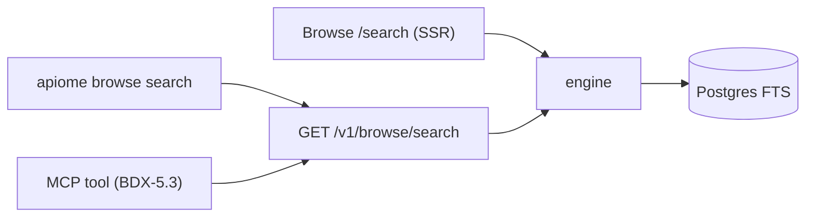

#### BDX-1.7 — Saved searches and search alerts (#6291)

**Problem statement.** A shareable URL is a save-by-bookmark. There is no *save this search* in the product, and no way to hear when a new version matches it.

**Solution / scope.**
- Phase 1 (browser only): *Save search* button stores the URL state in localStorage via `useStoredPref`; a *Saved* section on the search landing lists them with run / rename / remove; the palette lists them under *Saved*.
- Phase 2 (after PCX-2.2 #5897): *Alert me* turns a saved search into a subscription; the digest lists new hits since the last run; an Atom feed per saved search reuses BDX-5.2.
- Keep the saved-search shape (`SearchUrlState` + name + createdAt) versioned so phase 2 can import phase 1.

**Acceptance criteria.**
- [ ] A saved search survives reload and re-runs with the same URL state.
- [ ] Phase 2: a new published version matching a saved search produces one digest entry.

**Parallelism / dependencies.** Phase 1 parallel; phase 2 after PCX-2.2 (#5897) and BDX-5.2.

**Technical stack.** React, localStorage (phase 1); REST subscriptions + email (phase 2).

**Documentation (Docusaurus).** Pages: `browse-published-specs.md` — *Save a search*. Screenshots: n/a (the docs screenshot pipeline captures `apiome-ui` only until BDX-3.5 lands; until then write the Browse pages without screenshots and note it in the PR). Reference: phase 2: OpenAPI bump. Release notes: release-notes line per phase.

```text
[Save search] → localStorage{name,url} → Landing ▸ Saved · Palette ▸ Saved
          (phase 2) → POST /v1/subscriptions{kind:search,url} → digest / Atom
```

#### BDX-1.8 — Search analytics and zero-result log (#6292)

**Problem statement.** Nobody knows what visitors search for or where the engine fails them. Zero-result queries are the cheapest signal for both ranking fixes and catalog gaps.

**Solution / scope.**
- Record per-day counters (query text normalized, scope, result count bucket, clicked kind) with no visitor identifier, consent-aware per PCX-5.1 (#5912); finalized-day pruning like RDG-1.1.
- An admin report page in apiome-ui (*Browse search*): top queries, zero-result queries, click-through by kind, trend over 30 days.
- A nightly job that files the top zero-result queries into a review list (no auto-issues).

**Acceptance criteria.**
- [ ] Counters contain no IP, session or user id.
- [ ] The report answers *top 20 zero-result queries this week*.
- [ ] Opting out (consent) records nothing.

**Parallelism / dependencies.** Parallel; coordinate with PCX-5.1 for the consent mechanism.

**Technical stack.** PostgreSQL counters, Next.js route handler, apiome-ui report page.

**Documentation (Docusaurus).** Pages: `apiome-docs/docs/admin/` — new *Browse search report* page. Screenshots: apiome-ui report page: `browse-search-report` (light + dark). Reference: OpenAPI bump for the report endpoint. Release notes: release-notes line.

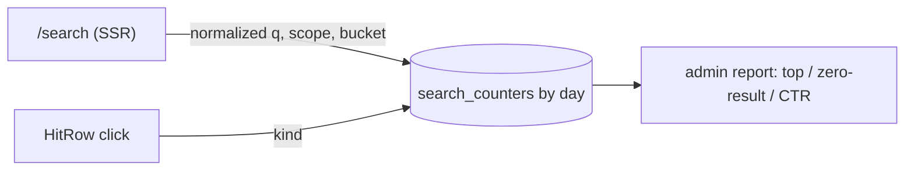

### BDX-EPIC-2 — Discovery and retail surfaces

#### BDX-2.1 — Explore pages by format, paradigm and organization (#6293)

**Problem statement.** The home chips link a format or paradigm to a filter-only search, which is a results page, not a landing page. A directory needs pages a search engine can index: *every GraphQL API on Apiome*.

**Solution / scope.**
- Three server-rendered listings with counts, descriptions (format family blurbs from `lib/browseFacets.ts`), the projects under each value, and a *Search within* link to the filtered search.
- Breadcrumbs, `<title>`/description per page, canonical URLs; link them from the navbar (*Explore*) and the home *Browse by* section.
- Reuse `SpecCard` and the facet roll-ups; no new SQL beyond grouping.

**Acceptance criteria.**
- [ ] `/explore/formats/graphql` lists every project with a published public GraphQL version.
- [ ] Pages render without JavaScript (SSR) and have unique titles.
- [ ] Home *Browse by* links point at explore pages; search stays one click away.

**Parallelism / dependencies.** Parallel.

**Technical stack.** Next.js server components, existing helpers.

**Documentation (Docusaurus).** Pages: `browse-published-specs.md` or the new browse-app page — *Explore*. Screenshots: n/a (the docs screenshot pipeline captures `apiome-ui` only until BDX-3.5 lands; until then write the Browse pages without screenshots and note it in the PR). Reference: n/a. Release notes: release-notes line.

```text
/explore ─┬─ /formats ──── /formats/graphql ──▶ projects + "Search within"
          ├─ /paradigms ── /paradigms/event_driven
          └─ /organizations (A–Z, counts)
```

#### BDX-2.2 — Project and version cards that answer the retail questions (#6294)

**Problem statement.** A card shows a name, a description and a date. `versions.quality_grade`, `mock_enabled`, the SDK offer, the operation and schema counts and the formats all exist and are not shown where a visitor decides whether to click.

**Solution / scope.**
- Extend the project/version queries with counts (`path_operation`, `classes`), `quality_grade`/`quality_score`, `mock_enabled`, SDK availability (from the public SDK info) and formats for the latest version.
- Add a compact *facts line* to `SpecCard`, `EntityHeader` and the project `HitRow`: `42 operations · 18 schemas · Grade B · Mock · SDK · OpenAPI 3.1 · updated 3d ago`.
- Sort options on the organization page and the home rails: most operations, best grade.
- Keep counts in the same query (no N+1); cache nothing new.

**Acceptance criteria.**
- [ ] Every project card and project search hit shows counts, grade when scored, mock/SDK badges when available.
- [ ] Organization page can sort by grade and by size.
- [ ] Home SSR time does not regress by more than 10% on the seeded fixture.

**Parallelism / dependencies.** Parallel. Precedes BDX-2.7 (needs the same card slot).

**Technical stack.** SQL aggregates, React.

**Documentation (Docusaurus).** Pages: browse page: *What a card tells you*. Screenshots: n/a (the docs screenshot pipeline captures `apiome-ui` only until BDX-3.5 lands; until then write the Browse pages without screenshots and note it in the PR). Reference: n/a. Release notes: release-notes line.

```text
┌ Payments API ─────────────────────────── Grade B ┐
│ Acme · /payments                                 │
│ 42 operations · 18 schemas · Mock · SDK · OpenAPI 3.1 · 3d ago │
└──────────────────────────────────────────────────┘
```

#### BDX-2.3 — Organization profiles: logo, links, verified badge (#6295)

**Problem statement.** Organizations are a monogram and a slug. Publishers cannot present themselves; readers cannot tell a verified vendor from a sandbox tenant.

**Solution / scope.**
- Add `tenants.profile` (logo asset reference, website, support URL, short tagline, long description Markdown, social links) and `verified_at`; RBAC `tenants:update`.
- apiome-ui: *Public profile* tab in tenant settings with preview; admin-only *Verified* toggle.
- Browse: logo in the organization header and cards (fallback monogram), tagline on cards and hits, verified check, links in the header.
- Sanitize Markdown; constrain logo size and type.

**Acceptance criteria.**
- [ ] A tenant with a logo and tagline shows both on `/tenant/{slug}`, in search hits and on cards.
- [ ] Verified shows only when an admin set it.
- [ ] Profile Markdown cannot inject HTML.

**Parallelism / dependencies.** Parallel; coordinate with PCX-5.4 (#5914) portal branding so the two do not define branding twice.

**Technical stack.** Flyway migration, FastAPI, Next.js (ui + browse), Markdown sanitizer.

**Documentation (Docusaurus).** Pages: `apiome-docs/docs/workspace/` tenant settings page — *Public profile*; browse page. Screenshots: apiome-ui: `tenant-public-profile` (light + dark). Reference: OpenAPI bump + regen. Release notes: release-notes post.

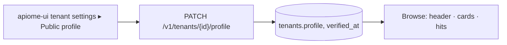

#### BDX-2.4 — Curated collections and featured APIs (#6296)

**Problem statement.** A retail front has editorial: *featured*, *new this month*, *for payments teams*. Browse has algorithmic rails only. The MCP catalog already has public collections (MCAT-22.4); the API catalog has none.

**Solution / scope.**
- Reuse the MCP collection model shape for API collections: name, slug, description, ordered members (project or version), published flag; admin UI in apiome-ui.
- Browse: a *Featured* rail on home (first published collection flagged featured), `/collections` index and `/collections/{slug}` page using `SpecCard`.
- Expose `collection:` in the query language and the rail so a search can be scoped to a collection.
- Version tags (`version_tags`, already searchable with `tag:`) get a *Tags* facet in the rail.

**Acceptance criteria.**
- [ ] An admin can publish a collection and it appears on home within one request.
- [ ] `collection:payments orders` searches inside the collection.
- [ ] Unpublished collections are invisible in Browse.

**Parallelism / dependencies.** Parallel; model mirrors MCAT-22.4.

**Technical stack.** Flyway, FastAPI, Next.js.

**Documentation (Docusaurus).** Pages: browse page — *Collections*; admin page for curation. Screenshots: apiome-ui: `collections-admin`. Reference: OpenAPI bump + regen. Release notes: release-notes post.

```text
admin ▸ Collections ─▶ api_collections(slug, members[]) ─▶ Browse: Featured rail · /collections/{slug} · collection: filter
```

#### BDX-2.5 — Related APIs and “more from this organization” (#6297)

**Problem statement.** Pages are dead ends: a visitor who reads one API has no path to the next one except the breadcrumb.

**Solution / scope.**
- A *Related* panel on project and version pages: same organization (newest first), then projects whose latest version shares three or more schema names (SQL over `classes`), then — when BDX-1.5 exists — nearest by embedding.
- Each related card is a `SpecCard` with the BDX-2.2 facts line.
- Cap at six; compute in one query per page.

**Acceptance criteria.**
- [ ] A project in an org with other projects shows them.
- [ ] Two petstore forks relate to each other by shared schema names.
- [ ] The panel adds no more than one query to the page.

**Parallelism / dependencies.** Parallel; the embedding tier waits for BDX-1.5.

**Technical stack.** SQL, React.

**Documentation (Docusaurus).** Pages: browse page — *Related APIs*. Screenshots: n/a (the docs screenshot pipeline captures `apiome-ui` only until BDX-3.5 lands; until then write the Browse pages without screenshots and note it in the PR). Reference: n/a. Release notes: release-notes line.

```text
Related ▸ [same org] → [shared schemas ≥3] → [embedding nearest]  (max 6)
```

#### BDX-2.6 — Compare from search and version quick-switch on hits (#6298)

**Problem statement.** Search with *All published* shows the same operation once per version, but turning that into a diff takes four clicks and a URL edit.

**Solution / scope.**
- A *Compare* checkbox on version/operation/schema hits of the same project (max two); a sticky bar offers *Compare v1.0.0 → v2.0.0* linking to `/tenant/{t}/{p}/compare?v1=&v2=`.
- The version chip on a hit opens a small menu of the project's other published versions (from the facets or one query) linking to the same anchor in that version.
- Keyboard: `c` toggles compare on the cursor row.

**Acceptance criteria.**
- [ ] Two hits of one project selected → one click opens the compare page at those versions.
- [ ] Selecting hits of different projects is refused with a message.
- [ ] The version menu lands on the same operation anchor in the other version when it exists.

**Parallelism / dependencies.** Parallel.

**Technical stack.** React.

**Documentation (Docusaurus).** Pages: browse page — *Compare from search*; `compare-published-versions.md` cross-link. Screenshots: n/a (the docs screenshot pipeline captures `apiome-ui` only until BDX-3.5 lands; until then write the Browse pages without screenshots and note it in the PR). Reference: n/a. Release notes: release-notes line.

```text
[x] POST /orders · v1.0.0     [x] POST /orders · v2.0.0   ──▶  ▸ Compare v1.0.0 → v2.0.0
```

#### BDX-2.7 — Popularity signals: views, downloads and “Popular this week” (#6299)

**Problem statement.** *Most active projects* means most versions, which rewards churn. A retail front ranks by what readers actually open and take.

**Solution / scope.**
- Daily counters per project/version for page views, spec downloads/exports and Try-It sends, with no visitor identifier (same substrate as BDX-1.8 and PCX-5.1).
- `sort=popular` in the search engine (counters joined in the scope CTE); *Popular this week* rail on home; a *views* fact on cards (BDX-2.2 slot).
- Admin can hide popularity for a tenant (privacy).

**Acceptance criteria.**
- [ ] Counters contain no identifiers.
- [ ] The rail and sort reflect the last seven finalized days.
- [ ] A tenant with popularity hidden shows no counts anywhere.

**Parallelism / dependencies.** After BDX-1.8 (shared counters) and BDX-2.2 (card slot).

**Technical stack.** PostgreSQL counters, SQL, React.

**Documentation (Docusaurus).** Pages: browse page — *Popular*; admin page for the privacy switch. Screenshots: n/a (the docs screenshot pipeline captures `apiome-ui` only until BDX-3.5 lands; until then write the Browse pages without screenshots and note it in the PR). Reference: OpenAPI bump if an admin endpoint is added. Release notes: release-notes line.

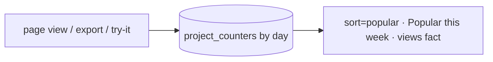

#### BDX-2.8 — Mobile and touch pass (#6300)

**Problem statement.** The pages are responsive, not designed for a phone: the stat pills wrap under the navbar, the filter drawer is desktop chrome, rails scroll but do not snap on touch, and the Monaco editor is unusable at 390 px.

**Solution / scope.**
- Bottom navigation (Discover · Search · MCP · Settings) under `md`; move the stat pills into the Discover page on mobile.
- Filter sheet from the bottom with *Apply* and a result count; sticky search box.
- Touch-snapping rails; 44 px targets audited; the spec viewer swaps Monaco for a read-only highlighted `<pre>` under `md` (FEATURE_ROADMAP 3.4).
- Playwright mobile checks for home, search, version.

**Acceptance criteria.**
- [ ] Every primary action is reachable with a thumb at 390 × 844.
- [ ] No horizontal scroll on home, search, version.
- [ ] Lighthouse mobile accessibility ≥ 95 on those pages.

**Parallelism / dependencies.** Parallel; after BDX-3.2 lands the a11y gate so regressions are caught.

**Technical stack.** Tailwind, React, Playwright.

**Documentation (Docusaurus).** Pages: browse page — *On a phone*. Screenshots: n/a (the docs screenshot pipeline captures `apiome-ui` only until BDX-3.5 lands; until then write the Browse pages without screenshots and note it in the PR). Reference: n/a. Release notes: release-notes line.

```text
┌──────────────┐
│  content     │
│              │
├──────────────┤
│ ⌂  🔍  ⬡  ⚙ │  ← bottom nav (< md)
└──────────────┘
```

### BDX-EPIC-3 — Retail polish, quality gates and docs

#### BDX-3.1 — Share the Hive token layer with Browse (#6301)

**Problem statement.** apiome-ui's Hive redesign defines tokens (`--fs-*`, surfaces, hairlines, `.hive-control`) with gates; Browse re-implements a navy-tinted zinc scale by hand. Two palettes drift; every brand change is done twice.

**Solution / scope.**
- Extract the token contract (globals `@theme`, dark-mode layering, metric utilities) into a shared stylesheet both apps import (workspace package or a build-time copy with a drift test).
- Port Browse's components to the tokens: navbar, cards, search band, rail, palette, tables; remove unlayered `h1`–`h3` sizing that the search page has to override with `!`.
- Add the Hive token gate (no raw hex outside the token file) to Browse's lint.
- Visual parity check with the HIVE-10.1 harness on three Browse routes.

**Acceptance criteria.**
- [ ] No hex literal outside the shared token file in Browse.
- [ ] Light and dark render from the same tokens as apiome-ui; the parity metric is within the HIVE-10.1 threshold.
- [ ] The search page no longer needs `!` size overrides.

**Parallelism / dependencies.** After the browse search ships (this baseline). Blocks BDX-3.2's contrast rules from being Browse-specific.

**Technical stack.** Tailwind v4 `@theme`, CSS layers, a drift test.

**Documentation (Docusaurus).** Pages: `apiome-docs/docs/admin/` design-system notes if present; otherwise the browse-app page *Appearance*. Screenshots: n/a. Reference: n/a. Release notes: release-notes line (visual refresh).

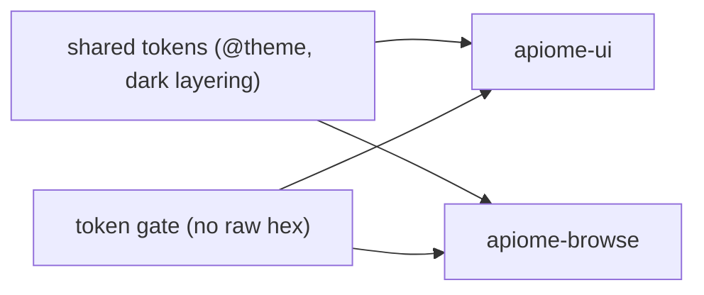

#### BDX-3.2 — Accessibility gate for Browse routes (#6302)

**Problem statement.** HIVE-10.2 gates apiome-ui's routes with axe in CI; Browse has no accessibility test at all, and the new search surface (palette, rail, keyboard cursor) is exactly where regressions hide.

**Solution / scope.**
- A route ledger (`e2e/a11y/routes.ts`) with fixtures (seeded DB or HTML dumps) for every Browse route and the palette open state; axe-core via Playwright, serious/critical fail, no exemption list (RC6-H2 precedent).
- Keyboard scripts: palette open/navigate/close, rail toggles, `j`/`k`/`↵`, filter drawer focus trap and return.
- A CI workflow mirroring `apiome-ui-a11y` with the path filters from the CI map (memory: per-workflow dependency map).
- Fix what it finds in the same PR.

**Acceptance criteria.**
- [ ] The workflow runs on PRs touching apiome-browse and fails on a serious/critical axe finding.
- [ ] Every route in the ledger has a fixture; a route added without one fails a test.
- [ ] Zero findings on main after the PR.

**Parallelism / dependencies.** Parallel. BDX-3.1 can relax Browse-only contrast exemptions later.

**Technical stack.** Playwright, axe-core, GitHub Actions.

**Documentation (Docusaurus).** Pages: `apiome-docs/docs/workspace/accessibility.md` — add the Browse app to the statement. Screenshots: n/a. Reference: n/a. Release notes: release-notes line.

```text
routes.ts ─▶ Playwright ─▶ axe (serious/critical) + keyboard scripts ─▶ CI (apiome-browse-a11y)
```

#### BDX-3.3 — Performance budgets and server paging for directory pages (#6303)

**Problem statement.** Home loads every public tenant into a client-side table; a tenant page loads every project. The search statement joins ten members with no supporting indexes beyond primary keys. RC6-H6 set a 50-row page and a first-row budget for apiome-ui; Browse has neither.

**Solution / scope.**
- Server paging (50 rows, URL `page=`) for the home organization directory and the tenant project list, with the facet counts still computed over the whole set (one aggregate query).
- Indexes: `versions(project_id, published, visibility, published_at DESC)` partial on public; `version_path(version_id)`, `classes(version_id)`, `class_properties(class_id)` where missing; verify with `EXPLAIN` on the seeded fixture.
- A first-row budget test (HIVE-13.3 style) for home, search results and the version page, with a seeded 1,000-project fixture; ceilings documented in the test helper.
- Record p95 for `/search?q=` on the fixture in the PR.

**Acceptance criteria.**
- [ ] Home and tenant pages render the first row within the documented budget at 1,000 projects.
- [ ] `EXPLAIN` for the search statement shows index scans on every member join.
- [ ] Facet counts stay whole-set while rows page.

**Parallelism / dependencies.** Parallel; BDX-1.1 replaces the text predicate later and keeps these indexes.

**Technical stack.** SQL, Flyway, vitest/Playwright timing tests.

**Documentation (Docusaurus).** Pages: n/a beyond a note on the browse-app page about paging. Screenshots: n/a. Reference: n/a. Release notes: release-notes line.

```text
home ▸ organizations: page=1..N (50) + facets over all  │  search: index scans per member  │  budget tests at 1,000 projects
```

#### BDX-3.4 — SEO, sharing metadata and OpenSearch (#6304)

**Problem statement.** Browse pages have one generic title and no structured data, so a search engine cannot index *Acme Payments API 2.1.0* as an API, a shared link shows no preview, and a browser cannot add Apiome as a search provider.

**Solution / scope.**
- `sitemap.xml` (organizations, projects, versions, explore pages) and `robots.txt` via Next route handlers; canonical URLs; per-page `<title>`/description (version: name, version, org).
- JSON-LD on organization (`Organization`), project/version (`WebAPI` with `documentation`, `provider`, `version`).
- Open Graph image routes for project and version pages (name, org, facts line from BDX-2.2) with `next/og`; Twitter card tags.
- `/opensearch.xml` describing `/search?q={searchTerms}` and the suggest endpoint; `<link rel=search>` in the layout.

**Acceptance criteria.**
- [ ] Rich-results test passes for a version page's `WebAPI` JSON-LD.
- [ ] A pasted version link shows a preview image with the project name and org.
- [ ] Chrome offers *Add Apiome* as a search engine from the home page.

**Parallelism / dependencies.** Parallel; the OG facts line is richer after BDX-2.2.

**Technical stack.** Next.js metadata API, `next/og`, JSON-LD.

**Documentation (Docusaurus).** Pages: browse-app page — *Sharing and search engines*; `admin/operating-apiome.mdx` — the public base URL the sitemap needs. Screenshots: n/a. Reference: n/a. Release notes: release-notes line.

```text
/sitemap.xml · /robots.txt · /opensearch.xml · <script type=application/ld+json> · /tenant/{t}/{p}/{v}/opengraph-image
```

#### BDX-3.5 — Docs screenshots for the Browse app (#6305)

**Problem statement.** The screenshot pipeline captures `apiome-ui` only (`DOCS_UI_URL`, `--start-ui`). Every Browse docs task has to say *no screenshot*, so the retail surface is undocumented visually.

**Solution / scope.**
- Manifest entries gain `app: "browse"` (default `ui`); the script resolves `DOCS_BROWSE_URL` (default `http://localhost:3001`), `--start-browse`, and skips sign-in for browse jobs.
- Staleness sources default to `apiome-browse/src/app/<route>` for browse entries.
- Add entries: `browse-home`, `browse-search-landing`, `browse-search-results`, `browse-search-palette`, `browse-version`, `browse-compare`, and reference them from the Ship pages.
- A fixture dump mode for Browse (seeded DB or static HTML) so CI can capture without the stack, as `--fixtures-only` does for ui.

**Acceptance criteria.**
- [ ] `yarn docs:screenshots -- --id browse-search-results` captures light and dark at 1440 × 900.
- [ ] `yarn docs:check` reports staleness for browse entries when their route folder changes.
- [ ] The Ship pages show the Browse screens.

**Parallelism / dependencies.** Parallel; unblocks the screenshot items of every other BDX issue.

**Technical stack.** Playwright, tsx, the docs gate libs.

**Documentation (Docusaurus).** Pages: `apiome-docs/docs/admin/contribute-to-the-docs.mdx` — the browse target; Ship pages get the screenshots. Screenshots: the six browse ids above. Reference: n/a. Release notes: release-notes line.

```text
screens.json{app:"browse"} ─▶ screenshots.ts ─▶ DOCS_BROWSE_URL (3001) ─▶ png light/dark ─▶ <Screenshot id="browse-…"/>
```

#### BDX-3.6 — Browse guide page set and in-app help links (#6306)

**Problem statement.** One section on *Browse published specs* now carries the whole search language. The app's empty states and syntax card have nowhere to link.

**Solution / scope.**
- `ship/browse-app.mdx`: what Browse is, who sees what (public only; private per BDX-4), home, organization/project/version pages, compare, export, MCP catalog; cross-links.
- `ship/search-the-catalog.mdx`: the query language table (moved from browse-published-specs), the results page, keyboard, sharing; screenshots once BDX-3.5 exists.
- Browse: *Learn the syntax* link in the syntax card and the no-results panel to the docs page (absolute URL like `SUPPORTED_FORMATS_DOC_URL`); the help catalog entry pattern from CDG-2.1.
- `yarn docs:check` green; sidebar positions set.

**Acceptance criteria.**
- [ ] Both pages exist with front matter and appear under Ship.
- [ ] The syntax card's *Learn more* opens the search page of the docs.
- [ ] No orphan or broken link in `docs:check`.

**Parallelism / dependencies.** Parallel; screenshots after BDX-3.5.

**Technical stack.** Docusaurus MDX.

**Documentation (Docusaurus).** Pages: the two new pages above; `browse-published-specs.md` trimmed to link them. Screenshots: after BDX-3.5: `browse-search-results`, `browse-search-palette`. Reference: n/a. Release notes: release-notes line.

```text
Ship ▸ Browse app ▸ Search the catalog  ◀── Browse: syntax card "Learn more" · NoResults "How search works"
```

#### BDX-3.7 — Copy gate and i18n-ready strings for Browse (#6307)

**Problem statement.** Browse copy was written page by page; HIVE-10.4's voice rules (no exclamation marks, sentence case, verbs on buttons) are not enforced, and every string is inline JSX, which PCX-5.5 (i18n routing, RTL) cannot translate.

**Solution / scope.**
- Port the TS-AST copy scanner from apiome-ui to Browse with the same ratchets; fix findings.
- Introduce a `messages` module (plain object per page) and move user-visible strings there; no runtime i18n library yet — the structure is what PCX-5.5 needs.
- RTL smoke: `dir=rtl` render of home and search must not break layout (logical CSS properties).

**Acceptance criteria.**
- [ ] Scanner runs in CI for Browse with zero findings on main.
- [ ] No user-visible string literal remains in a component outside the messages module (a test asserts it).
- [ ] Home and search render acceptably with `dir=rtl`.

**Parallelism / dependencies.** Parallel; precedes PCX-5.5 (#5915) for Browse.

**Technical stack.** TypeScript AST scanner, CSS logical properties.

**Documentation (Docusaurus).** Pages: n/a (internal); a line in `admin/contribute-to-the-docs.mdx` if the scanner has a docs rule. Screenshots: n/a. Reference: n/a. Release notes: n/a (no user-visible change) — say so in the PR.

```text
components ──▶ messages.ts ──▶ (PCX-5.5) locale catalogs   │  copy scanner ratchet in CI
```

### BDX-EPIC-4 — Private APIs in Browse

#### BDX-4.1 — Reader session in Browse (#6308)

**Problem statement.** Browse has no notion of a visitor. PCX-1.1 (#5889) defines reader identity and a portal session; Browse must read it before any private content can appear.

**Solution / scope.**
- Read the reader session (cookie on the shared domain, or a token handoff from apiome-ui) server-side; validate with REST; never trust a client claim.
- Navbar: *Sign in* opens the portal sign-in; signed-in state shows the reader and *Sign out*; no UI change for anonymous visitors.
- Thread the session into the DB layer as a `viewer` object (anonymous by default) so BDX-4.2 can gate rows; log nothing about anonymous visitors.

**Acceptance criteria.**
- [ ] A signed-in reader sees their name in the navbar across pages.
- [ ] A forged cookie yields anonymous, never an error.
- [ ] Anonymous rendering is byte-identical to today.

**Parallelism / dependencies.** After PCX-1.1 (#5889); EID-5.2 (#5689) for IdP sign-in later.

**Technical stack.** Next.js middleware/server components, Better Auth session validation via REST.

**Documentation (Docusaurus).** Pages: browse-app page — *Sign in*; PCX reader pages. Screenshots: n/a (the docs screenshot pipeline captures `apiome-ui` only until BDX-3.5 lands; until then write the Browse pages without screenshots and note it in the PR). Reference: OpenAPI bump if a validation endpoint is added. Release notes: release-notes post.

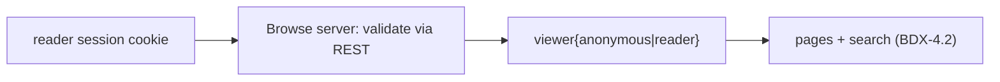

#### BDX-4.2 — Private versions in search and pages for signed-in readers (#6309)

**Problem statement.** Every Browse query hard-codes `visibility = 'public'`. PCX-1.3 (#5891) wants private versions in Browse for readers who are allowed; the search engine and every page must agree on the rule.

**Solution / scope.**
- Replace the public gate with a `visible_versions(viewer)` predicate: public, plus private versions whose project the viewer's reader grants cover (EID-5.1 #5688 grant model), evaluated server-side from the validated session.
- Search: `visibility:` filter and rail facet; a *Private* badge on hits and cards; counts honest to the viewer.
- Pages: project/version/compare/export honour the same predicate; direct URLs to private content 404 for anonymous visitors.
- A permission-matrix style test (RC6-H5 precedent): anonymous, reader-with-grant, reader-without-grant × every route and the search engine.

**Acceptance criteria.**
- [ ] Anonymous: no private row ever appears in any response (test enumerates routes and the suggest API).
- [ ] A reader with a grant sees the private version in search, on the project page and in compare.
- [ ] Revoking the grant hides it on the next request.

**Parallelism / dependencies.** After BDX-4.1, PCX-1.3 (#5891), EID-5.1 (#5688).

**Technical stack.** SQL predicate shared by every query, vitest matrix test, Playwright.

**Documentation (Docusaurus).** Pages: `browse-published-specs.md` — *Private versions*; PCX reader pages. Screenshots: n/a (the docs screenshot pipeline captures `apiome-ui` only until BDX-3.5 lands; until then write the Browse pages without screenshots and note it in the PR). Reference: n/a. Release notes: release-notes post.

```text
scope CTE: WHERE published AND (visibility='public' OR project_id IN viewer.grants)  ──▶ every member · every page
```

#### BDX-4.3 — API-key scoped browsing (#6310)

**Problem statement.** REST already serves private versions to an in-scope API key (`published.mdx` documents the dialog in apiome-ui). Browse cannot use one, so a partner with a key still cannot search the private spec they were given.

**Solution / scope.**
- *Use an API key* in the navbar: the key is sent to REST once for validation (scopes, tenant, projects) and kept only in an HttpOnly, SameSite cookie bound to the Browse origin; never in localStorage, never logged.
- The viewer object (BDX-4.1 shape, implemented here first) carries the key's grants; the scope CTE admits those projects' private versions (the predicate BDX-4.2 generalizes).
- A *Private · key* badge on hits and cards; *Forget key* clears the cookie.
- Rate-limit validation; keys never appear in URLs.

**Acceptance criteria.**
- [ ] With a valid key, the private versions of its projects appear in search and pages; without, nothing changes.
- [ ] The key is not readable from JavaScript and is absent from server logs (test greps the log).
- [ ] An expired or revoked key degrades to anonymous with a notice.

**Parallelism / dependencies.** Parallel; delivers the viewer seam BDX-4.1/4.2 build on.

**Technical stack.** Next.js route handler + cookies, REST key validation, SQL predicate.

**Documentation (Docusaurus).** Pages: `browse-published-specs.md` — *Browse private versions with an API key*. Screenshots: n/a (the docs screenshot pipeline captures `apiome-ui` only until BDX-3.5 lands; until then write the Browse pages without screenshots and note it in the PR). Reference: OpenAPI bump if a validation endpoint is added. Release notes: release-notes post.

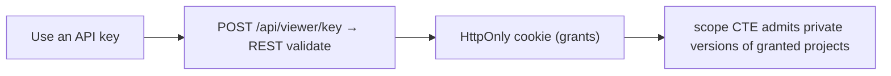

#### BDX-4.4 — Tenant-scoped portal mode (#6311)

**Problem statement.** A publisher wants `developers.acme.com` to be Browse for Acme only. PCX-5.4 (#5914) and PCX-5.6 (#5916) define branding and custom domains; Browse needs the scoped mode they point at.

**Solution / scope.**
- Middleware resolves the host (or `?org=`) to a tenant; the layout switches to the tenant's branding (BDX-2.3 profile), hides other organizations, and locks `org:` in every search request (the rail shows it as fixed).
- Home becomes the organization page; the MCP catalog is scoped the same way.
- Canonical URLs and sitemap per domain (BDX-3.4).

**Acceptance criteria.**
- [ ] On the custom domain, search and every page show only that tenant's content.
- [ ] Removing the lock restores the full directory.
- [ ] The sitemap on the domain lists only that tenant.

**Parallelism / dependencies.** After PCX-5.4 (#5914), PCX-5.6 (#5916), BDX-2.3, BDX-3.4.

**Technical stack.** Next.js middleware, REST domain lookup.

**Documentation (Docusaurus).** Pages: PCX custom-domain page + browse-app page — *Your own portal*. Screenshots: n/a (the docs screenshot pipeline captures `apiome-ui` only until BDX-3.5 lands; until then write the Browse pages without screenshots and note it in the PR). Reference: n/a. Release notes: release-notes post.

```text
developers.acme.com ─▶ middleware: host→tenant ─▶ org lock + branding ─▶ home=org page · search org:acme fixed
```

### BDX-EPIC-5 — Machine and agent access to Browse search

#### BDX-5.1 — JSON search results, llms.txt and per-page Markdown (#6312)

**Problem statement.** An agent that lands on Browse gets HTML. PCX-EPIC-4 (#5907) wants an agent-readable portal; PCX-4.2 (#5908) per-page Markdown. The search surface and the index file are the two entry points an agent needs first.

**Solution / scope.**
- `GET /api/search?…` returning `CatalogSearchResponse` (same contract as REST BDX-1.6, documented once); `/search` answers JSON on `Accept: application/json`.
- `/llms.txt` listing the directory structure, the search URL template and the top organizations; per-organization `llms.txt` under `/tenant/{slug}/llms.txt`.
- Version pages answer `Accept: text/markdown` with a rendered Markdown of the overview (operations, schemas) — coordinate the renderer with PCX-4.2 so there is one.

**Acceptance criteria.**
- [ ] `curl -H 'Accept: application/json' /search?q=orders` returns JSON matching the contract.
- [ ] `/llms.txt` validates against the llms.txt convention.
- [ ] A version page in Markdown lists every operation with method, path and summary.

**Parallelism / dependencies.** After BDX-1.6 (contract). Coordinate PCX-4.2 (#5908), PCX-EPIC-4 (#5907).

**Technical stack.** Next.js route handlers, content negotiation, Markdown renderer.

**Documentation (Docusaurus).** Pages: `apiome-docs/docs/reference/` — search API page; browse-app page — *For agents*. Screenshots: n/a. Reference: search API reference (from the OpenAPI schema of BDX-1.6). Release notes: release-notes post.

```text
agent ──▶ /llms.txt ──▶ /api/search?q= (JSON) ──▶ /tenant/{t}/{p}/{v} (Accept: text/markdown)
```

#### BDX-5.2 — Atom feed for a search (#6313)

**Problem statement.** Project changelog feeds exist (`changelog.xml`); a search cannot be followed. *Every new version from org:acme* or *every new DELETE operation on /payments* is a feed a reader would subscribe to.

**Solution / scope.**
- A route that resolves the same `SearchUrlState`, forces `sort=newest&all=1`, and renders the first 50 hits as Atom entries (id = hit_id, updated = published_at, link = hitHref).
- `<link rel=alternate type=application/atom+xml>` on the results page; a *Subscribe* button next to *Copy link*.
- Cache headers: `max-age=300`.

**Acceptance criteria.**
- [ ] A feed reader subscribed to `/search.atom?q=org:acme` shows a new entry when Acme publishes.
- [ ] The feed validates (W3C feed validator).
- [ ] Entries link to the same anchors as the HTML results.

**Parallelism / dependencies.** Parallel; BDX-1.7 phase 2 uses it.

**Technical stack.** Next.js route handler, the existing feed module.

**Documentation (Docusaurus).** Pages: `browse-published-specs.md` — *Follow a search*. Screenshots: n/a. Reference: n/a. Release notes: release-notes line.

```text
/search?q=org:acme ──[Subscribe]──▶ /search.atom?q=org:acme (newest, all versions, 50 entries)
```

#### BDX-5.3 — `browse_search` MCP tool (#6314)

**Problem statement.** An MCP host connected to Apiome can read a known spec but cannot find one. Discovery is the first thing an agent does.

**Solution / scope.**
- A `browse_search` tool (arguments mirror the search contract; results trimmed to kind, title, org/project/version, href, snippet) calling `GET /v1/browse/search`; no auth needed for public; the agent-key path (AGX) scopes private results later with BDX-4.x.
- Golden toolset entries and the description-enrichment overrides (AGX-1.3) so the tool reads well in hosts.
- Regenerate the MCP reference.

**Acceptance criteria.**
- [ ] An MCP host lists `browse_search` and a call for `orders` returns ranked hits with hrefs.
- [ ] Golden toolset tests pass; the MCP reference page shows the tool.

**Parallelism / dependencies.** After BDX-1.6. Coordinate CDG-4.1 (#5973) registry API and AGX toolsets.

**Technical stack.** Python MCP server, golden tests.

**Documentation (Docusaurus).** Pages: `apiome-docs/docs/reference/mcp-*` — tool reference; `reference/mcp-quickstart.md` example. Screenshots: n/a. Reference: MCP reference regen. Release notes: release-notes line.

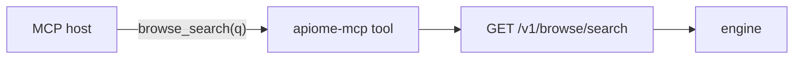

## 5. Work to be done, in order

Waves are checkpoints, not gates: a lane moves on as soon as its own dependencies are merged.

| Wave | Lane: engine | Lane: surfaces | Lane: gates & docs | Lane: private | Lane: machine |
|---|---|---|---|---|---|
| **1 — Browse RC** | BDX-1.3 find-in-version · BDX-1.1 FTS (with MFI-6.2) | BDX-2.2 cards · BDX-2.6 compare from search | BDX-3.5 screenshots → BDX-3.6 pages · BDX-3.2 a11y gate · BDX-3.3 budgets · BDX-3.4 SEO | BDX-4.3 API-key browsing | — |
| **2** | BDX-1.6 search API + CLI · BDX-1.2 did-you-mean · BDX-1.4 changelog search | BDX-2.1 explore · BDX-2.3 org profiles · BDX-2.5 related | BDX-3.1 shared tokens · BDX-3.7 copy gate | BDX-4.1 reader session (after PCX-1.1) | BDX-5.2 Atom feed · BDX-5.1 JSON + llms.txt (after 1.6) |
| **3** | BDX-1.8 analytics · BDX-1.7 saved searches · BDX-1.5 semantic | BDX-2.4 collections · BDX-2.7 popularity (after 1.8) · BDX-2.8 mobile | — | BDX-4.2 private in search (after PCX-1.3) · BDX-4.4 portal mode (after PCX-5.x) | BDX-5.3 MCP tool (after 1.6) |

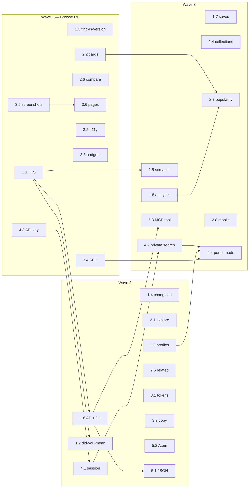

### Dependencies outside this roadmap

| This roadmap | Waits for | Why |
|---|---|---|
| BDX-1.1 | MFI-6.2 (#3754) | one FTS index for REST and Browse |
| BDX-1.7 phase 2 | PCX-2.2 (#5897) | subscriptions |
| BDX-1.8, BDX-2.7 | PCX-5.1 (#5912) | consent mechanism |
| BDX-2.3 | PCX-5.4 (#5914) | one definition of tenant branding |
| BDX-4.1 | PCX-1.1 (#5889), EID-5.2 (#5689) | reader identity and sign-in |
| BDX-4.2 | PCX-1.3 (#5891), EID-5.1 (#5688) | private-in-Browse policy and grants |
| BDX-4.4 | PCX-5.4 (#5914), PCX-5.6 (#5916) | branding and custom domains |
| BDX-5.1 | PCX-4.2 (#5908), PCX-EPIC-4 (#5907) | one Markdown renderer, one agent-portal story |
| BDX-5.3 | CDG-4.1 (#5973), AGX toolsets | registry API and tool quality |
| BDX-3.7 | precedes PCX-5.5 (#5915) | i18n needs a message catalog |

### Not in this roadmap

- Reader analytics beyond counters, feedback widgets and branding themes — PCX-EPIC-5 (#5911).
- gRPC / GraphQL test-drive in Browse — XPC-3.5 (#5744).
- Product pages, plans and *My apps* in Browse — APX (#6100, #6105).
- Try-It credential injection — CVT-2.7 (#6144).

