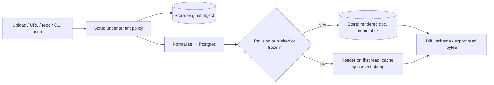

# Roadmap — Catalog, Projects, OpenAPI and Arazzo (RC9)

_Drafted 2026-11-19. Release: **RC9** (see [`RC9_PLAN.md`](RC9_PLAN.md)). Priority: **high** — these are the core of Apiome._
_The Contracts and PactFlow release is **RC10**: [`RC10_PLAN.md`](RC10_PLAN.md)._

**Umbrella:** [#7032](https://github.com/apiome/apiome/issues/7032). **Issue ID prefix:** `COA`. Epics `COA-EPIC-n`, issues `COA-n.m`. **GitHub title format:** `apiome: [COA-<epic>.<issue>] <title>`.

## 0. Source description (request, verbatim)

> Once RC9 is complete, create an RC10 that contains all of the remaining cleanup and improvement items for the Projects and Catalog, since OpenAPI/Arazzo is high priority, along with the Catalog import/export features. These are the core to Apiome, and important to keep current and competitive. It may make sense to make this an RC9, and rename the current RC9 that's being created (for pact and contracts) to RC10.

**Added 2026-11-19 (COA-EPIC-5):**

> The more I think about it, when we're storing original versions of files that are imported, the files are imported, but they are recreated when requested, so actions like diffs between two very very large versions of OpenAPI specifications take a very long time to run, because the two files have to be generated dynamically, then a diff is created, then ultimately displayed to the user. Isn't it a better idea to store the original documents in S3, but have the normalized data stored in the database? If this is possible, it would be nice to set an S3 store parameter in the REST server, or in the UI, so that it can pull those original files from a store rather than needing to recreate them. If this is not the way it currently runs, it _should_ be for RC9, as we are hardening the functionality now. The data can still be stored in normalized form, but the _original_ should be stored outside of the server so that it can have file I/O features applied to it more quickly.

**What the code does today (checked 2026-11-19 on `main` @ b3bccb2e7):**

| Concern | Today | Where |
| --- | --- | --- |
| OpenAPI original | Scrubbed source text kept in a Postgres `TEXT` column, once per revision, for provenance only. Nothing else reads it | `apiome.version_import_snapshots.source_text` (V362), `database.record_import_snapshot` |
| Other-format original | Scrubbed text inside the revision's JSONB `format_metadata.sourceContent`; missing for some revisions (`422 source-not-captured`, E1-6 backfill) | `versions.format_metadata`, `catalog_conversion.resolve_source_payload`, `source_backfill.py` |
| OpenAPI diff / compatibility | **Both documents are regenerated on every request**: `openapi_for_revision` loads every class, then runs one property query per class, then `generate_openapi_spec`; repeated for each transitive baseline | `compatibility_engine.openapi_for_revision`, `classified_diff_routes._compare` |
| Other-format diff | Canonical model re-parsed from `sourceContent` on every request | `compatibility_modes.canonical_model_for_revision` |
| UI document views | **A second, TypeScript generator runs in the Next.js server** and reads the database directly: Versions **View OpenAPI** and **Compare** (both sides built per click, then a Monaco text diff), the Catalog Versions tab inline diff, and the merge-request and review spec views. It bypasses REST, so any REST-side cache would not help these screens | `apiome-ui/lib/db/helper.ts` `buildOpenApiSpecForVersion` / `buildOpenApiSpecJsonForVersion`, `versions/page.tsx` `loadVersionSpec`, `utils/catalog-revision-diff.ts`, `api/merge-requests/[id]/spec`, `api/reviews/[id]/spec` |
| Other REST features | 31 modules call `generate_openapi_spec` / `openapi_for_revision` directly: lint, mock, Swagger UI, merge preview/merge/rollback, publish prechecks and guardrail, publication change report and changelog, PR-back, reviews, source workspace/provenance/preservation, consumer contracts, blast radius, component governance, repository federation, spec sync, import delta, quality capture, style guides, export/conversion | `git grep -l "generate_openapi_spec\|openapi_for_revision" apiome-rest/src` |
| `GET /v1/schema` | Regenerated per request unless the version is frozen; frozen bytes are a DB `BYTEA` | `version_spec_snapshots` (V279) |
| Object storage | Only for export **delivery** to a customer bucket (vault credential, boto3). The shared export artifact store's object backend is a **stub** that raises `ExportArtifactStoreNotConfigured` | `export_object_storage_delivery*.py`, `export_artifact_store.py` |
| Download the original | No endpoint, CLI command or UI action | — |

So the request describes the intended design, not the current one. One point shapes the design: a diff between two revisions has to compare what each revision **is now**, and a revision can be edited after import. Stored originals make "download / diff the original files" instant, but on their own they do not speed up a diff of an edited revision. COA-EPIC-5 therefore stores two kinds of object: the **original** (immutable, content-addressed) and the **rendered document** (the generated OpenAPI / canonical JSON for a revision at a given content stamp, written once for published or frozen revisions and cached for drafts). Normalized data stays in Postgres as the source of truth for editing.

## 1. Current standards (checked 2026-11-19)

| Spec | Current | Apiome today |
| --- | --- | --- |
| OpenAPI | **3.2.0** (3.1.2 patch, 3.0.4) | Import/emit 2.0, 3.0, 3.1, 3.2; 3.1/3.2 meta-schema validation; 3.2 `query`, `additionalOperations`, tag hierarchy modelled |
| Arazzo | **1.1.0** (May 2026; AsyncAPI sources, `querystring`) | Read/normalise/lint/emit 1.0.x and 1.1.x in apiome-rest, the CLI, the legacy and UI generators and the docs (COA-1.1); runs a stored workflow against a verification target or mock (COA-1.7) |
| Overlay | **1.1.0** (`copy`, RFC 9535), 1.2 in progress | Applies 1.0–1.2 with provenance; stored overlays; lint rules; no UI manager |

Sources: OpenAPI Initiative newsletters (Feb and Jun 2026), the Arazzo specification page and Redocly's Arazzo 1.1 release post. Competitive notes (from the Oct 2026 market analysis): OpenAPI 3.2 is a lead for Apiome (Spectral added 3.2 on 1 Oct 2026); Specmatic charges for Arazzo testing; Redocly/vacuum/Spectral lint Arazzo and Overlay; lint `--fix` and governance scorecards are the catch-up items (adopted below).

## 2. MVP definition

A team can (1) import an Arazzo 1.0/1.1 workflow with the OpenAPI/AsyncAPI files it calls, see it as steps and a graph, and export it as the right version; (2) trust that no OpenAPI 3.0/3.1/3.2 construct is silently lost, with every version validated; (3) author and see the 3.2 additions in Projects; (4) manage Overlays in the UI; (5) export bundled, dereferenced or split specs; (6) read docs that match the code; and (7) on an install with an S3-compatible document store configured, download any revision's original file and diff two large revisions without regenerating either document. COA-EPIC-5 ships in RC9 in full, with no MVP / V2 split. **V2:** workflow execution, change classification for Arazzo, the upgrade assistant, `$ref` hygiene, new validators.

## 3. Existing issues adopted (not duplicated)

| Issue | Title | Epic |
| --- | --- | --- |
| #5875 | GVM-EPIC-4 Arazzo and Overlay governance | Governance |
| #5879 | GVM-4.4 Arazzo 1.1 validation rules | Governance |
| #5880 | GVM-4.5 Arazzo and Overlay in the ladder, fixes and CLI | Governance |
| ✅ #5868 | GVM-EPIC-3 Deterministic auto-fix (GVM-3.1–3.6) — Complete | Governance |
| ✅ #5869 | GVM-3.1 rule SPI — Complete | Governance |
| ✅ #5870 | GVM-3.2 fix plan, apply and Overlay rendering — Complete | Governance |
| ✅ #5871 | GVM-3.3 `apiome lint --fix` and `--dry-run` (version mode; file mode follows GOV-3.5 #4442) — Complete | Governance |
| ✅ #5872 | GVM-3.4 CI fix suggestions (diff-action suggestion blocks, `apiome lint suggest`, gate and check-suite summaries) — Complete | Governance |
| #6654 | MFX-38.1 follow-up: GitLab/Bitbucket/Azure DevOps export git delivery | Import/export |
| #6706 | Catalog import and export demo script | Cleanup |

Related, not adopted: #5849/#5851/#4544 (Arazzo for agents, in Agent Tool Quality; unblocked by COA-1.7), #5804 (Overlays as SDK input). Decision needed: the Version Archaeology epic #1023 and Diff 0.247–0.251 (evolution timeline, change attribution, cross-project comparison, merge assistant) are Projects improvements that were moved to the Diff project on 2026-11-19; RC9 can take them.

## 4. Epics

| Epic | Title | Issues |
| --- | --- | --- |
| ✅ COA-EPIC-1 | Arazzo: complete, current and visible — Complete | 7 |
| ✅ COA-EPIC-2 | OpenAPI 3.2 / 3.1 fidelity and authoring — Complete | 8 |
| COA-EPIC-3 | Import and export fidelity | 6 |
| COA-EPIC-4 | Catalog and Projects cleanup | 4 |
| COA-EPIC-5 | Document store: originals and rendered documents in object storage | 15 |

### ✅ COA-EPIC-1 · [#7033](https://github.com/apiome/apiome/issues/7033) — Arazzo: complete, current and visible — Complete

Arazzo 1.0/1.1 is read, normalised, linted and emitted in apiome-rest, but the CLI, the legacy generator, the UI generator and the docs still say 1.0, workflows have no viewer, and filesets are not supported.

All seven issues of this epic are complete. The epic's overview page is `build/arazzo.mdx` (**Arazzo in Apiome**: the import → read → check → compare → export → run lifecycle, 1.0 vs 1.1, how the pieces fit), with release note `arazzo-complete-current-visible` and a What's new line.

**✅ COA-1.1 · #7037 Arazzo 1.1 consistency sweep: CLI, generator, UI and docs — Complete**
- **Shipped:** CLI 0.148.0 vendors the Arazzo 1.1 schema (`import_/schemas/arazzo/1.1/2026-04-15.json`) and validates each document against the schema for the version it declares (`arazzo_version_line`; other versions fail at `/arazzo`). REST 1.767.0 / OpenAPI 1.598.0: `GET /v1/arazzo/...` (and the per-class route) take `arazzo_version` (default `1.0.1`; `400` otherwise); `arazzo_generator.resolve_generator_arazzo_version` applies the export target's rule (`1.1.0` for AsyncAPI sources, a 1.0 request for one is rejected). UI 0.671.0: `generateArazzoSpec` takes `arazzoVersion` / `sourceDescriptions` (`resolveArazzoVersion`); the import analyzer accepts 1.1.x; the Projects importer accepts `asyncapi` sources in a 1.1 document and leaves their steps to the server. Docs: `bring-in/import-a-spec.md`, `ship/export-a-spec.md`, regenerated REST/CLI reference, `ARAZZO_ENDPOINTS.md`, release note `arazzo-1-1-consistency`.
- **Problem:** apiome-rest reads 1.0.x and 1.1.x (`arazzo_spec.py`, vendored schemas for both), but `apiome-cli/.../import_/arazzo.py` validates 1.0 only, the legacy generator behind `/v1/arazzo/{tenant}/{project}/{version}` and the UI generator (`apiome-ui/src/app/utils/arazzo.ts`, `templates/arazzo/arazzo-spec.hbs`) emit 1.0.1, and `apiome-rest/docs/ARAZZO_ENDPOINTS.md` and several docs pages say "Arazzo 1.0".
- **Solution/Scope:**
- Vendor the 1.1 schema into the CLI and validate against the version the document declares.
- Give the legacy generator and the UI generator an `arazzoVersion` option (`1.1.0` default for AsyncAPI-bearing sources, otherwise preserve; `1.0.1` selectable).
- Update `ARAZZO_ENDPOINTS.md`, the import wizard copy, `catalog-import-formats.ts` descriptions and the docs pages; remove every "Arazzo 1.0" claim that is no longer true.
- Add a test per surface that a 1.1 document (with an AsyncAPI source) round-trips.
- **Acceptance Criteria:**
- A 1.1 document validates in the CLI, imports in the wizard, and exports from the generator with no downgrade.
- `grep -ri "arazzo 1.0"` over docs and UI copy returns only deliberate mentions.
- Tests cover 1.0.1 and 1.1.0 on each surface.
- **Parallelism/Dependencies:** None; first item of the release.
- **Technical Stack:** apiome-rest, apiome-cli, apiome-ui, apiome-docs
- **Documentation:** `bring-in/import-a-spec.md`, `ship/export-a-spec.md`, `reference/` pages for the Arazzo endpoint and CLI; screenshots: n/a (no UI change)

**✅ COA-1.2 · #7038 Arazzo multi-file filesets — Complete**
- **Shipped:** REST 1.768.0 / OpenAPI 1.599.0: archive, bulk and repository intake rank an Arazzo workflow whose `sourceDescriptions` name sibling members as the root (its sources are dependencies, not rival roots; `.arazzo.*` added to `_ROOT_CANDIDATE_SUFFIXES`; the bulk/git reference closure follows source URLs). New `app.arazzo_source_resolution` resolves each source fileset → catalog (`Database.find_arazzo_source_in_catalog`: same repo/branch path, or same URL) → remote (`remote_ref_resolver.fetch_remote_documents`, SSRF-guarded, under `resolve_remote_refs` + the kill switch). The job summary's `arazzo_sources` block, `ARAZZO_SOURCES_*` events and `format_metadata.arazzoSources` list every unresolved source with a stable reason code. CLI 0.149.0: `apiome import arazzo <archive|directory> [--root]` imports the set through the adapter and prints the source report. Tests build filesets through `unpack_archive` (`tests/test_arazzo_multi_file_filesets.py`, `test_arazzo_1_1.py`). Docs: `bring-in/import-a-spec.md` (Import an Arazzo workflow with its API files), CLI/REST reference, release note `arazzo-multi-file-filesets`.
- **Problem:** FORMAT_SUPPORT_MATRIX §3: 39 of 43 adapters take multi-file filesets; Arazzo, JSON Schema, JTD and samples do not, so an Arazzo workflow cannot be imported with the descriptions it calls unless they are already in the catalog.
- **Solution/Scope:**
- Accept an Arazzo root plus referenced local files in the fileset path, the archive intake (`archive_intake._ROOT_CANDIDATE_SUFFIXES`) and repository imports.
- Resolve relative `sourceDescriptions` inside the fileset first, then the catalog, then remote (SSRF-guarded).
- Report each unresolved source with a stable reason code; store nothing silently.
- **Acceptance Criteria:**
- A zip of `flow.arazzo.yaml` + two OpenAPI files imports as one workflow with both sources resolved.
- Unresolved sources are listed in the import report.
- Corpus/unit tests build the fileset through `unpack_archive`, not directly.
- **Parallelism/Dependencies:** After COA-1.1.
- **Technical Stack:** apiome-rest, apiome-cli
- **Documentation:** `bring-in/import-a-spec.md` (Arazzo sources section); screenshots: n/a (no UI change)

**✅ COA-1.3 · #7039 Arazzo workflow viewer in Projects and Catalog — Complete**
- **Shipped:** REST 1.769.0 / OpenAPI 1.600.0: `GET /v1/workflows/{tenant}/versions/{version_id}`, `…/catalog/{item_id}` (latest revision) and `…/operations/{path_operation_id}` (new `arazzo_workflow_routes`, pure `arazzo_workflow_view`) return the persisted workflows with ordered steps, each step's resolved operation and `on_success`/`on_failure` actions, and each workflow's source-description status (`resolved`/`missing` from `format_metadata.arazzoSources`, `unknown` before COA-1.2). The minimal read COA-1.5 (#7041) will extend with the CLI and record docs (the issue's "COA-1.7" read endpoints are COA-1.5's). UI 0.672.0: a **Workflows** tab on Arazzo catalog items and on projects whose HEAD revision holds workflows (`components/ade/workflows/`): workflow list, source status, inputs/outputs, step list, a deterministic SVG step graph (`arazzoStepGraphModel`: next/success/failure/retry edges, self-retry badge, called workflows and `$components` references above the row, keyboard-operable nodes, text equivalent) and a step drawer that opens the operation (route, parameters, responses, owner link). Fixtures `hive-catalog-item/tab-workflows*.html`; axe in `tests/arazzo-workflows-panel.test.tsx`. Docs: new `build/arazzo-workflows.mdx`, `bring-in/catalog.mdx`, `build/versions.mdx`, `bring-in/import-a-spec.md`; screenshots `arazzo-workflows`, `arazzo-workflow-graph`, `arazzo-workflow-step`; release note `arazzo-workflow-viewer`.
- **Problem:** Workflows are persisted (`api_workflows`, `api_workflow_steps`, V225) but a user opening an Arazzo item or a project that references one sees an undifferentiated document; there is no way to read a workflow as a flow. (First confirm what the UI already shows.)
- **Solution/Scope:**
- A **Workflows** tab on Arazzo catalog items and on projects that have workflows: list, per-workflow step list with the operation each step calls (link into the project operation), inputs and outputs.
- A step graph (success/failure actions, `goto`/`end`) drawn with the existing graph components.
- Source-description status (resolved, missing) beside each workflow.
- Empty and error states; keyboard accessible; fixtures for the dump renderer.
- **Acceptance Criteria:**
- Opening a catalog Arazzo item shows its workflows and a step graph.
- Clicking a step opens the referenced operation.
- A11y pass; screenshots light and dark.
- **Parallelism/Dependencies:** After COA-1.1; uses the REST read endpoints from COA-1.7.
- **Technical Stack:** apiome-ui, apiome-rest
- **Documentation:** new `build/arazzo-workflows.mdx`; update `bring-in/catalog.mdx`; screenshots: arazzo-workflows, arazzo-workflow-graph

**✅ COA-1.4 · #7040 Arazzo round-trip and conformance corpus — Complete**
- **Shipped:** REST 1.770.0 / OpenAPI 1.601.0 (no endpoint change). Arazzo strict xfails 166 → 29: the Arazzo rule pack predicts the re-import's `{workflowId}#{stepId}` keys (`reimported_step_keys`, shared `planned_steps`: re-key DROP + SYNTH, duplicate step id DROP, service APPROX/DROP, agents and skills DROP), so all 56 source → Arazzo cells with operations pass; `reconcile` is a maximum bipartite matching (indexed, iterative), which fixed the fhir/opcua shared-key cells; 81 deliberate export refusals moved to `tests/roundtrip_unsupported.py` (recorded `unsupported`, each checked to still refuse); the 29 left name COA-3.1 (#7052, per-target re-key prediction) or COA-3.3 (#7054, re-import failures), with a ratchet test (`ARAZZO_XFAIL_CEILING`). Importer and rebuild now keep Arazzo 1.1 `channelPath` (a step target; was rejected), `action`, `correlationId`, `timeout`, workflow `parameters` and `$self` (left out of a 1.0 export, with the loss recorded). 14 `derived` corpus entries (OAI 1.0.0 examples and 1.1.0 schema fixtures, Redocly museum + cafe, Spectral ruleset examples, Specmatic PlaceOrder) with canonical and MCP toolset goldens; `tests/test_arazzo_conformance_corpus.py` checks schema, import, rebuild == source and a lossless round trip for 1.0 and 1.1 (`$components`, runtime expressions, `querystring`, `channelPath`). Docs: `ship/export-fidelity.md` (new **Arazzo exports** rows), `ship/export-a-spec.md`, `bring-in/import-a-spec.md`; release note `arazzo-round-trip-and-conformance`.
- **Problem:** `apiome-rest/tests/roundtrip_xfails.py` lists many Arazzo cells (a2a→arazzo, acp→arazzo, arazzo→apigee …) as strict xfails ("diff not fully explained by the fidelity report").
- **Solution/Scope:**
- For each Arazzo xfail cell, either fix the loss, explain it in the fidelity report, or document it as deliberate.
- Add a corpus of documents from the OpenAPI Initiative examples and common third-party tools (Redocly, Spectral, Specmatic) as foreign-source goldens.
- Add the 1.1 `$components`, runtime-expression and `querystring` cases.
- **Acceptance Criteria:**
- Strict xfails shrink; none is added.
- Foreign-source goldens pass for 1.0.1 and 1.1.0.
- Every remaining xfail has a reason string naming a ticket.
- **Parallelism/Dependencies:** After COA-1.1.
- **Technical Stack:** apiome-rest
- **Documentation:** `ship/export-fidelity.md` (Arazzo rows); screenshots: n/a (no UI change)

**✅ COA-1.5 · #7041 Arazzo workflow records: REST, CLI and docs — Complete**
- **Shipped:** REST 1.771.0 / OpenAPI 1.602.0: `GET /v1/workflows/{tenant}/versions/{version_id}/workflows/{workflow_id}` (one workflow by `workflowId`), `…/steps` and `…/steps/{step_id}` (ordered steps with `operationRef`/`operationId` resolution state), and `GET /v1/workflows/{tenant}/catalog/{item_id}/revisions/{version_id}` (a named catalog revision, 404 for another item's revision); `ArazzoWorkflowOut.step_resolution` counts steps by state on every workflow read. CLI 0.150.0: `apiome arazzo list|show|validate` (`commands/arazzo.py`, pure `arazzo_records.py`) for `--project/--version` or `--catalog [--revision]`; `validate FILE` checks a local document against its version's schema, `validate` with a revision exits 7 (`EXIT_ARAZZO_INVALID`) on unresolved/parse-error steps or missing sources. The dead `workflows` stubs stay unregistered; the CLI README now documents `apiome arazzo`. The stale "not stored as their own records" sentence was already removed by COA-1.3. Docs: new `reference/arazzo-workflow-records.md` (record shape, resolution states, source statuses; the generator owns `reference/rest/`, so the page lives beside it, and the REST tag page `reference/rest/arazzo-workflows.md` is regenerated), `build/arazzo-workflows.mdx`, `bring-in/import-a-spec.md`, generated `reference/cli/arazzo.md` + exit codes; release note `arazzo-workflow-records`.
- **Problem:** `import-a-spec.md` says "Workflows and their steps are not stored as their own records yet", yet `arazzo_workflow_persistence.py` writes them; there is no documented way to read them.
- **Solution/Scope:**
- REST: list/get workflows and steps for a version (and for a catalog revision), with `operationRef` resolution state.
- CLI: `apiome arazzo list|show|validate`.
- Correct the docs; document the record shape.
- **Acceptance Criteria:**
- Endpoints and CLI return the persisted workflows; OpenAPI version bumped.
- The stale docs statement is gone.
- **Parallelism/Dependencies:** Feeds COA-1.3.
- **Technical Stack:** apiome-rest, apiome-cli, apiome-docs
- **Documentation:** `bring-in/import-a-spec.md`, new `reference/rest/arazzo.md`, CLI reference; screenshots: n/a (no UI change)

**✅ COA-1.6 · #7042 Arazzo change reports and breaking-change depth — Complete**
- **Shipped:** REST 1.772.0 / OpenAPI 1.603.0 (no endpoint shape change). New pure `app/arazzo_change_rules.py`: 26 `arazzo.*` rules registered in the CTG classifier registry (`change_taxonomy_rules`) — workflow inputs (required added, type changed, removed, schema changed, added, made optional; compared after resolving `$ref` to `components.inputs`), workflow/step outputs, parameters (workflow, step, `components.parameters`), success criteria (multiset), `onSuccess`/`onFailure`/`successActions`/`failureActions`, step target, `dependsOn`, request body, step order (reorder dangerous, shift from an added/removed step safe; previously every insertion read as a reorder), position-only moves, source descriptions (removed breaking, changed dangerous, added safe) and docs-only edits. A kind no rule claims is breaking under `ctg.unclassified` (fail-safe). `ArazzoBreakingChangeClassifier` grades modified workflows/steps by the worst rule (rationale lists each) and reports source/component/referenced-input changes as unattributed findings. New `BreakingChangeClassifier.grades_classified_diff` (Arazzo opts in) puts Arazzo on the canonical path of `POST /v1/diff/{t}/classified` (`apiome diff`, diff Action), the publish guardrail and catalog revision change reports (`catalog_revision_change_report._classify`). 29 golden fixture pairs in `tests/fixtures/arazzo_breaking/` (+ `expected.json`, `APIOME_REGEN_ARAZZO_BREAKING=1`), `tests/test_arazzo_breaking_change.py`. Docs: `ship/api-changelog.mdx` (new **Arazzo workflow changes** rule table, test-checked); release note `arazzo-change-reports`.
- **Problem:** `arazzo_breaking_change.py` (61 lines) recognises step removal as breaking and reorder as dangerous; nothing else is classified, so a changed input schema or removed `sourceDescription` is silent.
- **Solution/Scope:**
- Add rules to the CTG classifier registry for workflow input/output schema, parameter, success/failure criteria, `onSuccess`/`onFailure` and source description changes.
- Show them in change reports and the diff CLI/Action.
- **Acceptance Criteria:**
- Each rule has a golden fixture pair; unknown kinds default to breaking (fail-safe).
- **Parallelism/Dependencies:** After COA-1.4.
- **Technical Stack:** apiome-rest
- **Documentation:** `ship/api-changelog.mdx`; screenshots: n/a (no UI change)

**✅ COA-1.7 · #7043 Run an Arazzo workflow against a target — Complete**
- **Shipped:** REST 1.773.0 / OpenAPI 1.604.0: `POST /v1/workflows/{tenant}/versions/{version_id}/workflows/{workflow_id}/run` (`arazzo_workflow_run_service`, pure `arazzo_workflow_run` + `arazzo_runtime_expression`) compiles a stored workflow into an ordered run against an ECA-1.2 target (a deployment or a `mock` target): step parameters and request bodies (`payload` + `replacements`, workflow-level and `components` parameters) are built from `$inputs`/`$steps.<id>.outputs`/`{$…}` runtime expressions; `successCriteria` (`simple`, `regex`, `jsonpath`; `xpath` unsupported; an implicit 2XX check when none) are judged with expected-vs-actual values; `end`/`goto` step/`retry` (`retryLimit` default 1, `retryAfter` ≤ 10 s) are followed, 100 executions max. CTG-4.3 safety: a mutating step needs target policy + `verification.allow_mutating` + a `MutatingFixture` (operation, or step via `case_id`), else the whole run is refused before sending (`ok: false`, `refusals[]`); unresolved / nested-workflow steps and inputs failing the `inputs` schema are refused the same way. Every executed run is ECA-1.3 evidence (runner `apiome-arazzo-runner`, one operation per step, criteria as assertions); `Database.get_arazzo_components`. CLI 0.151.0: `apiome arazzo run WORKFLOW_ID --target T [--input k=v] [--inputs FILE] [--allow-mutating --fixtures FILE]` (pure `arazzo_run.py`), exit 0 passed / 7 failed (`EXIT_ARAZZO_RUN_FAILED`) / 3 mutation refused. Acceptance: `tests/test_arazzo_workflow_run.py` runs a 3-step workflow against a stateful mock with passing and failing criteria and refuses mutating steps without policy or opt-in. Docs: `build/arazzo-workflows.mdx` (**Run a workflow against a target**), `ship/contract-testing-and-ci-gates.mdx`, regenerated REST/CLI reference + exit codes; release note `arazzo-workflow-run`; What's new line.
- **Problem:** Specmatic charges for Arazzo testing; Apiome has the suite compiler, runner and targets (ECA) but cannot execute a workflow's step chain, so the agent-facing roadmap (ATQ-5.4) has nothing to test against.
- **Solution/Scope:**
- Compile an Arazzo workflow into an ordered ECA run: step outputs feed later inputs through runtime expressions; success criteria are assertions.
- Same safety model as CTG-4.3 (read-only by default; mutation needs policy + opt-in + fixture).
- Report per step with the expected-vs-actual evidence; `apiome arazzo run`.
- **Acceptance Criteria:**
- A 3-step workflow runs against the mock with passing and failing criteria demonstrated.
- Mutating steps are refused without policy and opt-in.
- **Parallelism/Dependencies:** After COA-1.5; unblocks #5851.
- **Technical Stack:** apiome-rest, apiome-cli
- **Documentation:** `build/arazzo-workflows.mdx` (running a workflow); screenshots: n/a (no UI change)

### ✅ COA-EPIC-2 · [#7034](https://github.com/apiome/apiome/issues/7034) — OpenAPI 3.2 / 3.1 fidelity and authoring — Complete

OpenAPI 3.2 and 3.1.2 are the current specs. Import and emit exist; the work is to prove nothing is lost, validate every version, and surface 3.2 in Projects.

All eight issues of this epic are complete. The epic's overview page is `build/openapi.mdx` (**OpenAPI in Apiome**: the construct matrix → validate → dialects → 3.2 constructs → upgrade → overlays → references → export lifecycle, versions side by side, how the pieces fit), with release note `openapi-fidelity-and-authoring` and a What's new line.

| Issue | Title | Summary | Labels | Par | MVP | Cx | Modules |
| --- | --- | --- | --- | --- | --- | --- | --- |

**✅ COA-2.1 · #7044 OpenAPI construct losslessness audit — Complete**
- **Shipped:** REST 1.774.0 / OpenAPI 1.604.1. The audit found the canonical path silently dropped every OpenAPI construct the model has no field for (callbacks, links, webhooks, `discriminator`, `allOf`, examples, extensions, `$self`, `jsonSchemaDialect`, `$dynamicRef`, `itemSchema`, `querystring`, …) with no loss recorded. Fix: `openapi_source_preservation` — the normalizer keeps each source object verbatim in `extras["openapiSource"]` (root + non-schema components on the API, the Operation Object per operation, the Schema Object per type) with a digest; the emitter writes unedited entities back verbatim, edited ones from the model plus unmodelled fields with an `openapi-edited-*` loss; constructs newer than the target are removed with `openapi-3.1-only` / `openapi-3.2-only` losses; 3.0 → 3.1/3.2 upgrades schemas losslessly; 3.1+ → 3.0 downgrades restored schemas (`downgrade_remaining_schemas_30`, `openapi-30-ref-siblings`). The bag is excluded from fingerprints, the canonical diff and corpus snapshots. Audit: `openapi_document_walk` + `openapi_construct_audit` (42 constructs × 3.0/3.1/3.2, import → emit → re-import → emit, preserved / reported / silent) over `tests/fixtures/openapi_construct_corpus` (OAI 3.1 + 3.2 schema pass tests, learn.openapis.org 3.0/3.1/3.2 examples, one Apiome fixture per version; 86 documents): zero silent loss, every cell covered, lossless entity round trip, no new meta-schema errors (`tests/test_openapi_construct_audit.py`). Docs: new `reference/openapi-construct-matrix.md` (generated by `scripts/generate_openapi_construct_matrix_doc.py`, drift-tested), `ship/export-fidelity.md` (**OpenAPI exports**); release note `openapi-constructs-survive-export`; What's new line. Follow-up for COA-2.2: the bundled 3.1 meta-schema rejects a path-item `$ref` and `x-` keys in a Callback Object that the current OAI 3.1 tests accept.
- **Problem:** The canonical model and normaliser are broad, but a grep did not confirm handling of `webhooks`, `callbacks`, `links`, `discriminator`, `x-` extensions, `$self`, `jsonSchemaDialect`, `$dynamicRef`, `itemSchema` and streaming media types; a silent drop is the worst failure for the core format.
- **Solution/Scope:**
- Build an OpenAPI construct matrix (3.0.x, 3.1.x, 3.2) and a corpus covering each construct, including the OpenAPI Initiative test documents.
- Run import → emit → re-import → diff on each; every loss is fixed or reported in the loss report (seven categories).
- Add the matrix to the docs as the format's fidelity statement.
- **Acceptance Criteria:**
- Zero silent loss across the corpus for 3.0, 3.1 and 3.2 (same bar as RC7).
- The matrix is published and generated from the tests.
- **Parallelism/Dependencies:** Gates COA-2.3 and COA-2.5.
- **Technical Stack:** apiome-rest
- **Documentation:** `ship/export-fidelity.md`, new `reference/openapi-construct-matrix.md`; screenshots: n/a (no UI change)

**✅ COA-2.2 · #7045 Validate every OpenAPI version against its meta-schema — Complete**
- **Shipped:** REST 1.775.0 / OpenAPI 1.604.2. Vendored the official OpenAPI 3.0 (`oas/3.0/schema/2021-09-28`) and Swagger 2.0 schemas (draft-04, `Draft4Validator`); `validate_openapi_document` picks the schema from the declared `swagger` / `openapi` version, and 3.1.0 / 3.1.1 / 3.1.2 are covered explicitly. New `has_meta_schema` / `validation_status` (`validated` / `invalid` / `not_validated`) so a document no schema covers is never reported valid. The export round-trip now schema-checks the 3.0 and 2.0 downgrades and the construct audit checks 3.0. Docs: `ship/export-a-spec.md`; release note `every-openapi-version-validated`. The COA-2.1 follow-up (bundled 3.1 meta-schema rejecting a path-item `$ref` and `x-` keys in a Callback Object) is not part of this ticket.
- **Problem:** `openapi_validator.py` bundles the 3.1 and 3.2 meta-schemas only; 3.0 and Swagger 2.0 documents are not schema-validated, and the 3.1.2 patch release has no explicit coverage.
- **Solution/Scope:**
- Vendor the official 3.0 and 2.0 schemas; validate on import and before export for each emitted version.
- Show "not validated" where a validator is absent (RC7 rule).
- **Acceptance Criteria:**
- Invalid 3.0 and 2.0 fixtures fail with located errors; valid corpus passes.
- **Parallelism/Dependencies:** None.
- **Technical Stack:** apiome-rest
- **Documentation:** `ship/export-a-spec.md`; screenshots: n/a (no UI change)

**✅ COA-2.3 · #7046 JSON Schema dialect handling per document — Complete**
- **Shipped:** REST 1.776.0 / OpenAPI 1.604.3. New `app.openapi_schema_dialect` reads the document dialect (`jsonSchemaDialect`, 3.1/3.2 defaults, the 3.0 schema subset) and per-schema `$schema`; import keeps it as `schemaDialect` in the preservation bag and `CanonicalSchemaProjection.source_dialect` reports it. Every 3.0 ⇄ 2020-12 rewrite is recorded — inferred provenance per rewritten object (`record_schema_rewrites`), losses for `openapi-30-nullable-ref` and `openapi-30-schema-dialect`; the 3.0 downgrade folds `anyOf: [X, {type: null}]` back to `nullable`. Tests cover `$dynamicRef`/`$anchor` and the 3.0 → 3.1 → 3.2 → 3.0 corpus chain (the only residue is a default `exclusiveMinimum: false`, recorded on the upgrade hop). Docs: `ship/export-fidelity.md` (**Schema dialects**); release note `json-schema-dialect-per-document`.
- **Problem:** `canonical_json_schema.py` records a dialect that is always draft 2020-12; OpenAPI 3.0 uses a draft-04-like subset (`nullable`, boolean `exclusiveMinimum`) and 3.1/3.2 allow a declared dialect.
- **Solution/Scope:**
- Read and preserve the declared dialect; convert `nullable`/`exclusiveMinimum` forms on upgrade/downgrade with a loss entry where lossy.
- Test the `$dynamicRef`/`$anchor` cases.
- **Acceptance Criteria:**
- 3.0 → 3.1 → 3.2 → 3.0 round-trips on the corpus with every change recorded.
- **Parallelism/Dependencies:** After COA-2.1.
- **Technical Stack:** apiome-rest
- **Documentation:** `ship/export-fidelity.md`; screenshots: n/a (no UI change)

**✅ COA-2.4 · #7047 Bundle and dereference options — Complete**
- **Shipped:** REST 1.777.0 / OpenAPI 1.604.4 · CLI 0.152.0 · UI 0.673.5. New OpenAPI emit options `refs` (`bundle` default · `dereference` · `split`) and `ref_cycles` (`keep-ref` default · `error`) in `app.openapi_ref_modes`: dereference expands every internal `$ref` (components kept; literal data never treated as a reference; a dereference past 2M JSON values refused); a cycle is never expanded — `keep-ref` keeps the closing `$ref` and records an `openapi-dereference-cycle` loss, `error` refuses (422). Split writes the root plus `paths/*.json` and `components/<section>/<name>.json` (Swagger 2.0: `definitions/`); the fileset bundler maps a split layout back (whole-file entries, `discriminator.mapping`, `operationRef`) and the OpenAPI fileset import bundles it. The vendored 3.1 meta-schema gains the Path Item `$ref` (the COA-2.1 follow-up's first half). CLI `apiome export openapi --refs … --ref-cycles …` (also on `apiome export openapi-3.1`); Export studio and the Export dialog draw the options from the schema, and the dialog downloads a split export as the job's zip. Corpus: split bundles back byte-exact and dereference is stable through import at 3.0/3.1/3.2/2.0, no new meta-schema errors (`tests/test_openapi_ref_modes.py`). Docs: `ship/export-a-spec.md` (**Bundled, dereferenced or split into files**), `ship/export-studio.mdx`; screenshot `export-refs-options`; release note `bundle-and-dereference-options`; What's new line.
- **Problem:** Remote `$ref`s are merged on import and fileset bundling exists, but there is no user-facing choice on export (single bundled file, fully dereferenced, or split by path/schema), and no open issue covers it.
- **Solution/Scope:**
- Export options `bundle`, `dereference` (with a cycle policy) and `split`, in REST, CLI (`apiome export --refs`) and Export studio.
- Circular references are reported, never expanded forever.
- **Acceptance Criteria:**
- Each mode round-trips on the corpus; cycles produce a documented result.
- **Parallelism/Dependencies:** After COA-2.1.
- **Technical Stack:** apiome-rest, apiome-cli, apiome-ui
- **Documentation:** `ship/export-a-spec.md`, `ship/export-studio.mdx`; screenshots: export-refs-options

**✅ COA-2.5 · #7048 OpenAPI 3.2 in Projects: QUERY, additionalOperations, tags, streaming — Complete**
- **Shipped:** REST 1.778.0 / OpenAPI 1.605.0 · UI 0.673.6 · DB V397. The Projects path editor was shelved (2026-11-12, `private-suite/shelved/designer-workspace`), so the ticket was scoped (with the user) to storage, the authoring API, the generated document and the viewers; an editor UI waits for the designer redesign. V397: `shared_path_parameter.in_location` allows `querystring`; `item_schema` on request/response content rows (the stored schema is the stream's `itemSchema`), copied with a version's paths. REST: `GET`/`PUT /v1/projects/{tenant}/{project}/openapi-tags` (`app.openapi_project_tags`; the list on project metadata `x-apiome-tag-taxonomy`; 422 `invalid_tags` for repeated names, unknown or self parents, cycles; 409 on a concurrent change); content types take `item_schema`; operations must be RFC 9110 method tokens; `in_location` validated. Generators (UI `openapi-paths-generator` + `lib/utils/openapi-32-authoring.ts`, REST `paths_generator` / `generate_openapi_spec(openapi_version=…)`) are version-aware: 3.2 writes `query` / `additionalOperations`, `itemSchema`, `in: querystring` (with `content`) and tag `summary`/`parent`/`kind`; 3.1 uses the `x-apiome-*` stashes, leaves out querystring and the 3.2 tag fields (the REST 3.1 document no longer writes `query` / custom keys). QUERY and custom methods keep request bodies. The UI importer stores querystring parameters (schema from `content`) and flags stream content rows; the version spec (3.2.0) writes `tags` from the stored list. Spec viewer: title names the declared version; new **OpenAPI 3.2.0 constructs** panel (`Openapi32ConstructsPanel`, `summarizeOpenapi32Constructs`), none for 3.0/3.1; version diffs show the constructs as lines of the 3.2 document. Tests: UI `openapi32-project-constructs.test.ts` (3.2 round trip import → stored → generate → re-import; 3.1 has none), `openapi32-constructs-panel.test.tsx` (axe); REST `tests/test_openapi_32_project_constructs.py`. Docs: new `build/openapi-3-2-in-projects.mdx`, `build/edit-paths.md`, `build/versions.mdx`; screenshots `openapi32-operations`, `openapi32-tags`; release note `openapi-32-in-projects`; What's new line.
- **Problem:** The model carries the `query` method, `additionalOperations` and the tag hierarchy, but the Projects UI offers no way to create or inspect them, and 3.2 media-type additions (`itemSchema`, sequential media types) and the `querystring` parameter have no surface.
- **Solution/Scope:**
- Operation editor: QUERY and custom methods; tag parent/summary/kind editor.
- Responses/request bodies: streaming media types with `itemSchema`.
- Parameters: `in: querystring`.
- Docs preview and diff show them; version-aware: hidden when the project targets 3.0/3.1.
- **Acceptance Criteria:**
- A 3.2 project round-trips through the UI with each construct; a 3.1 project does not show them.
- **Parallelism/Dependencies:** After COA-2.1.
- **Technical Stack:** apiome-ui, apiome-rest
- **Documentation:** `build/` operation and tag pages; screenshots: openapi32-operations, openapi32-tags

**✅ COA-2.6 · #7049 Spec upgrade assistant (2.0 → 3.0 → 3.1 → 3.2) — Complete**
- **Shipped:** REST 1.779.0 / OpenAPI 1.606.0 · CLI 0.153.0 · UI 0.673.7. Pure `app.openapi_upgrade` (+ `openapi_upgrade_rules`, `openapi_upgrade_swagger2`) plans hop by hop — 2.0 → 3.0 (servers, components, `$ref`s, body / formData → `requestBody`, response `content` + examples, `collectionFormat` → `style`/`explode` incl. the `csv` default, `x-nullable`, `discriminator`, `type: file`, security schemes; `x-` kept), 3.0 → 3.1 (`nullable` → type arrays / `anyOf`, numeric exclusive bounds, `example` → `examples`), 3.1 → 3.2 (version) — recording every change (26 rules; hop, rule, pointer, before / after, `review`) with a `plan_digest`. REST `POST /v1/openapi-upgrade/{tenant}/plan` (pasted document or a project / catalog item version: captured source, or the rebuilt 3.1 document of a decomposed import) and `…/apply` (re-plans; 409 `plan-stale` / `nothing-to-upgrade` / `version-exists`; import quality gate; imports the upgraded document as a new version via the import pipeline; `openapi.upgrade.applied` audit). CLI `apiome upgrade FILE|--project P [--version V] --to 3.x [--output] [--apply --version-label]`. UI **Upgrade OpenAPI version…** dialog (Versions row menu; OpenAPI catalog item header menu) with per-rule counts, changes by hop, **Review** marks and **Apply as new version**. Acceptance: `unlisted_changes` empty on the corpus; upgraded corpus documents pass their meta-schema; 3.0 corpus → 3.1/3.2 → 3.0 downgrade matches the original apart from listed no-op keywords, 3.1 → 3.2 → 3.1 exactly, the Swagger 2.0 petstore → 3.x → 2.0 (`tests/test_openapi_upgrade.py`). Docs: new `build/upgrade-a-spec.mdx` (rule table drift-tested), `build/versions.mdx`, `bring-in/catalog.mdx`, REST + CLI reference; screenshot `openapi-upgrade-plan`; release note `openapi-upgrade-assistant`; What's new line. Follow-up: `downgrade_to_swagger_2` writes `name: null` for a `$ref` parameter and drops security, so richer 2.0 documents do not round-trip through it.
- **Problem:** Downgrade exists (`openapi_downgrade.py`); a user holding Swagger 2.0 or OpenAPI 3.0 specs has no guided upgrade to 3.1/3.2.
- **Solution/Scope:**
- Plan-then-apply: show every change (nullable → type arrays, `example` → `examples`, Swagger 2 body/formData → requestBody …), apply as a new version.
- `apiome upgrade --to 3.2`.
- **Acceptance Criteria:**
- The plan lists every change; applying creates a version; a downgrade of the result matches the original on the corpus.
- **Parallelism/Dependencies:** After COA-2.3.
- **Technical Stack:** apiome-rest, apiome-ui, apiome-cli
- **Documentation:** `build/` upgrade page; screenshots: n/a (no UI change)

**✅ COA-2.7 · #7050 Overlay manager in Versions — Complete**
- **Shipped:** REST 1.780.0 / OpenAPI 1.607.0 · UI 0.673.8 · docs 0.487.0. Engine: `apply_overlays` records an `OverlayActionOutcome` per action (kind incl. reusable `ref`, matches, changes, `applied` / `unmatched` / `invalid`), kept out of the fingerprinted `report()`; `ExportOverlayReport.actions` carries them on every export / verify / preview. New `app.version_overlay_diff` builds before / after rows from the ledger with every writer (`changed_by`). REST `POST …/overlays/preview` (draft appended or in place of `replace_overlay_id`, nothing written; also on published revisions) and `POST …/overlays/apply` (409 `overlay-chain-empty` / `overlay-no-changes` / `version-exists`; import quality gate; imports the rendered document as a new version; `version.overlays.applied` audit); GET preview gains `diff`. The import-as-a-version steps moved to `app.openapi_version_import`, shared with the spec upgrade assistant. UI: Versions → **Overlays** gains **New overlay** / pencil **Edit** (editor with **Update**, **Remove**, **Copy**, **Reusable** actions, a **JSON** view, a draft **Preview** with per-action match badges and a before / after table), an **Actions and matches** table and the before / after table on the chain preview, **Apply as version** and **Export with overlays** (Export Studio deep link). Acceptance: `tests/test_version_overlay_manager.py::test_acceptance_create_preview_apply` (update + remove + copy → preview diff → save → apply) and `apiome-ui/tests/overlay-manager.test.tsx`. Docs: new `build/overlay-manager.mdx` (named so its help-catalog id does not collide with `bring-in/overlays.md`), `build/versions.mdx`, `bring-in/overlays.md`, REST reference; screenshots `overlays-list`, `overlay-preview` (and `version-overlays` recaptured); release note `overlay-manager`; What's new line.
- **Problem:** Overlay 1.0–1.2 is applied in `openapi_overlay.py` with provenance, stored overlays and export-with-overlay exist, but a user cannot manage them in the app (UI surface unconfirmed).
- **Solution/Scope:**
- Versions → **Overlays**: stored overlays, an action list with per-target match counts, a before/after diff preview, apply as a version, export with overlay.
- Show per-value provenance.
- **Acceptance Criteria:**
- Create an overlay with an `update`, a `remove` and a `copy` action, preview the diff, apply it.
- **Parallelism/Dependencies:** None.
- **Technical Stack:** apiome-ui, apiome-rest
- **Documentation:** `build/overlays.mdx` (new); screenshots: overlays-list, overlay-preview

**✅ COA-2.8 · #7051 `$ref` hygiene: refresh, cycles and external-ref policy in the UI — Complete**
- **Shipped:** REST 1.781.0 / OpenAPI 1.608.0 · UI 0.674.0 · db 0.230.0 · docs 0.488.0. V398 `apiome.project_external_refs` (one row per project and URL: last check status/reason, last snapshot digest + document + `fetched_at`, optional pin, last diff). Pure `app.openapi_ref_hygiene`: external refs grouped by URL (via `scan_external_refs`), cycle groups by Tarjan SCC with a shortest path round each loop (literal `example`/`default` data skipped), `json_value_diff` (pointer rows, capped at 200). `app.project_references` classifies a refresh (`ok` / `changed` against the pin or the previous snapshot / `unreachable` / `blocked`). REST `GET /v1/projects/{t}/{p}/references`, `POST …/refresh` (tenant external-ref policy + `remote_ref_resolution_allowed` kill switch + SSRF guard, fresh cache so remote changes are seen; `project.external_ref.changed` audit), `PUT`/`DELETE …/pin`, and the REPO-3.9 policy's first API: `GET`/`PUT /v1/tenants/{t}/governance/external-ref-policy` (admin-only write, access-audited). UI: Versions → **References** tab (`ProjectReferencesPanel`: references with places, status + reason, last fetched, pin, **Show changes** diff, per-row refresh / pin, **Refresh all**, circular references) and `ExternalRefPolicyCard` (admins **Change policy**). Acceptance: `tests/test_project_references.py::test_acceptance_a_changed_remote_ref_is_reported_as_a_diff`. Docs: new `build/external-references.mdx`, `build/versions.mdx`, `bring-in/repositories.mdx`, REST reference (`project-references`); screenshot `project-references`; release note `external-references`; What's new line. Decisions (user, Nov 20 2026): refresh obeys the tenant policy and the kill switch; administrators edit the policy in the panel.
- **Problem:** External-ref scan and policy exist for repositories; users have no per-project view of what a spec pulls from outside and when it was last fetched.
- **Solution/Scope:**
- A **References** panel: external refs, last fetch, status, cycle list; refresh and pin actions.
- **Acceptance Criteria:**
- A changed remote ref is detected and reported as a diff.
- **Parallelism/Dependencies:** After COA-2.4.
- **Technical Stack:** apiome-ui, apiome-rest
- **Documentation:** `build/` references page; screenshots: project-references

### COA-EPIC-3 · [#7035](https://github.com/apiome/apiome/issues/7035) — Import and export fidelity

Close the silent-loss, scalar-leak and re-import gaps left from RC7 and triage the deferred export tickets, so every catalog import and export is honest and current.

| Issue | Title | Summary | Labels | Par | MVP | Cx | Modules |
| --- | --- | --- | --- | --- | --- | --- | --- |
| COA-3.2 · [#7053](https://github.com/apiome/apiome/issues/7053) | IDL scalar-name leaks and Avro int64 narrowing | Stop foreign scalar names leaking into asn1, corbaidl, flatbuffers, typespec, wsdl and xsd output; fix Avro int64 → int (#6278) | `bug`, `rest`, `mvp` | Y | Y | M | apiome-rest |
| COA-3.3 · [#7054](https://github.com/apiome/apiome/issues/7054) | Re-import failures: wadl, asn1, asyncapi, postman, oncrpc, protobuf, connectrpc, corbaidl | Make export → re-import succeed (or fail honestly) for the eight formats that currently do not | `bug`, `rest`, `mvp` | Y | Y | M | apiome-rest |
| COA-3.4 · [#7055](https://github.com/apiome/apiome/issues/7055) | Validators for the 14 "not applicable" export targets | Add a validator per target where one exists; show "not validated" where none does | `enhancement`, `rest`, `v2` | Y | N | M | apiome-rest |
| COA-3.5 · [#7056](https://github.com/apiome/apiome/issues/7056) | Sign-offs owed on closed export tickets #6223, #6227, #6229 | Verify the three closed tickets against their acceptance criteria and record the result | `documentation`, `mvp` | Y | Y | S | apiome-ui, apiome-docs |
| COA-3.6 · [#7057](https://github.com/apiome/apiome/issues/7057) | Triage the deferred export tickets and the "not planned" list | Check the state of every RC7/RC8 export ticket; close the not-planned ones with the stated reason; ticket what remains | `documentation`, `mvp` | Y | Y | S | docs |

**✅ COA-3.1 · #7052 Silent-loss ledger burn-down — Complete**
- **Shipped:** REST 1.786.0 / OpenAPI 1.612.0 (no endpoint change). The ledger was 148 pairs when the work started (628 at RC7 §0.1) and is now **empty**: 145 pairs report their loss, 3 were fixed outright (`graphql → graphql`, `aws-apigateway → aws-apigateway`, `azure-apim → azure-apim`), and 16 more pairs that counted as `ok` only because the file could not be read back now report theirs. New shared verdicts in `app.conversion_verdicts` (paradigm change, re-key `DROP` + `SYNTH`, source-format metadata, document envelope, agents and skills) are used by the OpenAPI, AsyncAPI, CloudEvents, GraphQL, JTD, CDDL, XML-RPC, Protobuf / Connect RPC, ONC RPC, WIT, Avro and Kafka Connect packs. Emitter fixes: GraphQL writes every type (not only those a root field reaches), ONC RPC writes structs of other formats, numbers procedures and writes identifiers, OpenAPI writes `requestBody.required`, Azure API Management keeps the policy's backend out of the definition's `servers`. Ratchet: `SILENT_LOSS_CEILING = 0` in `tests/test_export_conformance_matrix.py`. The strict round-trip matrix gained 251 passing cells (899 → 1,150; `ARAZZO_XFAIL_CEILING` 29 → 25). Tests: `tests/test_silent_loss_burn_down.py`. Docs: `ship/export-fidelity.md` (new **Exports from another format**, **How exports are tested**); release note `export-reports-name-every-loss`.
- **Problem:** `tests/export_conformance_ledger.py` still lists 628 source→target pairs with unexplained loss (RC7_CATALOG_IMPORT_EXPORT §0.1).
- **Solution/Scope:**
- Rank pairs by usage; for each, fix, report as a loss category or mark not applicable.
- The ledger only shrinks (ratchet test).
- **Acceptance Criteria:**
- Pair count falls by an agreed target each batch; no new pair appears.
- **Parallelism/Dependencies:** None.
- **Technical Stack:** apiome-rest
- **Documentation:** `ship/export-fidelity.md`; screenshots: n/a (no UI change)

**COA-3.2 · #7053 IDL scalar-name leaks and Avro int64 narrowing**
- **Problem:** Emitters pass canonical scalar names through unmapped in several IDL targets, and Avro narrows int64.
- **Solution/Scope:**
- Map every canonical scalar per target with a table test; narrowing becomes a reported loss or a `long`.
- **Acceptance Criteria:**
- Table tests cover every scalar × target.
- **Parallelism/Dependencies:** None.
- **Technical Stack:** apiome-rest
- **Documentation:** `ship/export-fidelity.md`; screenshots: n/a (no UI change)

**COA-3.3 · #7054 Re-import failures: wadl, asn1, asyncapi, postman, oncrpc, protobuf, connectrpc, corbaidl**
- **Problem:** RC7 §0.1 lists re-import failures for these eight formats.
- **Solution/Scope:**
- Reproduce each, fix or document, and add each to the round-trip corpus.
- **Acceptance Criteria:**
- Each format round-trips or has a strict xfail naming a ticket.
- **Parallelism/Dependencies:** None.
- **Technical Stack:** apiome-rest
- **Documentation:** `ship/export-fidelity.md`; screenshots: n/a (no UI change)

**COA-3.4 · #7055 Validators for the 14 "not applicable" export targets**
- **Problem:** 14 targets report the validator as "not applicable", which reads as a pass.
- **Solution/Scope:**
- Integrate an available validator per target, or make the UI and report say "not validated".
- **Acceptance Criteria:**
- No target shows validated without a validator.
- **Parallelism/Dependencies:** None.
- **Technical Stack:** apiome-rest
- **Documentation:** `ship/export-studio.mdx`; screenshots: n/a (no UI change)

**COA-3.5 · #7056 Sign-offs owed on closed export tickets #6223, #6227, #6229**
- **Problem:** Three tickets closed with a sign-off still owed (X2, X6, X8).
- **Solution/Scope:**
- Walk each ticket's criteria in the running app; file defects for any miss; comment the result.
- **Acceptance Criteria:**
- Each ticket has a recorded sign-off or a follow-up issue.
- **Parallelism/Dependencies:** None.
- **Technical Stack:** apiome-ui, apiome-docs
- **Documentation:** none; screenshots: n/a (no UI change)

**COA-3.6 · #7057 Triage the deferred export tickets and the "not planned" list**
- **Problem:** RC7 appendices hold ~86 deferred export tickets and RC8_PLAN §4 lists formats "considered, not planned"; many are closed, the docs lag GitHub.
- **Solution/Scope:**
- Produce one table: ticket, state, decision (do / close / later). Close the §4 tickets with a comment. Open tickets for the ranked targets still wanted (TS types-only, Zod, Bruno/Insomnia v5, Google Cloud API Gateway, Protobuf Editions, Tyk OAS, OData V2).
- **Acceptance Criteria:**
- Every listed ticket has a decision; the plan docs are corrected.
- **Parallelism/Dependencies:** None.
- **Technical Stack:** docs
- **Documentation:** none; screenshots: n/a (no UI change)

### COA-EPIC-4 · [#7036](https://github.com/apiome/apiome/issues/7036) — Catalog and Projects cleanup

Docs that contradict the code, Catalog/Projects path parity, a usability audit and the demo scripts.

| Issue | Title | Summary | Labels | Par | MVP | Cx | Modules |
| --- | --- | --- | --- | --- | --- | --- | --- |
| COA-4.1 · [#7058](https://github.com/apiome/apiome/issues/7058) | Docs truth pass for Catalog, Projects, OpenAPI and Arazzo | Remove every statement that contradicts the code | `documentation`, `mvp` | Y | Y | S | apiome-docs |
| COA-4.2 · [#7059](https://github.com/apiome/apiome/issues/7059) | Catalog ↔ Projects path parity | Check that formats built "on the Projects path" also behave on the Catalog path, and the reverse | `enhancement`, `rest`, `ui`, `mvp` | Y | Y | M | apiome-rest, apiome-ui |
| COA-4.3 · [#7060](https://github.com/apiome/apiome/issues/7060) | Projects and Catalog usability audit | Walk the core journeys end to end and file every defect | `enhancement`, `ui`, `mvp` | Y | Y | M | apiome-ui |
| COA-4.4 · [#7061](https://github.com/apiome/apiome/issues/7061) | Demo scripts: Arazzo workflows and OpenAPI 3.2 | Two five-minute demo-video scripts as GitHub issues | `documentation`, `mvp` | Y | Y | S | docs |

**COA-4.1 · #7058 Docs truth pass for Catalog, Projects, OpenAPI and Arazzo**
- **Problem:** Known contradictions: "Arazzo 1.0" claims, "workflows are not stored as records", the format support matrix §7 ("no Arazzo 1.1", "no Overlay lint"), and format-coverage statements that name only the Projects path.
- **Solution/Scope:**
- Read the Bring in, Build and Ship pages for these formats against the code; correct them; regenerate the matrix from the registry rather than by hand.
- **Acceptance Criteria:**
- A reviewer finds no contradiction on a sample of 20 statements.
- **Parallelism/Dependencies:** Parallel with COA-1.1.
- **Technical Stack:** apiome-docs
- **Documentation:** `bring-in/*`, `build/*`, `ship/export-*`; screenshots: n/a (no UI change)

**COA-4.2 · #7059 Catalog ↔ Projects path parity**
- **Problem:** RC7 §3.2 builds OA3–OA6 and AZ2 on the Projects path; whether the Catalog path gives the same result is not asserted.
- **Solution/Scope:**
- A parity test importing each format both ways and comparing the canonical output; fix or document each difference.
- **Acceptance Criteria:**
- Parity table in the docs; no unexplained difference.
- **Parallelism/Dependencies:** After COA-2.1.
- **Technical Stack:** apiome-rest, apiome-ui
- **Documentation:** `bring-in/catalog.mdx`, `bring-in/import-a-spec.md`; screenshots: n/a (no UI change)

**COA-4.3 · #7060 Projects and Catalog usability audit**
- **Problem:** RC8 narrowed to Catalog and Projects; the journeys (import → project → version → publish → export) have not had one end-to-end review since the facelift.
- **Solution/Scope:**
- Run the catalog/project journey specs and a manual pass on 1440×900 and 1024 wide, light and dark; list defects by severity; fix the small ones in the audit PR and ticket the rest into this release.
- **Acceptance Criteria:**
- A written defect list; every S1/S2 ticketed.
- **Parallelism/Dependencies:** None.
- **Technical Stack:** apiome-ui
- **Documentation:** none; screenshots: n/a (no UI change)

**COA-4.4 · #7061 Demo scripts: Arazzo workflows and OpenAPI 3.2**
- **Problem:** Demo scripts live in issues (not files). #6706 already covers catalog import/export.
- **Solution/Scope:**
- Script 1: import an Arazzo workflow with its OpenAPI files, view the workflow graph, run it (if COA-1.7 lands). Script 2: author a 3.2 QUERY operation, upgrade a 3.0 spec, apply an overlay.
- **Acceptance Criteria:**
- Both scripts follow the house shape (goal, before you record, timed table, risky spots, done-when).
- **Parallelism/Dependencies:** After COA-1.3 and COA-2.5.
- **Technical Stack:** docs
- **Documentation:** none; screenshots: n/a (no UI change)

### COA-EPIC-5 · [#7076](https://github.com/apiome/apiome/issues/7076) — Document store: originals and rendered documents in object storage

All of COA-EPIC-5 ships in RC9; there is no MVP / V2 split within the epic. Keep normalized data in Postgres, but store every imported **original** and every **rendered document** as an immutable object in a configurable document store: S3-compatible in production, the local filesystem for development, and the database as the zero-config fallback. Diffs, downloads, exports and `/v1/schema` then read stored bytes instead of regenerating documents on every request. The background is in §0 (Added 2026-11-19).

```
            import (any path)                          edit (classes / paths / …)
                  │                                              │
                  ▼                                              ▼
   ┌──────── document store SPI (COA-5.1) ────────┐     versions.content_stamp++   (COA-5.2)
   │ s3 (AWS, MinIO, R2, GCS-interop) │ fs │ db   │              │
   └───────────────────────────────────────────────┘              │
        ▲ originals/sha256/…  (COA-5.3)                           │ stale → re-render
        ▲ rendered/<rev>/<stamp>/<generator>.json  (COA-5.5) ◄────┘
        │
   REST readers: diff · compatibility · merge-request changes · changelog · /v1/schema · export ·
            source provenance · download original · lint · mock · merge · publish · … (COA-5.4, 5.6, 5.7, 5.14)
   UI: Versions view/compare · Catalog diff · MR / review spec ──► REST only, no Next.js generator (COA-5.13)

   Postgres keeps: classes · properties · paths · … (normalized, editable)
                   apiome.document_objects + apiome.version_documents (metadata + pointers only)
```



| Issue | Title | Summary | Labels | Par | Cx | Modules |
| --- | --- | --- | --- | --- | --- | --- |
| COA-5.1 · [#7077](https://github.com/apiome/apiome/issues/7077) | Document store SPI with S3, filesystem and database backends | One storage interface for immutable, content-addressed objects; S3-compatible, filesystem and DB backends selected by server config | `enhancement`, `rest` | N | L | apiome-rest |
| COA-5.2 · [#7078](https://github.com/apiome/apiome/issues/7078) | Document object tables and the revision content stamp | `document_objects` / `version_documents` metadata tables and a `versions.content_stamp` bumped by every normalized-data write | `enhancement`, `database` | Y | M | apiome-db, apiome-rest |
| COA-5.3 · [#7079](https://github.com/apiome/apiome/issues/7079) | Store the original on every import path | Every importer (UI worker, import-source pipeline, catalog upload, URL, repository, CLI push, spec sync) writes the scrubbed original to the store | `enhancement`, `rest`, `ui` | N | L | apiome-rest, apiome-ui, apiome-cli |
| COA-5.4 · [#7080](https://github.com/apiome/apiome/issues/7080) | Read captured sources through the store | Canonical rebuild, export source, provenance, catalog detail and the source workspace read originals via one helper, with the legacy columns as fallback | `enhancement`, `rest` | Y | M | apiome-rest |
| COA-5.5 · [#7081](https://github.com/apiome/apiome/issues/7081) | Rendered document cache for revisions | Write the generated OpenAPI / canonical JSON per (revision, content stamp, generator version); immutable for published and frozen revisions | `enhancement`, `rest`, `performance` | N | L | apiome-rest |
| COA-5.6 · [#7082](https://github.com/apiome/apiome/issues/7082) | Diff and compatibility read stored documents | Classified diff, compatibility check, merge-request changes, changelog and transitive baselines use the cache; equal digests short-circuit to an empty diff | `enhancement`, `rest`, `performance` | N | M | apiome-rest, apiome-ui |
| COA-5.7 · [#7083](https://github.com/apiome/apiome/issues/7083) | Download and compare the original file | REST stream / presigned download with ETag and Range, `apiome versions original`, UI download and an "originals" text-diff mode | `enhancement`, `rest`, `ui`, `cli` | Y | M | apiome-rest, apiome-ui, apiome-cli |
| COA-5.8 · [#7084](https://github.com/apiome/apiome/issues/7084) | Migrate existing sources and snapshots into the store | Resumable, verifying job that moves `source_text`, `sourceContent`, frozen schemas and export artifacts into the store; DB purge only behind a flag | `enhancement`, `rest`, `database` | N | M | apiome-rest, apiome-db |
| COA-5.9 · [#7085](https://github.com/apiome/apiome/issues/7085) | Document store settings, health and admin screen | Server env config is authoritative; ops health check, "test connection" and usage in the platform-admin UI | `enhancement`, `rest`, `ui` | Y | M | apiome-rest, apiome-ui |
| COA-5.10 · [#7086](https://github.com/apiome/apiome/issues/7086) | Lifecycle, reference counting and integrity checks | Delete on prune/tenant deletion by reference count, orphan GC, scheduled digest verification and audit rows | `enhancement`, `rest`, `security` | Y | M | apiome-rest, apiome-db |
| COA-5.11 · [#7087](https://github.com/apiome/apiome/issues/7087) | Large-spec performance benchmark and gate | Benchmark diff, schema and export on large specs before/after; nightly gate with agreed latency targets | `enhancement`, `performance`, `testing` | Y | S | apiome-rest |
| COA-5.12 · [#7088](https://github.com/apiome/apiome/issues/7088) | Local MinIO and deployment examples | MinIO in `docker-compose.yml`, prod env example and `get-apiome` prompts for the store | `enhancement`, `devops` | Y | S | deploy, docker-compose |
| COA-5.13 · [#7089](https://github.com/apiome/apiome/issues/7089) | UI reads revision documents from REST, not its own generator | Versions view/compare, Catalog diff and MR/review spec views fetch cached documents from REST; retire the Next.js `buildOpenApiSpecForVersion` path after a parity audit | `enhancement`, `ui`, `rest`, `performance` | N | L | apiome-ui, apiome-rest |
| COA-5.14 · [#7090](https://github.com/apiome/apiome/issues/7090) | Every REST feature reads revision documents through the store | Lint, mock, Swagger UI, merge/rollback, publish, change reports, PR-back, reviews, source workspace, contracts, blast radius, governance, sync and export use the rendered-document service; an architecture test forbids direct generation | `enhancement`, `rest`, `performance` | Y | L | apiome-rest |
| COA-5.15 · [#7092](https://github.com/apiome/apiome/issues/7092) | Per-tenant bring-your-own buckets | A tenant can point its originals and rendered documents at its own S3-compatible bucket, using a sealed tenant storage credential; the platform store stays the default | `enhancement`, `rest`, `ui`, `security` | Y | L | apiome-rest, apiome-ui, apiome-db |

**COA-5.1 · #7077 Document store SPI with S3, filesystem and database backends**
- **Problem:** Apiome has no general object storage. Originals sit in Postgres `TEXT`/JSONB, frozen schemas and export artifacts in `BYTEA`, and the export artifact store's object backend is a stub (`ExportArtifactStoreNotConfigured`). Large documents bloat rows, backups and queries, and no file I/O (streaming, Range, presigned URLs) can be applied to them.
- **Solution/Scope:**
- `app/document_store.py`: a `DocumentStore` protocol — `put(tenant_id, data|stream, media_type) -> ObjectRef` (content-addressed by SHA-256, idempotent), `get`, `open_stream`, `head`, `exists`, `delete`, `presign_get(ttl)` (optional per backend).
- Backends: `s3` (boto3, already a dependency; AWS, MinIO, Cloudflare R2, GCS interop; virtual-host or path-style; SSE-S3/SSE-KMS; IAM role, env or static keys), `filesystem` (dev/single-node, under `APIOME_DOCUMENT_STORE_PATH`), `db` (the current behavior, so an install without a bucket keeps working).
- Key layout: `<prefix>/tenants/<tenant_id>/objects/sha256/<aa>/<hex>`; tenant isolation in the key, never in a shared namespace.
- Settings in `config.py`: `APIOME_DOCUMENT_STORE` (`db` default, `s3`, `filesystem`), `_BUCKET`, `_PREFIX`, `_REGION`, `_ENDPOINT_URL`, `_ADDRESSING_STYLE`, `_SSE`, `_KMS_KEY_ID`, `_ACCESS_KEY_ID`/`_SECRET_ACCESS_KEY` (optional), `_PRESIGN_TTL_SECONDS`, `_DB_MAX_BYTES`. Endpoints pass the existing SSRF guard.
- Implement the export artifact store's object backend on this SPI (removes the stub).
- Multipart upload above a size threshold; bounded memory (stream, never read a 100 MB spec whole when avoidable).
- **Acceptance Criteria:**
- One contract test suite runs against all three backends (S3 via moto or MinIO in CI).
- Same bytes → same key; a second `put` writes nothing.
- An export larger than `export_artifact_db_max_bytes` now succeeds when `s3` is configured.
- Secrets never appear in logs or errors (redaction test).
- **Parallelism/Dependencies:** First in the epic; COA-5.2 can run beside it.
- **Technical Stack:** Python, boto3, FastAPI settings, moto/MinIO for tests.
- **Documentation:** `admin/operating-apiome.mdx` (environment reference: document store), new `admin/document-store.mdx` (+ `helpCatalog.ts` entry); screenshots: n/a; release note.

**COA-5.2 · #7078 Document object tables and the revision content stamp**
- **Problem:** Nothing records where a revision's documents live, and nothing tells a cache whether a revision changed since a document was rendered (there is no per-revision change counter today).
- **Solution/Scope:**
- Migration: `apiome.document_objects` (id, tenant_id, sha256, size_bytes, media_type, encoding, backend, storage_key, ref_count, created_at, verified_at) unique on (tenant_id, sha256).
- `apiome.version_documents` (version_id, role `original`|`original_part`|`rendered_openapi`|`rendered_canonical`|`frozen_schema`, object_id, part_path, content_stamp, generator, generator_version, created_at); filesets (Arazzo with its sources, multi-file protobuf) hold one row per part plus a manifest.
- `versions.content_stamp BIGINT`, bumped by triggers on writes to classes, properties, paths, operations, servers, security schemes, component pins and the revision's own metadata (one trigger function, covered by a test that fails when a new normalized table is added without it).
- **Acceptance Criteria:**
- Every edit through REST bumps the stamp exactly once per transaction; reads do not.
- Migration runs online on a large DB (no table rewrite of `versions`).
- **Parallelism/Dependencies:** Parallel with COA-5.1.
- **Technical Stack:** SQL (Flyway-style `V###__` scripts), apiome-db migrator, Python DB layer.
- **Documentation:** `reference/rest/versions.md` (no API change; note the stamp in the ETag of COA-5.5); screenshots: n/a; release note.

**COA-5.3 · #7079 Store the original on every import path**
- **Problem:** OpenAPI imports keep the original only in `version_import_snapshots`; other formats keep it in `format_metadata.sourceContent`; some paths keep nothing (decomposed OpenAPI imports, so `source-not-captured`).
- **Solution/Scope:**
- Write the original through the store and a `version_documents` `original` row on: the apiome-ui tsx worker (via `spec_import_engine._record_worker_import_snapshot`), `import_source_pipeline`, catalog upload, URL import and refresh, repository import and webhook refresh, `apiome push`/CLI import, spec sync.
- Store exactly what is stored today: the text **after** the tenant's secret scrub (MFI-29.6), with the digest of the uploaded bytes kept as now. Withheld sources stay withheld. Unscrubbed originals are out of scope.
- Keep writing `source_text` / `sourceContent` while `APIOME_DOCUMENT_STORE=db`; in `s3`/`filesystem` mode store a pointer only.
- Gzip-encode text above a threshold (recorded in `encoding`).
- **Acceptance Criteria:**
- An import on each path produces one `original` object whose SHA-256 matches the stored (scrubbed) text; re-importing identical bytes reuses the object.
- Import latency regression < 5 % on the import benchmark.
- **Parallelism/Dependencies:** After COA-5.1 and COA-5.2.
- **Technical Stack:** Python (apiome-rest), TypeScript worker (apiome-ui), apiome-cli.
- **Documentation:** `bring-in/what-an-import-records.md`, `bring-in/how-importing-works.mdx`, `bring-in/collection-secret-scrubbing.md`; screenshots: n/a; release note.

**COA-5.4 · #7080 Read captured sources through the store**
- **Problem:** At least five modules read `sourceContent` or `source_text` directly (`catalog_detail`, `export_source`, `format_adapter_evidence`, `source_provenance`, `canonical_model_for_revision`), and version queries drag the JSONB source along.
- **Solution/Scope:**
- `revision_source(db, store, tenant_id, version_id)` returns text + digest + format, trying `version_documents` first and the legacy columns second.
- Move every reader onto it; drop `format_metadata` source keys from list/summary queries.
- Cache parsed canonical models in-process by object digest (bounded LRU, memory-capped per AGENTS.md).
- **Acceptance Criteria:**
- A grep test fails if a module outside the helper reads `sourceContent`/`source_text`.
- Export, conversion and provenance tests pass against all three backends.
- **Parallelism/Dependencies:** After COA-5.3; parallel with COA-5.5.
- **Technical Stack:** Python.
- **Documentation:** `reference/rest/source-provenance.md`, `ship/export-fidelity.md` (source-not-captured wording); screenshots: n/a; release note.

**COA-5.5 · #7081 Rendered document cache for revisions**
- **Problem:** `openapi_for_revision` loads all classes, runs one property query per class and regenerates the spec on every diff, compatibility check and `/v1/schema` request. For very large specs this dominates diff latency.
- **Solution/Scope:**
- `rendered_document(revision, kind)`: look up `version_documents` by (revision, kind, content_stamp, generator_version); on a miss render, `put`, record, return. Single-flight per key so concurrent requests render once.
- Published and frozen revisions render at publish/freeze and never again (immutable); drafts are cached by stamp; a generator version bump invalidates by key, not by deletion.
- Move `version_spec_snapshots` content to a `frozen_schema` object (row keeps the metadata).
- `/v1/schema` serves the cached bytes with `ETag: "<sha256>"`, honors `If-None-Match`, and streams.
- Batch the class/property load (one query per table, not per class) for the cold path.
- **Acceptance Criteria:**
- Second request for the same revision issues no class/property queries (query-count test).
- An edit bumps the stamp and the next read re-renders; the old object is left for GC.
- Byte-for-byte equality with the current generator output across the OpenAPI corpus.
- **Parallelism/Dependencies:** After COA-5.1 and COA-5.2.
- **Technical Stack:** Python.
- **Documentation:** `build/versions.mdx` (freeze/publish behavior), `reference/rest/versions.md`; REST reference regenerated; screenshots: n/a; release note.

**COA-5.6 · #7082 Diff and compatibility read stored documents**
- **Problem:** Classified diff (`/v1/diff/{t}/classified`), the compatibility check, merge-request changes, the version changelog and transitive baselines all regenerate each side, once per baseline.
- **Solution/Scope:**
- Route every side through COA-5.5 (`openapi_for_revision` becomes a cache read) and canonical models through COA-5.4's digest cache.
- Short-circuit: equal rendered digests → empty diff without classifying.
- Covers the diff family only; every other REST consumer is COA-5.14 and the UI's own diff views are COA-5.13.
- Response carries `X-Apiome-Document-Cache: hit|miss` per side for diagnosis.
- UI: the versions page and merge-request changes tab show progress for a cold render instead of a blank wait.
- **Acceptance Criteria:**
- With a warm cache, a diff of two large revisions does no generation (benchmark in COA-5.11).
- Classified diff output is identical to the pre-change output across the diff corpus.
- **Parallelism/Dependencies:** After COA-5.5.
- **Technical Stack:** Python, Next.js.
- **Documentation:** `reference/rest/classified-diff.md`, `reference/rest/compatibility.md`, `govern/compatibility-modes.md`; screenshots: n/a unless the progress state is visible (then the versions compare screenshot id); release note.

**COA-5.7 · #7083 Download and compare the original file**
- **Problem:** There is no way to get back the file that was imported, or to compare two imported files as text.
- **Solution/Scope:**
- REST: `GET /v1/versions/{tenant}/{project}/{version}/original` (and `/original/{part_path}` for filesets) streams the bytes with the original file name, `ETag`, `Range`; with `?redirect=presigned` and an S3 store, `302` to a short-lived presigned URL. `404 original-not-stored` when none exists, `410` when withheld.
- CLI: `apiome versions original <project> <version> [-o file]`.
- UI: "Download original" on the version and catalog item pages; an **Originals** mode in the compare view that text-diffs two stored originals (virtualized for large files) beside the existing semantic diff.
- Permission: `versions:view`; withheld sources honor the intake policy.
- **Acceptance Criteria:**
- Downloaded bytes' SHA-256 equals the stored digest; Range requests return 206.
- The compare view opens a 20 MB diff without freezing the tab.
- **Parallelism/Dependencies:** After COA-5.3; parallel with COA-5.5/5.6.
- **Technical Stack:** FastAPI, Next.js, apiome-cli.
- **Documentation:** `build/versions.mdx`, `build/revision-history.md`, `reference/rest/versions.md`, `reference/cli/versions.md`; screenshots: `versions-download-original`, `versions-compare-originals` (light + dark); REST and CLI reference regenerated; release note.

**COA-5.8 · #7084 Migrate existing sources and snapshots into the store**
- **Problem:** Existing installs hold originals, frozen schemas and export artifacts in the database.
- **Solution/Scope:**
- `scripts/migrate_documents_to_store.py` (and an admin-triggered job): copies `version_import_snapshots.source_text`, `format_metadata.sourceContent`, `version_spec_snapshots.content` and `export_job_artifact` bytes into the store; writes `version_documents`; verifies each digest after upload.
- Resumable (checkpointed), rate-limited, `--dry-run`, `--tenant`; bounded memory and one worker by default.
- `--purge-db-copies` only after verification, as a separate step.
- **Acceptance Criteria:**
- Re-running is a no-op; an interrupted run resumes; every migrated object verifies.
- **Parallelism/Dependencies:** After COA-5.3 and COA-5.5.
- **Technical Stack:** Python, SQL.
- **Documentation:** `admin/operating-apiome.mdx` runbook "Move documents to object storage" beside "Repair items with no captured source"; screenshots: n/a; release note.

**COA-5.9 · #7085 Document store settings, health and admin screen**
- **Problem:** Operators need to know which store is active and whether it works; you asked for the setting in the REST server or the UI.
- **Solution/Scope:**
- The REST server's environment is authoritative (credentials never stored in or edited from the UI). The UI never talks to the bucket directly; it reads through REST.
- `GET /v1/ops/document-store` (platform admin): backend, bucket, prefix, region, encryption, object count/bytes, last integrity run; `POST …/test` writes, reads and deletes a probe object.
- `/health` reports the store as a dependency.
- Platform-admin UI page showing the same, with "Test connection".
- Per-tenant bring-your-own buckets are COA-5.15 (#7092).
- **Acceptance Criteria:**
- Misconfiguration fails fast at startup with a redacted, actionable message, or degrades to `db` only if `APIOME_DOCUMENT_STORE_FALLBACK=db` is set.
- **Parallelism/Dependencies:** After COA-5.1.
- **Technical Stack:** FastAPI, Next.js.
- **Documentation:** `admin/document-store.mdx`, `admin/admin-console.mdx`, `reference/rest/ops.md`; screenshots: `admin-document-store` (light + dark); REST reference regenerated; release note.

**COA-5.10 · #7086 Lifecycle, reference counting and integrity checks**
- **Problem:** Content-addressed objects are shared between revisions, so deleting a revision cannot simply delete its objects; and stored bytes must be provably unchanged.
- **Solution/Scope:**
- Reference counting on `document_objects`; version prune (MFI-31.5), version delete and tenant deletion decrement and delete at zero; tenant deletion also removes the tenant prefix.
- Orphan GC job for objects with no reference after a grace period, and for stale rendered drafts.
- Scheduled integrity run re-hashes a sample (or all) and records `verified_at`; mismatches alert and fall back to re-render (rendered) or flag (original).
- Audit rows for purge and integrity failures.
- **Acceptance Criteria:**
- Deleting one of two revisions that share an original keeps the object; deleting both removes it.
- Tenant deletion leaves no objects under its prefix (test against MinIO).
- **Parallelism/Dependencies:** After COA-5.2 and COA-5.3.
- **Technical Stack:** Python, SQL.
- **Documentation:** `admin/document-store.mdx` (retention and integrity), `admin/admin-tenants.mdx` (deletion); screenshots: n/a; release note.

**COA-5.11 · #7087 Large-spec performance benchmark and gate**
- **Problem:** There is no measurement of diff, schema or export latency on very large specs, so the gain cannot be shown or protected.
- **Solution/Scope:**
- Fixtures: large public OpenAPI specs (e.g. GitHub REST, Stripe, Azure) plus a synthetic 50 MB spec; pairs of revisions with small and large changes.
- Measure cold and warm latency and peak memory for classified diff, compatibility, `/v1/schema` and export, before (main) and after.
- Nightly job with agreed thresholds (proposal: warm diff of two large revisions under 2 s, `/v1/schema` warm under 200 ms).
- **Acceptance Criteria:**
- Baseline recorded on `main` before COA-5.5 merges; nightly gate active by the end of the epic.
- **Parallelism/Dependencies:** Baseline first (any time); gate after COA-5.6.
- **Technical Stack:** pytest-benchmark or a script, GitHub Actions nightly.
- **Documentation:** none (internal); screenshots: n/a.

**COA-5.12 · #7088 Local MinIO and deployment examples**
- **Problem:** Developers and self-hosters need a bucket to run the S3 backend.
- **Solution/Scope:**
- MinIO service (and bucket-init) in `docker-compose.yml`, wired by `docker-compose.env.example`; prod examples for AWS S3 and R2 in `docker-compose.prod.env.example`; `deploy/get-apiome` asks for the store.
- **Acceptance Criteria:**
- `docker compose up` gives a working `s3` store; the default stays `db` when unset.
- **Parallelism/Dependencies:** After COA-5.1.
- **Technical Stack:** Docker Compose, shell.
- **Documentation:** `getting-started` install page, `admin/document-store.mdx`; screenshots: n/a; release note.

**COA-5.13 · #7089 UI reads revision documents from REST, not its own generator**
- **Problem:** The screens users open most build OpenAPI in the Next.js server with a TypeScript generator that queries Postgres directly (`apiome-ui/lib/db/helper.ts` `buildOpenApiSpecForVersion`): Versions **View OpenAPI** (`handleViewOpenApi`) and **Compare** (`loadVersionSpec` × 2, then a Monaco text diff), the Catalog Versions tab inline diff (`utils/catalog-revision-diff.ts`), and `GET /api/merge-requests/[id]/spec` and `/api/reviews/[id]/spec`. Every click regenerates both documents, the REST cache in COA-5.5 never sees these requests, and two generators (TypeScript and Python) can disagree about the same revision.
- **Solution/Scope:**
- Parity audit first: render every revision of the OpenAPI corpus (and a sample of real tenants' revisions in a scratch DB) with both generators; classify each difference (canvas notes, components, servers, extensions, ordering); move anything the UI needs into the Python generator (`openapi_generator.py`) so REST is the single generator.
- Replace each call site with a REST fetch of the cached rendered document (`GET /v1/schema/{tenant}/{project}/{version}`, or a by-record-id variant if one is needed), honoring `ETag` / `If-None-Match` and a client cache keyed by digest.
- Compare view: fetch both sides in parallel from REST; skip the text diff when the digests are equal; show an **Original / Rendered** toggle backed by COA-5.7; virtualize large diffs.
- Remove `buildOpenApiSpecForVersion` / `buildOpenApiSpecJsonForVersion` and the server action in `helper-actions.ts`; keep `app/utils/openapi.ts` only for what still needs it client-side (draft previews of unsaved edits), or remove it.
- **Acceptance Criteria:**
- `git grep buildOpenApiSpecForVersion apiome-ui/src apiome-ui/lib` is empty, and a jest guard test keeps it that way.
- The parity report is attached to the PR; every difference is fixed or explicitly accepted.
- Opening Compare on two large, already-rendered revisions makes no Postgres class/property queries from the Next.js server and no generation in REST (COA-5.11 benchmark).
- **Parallelism/Dependencies:** After COA-5.5 (the cache must exist); the parity audit can start at once. With COA-5.7 for the Original toggle.
- **Technical Stack:** Next.js / React (apiome-ui), FastAPI (apiome-rest), jest, pytest.
- **Documentation:** `build/versions.mdx` (View OpenAPI, Compare), `bring-in/catalog.mdx` (Versions tab diff), `build/merge-requests.mdx`, `govern/reviews.mdx`; screenshots: versions compare and catalog versions diff refreshed, `versions-compare-originals` (light + dark); REST reference regenerated if an endpoint is added; release note.

**COA-5.14 · #7090 Every REST feature reads revision documents through the store**
- **Problem:** Besides the diff family (COA-5.6), 31 apiome-rest modules call `generate_openapi_spec` or `openapi_for_revision` directly, so lint, mock, Swagger UI, merge preview/merge/rollback, publish prechecks and the breaking-change guardrail, publication change reports and changelogs, PR-back, reviews, the source workspace (provenance, preservation, source review, source apply), consumer contracts, blast radius, component governance, repository federation, spec sync, import delta, quality capture, style guides and export/conversion each regenerate the same document. The UI, CLI and MCP server reach all of these through REST, so this is where they get fixed.
- **Solution/Scope:**
- One module (`app/rendered_documents.py`, from COA-5.5) owns rendering. Move every caller to `rendered_document(revision, kind)` for stored revisions.
- Hypothetical states do not read the cache: the component bulk-upgrade preview (`component_pin_rows` override), the merge result before commit and the source-change apply preview render directly through an explicit `render_uncached(...)`; the committed merge and the source apply **write through** the new stamp's document so the next read is warm.
- Same for canonical models: every `build_conversion_source` / `canonical_model_for_revision` caller goes through COA-5.4's helper and digest cache.
- Architecture test: outside `rendered_documents.py` and `openapi_generator.py`, any call to `generate_openapi_spec` fails CI unless it is `render_uncached` with a reason.
- **Acceptance Criteria:**
- The architecture test passes with zero exemptions beyond the three hypothetical renders.
- Lint, mock start, merge preview and publish on a large warm revision issue no class/property queries (query-count tests).
- Every affected module's existing tests pass unchanged against the `db`, `filesystem` and `s3` backends.
- **Parallelism/Dependencies:** After COA-5.5; module groups (lint/mock, merge/publish, source workspace, governance/contracts, sync/export) can go in parallel PRs.
- **Technical Stack:** Python (apiome-rest), pytest.
- **Documentation:** `build/lint-and-quality.md`, `ship/mock-try-out.mdx`, `build/version-control.mdx` (merge/rollback), `getting-started/versions-and-publishing.mdx`; screenshots: n/a (no UI change); REST reference regenerated (OpenAPI version bump); release note.

**COA-5.15 · #7092 Per-tenant bring-your-own buckets**
- **Problem:** COA-5.1 gives the whole install one store. Enterprise tenants often need their API documents in a bucket they own, for data residency, their own KMS keys, retention rules or audit, and a shared SaaS install cannot meet that with one platform bucket.
- **Solution/Scope:**
- Tenant setting: `document_store` = `platform` (default) or `tenant`, with a stored credential, bucket, prefix, region, endpoint, addressing style and SSE / KMS key id. Credentials reuse the sealed tenant storage credentials already used for export delivery (`POST /v1/export/{tenant}/storage-credentials`, `mcp_credential_crypto`); when the credential vault (CVT-EPIC-1, #6130) lands they move with every other sealed credential.
- A store router resolves the backend per tenant on every `put` / `get` / `presign`; `document_objects.backend` and `storage_key` record where each object lives, so platform and tenant objects can coexist during a move.
- REST: `GET` / `PUT /v1/tenants/{tenant}/document-store`, and `POST …/document-store/test` (write, read, delete a probe object; checks the bucket policy allows Apiome's key layout).
- Switching: moving to or from a tenant bucket runs COA-5.8's copy-and-verify job scoped to the tenant; reads keep working from the old location until each object verifies; old copies are deleted only after an explicit confirm.
- Failure handling: an unreachable or revoked tenant bucket answers `503 tenant-document-store-unavailable` with the reason (never a secret); rendered documents fall back to rendering uncached; originals report unavailable; the tenant's admins get a notification and the ops health check lists the tenant.
- Controls: a platform setting `APIOME_DOCUMENT_STORE_ALLOW_TENANT_BUCKETS` (default off); a new permission `document_store:manage` for tenant admins; endpoints pass the SSRF guard; every change is audited.
- UI: a **Document storage** section in tenant settings (choose platform or own bucket, pick or add a credential, test, start a move and watch its progress); the platform-admin screen from COA-5.9 lists which tenants use their own bucket.
- COA-5.10's lifecycle (reference counts, GC, integrity runs, tenant deletion) works per backend; tenant deletion never deletes a tenant-owned bucket, only Apiome's prefix in it.
- **Acceptance Criteria:**
- With two tenants on different MinIO buckets, neither tenant's objects appear in the other's bucket or the platform bucket (test).
- A move from platform to tenant bucket and back leaves every object verified and no request failing during the move.
- Revoking the tenant credential produces the `503`, the notification and the health entry, and diffs still answer (uncached).
- Secrets never appear in responses, logs or audit rows (redaction test).
- **Parallelism/Dependencies:** After COA-5.1, COA-5.8, COA-5.9 and COA-5.10.
- **Technical Stack:** FastAPI, boto3, SQL migration (tenant document-store settings), Next.js.
- **Documentation:** `admin/document-store.mdx` (tenant buckets), `admin/admin-tenants.mdx`, `reference/rest/tenants.md`; screenshots: `tenant-document-storage` (light + dark, 1440 × 900); REST reference regenerated (OpenAPI version bump); release note.

## 5. Work to be done, in order

1. **Quick wins and the truth pass (parallel):** COA-1.1 · COA-2.2 · COA-4.1 · COA-3.5 · COA-3.6.
2. **Foundations:** COA-2.1 (construct audit) · COA-1.5 (workflow records) · COA-1.2 (Arazzo filesets) · COA-4.3 (usability audit).
3. **Fidelity and options:** COA-1.4 · COA-2.3 · COA-2.4 · COA-2.7 · COA-4.2 · #5879 · #5880.
4. **Surfaces and burn-down:** COA-1.3 · COA-2.5 · COA-3.1 · COA-3.2 · COA-3.3 · governance epics #5875 and #5868 (+ #5869–#5872).
5. **Document store (COA-EPIC-5), alongside 2–4:** COA-5.11 baseline · COA-5.1 + COA-5.2 → COA-5.3 · COA-5.9 · COA-5.12 → COA-5.4 · COA-5.5 · COA-5.7 → COA-5.6 · COA-5.13 · COA-5.14 · COA-5.8 · COA-5.10 → COA-5.15 → COA-5.11 gate. COA-5.13's parity audit can start in phase 2.
6. **Demos and delivery:** COA-4.4 · #6706 · #6654.
7. **V2:** COA-1.6 · COA-2.6 · COA-2.8 · COA-3.4 · COA-1.7.

Each issue follows AGENTS.md: OpenAPI version bump for REST changes, package bumps, docs in the same PR with regenerated screenshots, a release note, and `yarn docs:check`.
