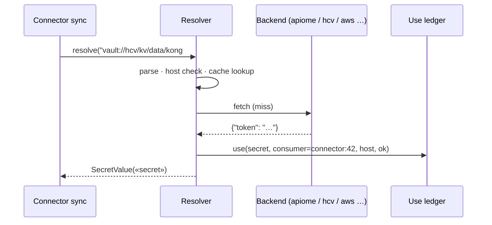
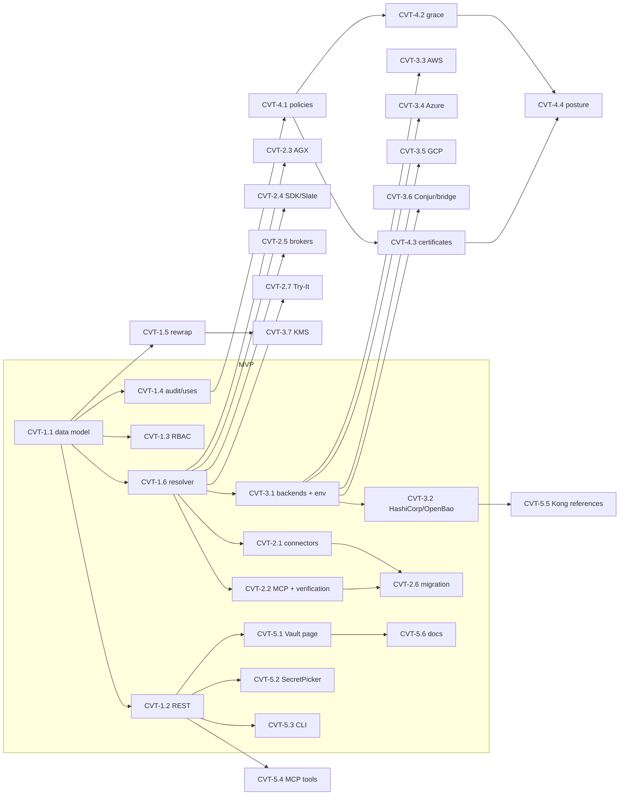

# Roadmap — Credential Vault (CVT)

## 0. Roadmap request

> Create roadmaps for features that Kong provides that Apiome does not (yet) if there's a good fit. If Kong
> provides a feature that is not appropriate for Apiome, or is not a direct competitive feature, skip it. Things
> like managing credentials and keys for live traffic was a request from someone at a meetup recently, so this
> would be a good candidate for a roadmap feature - to store credentials and keys, similar to a Vault store. A
> roadmap for a connector store might make sense, but Apiome is not an API gateway, it's an API Cataloging
> system, so it may not be a good fit for the application. Use your judgement to determine the best path forward.

This roadmap is the **storage half** of that request: one tenant-scoped vault for every credential Apiome holds,
with references to external secret managers. The **issuance half** — keys and client credentials handed to API
consumers and provisioned onto gateways — is the sibling roadmap
[`ROADMAP_API_PRODUCTS_AND_APPLICATION_ACCESS.md`](./ROADMAP_API_PRODUCTS_AND_APPLICATION_ACCESS.md) (APX), which
stores everything it issues here.

### 0.1 Kong parity — what is being matched, and what is not

| Kong capability | Kong source | Fit for Apiome | Disposition |
| --- | --- | --- | --- |
| **Vault entity** — secrets referenced as `{vault://<backend>/<path>[/<key>]}` instead of literals | [Kong Vault entity](https://developer.konghq.com/gateway/entities/vault/), [secrets management](https://developer.konghq.com/gateway/secrets-management/) | **Yes.** Apiome holds credentials for gateways, registries, MCP servers, brokers and agent upstreams | CVT-1.6 reference grammar + resolver |
| **Backends**: env, AWS Secrets Manager, Azure Key Vault, GCP Secret Manager, HashiCorp Vault, CyberArk Conjur, file, custom | [Kong Vault backends](https://developer.konghq.com/gateway/entities/vault/?tab=aws) | **Yes.** Enterprise tenants will not copy secrets into a second store | CVT-EPIC-3 |
| **Rotation** — Kong re-fetches on a TTL; the backend owns rotation | [Kong secrets management](https://developer.konghq.com/gateway/secrets-management/), [GCP rotation how-to](https://developer.konghq.com/how-to/rotate-secrets-in-google-cloud-secret/) | **Yes**, and Apiome adds what a gateway cannot: expiry policy, owner notification, an unused-secret report | CVT-EPIC-4 |
| **Certificates / SNIs / CA certificates** on the gateway | Kong Gateway entities | **Partly.** Apiome does not terminate TLS, but an **inventory with expiry alerts** across every connected gateway is a catalog job | CVT-4.3 (metadata only — never private keys from gateways) |
| Injecting secrets into live proxied traffic (PDK `kong.vault`) | [kong.vault PDK](https://developer.konghq.com/gateway/pdk/reference/kong.vault/) | **No** — Apiome is not in the request path | Skipped. Apiome resolves secrets only for its *own* outbound calls (connectors, Try-It relay, verification, agent proxy) |

### 0.2 Current state (measured 2026-10-21, `main` @ 499ecc2c1)

Apiome already has **nine** encrypted credential stores, each with its own table, its own envelope magic and its
own master-key env var. None can reference an external secret manager; the only reference mechanism is
`verification_target.auth_kind = env` (V211).

| Store | Migration | Crypto / key env | Write-only | Rotation | REST |
| --- | --- | --- | --- | --- | --- |
| `mcp_endpoint_credentials` | V129 | `EnvelopeCipher` OMCV · `APIOME_MCP_CREDENTIAL_ENCRYPTION_KEYS` | yes | re-seal on PUT | `/v1/mcp/{t}/endpoints/{id}/credentials` |
| `upstream_credentials` + `upstream_credential_uses` | V268 | OUCV · `APIOME_UPSTREAM_CREDENTIAL_ENCRYPTION_KEYS` | yes | `/rotate` in place | `/v1/tenants/{t}/agent-toolsets/{id}/upstream-credentials` |
| `catalog_connector_credentials` | V281 | reuses OMCV | yes | replace only | `/v1/tenants/{t}/connectors/{id}/credentials` |
| `sdk_registry_credentials` | V256 | OSRV · `APIOME_SDK_REGISTRY_CREDENTIAL_ENCRYPTION_KEYS` | yes (fingerprint) | `key_version` | `/v1/projects/{t}/{p}/sdk-registry-credentials/{eco}` |
| `auth_provider_config.client_secret_encrypted` | V196 | own envelope · `AUTH_CONFIG_ENC_KEY` | yes | `enc_key_id` | `/v1/admin/auth-providers/{id}` |
| linked-account OAuth tokens / PATs | V010, V199, V275 | OLAT · `APIOME_LINKED_ACCOUNT_TOKEN_ENCRYPTION_KEYS` | — | `key_version` | — |
| `repository_webhook_subscription.secret_enc` | V227–V228 | Fernet · `APIOME_WEBHOOK_SIGNING_SECRET_ENCRYPTION_KEY` | yes | grace-window rotate | `/v1/tenants/{t}/repositories/{id}/webhook/rotate` |
| `slate_git_connections` | V197 | Fernet + OMCV | yes | `token_key_version` | — |
| *(planned)* `mock_broker_bindings` | XPC-2.1 #5735 | would add `APIOME_BROKER_CREDENTIAL_ENCRYPTION_KEYS` | yes | in place | `…/mock/broker-bindings` |

Shared helper: `apiome-rest/src/app/envelope_crypto.py` (`EnvelopeCipher`, AES-256-GCM, per-secret data key, versioned
master key bound into AAD, fails closed with no key). Highest migration: **V307**. Try-It (`apiome-browse/src/app/api/try-it`)
can only use credentials the reader types into the browser.

**Consequences today:** an operator rotating master keys touches nine env vars; there is no single answer to “which
credentials does this tenant hold, who uses them, and when do they expire”; secrets an enterprise already keeps in
HashiCorp Vault or AWS Secrets Manager must be **copied** into Apiome.

### 0.3 Prior art — existing GitHub issues to reconcile (do **not** duplicate)

| Issue | Title | State | Disposition |
| --- | --- | --- | --- |
| [#1264](https://github.com/apiome/apiome/issues/1264) | [Epic] Secrets & Compliance Management (private-suite #1015–#1019) | OPEN · Future | **Superseded** by CVT. Key vault (#1015) → CVT-EPIC-1; rotation (#1016) → CVT-4.1/4.2; leak detection (#1017) → CVT-4.4 over ASP-3; audit (#1018) → CVT-1.4. Zero-trust access policies (#1019) stay out of scope. Close #1264 with a pointer when CVT issues are filed. |
| [#4534](https://github.com/apiome/apiome/issues/4534) | [AGX-2.2] Upstream auth vault | CLOSED | **Pattern source.** Write-only API, use ledger and host binding are generalised by CVT-1.2/1.4/1.6; its rows migrate in CVT-2.3. |
| [#3643](https://github.com/apiome/apiome/issues/3643) | V2-MCP-EPIC-20 Authentication & Secret Vault (outbound) | OPEN · RC5 | **Kept.** #3679/#3680 (OAuth 2.1 discovery, auth-code + PKCE) are MCP-specific flows; when they land they store tokens through CVT (`oauth2_token` kind). CVT-2.2 moves the V129 table under the vault. |
| [#3702](https://github.com/apiome/apiome/issues/3702) | V2-MCP-24.6 Credential management UI | OPEN · Future | **Absorbed** into CVT-5.2 (shared secret picker); re-point the issue at CVT-5.2 rather than building an MCP-only form. |
| [#5735](https://github.com/apiome/apiome/issues/5735) | [XPC-2.1] Broker bindings, credential vault and the opt-in dev broker | OPEN | **Coordinate.** If CVT-1.1 lands first, XPC-2.1 stores the SASL secret as a vault reference and does not add `APIOME_BROKER_CREDENTIAL_ENCRYPTION_KEYS`; otherwise CVT-2.5 migrates it. Amend #5735's scope note either way. |
| [#5931](https://github.com/apiome/apiome/issues/5931) / [#5934](https://github.com/apiome/apiome/issues/5934) | [ASP-EPIC-3] Secret and PII scanning / [ASP-3.3] secret lint rules | OPEN | **Reused, not rebuilt.** CVT-4.4 consumes `app.sensitive_data` findings and adds “move this literal into the vault” as a fix. |
| [#4969](https://github.com/apiome/apiome/issues/4969) | [OLO-8.3] Envelope-encryption helper | CLOSED | `EnvelopeCipher` is the vault's cipher; no new crypto. |
| [#2785](https://github.com/apiome/apiome/issues/2785) | REPO-4.7 Webhook signing-secret rotation | CLOSED | **Pattern source** for CVT-4.2's grace-window rotation. |

---

## 1. MVP Definition

**MVP = a workspace administrator stores a secret once in Settings → Vault (or points at a path in HashiCorp Vault
or environment variables), picks it from a secret picker when configuring a connector, an MCP endpoint or a
verification target, rotates it without downtime, and can see every place it is used — while the secret itself can
never be read back through any Apiome API, CLI, MCP tool or UI.**

### 1.1 MVP scope (in)

| Epic | Issues | Why it is load-bearing |
| --- | --- | --- |
| CVT-EPIC-1 Vault core | 1.1, 1.2, 1.3, 1.4, 1.6 | Storage, write-only API, permissions, audit and references are the product |
| CVT-EPIC-2 Adoption | 2.1, 2.2, 2.6 | Without consumers the vault is a ninth store; connectors and MCP endpoints are the two most-used credential forms |
| CVT-EPIC-3 External backends | 3.1, 3.2 | `env` + HashiCorp Vault/OpenBao covers self-hosters and the meetup request (“similar to a Vault store”) |
| CVT-EPIC-5 Surfaces | 5.1, 5.2, 5.3, 5.6 | The UI, the shared picker, the CLI and the docs page |

### 1.2 Post-MVP

1.5 (master-key re-wrap job), 2.3–2.5 and 2.7, 3.3–3.7, all of EPIC-4, 5.4–5.5.

### 1.3 Out of scope

- Resolving secrets into **live gateway traffic** (Apiome is not in the request path).
- Zero-trust / context-aware access policies (#1264 child #1019).
- Acting as a general-purpose secret manager for applications outside Apiome (no “read secret” endpoint for third
  parties — the vault serves Apiome's own outbound calls and APX provisioning only).
- Hardware security modules; KMS-wrapped master keys are CVT-3.7 (v2), not an HSM integration.

### 1.4 MVP exit criteria

- [ ] A secret created through REST, CLI or UI is never returned — the secret sweep test (pattern:
      `tests/test_upstream_credential_secret_sweep.py`) walks every `GET` route and finds no value or ciphertext.
- [ ] A connector and an MCP endpoint configured with `vault://apiome/prod/kong-admin#token` sync and connect; rotating
      the secret takes effect on the next call with no restart.
- [ ] The same connector configured with `vault://hcv/kv/data/kong#token` against a HashiCorp Vault dev server works,
      and removing the Vault token surfaces `secret-backend-unreachable` on the connector, not a 500.
- [ ] The secret's **Uses** tab lists both consumers with last-used timestamps; the audit log shows create, rotate and
      every use as metadata only.
- [ ] Existing V129 / V281 rows are migrated into the vault with no failed sync during the migration window.

---

## 2. Architecture

```mermaid
flowchart TB
  subgraph surfaces[Surfaces]
    UI[apiome-ui Settings → Vault<br/>+ SecretPicker]
    CLI[apiome vault …]
    MCP[apiome-mcp metadata tools]
  end
  subgraph rest[apiome-rest]
    API[/v1/tenants/{t}/vault/secrets<br/>write-only/]
    RES[Secret resolver<br/>vault://backend/path#field@version]
    CACHE[(in-process cache<br/>TTL per backend)]
    AUD[vault.secret.* audit<br/>+ vault_secret_uses ledger]
  end
  subgraph store[Backends]
    LOCAL[(vault_secrets / vault_secret_versions<br/>EnvelopeCipher · APIOME_VAULT_ENCRYPTION_KEYS)]
    ENV[env / file]
    HCV[HashiCorp Vault / OpenBao]
    AWS[AWS Secrets Manager]
    AZ[Azure Key Vault]
    GCP[GCP Secret Manager]
  end
  subgraph consumers[Consumers — Apiome's own outbound calls]
    CON[Connectors · Kong/AWS/APIM/Apigee/registries]
    MCPE[MCP endpoints · verification targets]
    AGX[Agent upstream proxy]
    SDK[SDK registries · Slate git]
    BRK[Mock broker bindings]
    TRY[Try-It relay · server-side injection]
    APX[APX gateway provisioning]
  end
  UI & CLI --> API --> LOCAL
  MCP -.metadata only.-> API
  consumers -->|reference| RES --> CACHE
  RES --> LOCAL & ENV & HCV & AWS & AZ & GCP
  RES --> AUD
```

**Reference grammar** (deliberately close to Kong's so a Kong operator recognises it):

```
vault://<backend>/<path>[#<field>][@<version>]

vault://apiome/prod/kong-admin#token          Apiome-held secret, JSON field "token", latest version
vault://apiome/prod/kong-admin@3              pinned version 3
vault://hcv/kv/data/payments/kong#token       HashiCorp Vault KV v2, backend registered as "hcv"
vault://aws/prod/kong-admin#token             AWS Secrets Manager secret "prod/kong-admin"
vault://env/KONG_ADMIN_TOKEN                  environment variable on the apiome-rest host (admin-enabled only)
```

---

## 3. Epics

### CVT-EPIC-1 — Vault core

| # | Title | Summary | Labels | Parallel | MVP | Complexity | Modules |
| --- | --- | --- | --- | --- | --- | --- | --- |
| CVT-1.1 | Vault data model and sealed storage | `vault_secrets` + `vault_secret_versions` (V308), typed kinds, paths, labels, `EnvelopeCipher` under one key map | `security`, `database`, `rest` | N | Y | L | apiome-db, apiome-rest |
| CVT-1.2 | Write-only secrets REST API | Create, list/describe metadata, add version, disable version, soft-delete with recovery window — no read-back | `security`, `rest` | N | Y | M | apiome-rest |
| CVT-1.3 | Vault permissions | `vault:manage` and `vault:use` RBAC resources, project scoping, no `vault:read` | `security`, `roles`, `rest` | Y | Y | M | apiome-rest, apiome-db, apiome-ui |
| CVT-1.4 | Audit events and use ledger | `vault.secret.*` audit + `vault_secret_uses` (consumer, target host, outcome) generalised from AGX-2.2 | `security`, `observability`, `rest` | Y | Y | M | apiome-rest, apiome-db |
| CVT-1.5 | Master-key rotation and re-wrap job | Re-seal data keys under a new key version, resumable, with progress and an admin CLI | `security`, `infrastructure` | Y | N | M | apiome-rest, apiome-cli |
| CVT-1.6 | Secret references and resolver | `vault://` grammar, in-process resolver with TTL cache, host binding, typed errors | `security`, `rest` | N | Y | L | apiome-rest |

#### CVT-1.1 — Vault data model and sealed storage

- **Problem Statement:** Nine stores, nine key env vars (§0.2). A tenant has no single inventory, and every new
  feature that needs a credential re-implements sealing, redaction and rotation.
- **Solution/Scope:**
  - Migration **V308** `vault_secrets` — `id`, `tenant_id`, `project_id` (nullable = tenant-wide), `path`
    (`[a-z0-9][a-z0-9/_-]{0,199}`, unique per tenant), `kind`, `description`, `labels jsonb`, `owner_team_id`,
    `allowed_hosts text[]` (CVT-1.6), `expires_at`, `rotation_policy jsonb` (CVT-4.1), `current_version`,
    `deleted_at`, `purge_after`, timestamps, `created_by`.
  - `vault_secret_versions` — `secret_id`, `version` (monotonic), `ciphertext bytea`, `key_version`,
    `fingerprint` (SHA-256 prefix, 8 hex, for humans), `state` (`enabled` | `disabled` | `destroyed`), `created_at`,
    `created_by`. Destroy zeroes the ciphertext; metadata remains for audit.
  - Kinds: `opaque`, `api_key` (header/query name), `bearer`, `basic` (username + password), `oauth2_client`
    (client id + secret + token URL + scopes), `oauth2_token` (access + refresh + expiry, for #3680),
    `certificate` (PEM chain + optional private key), `ssh_key`, `json` (arbitrary fields). Each kind has a JSON
    Schema validated on write; the client id, username and certificate subject are **non-secret metadata** and
    stored in clear so the UI can show them.
  - New `app/vault/cipher.py` wraps `EnvelopeCipher` with magic `OVLT` and key map `APIOME_VAULT_ENCRYPTION_KEYS`
    (JSON `{version: base64key}` + `APIOME_VAULT_ACTIVE_KEY_VERSION`), the same shape as the existing maps. AAD binds
    `tenant_id`, `secret_id` and `version` so a ciphertext cannot be replayed into another row.
  - Fails closed: with no key configured, writes return `503 vault-not-configured` and the UI says so.
- **Acceptance Criteria:** migration applies and rolls forward on a populated DB; a ciphertext copied to another
  tenant's row fails to decrypt (AAD test); `destroyed` versions cannot be resolved; per-kind schema rejects a
  `basic` secret without a password with `422`; `docker-compose.prod.env.example` documents the new keys.
- **Parallelism/Dependencies:** Foundation; blocks every other CVT issue. Coordinate with XPC-2.1 #5735 (§0.3).
- **Technical Stack:** Flyway-style SQL migration, FastAPI, `EnvelopeCipher`, Pydantic per-kind models.
- **Documentation (Docusaurus):** new page `admin/vault-encryption-keys.mdx` (key map format, generation command,
  fail-closed behaviour); update `admin/operating-apiome.mdx` env-var table; release-notes entry.

```
vault_secrets 1 ──── * vault_secret_versions
  path  prod/kong-admin              v1 disabled   key_v1  fp 3fa9c1e0
  kind  bearer                       v2 enabled    key_v2  fp 91b0d2aa   ← current_version
  allowed_hosts [kong-admin.example.com]
```

#### CVT-1.2 — Write-only secrets REST API

- **Problem Statement:** Every store has its own route shape; a client automating credential setup must learn
  nine. The existing guarantee — no read-back — must hold for a general API.
- **Solution/Scope:** `/v1/tenants/{t}/vault/secrets`:
  - `POST` create (value in body, returns metadata), `GET` list (filter by path prefix, kind, label, project,
    expiring-before), `GET /{id}` metadata + versions, `POST /{id}/versions` add a version (rotate),
    `POST /{id}/versions/{v}/disable|enable|destroy`, `PATCH /{id}` metadata only, `DELETE /{id}` soft delete with a
    7-day recovery window (`POST /{id}/restore`), `POST /{id}/test` (resolve + kind-specific probe where the
    consumer supplies one, e.g. connector dry run).
  - Responses never include `value`, `ciphertext` or derived material other than `fingerprint`.
  - Request bodies carrying values are excluded from request logging (extend the existing redaction middleware
    list) and from error echoes.
  - Bump the OpenAPI version.
- **Acceptance Criteria:** secret sweep test over every `GET` in the app (not only vault routes) finds no value or
  ciphertext; a validation error on create does not echo the submitted value; soft-deleted secrets fail resolution
  with `secret-deleted` and are purged after the window by a scheduled job.
- **Parallelism/Dependencies:** After CVT-1.1. Parallel with 1.3, 1.4.
- **Technical Stack:** FastAPI routers, existing pagination helpers, scheduler used by webhook-secret sweep.
- **Documentation (Docusaurus):** regenerate `reference/rest/` (new `vault.md`); release-notes entry.

#### CVT-1.3 — Vault permissions

- **Problem Statement:** Today credential routes ride on unrelated permissions (`versions:edit`, connector admin).
  A vault needs to separate *who manages secrets* from *who may attach one to a feature*.
- **Solution/Scope:** New RBAC resource `vault` with actions `manage` (create, rotate, delete, metadata) and `use`
  (pick a secret in a picker / reference it in a config). There is deliberately **no `read`**. Project-scoped
  secrets require project membership in addition. Default roles: Owner/Admin → manage+use; Maintainer → use;
  others none. A config referencing a secret the saving user may not `use` is refused `403 vault-use-denied`.
- **Acceptance Criteria:** role matrix tests; a maintainer can attach but not rotate; references are re-checked on
  save, not on every resolution (resolution runs as the system on behalf of the feature).
- **Parallelism/Dependencies:** After 1.1; parallel with 1.2/1.4.
- **Technical Stack:** existing roles/permissions tables and `require_permission` dependencies; apiome-ui role editor.
- **Documentation (Docusaurus):** update `workspace/roles` page permission matrix; screenshot `roles-vault-permissions`.

#### CVT-1.4 — Audit events and use ledger

- **Problem Statement:** Only some stores audit, and only AGX-2.2 records *use*. “Is this credential still used,
  and by what?” is unanswerable for connectors and MCP endpoints.
- **Solution/Scope:** Audit events `vault.secret.created|version_added|version_disabled|version_destroyed|deleted|restored|metadata_updated`
  (metadata only). New `vault_secret_uses` — `secret_id`, `version`, `consumer_kind` (`connector`,
  `mcp_endpoint`, `verification_target`, `agent_toolset`, `sdk_registry`, `broker_binding`, `try_it`,
  `apx_provisioner`), `consumer_id`, `target_host`, `outcome` (`ok`, `auth_failed`, `unreachable`), hourly
  counters + `last_used_at` (counters, not a request log — same principle as the usage index). AGX's
  `upstream_credential_uses` becomes a view over this table after CVT-2.3.
- **Acceptance Criteria:** every resolution writes or increments a use row; a consumer reporting `auth_failed`
  after a rotation is visible on the secret page within one minute; retention 400 days, configurable.
- **Parallelism/Dependencies:** After 1.1; parallel.
- **Technical Stack:** PostgreSQL upsert counters, existing audit writer.
- **Documentation (Docusaurus):** section “Uses and audit” in `workspace/vault.mdx` (CVT-5.6).

#### CVT-1.5 — Master-key rotation and re-wrap job

- **Problem Statement:** Adding a new master key version today only affects new writes; old rows stay under the old
  key until each is rewritten, so retiring a key is unprovable.
- **Solution/Scope:** Background job re-wraps each version's data key under the active key version (no plaintext
  change), resumable by cursor, rate-limited, reporting progress at `GET /v1/admin/vault/rewrap`. CLI
  `apiome admin vault rewrap [--dry-run]`. When complete, the admin page shows “key v1 no longer referenced — safe
  to remove”. Applies to legacy stores until CVT-2.6 retires them.
- **Acceptance Criteria:** after rewrap no row has `key_version` < active; job survives restart mid-run; secrets
  resolve throughout.
- **Parallelism/Dependencies:** After 1.1; post-MVP.
- **Technical Stack:** existing job runner, `EnvelopeCipher.rewrap`.
- **Documentation (Docusaurus):** runbook section in `admin/vault-encryption-keys.mdx`; CLI reference regen.

#### CVT-1.6 — Secret references and resolver

- **Problem Statement:** Consumers hold foreign keys into their own credential tables. To support external backends
  and pinning, they need a portable reference, and the resolution rules (host binding, caching, errors) must be
  identical everywhere.
- **Solution/Scope:**
  - Grammar in §2. Parser in `app/vault/reference.py` with a strict ABNF; `apiome` is the built-in backend name.
  - `resolve(ref, *, consumer, target_url) -> SecretValue` — checks the secret's `allowed_hosts` against
    `target_url` (exact host or `*.suffix`, after `app.ssrf_guard` resolution), checks version state, decrypts or
    calls the backend, records the use (1.4), caches per backend TTL (default 300 s for external backends, 0 for
    `apiome`, invalidated on version add).
  - `SecretValue` is an opaque wrapper whose `__repr__`/`__str__`/JSON encoding emit `«secret»`, so accidental
    logging is safe.
  - Typed errors: `secret-not-found`, `secret-deleted`, `secret-version-disabled`, `secret-host-not-allowed`,
    `secret-backend-unreachable`, `secret-field-missing`. Consumers surface these verbatim on their status.
  - `vault://env/...` is allowed only when the server sets `APIOME_VAULT_ALLOW_ENV=true` (self-hosters), preserving
    today's `auth_kind=env` behaviour for verification targets.
- **Acceptance Criteria:** fuzzed parser; a secret bound to `kong-admin.example.com` refused for
  `evil.example.com`; DNS-rebinding test via ssrf_guard; `SecretValue` never appears in structlog output (log capture test).
- **Parallelism/Dependencies:** After 1.1; blocks EPIC-2 and EPIC-3.
- **Technical Stack:** Python, `app.ssrf_guard`, `cachetools` TTL cache.
- **Documentation (Docusaurus):** reference page `reference/vault-references.md` (grammar, examples, errors).



---

### CVT-EPIC-2 — Adopt the vault across Apiome

Every credential form in Apiome takes either a **new value** (stored as an `apiome` vault secret automatically,
path `auto/<feature>/<id>`) or a **reference** chosen in the picker. Legacy tables are migrated, dual-read for one
release, then dropped.

| # | Title | Summary | Labels | Parallel | MVP | Complexity | Modules |
| --- | --- | --- | --- | --- | --- | --- | --- |
| CVT-2.1 | Connectors use vault references | `catalog_connector_credentials` → vault refs; CLI `--credentials-ref` | `security`, `integrations`, `gateway` | Y | Y | M | apiome-rest, apiome-cli, apiome-ui |
| CVT-2.2 | MCP endpoints and verification targets use the vault | V129 rows and `verification_target.auth_kind=vault` | `security`, `mcp`, `contracts` | Y | Y | M | apiome-rest, apiome-ui |
| CVT-2.3 | Agent upstream credentials on the vault | AGX `upstream_credentials` becomes vault-backed; use ledger becomes a view | `security`, `ai`, `mcp` | Y | N | M | apiome-rest, apiome-db |
| CVT-2.4 | SDK registry and Slate git credentials on the vault | V256 and V197 secrets move under the vault | `security`, `sdk`, `slate` | Y | N | S | apiome-rest, apiome-db |
| CVT-2.5 | Broker bindings on the vault | XPC-2.1 SASL secrets as references (no new key map) | `security`, `mock-server`, `asyncapi` | Y | N | S | apiome-rest |
| CVT-2.6 | Legacy store migration and key retirement | Backfill, dual-read window, drop legacy columns and env keys | `security`, `database`, `infrastructure` | N | Y | L | apiome-db, apiome-rest |
| CVT-2.7 | Try-It server-side credential injection | Try-It relay injects a vault secret the reader is entitled to, never sending it to the browser | `security`, `browser`, `portal` | Y | N | M | apiome-browse, apiome-rest |

#### CVT-2.1 — Connectors use vault references

- **Problem Statement:** Connector credentials (Kong admin tokens, AWS keys, Azure service principals, Apigee
  service accounts, registry passwords) are the most sensitive and most copied secrets Apiome holds.
- **Solution/Scope:** Connector create/update accepts `credentialsRef: "vault://…"` *or* `credentials: {…}` (which
  creates `auto/connectors/<id>` and stores the reference). Connector sync resolves via CVT-1.6 with
  `allowed_hosts` defaulted from the connector's base URL. Dry run, status and run log report resolver errors.
  CLI: `apiome connectors add --credentials-ref vault://…` alongside `--credentials-file`.
  Connector kinds whose auth is a cloud identity (AWS role, Azure managed identity) may reference a `json` secret
  or none.
- **Acceptance Criteria:** existing connectors keep syncing during and after migration (2.6); a rotated secret is
  used on the next sync; a connector page shows the secret path and fingerprint, never the value.
- **Parallelism/Dependencies:** After 1.6; parallel with 2.2–2.5.
- **Technical Stack:** `catalog_connector_*` modules, apiome-cli Typer commands, SecretPicker (5.2).
- **Documentation (Docusaurus):** update `bring-in/connectors.mdx` (credentials step, CLI example); screenshot
  `connector-credentials-vault`; regenerate CLI `connectors` reference and REST `connectors.md`.

#### CVT-2.2 — MCP endpoints and verification targets use the vault

- **Problem Statement:** V129 MCP credentials and V211 verification targets have their own reference rules
  (`auth_kind` `env` | `stored`).
- **Solution/Scope:** Add `auth_kind = vault` with `auth_ref` a `vault://` reference; `stored` rows migrate to
  `vault` in 2.6; `env` maps to `vault://env/<NAME>` behind `APIOME_VAULT_ALLOW_ENV`. MCP endpoint credential
  `PUT` writes into the vault. #3679/#3680 OAuth tokens persist as `oauth2_token` secrets with refresh writing a
  new version.
- **Acceptance Criteria:** `apiome verify` against a target using a vault ref passes; MCP catalog health checks
  resolve credentials through the vault; existing `env` targets unchanged.
- **Parallelism/Dependencies:** After 1.6.
- **Technical Stack:** `mcp_catalog_routes.py`, verification target module.
- **Documentation (Docusaurus):** update MCP catalog credentials page and `reference/ci` verification docs; REST regen.

#### CVT-2.3 — Agent upstream credentials on the vault

- **Problem Statement:** AGX-2.2 built the best of the nine stores; it should be the vault, not beside it.
- **Solution/Scope:** `upstream_credentials` rows gain `secret_ref`; the invocation proxy resolves through the
  resolver with the toolset's server URL as `target_url`; the existing REST shape is kept (backward compatible) and
  documented as a facade. `upstream_credential_uses` becomes a view over `vault_secret_uses`.
- **Acceptance Criteria:** AGX's existing security tests pass unchanged; zero-downtime rotation test still passes.
- **Parallelism/Dependencies:** After 1.4, 1.6.
- **Technical Stack:** apiome-rest AGX proxy, SQL view.
- **Documentation (Docusaurus):** update agent toolset credentials page to point at the vault.

#### CVT-2.4 — SDK registry and Slate git credentials on the vault

- **Problem Statement / Scope:** Same move for `sdk_registry_credentials` (npm/PyPI tokens) and
  `slate_git_connections` tokens/webhook secrets. Registry hosts become `allowed_hosts` (`registry.npmjs.org`,
  `upload.pypi.org`).
- **Acceptance Criteria:** SDK publish and Slate builds succeed with vault-held tokens; fingerprints preserved.
- **Parallelism/Dependencies:** After 1.6.
- **Documentation (Docusaurus):** update SDK delivery and Slate hosting pages.

#### CVT-2.5 — Broker bindings on the vault

- **Problem Statement / Scope:** XPC-2.1 (#5735) proposes another key map. Store `credential_ref` instead;
  `bootstrap` hosts become `allowed_hosts`. If XPC-2.1 ships first, migrate its rows here.
- **Acceptance Criteria:** `/test` on a binding reports `unreachable: auth` for a wrong password via the resolver
  error; no `APIOME_BROKER_CREDENTIAL_ENCRYPTION_KEYS` in the env example.
- **Parallelism/Dependencies:** After 1.6; coordinate with #5735.
- **Documentation (Docusaurus):** update `reference/mock-runtime/event-mock-brokers.md`.

#### CVT-2.6 — Legacy store migration and key retirement

- **Problem Statement:** Adoption is only real when the legacy tables and their env keys are gone.
- **Solution/Scope:** For each legacy store: (1) migration adds `secret_ref`; (2) backfill job decrypts with the
  legacy cipher and re-seals into the vault in batches, writing `secret_ref`; (3) one release of dual-read
  (prefer `secret_ref`, fall back to legacy); (4) migration nulls legacy ciphertext columns; (5) the next minor
  removes the legacy env vars from the example files and logs a startup warning if they are still set. Linked-account
  OAuth tokens and `auth_provider_config` (server-wide, pre-tenant) **stay** on their own keys — documented
  exception, because they are needed before a tenant context exists.
- **Acceptance Criteria:** backfill is idempotent and resumable; integration test runs a connector sync and an MCP
  health check continuously during backfill with no failure; post-migration, `SELECT` over legacy ciphertext
  columns returns only NULL.
- **Parallelism/Dependencies:** After 2.1 and 2.2 (MVP covers V129 + V281); later stores migrate as 2.3–2.5 land.
- **Technical Stack:** Flyway migrations, job runner, legacy ciphers.
- **Documentation (Docusaurus):** upgrade note in `admin/migrations.mdx` with the release in which each env var is
  retired; release-notes entry flagged **operator action**.

```
release N     add secret_ref · backfill · dual-read          env: OLD_KEYS + APIOME_VAULT_ENCRYPTION_KEYS
release N+1   legacy ciphertext nulled                         env: APIOME_VAULT_ENCRYPTION_KEYS (+ OLD_KEYS warned)
release N+2   legacy env vars ignored                          env: APIOME_VAULT_ENCRYPTION_KEYS
```

#### CVT-2.7 — Try-It server-side credential injection

- **Problem Statement:** Try-It (SIM-3.6) keeps reader-typed credentials in `sessionStorage`. Internal teams want
  to try a staging API with a shared sandbox key without pasting it, and the key must never reach the browser.
- **Solution/Scope:** A project may declare **Try-It credentials** per server URL: a vault reference plus who may
  use it (workspace members; with PCX-1.1, signed-in portal readers or segments). The browse relay
  (`apiome-browse/src/app/api/try-it/route.ts`) calls a new internal `POST /v1/internal/try-it/inject` that
  resolves the secret for the exact server host and returns the decorated upstream request to the relay only.
  The panel shows “Using workspace sandbox key (fp 91b0d2aa)”. Anonymous readers never get injection.
  With APX, a signed-in developer's **own application key** can be injected instead (APX-5.4).
- **Acceptance Criteria:** HAR of the browser session contains no secret; relay refuses injection for a host other
  than the declared server; rate-limited per reader.
- **Parallelism/Dependencies:** After 1.6; full value after PCX-1.1 (#5889).
- **Technical Stack:** apiome-browse route handler, internal service token, existing relay SSRF guard.
- **Documentation (Docusaurus):** update `ship/mock-try-out.mdx` (“Shared credentials”); screenshot `try-it-vault-credential`.

---

### CVT-EPIC-3 — External secret backends

| # | Title | Summary | Labels | Parallel | MVP | Complexity | Modules |
| --- | --- | --- | --- | --- | --- | --- | --- |
| CVT-3.1 | Backend registry, `env` and `file` backends | Pluggable backend interface, per-tenant backend config with its own credential, health | `security`, `integrations` | N | Y | M | apiome-rest, apiome-db |
| CVT-3.2 | HashiCorp Vault / OpenBao backend | KV v1/v2, token / AppRole / Kubernetes auth, namespaces | `security`, `integrations` | Y | Y | M | apiome-rest |
| CVT-3.3 | AWS Secrets Manager backend | Static keys or assumed role; JSON field selection; version stages | `security`, `integrations` | Y | N | M | apiome-rest |
| CVT-3.4 | Azure Key Vault backend | Service principal / managed identity; secrets and certificates | `security`, `integrations` | Y | N | M | apiome-rest |
| CVT-3.5 | GCP Secret Manager backend | Service account / workload identity; versions | `security`, `integrations` | Y | N | M | apiome-rest |
| CVT-3.6 | CyberArk Conjur and HTTP bridge backends | Conjur API plus a documented HTTP bridge contract for anything else | `security`, `integrations` | Y | N | M | apiome-rest |
| CVT-3.7 | KMS-wrapped master keys | Optional AWS KMS / Azure Key Vault keys / GCP KMS wrapping of `APIOME_VAULT_ENCRYPTION_KEYS` | `security`, `infrastructure` | Y | N | L | apiome-rest |

#### CVT-3.1 — Backend registry, `env` and `file` backends

- **Problem Statement:** Enterprises will not copy secrets out of their system of record (Kong supports env,
  AWS, Azure, GCP, HashiCorp, Conjur, file and custom backends — §0.1).
- **Solution/Scope:** `vault_backends` (V309) — `tenant_id`, `name` (the `<backend>` in references; `apiome`
  reserved), `kind`, `config jsonb` (non-secret: address, region, namespace, mount), `auth_secret_ref` (the
  backend's own credential is an `apiome` vault secret — the one thing that must be held locally), `cache_ttl_seconds`,
  `status`, `last_checked_at`. Interface `SecretBackend.fetch(path, field, version) -> bytes | dict` and
  `health()`. `env` and `file` backends are **server-level** (configured by operators in env, not by tenants) and
  disabled unless `APIOME_VAULT_ALLOW_ENV` / `APIOME_VAULT_FILE_ROOT` is set. REST `/v1/tenants/{t}/vault/backends`
  CRUD + `POST /{name}/test`. External backends are **read-only**: Apiome never writes to them.
- **Acceptance Criteria:** a reference to an unknown backend is rejected at save time; backend health is shown on
  every secret that uses it; a backend outage returns `secret-backend-unreachable` and serves a cached value only
  within its TTL (stale-if-error off by default, opt-in per backend).
- **Parallelism/Dependencies:** After 1.6; blocks 3.2–3.6.
- **Technical Stack:** FastAPI, plugin registry pattern used by connectors.
- **Documentation (Docusaurus):** new page `workspace/vault-backends.mdx` (overview + per-backend sections added by 3.2–3.6).

#### CVT-3.2 — HashiCorp Vault / OpenBao backend

- **Solution/Scope:** `hvac`-based client; KV v1 and v2 (`data/` path handling, `@version` → KV v2 version);
  auth methods token, AppRole (role id + secret id in the local vault), Kubernetes (service-account JWT from a
  mounted path, for in-cluster deployments); Vault Enterprise namespaces; TLS CA bundle option. OpenBao is
  API-compatible and covered by the same CI test (dev-mode containers for both).
- **Acceptance Criteria:** compose-based integration tests against `hashicorp/vault` and `openbao/openbao` dev servers;
  AppRole token renewal before expiry; a revoked token surfaces as `auth_failed` on the backend status.
- **Parallelism/Dependencies:** After 3.1.
- **Technical Stack:** `hvac`, docker-compose test profile.
- **Documentation (Docusaurus):** HashiCorp Vault section, with a policy snippet granting read on the mount path.

#### CVT-3.3 / 3.4 / 3.5 — AWS, Azure and GCP backends

- **Solution/Scope (each):** official SDK (`boto3`, `azure-keyvault-secrets` + `azure-identity`,
  `google-cloud-secret-manager`); JSON secret field selection via `#field`; version/stage mapping (`@AWSPREVIOUS`,
  Azure version id, GCP numeric version / `latest`); ambient identity (instance role, managed identity, workload
  identity) as an operator opt-in so a self-hoster can avoid storing a cloud key at all. Azure also reads
  certificates (feeding CVT-4.3).
- **Acceptance Criteria:** mocked-SDK unit tests plus an opt-in live test job gated on repository secrets; IAM
  least-privilege policy documented and tested.
- **Parallelism/Dependencies:** After 3.1; mutually parallel.
- **Documentation (Docusaurus):** one section per backend in `workspace/vault-backends.mdx` with minimal IAM policy.

#### CVT-3.6 — CyberArk Conjur and HTTP bridge backends

- **Solution/Scope:** Conjur REST client (API key auth). **HTTP bridge**: a documented contract
  (`GET {base}/secrets/{path}?field=&version=` with HMAC-signed request, JSON response) so a customer can front
  any other store (1Password Connect, Doppler, Infisical, Akeyless) without Apiome shipping a client — the same
  idea as Kong's custom vaults and Konnect's custom DCR bridge.
- **Acceptance Criteria:** reference bridge implementation in `scripts/vault-bridge-example/` used in tests.
- **Documentation (Docusaurus):** bridge contract in `reference/vault-http-bridge.md`.

#### CVT-3.7 — KMS-wrapped master keys

- **Solution/Scope:** `APIOME_VAULT_KEY_PROVIDER=aws-kms|azure-kv|gcp-kms` — the master key map holds KMS-wrapped
  keys unwrapped once at startup; rewrap (1.5) supports moving from raw keys to KMS.
- **Acceptance Criteria:** startup fails closed if KMS is unreachable; no raw key in env when KMS is used.
- **Documentation (Docusaurus):** section in `admin/vault-encryption-keys.mdx`.

---

### CVT-EPIC-4 — Lifecycle: expiry, rotation, certificates and posture

| # | Title | Summary | Labels | Parallel | MVP | Complexity | Modules |
| --- | --- | --- | --- | --- | --- | --- | --- |
| CVT-4.1 | Expiry and rotation policies | Max age, expiry dates, reminder schedule, owner team notifications | `security`, `governance` | Y | N | M | apiome-rest, apiome-ui |
| CVT-4.2 | Grace-window rotation | Previous version stays resolvable for a configured window; consumers report which version they used | `security` | Y | N | M | apiome-rest |
| CVT-4.3 | Certificate inventory | Certificates from the vault and from gateway connectors, with chain, SANs and expiry alerts | `security`, `gateway`, `catalog` | Y | N | L | apiome-rest, apiome-db, apiome-ui |
| CVT-4.4 | Secret posture report | Expiring, overdue, unused and leaked secrets in one Govern page; “move literal to vault” fix from ASP-3 findings | `security`, `governance` | Y | N | M | apiome-rest, apiome-ui |

#### CVT-4.1 — Expiry and rotation policies

- **Problem Statement:** A gateway does not tell you its admin token is a year old; a catalog can.
- **Solution/Scope:** `rotation_policy` on a secret or as a tenant default per kind: `max_age_days`,
  `remind_before_days` (default 30/7/1), `owner_team_id`. Daily job raises `vault.secret.expiring` /
  `vault.secret.overdue` into the COL inbox and, when PCX-3.1 (PCX-EPIC-3, umbrella #5887) ships, the delivery service
  (email/Slack/Teams/webhook). Certificates use their `notAfter`.
- **Acceptance Criteria:** reminders fire once per threshold; rotating clears the overdue state; tenant default
  applies to auto-created secrets.
- **Parallelism/Dependencies:** After 1.4.
- **Documentation (Docusaurus):** “Rotation policies” section in `workspace/vault.mdx`; screenshot `vault-rotation-policy`.

#### CVT-4.2 — Grace-window rotation

- **Solution/Scope:** Adding a version may set `previous_valid_for` (e.g. 24 h) — for `apiome`-held secrets that
  Apiome itself presents (webhook signing secrets, APX-issued keys) both versions remain resolvable for the window;
  the use ledger shows which version consumers still use; the old version auto-disables at window end. Generalises
  the V228 webhook pattern so `repository_webhook_subscription` can move onto it.
- **Acceptance Criteria:** during the window both versions verify; after it only the new; ledger shows the cut-over.
- **Documentation (Docusaurus):** section in `workspace/vault.mdx`.

#### CVT-4.3 — Certificate inventory

- **Problem Statement:** Kong, AWS API Gateway, Azure APIM and Apigee each hold TLS certificates; expiries cause
  outages and are tracked nowhere central. Apiome already syncs those gateways (gateway configs, V298).
- **Solution/Scope:** `catalog_certificates` (V310) — source (`vault` | connector id), subject, SANs, issuer,
  serial, `not_before`, `not_after`, key type/size, SHA-256 fingerprint, `used_by` (environment, SNI, custom
  domain). Connector sync reads **public certificate metadata only** (Kong `/certificates` + `/snis`, AWS custom
  domain names, APIM hostname configs, Apigee keystores' certs); private keys are never fetched. Gateway config
  pages (connectors.mdx) gain a **Certificates** panel; Govern gains **Certificates** with expiry buckets. Expiry
  reminders reuse 4.1.
- **Acceptance Criteria:** Kong fixture sync lists certs with SNIs; no private key field is requested from any
  provider API (asserted on recorded requests); a cert expiring in 7 days raises a notification to the gateway
  config's owner team.
- **Parallelism/Dependencies:** After 4.1; parallel with APX.
- **Technical Stack:** `cryptography` x509 parsing, existing connector providers.
- **Documentation (Docusaurus):** new `govern/certificates.mdx`; update `bring-in/connectors.mdx` gateway config
  section; screenshots `govern-certificates`, `gateway-config-certificates`.

```
Govern → Certificates
 ┌──────────────────────────┬───────────────┬──────────────┬────────────┬──────────┐
 │ Subject                  │ Where         │ Expires      │ Owner      │ Status   │
 ├──────────────────────────┼───────────────┼──────────────┼────────────┼──────────┤
 │ api.example.com          │ Kong prod-cp  │ 2026-10-28   │ Payments   │ ▲ 7 days │
 │ *.partners.example.com   │ AWS us-east-1 │ 2027-02-01   │ Platform   │ ok       │
 │ mtls-client-ca           │ vault         │ 2028-01-01   │ Security   │ ok       │
 └──────────────────────────┴───────────────┴──────────────┴────────────┴──────────┘
```

#### CVT-4.4 — Secret posture report

- **Solution/Scope:** Govern → **Secret posture**: expiring/overdue (4.1), unused for N days (1.4 ledger),
  failing (`auth_failed` uses), legacy stores not yet migrated (2.6), credentials redacted on gateway import
  (`catalog_gateway_configs.posture.credential_redactions`), and ASP-3 `secret-in-document` findings with a
  **Move to vault** action that creates the secret and replaces the literal in the spec example with a placeholder.
  Contributes a `secrets` signal to the security axis (ASP-1.3) when present.
- **Acceptance Criteria:** each bucket links to the item; the move-to-vault action never logs the literal.
- **Parallelism/Dependencies:** After 1.4, 4.1; uses ASP-3.1 when shipped.
- **Documentation (Docusaurus):** new `govern/secret-posture.mdx`; screenshot `govern-secret-posture`.

---

### CVT-EPIC-5 — Surfaces

| # | Title | Summary | Labels | Parallel | MVP | Complexity | Modules |
| --- | --- | --- | --- | --- | --- | --- | --- |
| CVT-5.1 | Vault page in apiome-ui | Settings → Vault: list, create wizard per kind, versions, uses, backends | `ui`, `security` | Y | Y | L | apiome-ui |
| CVT-5.2 | SecretPicker component | One picker for every credential field: choose, create inline, or paste a reference (absorbs #3702) | `ui`, `security`, `design-system` | Y | Y | M | apiome-ui |
| CVT-5.3 | `apiome vault` CLI | create/rotate/list/describe/delete, values only from stdin or file, never echoed | `cli`, `security` | Y | Y | M | apiome-cli |
| CVT-5.4 | MCP vault metadata tools | `vault.list` / `vault.describe` metadata-only tools for agents, with redaction tests | `mcp`, `security` | Y | N | S | apiome-mcp, apiome-rest |
| CVT-5.5 | Push-back emits references, not literals | Kong decK export writes `{vault://…}` for credentials when the backend is shared with Kong | `gateway`, `export`, `security` | Y | N | M | apiome-rest |
| CVT-5.6 | Vault documentation and security model | Overview, security model, threat model and migration guide | `documentation`, `security` | Y | Y | S | apiome-docs |

#### CVT-5.1 — Vault page in apiome-ui

- **Solution/Scope:** Route `/ade/dashboard/settings/vault` (under Workspace & account). List with path tree,
  kind, backend, fingerprint, expiry, last used, owner; filters. Create wizard: kind → fields (masked inputs, paste
  or file upload for PEM) → path & labels → allowed hosts → rotation policy → review. Detail tabs: **Versions**
  (add, disable, destroy), **Uses** (ledger), **Audit**, **Settings**. Backends tab (3.1). Empty and
  not-configured states (`vault-not-configured` explains the env key). Follows `docs/mockups/DESIGN.md`.
- **Acceptance Criteria:** no value is ever placed in React state after submit (masked field cleared on success,
  test); axe clean; light/dark screenshots.
- **Parallelism/Dependencies:** After 1.2.
- **Documentation (Docusaurus):** screenshots `vault-list`, `vault-create`, `vault-secret-uses`.

#### CVT-5.2 — SecretPicker component

- **Solution/Scope:** `<SecretPicker kind=… host=…>` — search existing secrets filtered by kind and whose
  `allowed_hosts` match the consumer host; **Create new** inline (opens the wizard in a dialog); **Reference**
  text mode with live validation of `vault://` syntax and backend existence. Replaces credential inputs on
  connectors, MCP endpoints, verification targets, agent upstreams, SDK registries and (with APX) provisioners.
  Re-points #3702.
- **Acceptance Criteria:** every credential form in apiome-ui uses the picker (lint: no raw `type="password"`
  inputs outside the vault wizard); keyboard accessible.
- **Documentation (Docusaurus):** screenshot `secret-picker`.

#### CVT-5.3 — `apiome vault` CLI

- **Solution/Scope:** `apiome vault secrets create <path> --kind bearer --value-file token.txt` (or `--value -`
  for stdin), `rotate`, `list`, `describe`, `disable-version`, `delete`, `restore`; `apiome vault backends
  add|list|test`; `apiome vault ref check <ref>`. No `--value <literal>` flag (shell history). JSON output mode.
- **Acceptance Criteria:** clig.dev conformance tests; value never printed, including in `--verbose`/debug HTTP logs.
- **Documentation (Docusaurus):** regenerate CLI reference; quickstart snippet in `workspace/vault.mdx`.

#### CVT-5.4 — MCP vault metadata tools

- **Solution/Scope:** read-only `vault.list` and `vault.describe` in apiome-mcp returning metadata (path, kind,
  expiry, last used) scoped to the key's tenant; never values. Lets an agent answer “which credentials expire
  this month?”. MCP trust-posture rules updated to flag any tool that returns a `SecretValue`.
- **Documentation (Docusaurus):** regenerate MCP tool reference.

#### CVT-5.5 — Push-back emits references, not literals

- **Problem Statement:** “Push back” to Kong Declarative Config (connectors.mdx) currently drops credentials
  (redacted at import). Teams that run both Apiome and Kong against the same HashiCorp Vault want the exported
  decK file to carry `{vault://hcv/...}` references Kong can resolve itself.
- **Solution/Scope:** A backend may declare its **Kong vault prefix** (e.g. Apiome backend `hcv` ↔ Kong vault
  prefix `hcv`). On export to `kong`, credential-bearing fields whose catalog value is a vault reference on such a
  backend are written as Kong references; `apiome`-held secrets are **never** exported (fidelity report lists them
  as dropped with the reason). Generalises to other gateway exports when FMT-7.7 (#5461) lands.
- **Acceptance Criteria:** round-trip fixture; fidelity report shows “2 credentials exported as Kong vault
  references, 1 dropped (held by Apiome)”.
- **Parallelism/Dependencies:** After 3.2; export fidelity engine.
- **Documentation (Docusaurus):** update `ship/export-fidelity.md` and the push-back section of `bring-in/connectors.mdx`.

#### CVT-5.6 — Vault documentation and security model

- **Solution/Scope:** Overview page `workspace/vault.mdx` (what it is, when to use it, references, permissions,
  uses, rotation), `admin/vault-encryption-keys.mdx`, `workspace/vault-backends.mdx`, `reference/vault-references.md`,
  a **security model** section (write-only guarantee, AAD binding, host binding, what an attacker with DB access
  without keys gets), and a migration guide from per-feature credentials. Release notes for the epic.
- **Acceptance Criteria:** `yarn docs:check` passes; sidebar entries under Workspace & account and Admin & tools.

---

## 4. Work to be done, in order



1. **CVT-1.1** (foundation; settle the XPC-2.1 coordination first).
2. **CVT-1.2 ∥ CVT-1.3 ∥ CVT-1.4 ∥ CVT-1.6**.
3. **CVT-3.1 → CVT-3.2** ∥ **CVT-2.1 ∥ CVT-2.2** ∥ **CVT-5.1 ∥ CVT-5.2 ∥ CVT-5.3**.
4. **CVT-2.6** (V129 + V281 backfill) and **CVT-5.6**. **MVP done** — demo: create `prod/kong-admin` in the UI, attach it
   to a Kong connector with the picker, sync, rotate, sync again, open **Uses**; repeat with
   `vault://hcv/kv/data/kong#token` against a Vault dev container; run the secret sweep test.
5. v2 tracks in parallel: **2.3 ∥ 2.4 ∥ 2.5 ∥ 2.7**; **3.3 ∥ 3.4 ∥ 3.5 ∥ 3.6**; **1.5 → 3.7**;
   **4.1 → 4.2 ∥ 4.3 → 4.4**; **5.4**; **5.5** after 3.2.
6. **APX** (sibling roadmap) can start its MVP once **CVT-1.6** is merged.

## 5. Labels

Existing: `security`, `rest`, `ui`, `cli`, `mcp`, `database`, `integrations`, `gateway`, `governance`, `roles`,
`observability`, `infrastructure`, `export`, `browser`, `portal`, `documentation`, `mvp`, `epic`, `v2`.
New: **`roadmap-credential-vault`** (applied to every CVT issue), **`vault`**.
