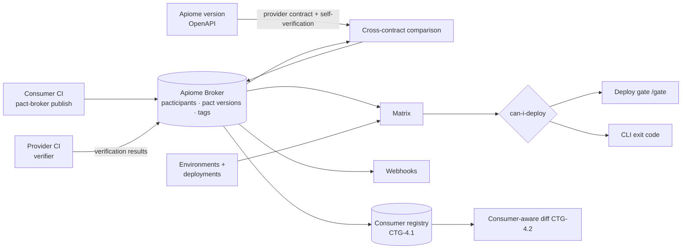
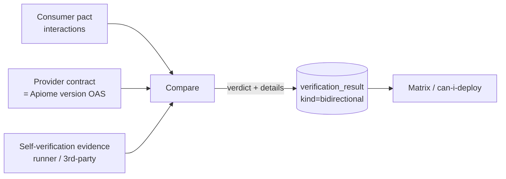

# Roadmap — Pact Broker & PactFlow Parity (Contract Testing Hub)

_Drafted 2026-11-19 against `main` @ `e952b7d0c`. Release: **RC10** (see [`RC10_PLAN.md`](RC10_PLAN.md)). Priority: **extremely high**._
_Status: **issues filed 2026-11-19** (numbers in the tables below). Companion roadmap: [`ROADMAP_CONTRACT_AGREEMENTS.md`](ROADMAP_CONTRACT_AGREEMENTS.md) (the SLA / data-sharing agreement half, moved from private-suite)._

**Umbrella:** [#6906](https://github.com/apiome/apiome/issues/6906). **Issue ID prefix:** `PFX`. Epics `PFX-EPIC-n`, issues `PFX-n.m`.
**GitHub title format:** `apiome: [PFX-<epic>.<issue>] <title>`.
**Recommended labels:** `contracts`, `pact`, `rest`, `ui`, `cli`, `devex`, `automation`, `mvp`, `v2`, `epic`, `documentation`.
**Visibility (decided 2026-11-24):** PFX work is **not feature-flagged**. Everything ships visible on the beta build as it merges — no `UNRELEASED_FEATURE_IDS` entry, no `UnreleasedFeatureGate`, no preview env var, no server-side enable switch, and docs pages go under `apiome-docs/docs/` (not `apiome-docs/unreleased/`).

---

## 0. Source description (request, verbatim)

> Create RC10 Project plan to include tickets to enable Contracts an PactFlow functionality into Apiome. Any
> functionality in apiome/private-suite that covers contracts and pactflow should be moved to apiome/apiome,
> and put in the roadmap. This is the next Release Candidate functionality list, and is an extremely high
> priority feature.

**What this roadmap delivers:** Apiome becomes a drop-in **Pact Broker / PactFlow replacement**. Existing Pact
tooling (the `pact-broker` CLI, pact-jvm / pact-js / pact-go / pact-python / pact-ruby / pact-net clients, the
Pact Docker CLI and the official GitHub Actions) works against Apiome by changing only the broker base URL and
token. On top of that it ships PactFlow's differentiator, **bi-directional contract testing** (consumer pact ⇄
provider OpenAPI), wired into what Apiome already owns: the canonical spec model, the breaking-change
classifier, the consumer registry, the contract runner and the deploy gate.

Sources: Pact Broker REST/HAL API and `pact-broker` CLI; PactFlow docs (bi-directional contracts, teams, secrets,
webhooks, environments, can-i-deploy); the Pact specification v1–v4 and Pact plugin framework; the private-suite
roadmaps listed in §3.

---

## 1. What already exists (do NOT rebuild)

| Capability | Where | Ticket(s) | Reuse in this roadmap |
| --- | --- | --- | --- |
| Breaking-change classifier + pointers | `app/change_taxonomy` | CTG-1.1 | Cross-contract comparison (PFX-2.2) |
| Consumer registry (`consumer`, `consumer_contract`, V251) | `consumer_contract*.py`, `consumer_surface.py` | CTG-4.1 #4479 | Pacticipant ↔ consumer link (PFX-1.1, 7.1) |
| Pact 1.x–4.x **parse only** → declared surface | `pact_contract_import.py`, `PactImportDialog.tsx` | CTG-4.1 | Ingest path for PFX-1.2 |
| Consumer-aware breaking analysis | `consumer_impact*.py` | CTG-4.2 #4480 | PFX-7.4 · [#6964](https://github.com/apiome/apiome/issues/6964) |
| Contract-suite compiler and HTTP runner | `contract_suite*.py`, `contract_runner*.py` | ECA-1.1, 2.1 | Verifier (PFX-3.2) and self-verification (PFX-2.4) |
| Verification targets (SSRF-guarded) | `verification_target*.py` | ECA-1.2 | Provider base URLs (PFX-3.2) |
| Provider verification report vs live | `provider_verification*.py` (V252) | CTG-4.3 #4489 | Evidence for bi-directional (PFX-2.4) |
| Scheduled verification + drift alerts | `verification_schedule*` (V253) | CTG-4.4 #4501 | PFX-6.2 · [#6954](https://github.com/apiome/apiome/issues/6954) |
| Deploy-gate status API (`/gate`, V254) | `deploy_gate*.py` | CTG-4.5 #4502 | New signal: can-i-deploy (PFX-7.2) |
| Push webhooks, signing, dead-letter | `publish_webhooks.md` | CTG-3.3 | PFX-1.9 · [#6922](https://github.com/apiome/apiome/issues/6922) |
| `apiome diff`, diff-action, mock-action | `apiome-cli`, `diff-action/` | CTG-2.x | PFX-4.3 · [#6940](https://github.com/apiome/apiome/issues/6940) |
| GraphQL / gRPC adapters in the suite | `contract_suite_graphql.py`, XPC | XPC-1.2, 3.2 | PFX-3.7 · [#6937](https://github.com/apiome/apiome/issues/6937) |

Gaps this roadmap closes: there is **no broker** (no pacticipants, pact versions, branches/tags, environments,
deployments, verification-result publication, matrix/can-i-deploy, pending/WIP pacts, broker-compatible
webhooks or CLI), **no provider-state / matching-rule verifier**, **no bi-directional contract testing**, and
**no migration path** from an existing Pact Broker or PactFlow.

---

## 2. MVP Definition

A team can:

1. Point `pact-broker publish` / pact-js / pact-jvm at Apiome and **publish consumer pacts** with version,
   branch and tags; fetch them with consumer-version selectors.
2. **Publish provider verification results** (from any Pact verifier) or run Apiome's own verifier, which
   replays interactions against a registered target with provider states and matching rules.
3. Run `pact-broker can-i-deploy --to-environment production` (or `apiome pact can-i-deploy`) and get the
   same verdict, reasons and exit code as the Pact Broker, backed by **environments and recorded deployments**.
4. Publish a **provider contract** (OpenAPI from an Apiome version) with self-verification evidence and get
   **bi-directional** verdicts for every consumer pact without running a provider-side Pact test.
5. See pacticipants, pacts, the compatibility matrix, verification results, environments and webhooks in the
   UI, and fire webhooks on contract events.
6. **Migrate** an existing Pact Broker / PactFlow workspace into Apiome with one command.

**Out of MVP (v2):** async/message pacts and Pact plugins (gRPC, GraphQL), PR commit statuses, teams/ownership
notifications, health rollups and analytics, deploy simulator, Postman collections, Jenkins/Azure recipes.

---

## 3. Private-suite sources moved into this roadmap

Everything below currently lives in `apiome/private-suite` (all open). The Pact/PactFlow items are absorbed into
the `PFX` epics; the SLA / agreement items move to `ROADMAP_CONTRACT_AGREEMENTS.md`. Disposition is applied when
issues are filed (proposal: `gh issue transfer` is **not** used — the issues are re-filed with the apiome
template so they carry the Documentation section; old issues are closed with a link).

| private-suite issue | Title | Disposition → |
| --- | --- | --- |
| #1543 | [Epic 6] Contract Testing & CI/CD Pipeline | Absorbed → `PFX` epics 1, 4, 5 |
| #1544 | Testing 6.1 Pact Broker Hosting | → PFX-1.1…1.3, 1.8 |
| #1545 | Testing 6.2 Consumer Contract Registration | → PFX-1.2, 4.1 |
| (Testing 6.3) | Provider Verification Workflow | → PFX-3.2, 5.5 |
| #1547 | Testing 6.4 Can-I-Deploy Integration | → PFX-1.6, 5.4 |
| #1548 | Testing 6.5 Webhook on Contract Change | → PFX-1.9, 5.6 |
| (Testing 6.6) | Generate Postman Collections | → PFX-4.7 |
| (Testing 6.7) | GitHub Actions CI Workflow | → PFX-4.3 |
| (Testing 6.8) | Quality Gate for Publishing | → PFX-7.3 |
| #1040–#1044 | Test Lab 1.1–1.5 (contract model, authoring, verification engine, breaking-change detection, matrix) | → PFX-1.1, 5.2, 3.2, CTG-1.1 (done), 5.4 |
| #1888, #1798, #844 | Paths 3.4 Contract Testing; Browser 12.3 API Contract Tests; Gateway 1.4 Response Validation & Contracts | Triage: link to PFX-3.2 / CAG-7.3, close as duplicates where covered |
| #2298 | [Epic] Contract Testing & Deploy Gating (Pact) | Absorbed → PFX epics 1, 2, 5, 7 |
| #2299 / #2300 | 5.1 Pact Data Model & Contract Binding / 5.2 Consumer Pact Capture | → PFX-1.1, 1.2, CAG-5.1 (clause binding slice) |
| #2301 | 5.3 Provider Verification & SLA Clause Binding | → PFX-3.2 + CAG-5.3 (SLA strike binding) |
| #2302 / #2303 | 5.4 Compatibility Matrix / 5.5 Can-I-Deploy Gate | → PFX-1.6, 5.4 |
| (5.6) | CI Integration & Gate Events | → PFX-4.3 |
| #2336–#2340 | [Epic] Pact Operations & Release Intelligence; 10.1–10.4 | → PFX-5.5, 6.2, 5.7, 6.3 |
| #402–#422, #2305…#2350 | Contracts 0.191–0.211 and Epics 6–11 | → `ROADMAP_CONTRACT_AGREEMENTS.md` |
| #2350 | Designer DCW-EPIC-4 Sample-first contract intake | Stays in private-suite (Designer); cross-link only |
| #2297 | V2-MCP-14.7 Cross-SDK contract tests | Not Pact; stays |

Mockups moved with the plan: `private-suite/docs/mockups/pact/*` (broker, consumer-contract, webhooks,
verification, can-i-deploy, quality-gate) and `mockups/contracts/{matrix,verification,can-i-deploy}.html` become
the design references for Epic 5 (copy to `docs/mockups/pact/` in apiome when the epic is filed).

---

## 4. Epics

| Epic | Title | MVP issues | Issues |
| --- | --- | --- | --- |
| ✅ PFX-EPIC-1 | Pact Broker core: model, API, can-i-deploy | 1.1–1.9 | 11 |
| PFX-EPIC-2 | Bi-directional contract testing | 2.1–2.4 | 6 |
| PFX-EPIC-3 | Provider verification engine | 3.1–3.3 | 7 |
| PFX-EPIC-4 | CLI, CI and client compatibility | 4.1–4.3 | 7 |
| PFX-EPIC-5 | Contracts workspace UI | 5.1–5.4, 5.6 | 8 |
| PFX-EPIC-6 | Operations, governance and migration | 6.1, 6.7 | 8 |
| PFX-EPIC-7 | Integration with specs, gates and registry | 7.1–7.3 | 5 |

### ✅ PFX-EPIC-1 · [#6907](https://github.com/apiome/apiome/issues/6907) — Pact Broker core · umbrella of the hub

✅ **Done** (2026-11-24).

**Status.** All eleven issues of this epic are complete (PFX-1.11 #6924 was the last). #6907 added the hub page `apiome-docs/docs/ship/pact-broker/overview.mdx` (when to use it · where you work from · at a glance · how the pieces fit), its **Help & docs** entry, the release-notes post `2026-11-24-pact-broker-core-overview.mdx` and a What's new line.

#### Detailed issue descriptions

**✅ PFX-1.1 · #6914 Pacticipant, version, branch and tag model — Complete**
- **Problem:** Apiome stores *what a consumer uses* (CTG-4.1) but not *who published which pact from which build*. Pact tooling addresses everything by pacticipant name, application version, branch and tag; without those there is no matrix, no can-i-deploy and no environments.
- **Solution/Scope:** New migration (check V### on `origin/main` first) adding `pacticipant` (tenant, slug, display name, repository URL, main branch, optional `project_id`, optional `consumer_id`), `pacticipant_version` (immutable; version string, build URL, created_by), `pacticipant_branch` + `pacticipant_branch_version` (head per branch), `pacticipant_version_tag`. Provider pacticipant may bind to an Apiome project; consumer pacticipant to a `consumer` row (CTG-4.1). RBAC resource `pacts` (view/create/edit; delete Owner/Admin) seeded via `seed_builtin_roles`. Rules: versions never mutate; names unique per tenant; cross-tenant access impossible by composite FKs, as in V251.
- **Acceptance Criteria:** Create/list/get/delete pacticipants; versions are immutable; branch head moves forward only on publish; tags idempotent; deleting a project does not delete pacticipants (it nulls the binding); `yarn`/pytest + scratch-DB SQL checks.
- **Parallelism/Dependencies:** Foundation; blocks everything in Epic 1. Reuses V251 patterns.
- **Technical Stack:** PostgreSQL, FastAPI (`app/pacticipant*.py`).
- **Documentation (Docusaurus):** `docs/ship/pact-broker/concepts.mdx` (new), glossary entries, release note; reference regen (REST); no screenshots.

**✅ PFX-1.2 · #6915 Pact publication and retrieval API — Complete**
- **Problem:** Clients cannot publish pacts to Apiome.
- **Solution/Scope:** Pact Broker–compatible endpoints under `/v1/tenants/{tenant}/pact-broker/…` (and a tenant-host alias so the base URL is a single string): `PUT /pacts/provider/{p}/consumer/{c}/version/{v}`, `POST /contracts/publish` (bulk, with branch/tags/build URL), `GET /pacts/provider/{p}/consumer/{c}/version/{v}`, `…/latest`. Content-addressed `pact_version` (SHA-256 of canonical content) so identical pacts across consumer versions share one verification target. Pact spec v1–v4 accepted and stored verbatim; the existing `pact_contract_import` runs on publish to refresh the consumer surface (PFX-7.1). Size and rate limits; 409 on a changed pact for an already-published consumer version (broker behaviour, configurable).
- **Acceptance Criteria:** `pact-broker publish` and pact-js `publishPacts` succeed against a dev stack; the same pact published for ten versions yields one `pact_version`; invalid pact → 422 with the located problem; HAL links present.
- **Parallelism/Dependencies:** After 1.1.
- **Technical Stack:** FastAPI, Postgres JSONB + hash column.
- **Documentation:** `docs/ship/pact-broker/publish-pacts.mdx`; REST reference regen; release note.

**✅ PFX-1.3 · #6916 Consumer-version selectors and latest queries — Complete**
- **Problem:** Verifiers fetch "the pacts I must verify" via selectors, not by name.
- **Solution/Scope:** `POST /pacts/provider/{p}/for-verification` with `consumerVersionSelectors` (`mainBranch`, `branch`, `matchingBranch`, `deployedOrReleased`, `deployed`, `released`, `environment`, `latest`, `tag`, `fallbackBranch`), `includePendingStatus`, `includeWipPacts`, `providerVersionBranch`. Returns pact URLs with notices (why this pact was selected), as the broker does.
- **Acceptance Criteria:** Each selector kind has a fixture test; response shape matches the Pact Broker golden; ambiguous selectors rejected with 400.
- **Parallelism/Dependencies:** After 1.1, 1.2; needs 1.5 for environment selectors (stub until then).
- **Technical Stack:** FastAPI, SQL.
- **Documentation:** `…/pact-broker/selectors.mdx`.

**✅ PFX-1.4 · #6917 Verification-result publication — Complete**
- **Problem:** A can-i-deploy verdict needs recorded results.
- **Solution/Scope:** `POST /pacts/provider/{p}/consumer/{c}/pact-version/{sha}/verification-results` (and the HAL-linked equivalent) storing success, provider version, build URL, per-interaction test results, verifier name/version, branch; `verification_result` immutable and unique per (pact_version, provider_version, number). Latest result per pair is an indexed lookup. Existing CTG-4.3 reports are linked, not duplicated.
- **Acceptance Criteria:** pact-js verifier with `publishVerificationResult: true` succeeds; failed results keep test detail; the matrix (1.6) reads without parsing bodies.
- **Parallelism/Dependencies:** After 1.1, 1.2.
- **Technical Stack:** Postgres, FastAPI.
- **Documentation:** `…/pact-broker/verification-results.mdx`.

**✅ PFX-1.5 · #6918 Environments and deployment recording — Complete**
- **Problem:** can-i-deploy answers "is it safe in *production*?", which needs to know what is deployed there.
- **Solution/Scope:** `environment` (name, display name, production flag, contract-required flag), `deployed_version` (currently-deployed / released flag, application instance), `released_version`. Endpoints and CLI parity: `create-environment`, `record-deployment`, `record-undeployment`, `record-release`, `record-support-ended`, `list-environments`. Hooks into the existing project environments if present (link, do not duplicate).
- **Acceptance Criteria:** Recording a deployment marks the previous one undeployed (same application instance); history retained; `pact-broker record-deployment` works unmodified.
- **Parallelism/Dependencies:** After 1.1; parallel with 1.2–1.4.
- **Technical Stack:** Postgres, FastAPI.
- **Documentation:** `…/pact-broker/environments.mdx`.

**✅ PFX-1.6 · #6919 Matrix and can-i-deploy — Complete**
- **Problem:** The deploy decision is the product's headline.
- **Solution/Scope:** `GET /matrix` with the broker's `q[]` selectors and `latestby`, `GET /can-i-deploy` (`pacticipant`, `version`, `to`, `toEnvironment`, `ignore`), a verdict with per-row reasons ("no verification result", "verification failed", "pact is pending", "no pact"), summary text matching broker wording, and `retry-while-unknown` semantics via a `Retry-After` hint. Also bi-directional rows (PFX-2.3). The verdict function is pure and shared with the deploy gate (PFX-7.2).
- **Acceptance Criteria:** Golden verdicts for the Pact Broker's documented scenarios (pass, fail, unknown, pending, ignored pacticipant, environment with no deployments); `pact-broker can-i-deploy` exit codes match; matrix query p95 < 200 ms on 10k pact versions (scratch-DB benchmark).
- **Parallelism/Dependencies:** After 1.4 and 1.5. Blocks 5.4, 7.2.
- **Technical Stack:** SQL with named statements (see browse SSR recipe), FastAPI.
- **Documentation:** `…/pact-broker/can-i-deploy.mdx`; also the existing CI-gates hub gets a section.

**✅ PFX-1.7 · #6920 Pending pacts and work-in-progress pacts — Complete**
- **Problem:** A new consumer expectation must not break the provider build the moment it is published.
- **Solution/Scope:** Pending = a pact version never successfully verified by the provider branch; verification failures of pending pacts do not fail the provider build. WIP = pacts from consumer branches not matched by selectors, included on request. Implement the broker's definitions, exposed in `for-verification` notices and the matrix.
- **Acceptance Criteria:** Fixture scenarios from the broker docs pass; pending flag flips after first success.
- **Parallelism/Dependencies:** After 1.3, 1.4.
- **Technical Stack:** SQL, FastAPI.
- **Documentation:** `…/pact-broker/pending-and-wip.mdx`.

**✅ PFX-1.8 · #6921 Broker API conformance suite — Complete**
- **Problem:** "Drop-in" is a claim that must be tested.
- **Solution/Scope:** CI job that boots the stack, then runs the official `pact-broker` CLI (Docker) through publish → verify → record-deployment → can-i-deploy, plus pact-js and pact-jvm consumer/provider examples. Golden transcripts of HAL responses checked in. Tracks supported broker API version; unsupported endpoints return a documented 501 with a pointer, never a silent 404.
- **Acceptance Criteria:** Suite green in CI; a compatibility table page lists every Pact Broker endpoint as supported/partial/not planned.
- **Parallelism/Dependencies:** Grows with 1.2–1.6; starts after 1.2.
- **Technical Stack:** GitHub Actions, Docker, scripts/.
- **Documentation:** `…/pact-broker/compatibility.mdx` (generated table).

**✅ PFX-1.9 · #6922 Contract webhooks — Complete**
- **Problem:** CI needs to be told "a pact needs verifying" and "a verification finished".
- **Solution/Scope:** Webhook CRUD in the broker shape (event types `contract_content_changed`, `contract_published`, `contract_requiring_verification_published`, `provider_verification_published`, `provider_verification_succeeded`, `provider_verification_failed`, `consumer_version_branch_created`…) with templated bodies (`${pactbroker.pactUrl}` etc.), GitHub Actions `repository_dispatch` and a generic HTTP target, HMAC signing, retries and dead-letter reusing the existing push-webhook machinery (CTG-3.3), a per-delivery execution log, SSRF guard (ECA-1.2 policy), secrets via the credential vault.
- **Acceptance Criteria:** A published pact fires `contract_requiring_verification_published` once per provider branch; failed delivery retried then dead-lettered; template variables covered by tests; secrets never in logs.
- **Parallelism/Dependencies:** After 1.2, 1.4.
- **Technical Stack:** FastAPI, existing delivery worker, Postgres.
- **Documentation:** `…/pact-broker/webhooks.mdx`; screenshot ids in 5.6.

**✅ PFX-1.10 · #6923 Badges and public status endpoints — Complete** — SVG badge per pact / pacticipant ("verified", "failing", "unknown"), shields.io endpoint JSON, optional embed on the browse project page (only when the project is public). *Deps:* 1.4. **Docs:** `…/pact-broker/badges.mdx`.

**✅ PFX-1.11 · #6924 Pacticipant labels, version delete and cleanup — Complete** — labels, soft-delete of versions and pacticipants with audit, selector-based retention (keep latest N per branch, anything deployed/released, everything in the last D days) as a dry-run-first job. *Deps:* 1.1, 1.5. **Docs:** `…/pact-broker/retention.mdx`.

### PFX-EPIC-2 · [#6908](https://github.com/apiome/apiome/issues/6908) — Bi-directional contract testing

| Issue | Title | Summary | Labels | Par | MVP | Cx | Modules |
| --- | --- | --- | --- | --- | --- | --- | --- |
| PFX-2.5 · [#6929](https://github.com/apiome/apiome/issues/6929) | Comparison fidelity report | Show what was compared and what could not be (matching rules, oneOf, content types) | `contracts`,`pact`,`ui` | Y | N | M | apiome-rest, apiome-ui |
| PFX-2.6 · [#6930](https://github.com/apiome/apiome/issues/6930) | Pact export from a declared consumer surface | Generate a Pact v4 file from a CTG-4.1 consumer contract | `contracts`,`pact`,`rest` | Y | N | M | apiome-rest, apiome-cli |

**✅ PFX-2.1 · #6925 Provider contract publication — Complete**
- **Problem:** Bi-directional testing needs the provider's OpenAPI registered against a provider version, tying it to the broker's version/branch model.
- **Solution/Scope:** `PUT /contracts/provider/{p}/version/{v}` accepting an inline OAS or a reference to an Apiome `project@version` (preferred: the canonical model emits OAS 3.x via the existing exporter), content type, branch, tags, build URL, self-verification results (2.4). Stored write-once with a hash; a provider pacticipant bound to an Apiome project resolves `latest`.
- **Acceptance Criteria:** Publishing by reference and inline both work; hash dedupes; non-OAS inputs rejected with the located reason; fixtures for 3.0 and 3.1.
- **Dependencies:** 1.1. **Stack:** FastAPI, canonical model.
- **Docs:** `…/pact-broker/bi-directional.mdx`.

**✅ PFX-2.2 · #6926 Cross-contract comparison engine — Complete**
- **Problem:** The core of PactFlow's value: decide whether the provider's OAS satisfies every interaction in a consumer pact, without running the provider.
- **Solution/Scope:** Pure module `app/pact_oas_compare.py`: resolve each interaction to an operation (reuse `consumer_surface` path templating), then check method, path/query parameters, request headers and body against the request schema, and response status, headers and body against the response schema (JSON Schema 2020-12 / OAS 3.0 dialect via the IXH-5.1 validator). Matching rules v2–v4 mapped to schema constraints where lossless; everything not mapped is recorded in the fidelity list (2.5), never dropped. Unknown operations, undeclared statuses and nullable/required mismatches are named failures with JSON Pointers (the CTG-1.1 vocabulary).
- **Acceptance Criteria:** Corpus of ≥60 pact/OAS pairs with golden verdicts (pass, each failure class, partial); deterministic output; 1 MB pact compares in < 2 s; foreign fixtures (pacts generated by pact-js/jvm/go).
- **Dependencies:** 1.2, 2.1; shares code with CTG-4.1. **Stack:** Python.
- **Docs:** `…/pact-broker/comparison-rules.mdx` (table of every rule and mapping).

**✅ PFX-2.3 · #6927 Bi-directional verdicts in the matrix — Complete** — comparison runs when either side publishes; result stored as `verification_result` with `kind = bidirectional` plus the comparison payload; matrix and can-i-deploy treat it exactly as a native result and mark its kind. Re-runs when a new provider contract arrives for the branch. *Deps:* 1.4, 1.6, 2.2. **Docs:** matrix page section.

**✅ PFX-2.4 · #6928 Self-verification evidence — Complete** — the provider contract is trusted only if evidence says the provider matches it: accept (a) an Apiome **provider-verification report** (CTG-4.3) from a registered target, (b) uploaded third-party results (Schemathesis JUnit/JSON, Dredd, Postman/Newman, generic JUnit) with a size cap and content-type validation. Evidence kind, tool and digest recorded; a missing/failed evidence yields verdict "provider contract unverified" (configurable warn/fail). CLI: `apiome pact publish-provider-contract --evidence <file>`. *Deps:* 2.1; reuses CTG-4.3 reports. **Docs:** guide with one worked example per tool.

**PFX-2.5 · #6929 Comparison fidelity report** — surfaced in API and UI: for every interaction the list of checks performed, unsupported matching rules, and "could not compare" items, so a green verdict is never read as stronger than it is (same honesty rule as CTG-4.3 coverage). *Deps:* 2.2. **Docs:** screenshot `pact-comparison-fidelity`.

**PFX-2.6 · #6930 Pact export from a declared consumer surface** — consumers registered through the UI picker (not a pact file) can export a Pact v4 file (and publish it to the broker) generated from the operations/fields they declared, using OAS examples as the sample values. *Deps:* CTG-4.1, 1.2. **Docs:** how-to page.

### PFX-EPIC-3 · [#6909](https://github.com/apiome/apiome/issues/6909) — Provider verification engine

| Issue | Title | Summary | Labels | Par | MVP | Cx | Modules |
| --- | --- | --- | --- | --- | --- | --- | --- |
| PFX-3.1 · [#6931](https://github.com/apiome/apiome/issues/6931) | Pact → contract-suite compiler | Compile pact interactions into ECA suite cases | `contracts`,`pact`,`rest`,`mvp` | N | Y | L | apiome-rest |
| PFX-3.2 · [#6932](https://github.com/apiome/apiome/issues/6932) | Provider verifier (replay with states) | Replay against a target, publish results to the broker | `contracts`,`pact`,`rest`,`mvp` | N | Y | XL | apiome-rest |
| PFX-3.3 · [#6933](https://github.com/apiome/apiome/issues/6933) | Provider-state registry and setup | Declare states, state-change URL / handler, params | `contracts`,`pact`,`rest`,`mvp` | Y | Y | M | apiome-rest, apiome-ui |
| PFX-3.4 · [#6934](https://github.com/apiome/apiome/issues/6934) | Matching-rules engine | v2–v4 matching rules, generators, content types | `contracts`,`pact`,`rest` | Y | N | L | apiome-rest |
| PFX-3.5 · [#6935](https://github.com/apiome/apiome/issues/6935) | External-verifier result ingestion | Accept Pact-standard verifier output and JUnit | `contracts`,`pact`,`rest` | Y | N | S | apiome-rest |
| PFX-3.6 · [#6936](https://github.com/apiome/apiome/issues/6936) | Message (async) pacts | Pact v3/v4 messages verified against AsyncAPI | `contracts`,`pact`,`rest` | Y | N | L | apiome-rest |
| PFX-3.7 | Plugin pacts: gRPC and GraphQL | Plugin-framework interactions on the XPC adapters | `contracts`,`pact`,`rest` | Y | N | L | apiome-rest |

**PFX-3.1 · #6931 Pact → contract-suite compiler** — the ECA-1.1 compiler's case model gains a `pact` source: request, expected response, provider state, matching rules; manifest stays byte-identical per (pact version, options) with a `sha256:` digest. Unsupported semantics reported, never skipped. *Deps:* 1.2, ECA-1.1. **Docs:** reference regen; `…/pact-broker/verification.mdx`.

**PFX-3.2 · #6932 Provider verifier**
- **Problem:** Native Pact verification is run by provider-side language libraries; teams without them (or wanting hosted verification) need Apiome to do it.
- **Solution/Scope:** `POST …/pacts/provider/{p}/verify` selects pacts through the PFX-1.3 selectors, replays them via the ECA-2.1 runner against a registered verification target (SSRF policy, mutation rules and fixtures from CTG-4.3 apply), applies provider states (3.3) and matching rules (3.4), and publishes a verification result (1.4) tagged with provider version/branch. Mutating interactions need the target policy to allow mutation **and** an explicit opt-in. Logs include expected-vs-actual diffs.
- **Acceptance Criteria:** Verifies fixtures produced by pact-js/jvm/go; failures name the interaction, field pointer and rule; a run cannot widen target policy; results show in can-i-deploy.
- **Dependencies:** 3.1, 3.3, 1.4. **Stack:** Python, existing runner. **Docs:** `…/pact-broker/hosted-verification.mdx`.

**PFX-3.3 · #6933 Provider-state registry** — states per provider (name, parameters, setup/teardown), state-change URL or a recorded fixture, per-target override; interactions with an unregistered state are flagged before a run. *Deps:* 1.1. **Docs:** screenshot `pact-provider-states`.

**PFX-3.4 · #6934 Matching-rules engine** — `type`, `regex`, `include`, `number/integer/decimal`, `date/time/timestamp`, `minType/maxType`, `arrayContains`, `eachKey/eachValue`, `contentType`, `boolean`, `null`, plus generators ignored on verification; table-driven tests against the Pact specification test-suite vectors. *Deps:* 3.1. **Docs:** supported-rules table.

**PFX-3.5 · #6935 External-verifier result ingestion** — endpoint and CLI for results produced elsewhere (pact_verifier_cli JSON, JUnit) mapped to the verification-result model. *Deps:* 1.4.

**PFX-3.6 · #6936 Message pacts** — Pact v3/v4 message interactions resolved to AsyncAPI channels/messages (reuses the PCX event-catalogue and AsyncAPI adapter) and compared like 2.2; verifier for synchronous message handlers deferred. *Deps:* 2.2.

**PFX-3.7 · #6937 Plugin pacts: gRPC and GraphQL** — Pact plugin-framework interactions mapped onto XPC-1.2/3.2 adapters and the XPC-1.6 GraphQL consumer-contract model. *Deps:* 3.2, XPC-1.6 #5733.

### PFX-EPIC-4 · [#6910](https://github.com/apiome/apiome/issues/6910) — CLI, CI and client compatibility

| Issue | Title | Summary | Labels | Par | MVP | Cx | Modules |
| --- | --- | --- | --- | --- | --- | --- | --- |
| PFX-4.1 · [#6938](https://github.com/apiome/apiome/issues/6938) | `apiome pact` command group | publish, list, describe, can-i-deploy, record-*, webhooks | `cli`,`pact`,`mvp` | Y | Y | L | apiome-cli |
| PFX-4.2 · [#6939](https://github.com/apiome/apiome/issues/6939) | Broker-compatible auth and API-key scopes | Bearer/basic mapped to API keys; scopes `pact:read/publish/verify` | `contracts`,`pact`,`rest`,`mvp` | Y | Y | M | apiome-rest, apiome-ui |
| PFX-4.3 | CI actions and recipes | `pact-action`, GitLab/Bitbucket recipes, pacts-in-PR comment | `automation`,`pact`,`mvp` | Y | Y | M | new action dir |
| PFX-4.4 · [#6941](https://github.com/apiome/apiome/issues/6941) | Commit statuses and PR checks | Verification status back to GitHub/GitLab | `automation`,`integrations`,`pact` | Y | N | M | apiome-rest |
| PFX-4.5 · [#6942](https://github.com/apiome/apiome/issues/6942) | MCP tools for pacts | List pacts, matrix, can-i-deploy, record-deployment | `mcp`,`pact` | Y | N | M | apiome-mcp |
| PFX-4.6 · [#6943](https://github.com/apiome/apiome/issues/6943) | Jenkins and Azure Pipelines recipes | Reference pipelines | `automation`,`pact` | Y | N | S | docs |
| PFX-4.7 · [#6944](https://github.com/apiome/apiome/issues/6944) | Postman collection export | Collection v2.1 from schemas and from a pact | `contracts`,`pact`,`cli` | Y | N | M | apiome-rest, apiome-cli |

**PFX-4.1** — `apiome pact publish|publish-provider-contract|list-pacticipants|describe-version|can-i-deploy|record-deployment|record-release|create-environment|create-webhook|verify|migrate`, honours `PACT_BROKER_BASE_URL`/`PACT_BROKER_TOKEN` as well as `APIOME_*`; exit codes identical to `pact-broker`; JSON/markdown output. *Deps:* 1.2–1.6. **Docs:** CLI reference regen + page.

**PFX-4.2** — Pact tooling sends a bearer token or basic auth: accept both against Apiome API keys; new scopes on `api_keys.scopes` with the CTG-2.3 allowlist pattern; read-only keys for CI verifiers. *Deps:* none. **Docs:** security note + key-scope table.

**PFX-4.3** — composite action(s) in `pact-action/` mirroring `diff-action/` (publish pacts, can-i-deploy gate with sticky PR comment, record-deployment on merge), GitLab and Bitbucket recipes executed in a smoke matrix. *Deps:* 4.1. **Docs:** `…/ci-pact.mdx` embeds recipes verbatim.

**PFX-4.4** — post verification status per provider/consumer pair as a GitHub commit status / check and GitLab status via the integrations installed in the tenant. *Deps:* 1.4, integrations auth.

**PFX-4.5** — MCP tools following the tool-quality rules (AAU/ATQ): bounded output, explicit errors. *Deps:* 1.6.

**PFX-4.6 · #6943 / 4.7** — recipes; Postman collection generation (Testing 6.6) from schemas and from a pact.

### PFX-EPIC-5 · [#6911](https://github.com/apiome/apiome/issues/6911) — Contracts workspace UI

Design references: `mockups/pact/*` and `mockups/contracts/{matrix,verification,can-i-deploy}.html` (moved with this plan). Placement: a **Contracts** area under the project/ tenant navigation, with the existing Consumers page as a tab. Follow the facelift data-fx conventions and the DOC-contract (screenshots in light/dark).

| Issue | Title | Summary | Labels | Par | MVP | Cx | Modules |
| --- | --- | --- | --- | --- | --- | --- | --- |
| PFX-5.1 · [#6945](https://github.com/apiome/apiome/issues/6945) | Pacticipants list and detail | Versions, branches, tags, environments, labels | `ui`,`pact`,`mvp` | Y | Y | M | apiome-ui |
| PFX-5.2 · [#6946](https://github.com/apiome/apiome/issues/6946) | Pact detail and interaction viewer | Interactions, states, diff vs previous, verification status | `ui`,`pact`,`mvp` | Y | Y | M | apiome-ui |
| PFX-5.3 · [#6947](https://github.com/apiome/apiome/issues/6947) | Integration network graph | Pacticipant dependency diagram with verdict colouring | `ui`,`pact` | Y | N | M | apiome-ui |
| PFX-5.4 · [#6948](https://github.com/apiome/apiome/issues/6948) | Matrix and can-i-deploy console | Grid, query builder, verdict explanation | `ui`,`pact`,`mvp` | N | Y | L | apiome-ui |
| PFX-5.5 · [#6949](https://github.com/apiome/apiome/issues/6949) | Verification results and operations | Logs, expected-vs-actual, re-run, verify-all-stale, history | `ui`,`pact` | Y | N | M | apiome-ui, apiome-rest |
| PFX-5.6 · [#6950](https://github.com/apiome/apiome/issues/6950) | Webhooks UI and execution log | Create/test/redeliver, delivery log | `ui`,`pact`,`mvp` | Y | Y | M | apiome-ui |
| PFX-5.7 · [#6951](https://github.com/apiome/apiome/issues/6951) | Environments and deployments dashboard | Deployed versions, history, deploy simulator | `ui`,`pact` | Y | N | L | apiome-ui, apiome-rest |
| PFX-5.8 · [#6952](https://github.com/apiome/apiome/issues/6952) | Publish pacts from the Pact import dialog | Existing dialog publishes to the broker, not just the registry | `ui`,`pact` | Y | N | S | apiome-ui |

**PFX-5.1…5.8** share: server-component pages with the BFF proxies under `/api/pact/*`, empty states with the CLI snippet, keyboard accessible tables, **no feature gating** — every screen is visible (rail, command palette, routes) as soon as its PR merges: do not add an id to `UNRELEASED_FEATURE_IDS`, do not add an `UnreleasedFeatureGate` layout, and nothing may depend on `NEXT_PUBLIC_APIOME_PREVIEW_FEATURES`, fixtures for the fixture-dump renderer, Help-guide articles with keywords, and per-screen screenshot ids (`pact-pacticipants`, `pact-detail`, `pact-matrix`, `pact-can-i-deploy`, `pact-verification`, `pact-webhooks`, `pact-environments`) in light and dark. **Acceptance:** each page renders from fixtures and live stack; a11y pass (axe) with no serious violations; docs page per screen. **Dependencies:** matching API issue in Epic 1/3. 5.5 absorbs private-suite 10.1; 5.7 absorbs 10.3.

### PFX-EPIC-6 · [#6912](https://github.com/apiome/apiome/issues/6912) — Operations, governance and migration

| Issue | Title | Summary | Labels | Par | MVP | Cx | Modules |
| --- | --- | --- | --- | --- | --- | --- | --- |
| PFX-6.1 · [#6953](https://github.com/apiome/apiome/issues/6953) | RBAC, audit and tenant isolation | `pacts` resource matrix, audit events for every write | `contracts`,`rest`,`mvp` | Y | Y | M | apiome-rest, apiome-db |
| PFX-6.2 | Stale-pact remediation and verification scheduling | Re-publish requests, cadence and thresholds (10.2) | `contracts`,`pact` | Y | N | M | apiome-rest, apiome-ui |
| PFX-6.3 · [#6955](https://github.com/apiome/apiome/issues/6955) | Contract health rollup and analytics | Pass-rate/duration trends, fused signals (10.4) | `contracts`,`pact`,`ui` | N | N | M | apiome-rest, apiome-ui |
| PFX-6.4 · [#6956](https://github.com/apiome/apiome/issues/6956) | Teams and ownership | Pacticipant owners, notifications to owners | `contracts`,`pact` | Y | N | M | apiome-rest, apiome-ui |
| PFX-6.5 · [#6957](https://github.com/apiome/apiome/issues/6957) | Secrets for webhooks and targets | Credential-vault references only | `contracts`,`security` | Y | N | S | apiome-rest |
| PFX-6.6 · [#6958](https://github.com/apiome/apiome/issues/6958) | Scale and performance pass | Matrix at 100k versions, indexes, pagination, named statements | `contracts`,`rest` | N | N | M | apiome-rest, apiome-db |
| PFX-6.7 · [#6959](https://github.com/apiome/apiome/issues/6959) | Migration from Pact Broker / PactFlow | One-command bulk import of pacticipants, versions, pacts, results, environments, deployments, webhooks | `contracts`,`pact`,`cli`,`mvp` | N | Y | L | apiome-cli, apiome-rest |
| PFX-6.8 · [#6960](https://github.com/apiome/apiome/issues/6960) | Self-host packaging | Compose profile, sizing, backup notes, upgrade guide | `contracts`,`devex` | Y | N | S | deploy |

**PFX-6.1** — add `pacts` to the permission-matrix JSON and `seed_builtin_roles`; every mutating call writes `access_audit`; tenant isolation tests mirror V251's composite-FK tests. **PFX-6.7** — `apiome pact migrate --from https://… --token …` reads the source via its REST API (pacticipants, versions, tags, branches, pacts, verification results, environments, deployments, webhooks and labels), re-creates them idempotently with a dry-run report listing anything not portable (PactFlow secrets are not exported; they are listed for re-entry); resumable; preserves timestamps. **PFX-6.2/6.3** absorb private-suite 10.2/10.4. Remaining items are short-form as above. **Docs:** migration guide with a before/after checklist; performance page.

### PFX-EPIC-7 · [#6913](https://github.com/apiome/apiome/issues/6913) — Integration with specs, gates and the registry

| Issue | Title | Summary | Labels | Par | MVP | Cx | Modules |
| --- | --- | --- | --- | --- | --- | --- | --- |
| PFX-7.1 · [#6961](https://github.com/apiome/apiome/issues/6961) | One consumer model | Publishing a pact upserts `consumer` + `consumer_contract` | `contracts`,`pact`,`rest`,`mvp` | N | Y | M | apiome-rest |
| PFX-7.2 · [#6962](https://github.com/apiome/apiome/issues/6962) | can-i-deploy as a deploy-gate signal | Add a signal to `/gate` with the shared verdict function | `contracts`,`pact`,`rest`,`mvp` | N | Y | M | apiome-rest |
| PFX-7.3 · [#6963](https://github.com/apiome/apiome/issues/6963) | Quality gate for publishing | Block version publish on failing contracts (policy: off/warn/block) | `contracts`,`pact`,`ui`,`mvp` | N | Y | M | apiome-rest, apiome-ui |
| PFX-7.4 | Broker-backed consumer impact in diff and CI | `apiome diff --consumers` and diff-action use broker consumers | `contracts`,`diff`,`automation` | Y | N | S | apiome-rest, diff-action |
| PFX-7.5 · [#6965](https://github.com/apiome/apiome/issues/6965) | Contracts on browse and portal pages | Consumers/verification badges for public APIs | `contracts`,`browser` | Y | N | S | apiome-browse |

**PFX-7.1** — a pact publish refreshes the consumer's declared surface (revision N+1 per CTG-4.1 rule 2) via `pact_contract_import`; unresolved interactions stay recorded with reason codes. **PFX-7.2** — `/gate` gains a `contracts` signal with the same five statuses (`not_configured` / `unknown` excluded and counted); fails soft; no new endpoint. **PFX-7.3** — reuses the CTG-3.4 guardrail pattern (preflight endpoint, force-publish with reason, audited) and the Testing 6.8 quality-gate mockup. Both carry the OpenAPI bump and the docs updates.

---

## 5. Work to be done, in order

1. **Foundation:** PFX-1.1 · PFX-6.1 · PFX-4.2 (parallel).
2. **Publish and retrieve:** PFX-1.2 → PFX-1.3 ∥ PFX-1.4 ∥ PFX-1.5 ∥ PFX-7.1.
3. **The verdict:** PFX-1.6 → PFX-1.8 (conformance suite goes green here) → PFX-7.2.
4. **Bi-directional:** PFX-2.1 → PFX-2.2 → PFX-2.3 ∥ PFX-2.4.
5. **Verification engine:** PFX-3.1 → PFX-3.3 → PFX-3.2 (with PFX-3.4 landing before the verifier is released).
6. **Surface:** PFX-4.1 → PFX-4.3; PFX-1.9 webhooks; UI PFX-5.1, 5.2, 5.4, 5.6 in parallel once their APIs land.
7. **Adoption:** PFX-6.7 migration, PFX-7.3 publish gate.
8. **Depth (V2):** PFX-1.7, 1.10, 1.11, 2.5, 2.6, 3.4–3.7, 4.4–4.7, 5.3, 5.5, 5.7, 5.8, 6.2–6.6, 6.8, 7.4, 7.5.

Each issue follows the AGENTS.md contract: OpenAPI version bump in `apiome-rest`, package version bumps, roadmap tick, docs in the same PR with regenerated screenshots/reference and a release-note entry, `yarn docs:check` green.

## 6. Open questions for validation

1. Base-URL shape: `/v1/tenants/{tenant}/pact-broker/…` plus a tenant-host alias vs. only a dedicated broker hostname. Existing clients want a single base URL.
2. Is full byte-level HAL compatibility required (follow `_links` templates), or "works with the official CLI and clients" (recommended)?
3. Bi-directional: is OAS-only enough for RC10 (recommended), with AsyncAPI/GraphQL in V2?
4. Hosted verification (PFX-3.2) in MVP or V2? Recommended MVP since it needs no provider-side Pact library.
