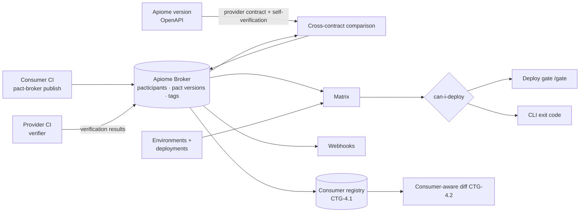
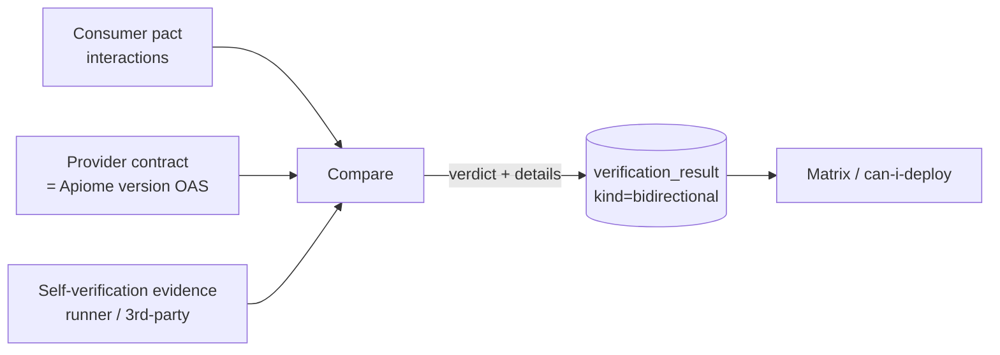
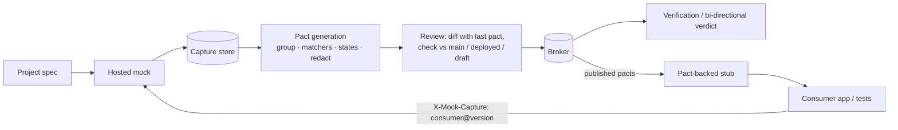

# Roadmap — Pact Broker & PactFlow Parity (Contract Testing Hub)

_Drafted 2026-11-19 against `main` @ `e952b7d0c`. Release: **RC10** (see [`RC10_PLAN.md`](RC10_PLAN.md)). Priority: **extremely high**._
_Status: **issues filed 2026-11-19** (numbers in the tables below). Companion roadmap: [`ROADMAP_CONTRACT_AGREEMENTS.md`](ROADMAP_CONTRACT_AGREEMENTS.md) (the SLA / data-sharing agreement half, moved from private-suite)._

**Umbrella:** [#6906](https://github.com/apiome/apiome/issues/6906). **Issue ID prefix:** `PFX`. Epics `PFX-EPIC-n`, issues `PFX-n.m`.
**GitHub title format:** `apiome: [PFX-<epic>.<issue>] <title>`.
**Recommended labels:** `contracts`, `pact`, `rest`, `ui`, `cli`, `devex`, `automation`, `mvp`, `v2`, `epic`, `documentation`.
**Visibility (decided 2026-11-24):** PFX work is **not feature-flagged**. Everything ships visible on the beta build as it merges — no `UNRELEASED_FEATURE_IDS` entry, no `UnreleasedFeatureGate`, no preview env var, no server-side enable switch, and docs pages go under `apiome-docs/docs/` (not `apiome-docs/unreleased/`).

---

## 0. Source description (request, verbatim)

> Create RC10 Project plan to include tickets to enable Contracts an PactFlow functionality into Apiome. Any
> functionality in apiome/private-suite that covers contracts and pactflow should be moved to apiome/apiome,
> and put in the roadmap. This is the next Release Candidate functionality list, and is an extremely high
> priority feature.

**What this roadmap delivers:** Apiome becomes a drop-in **Pact Broker / PactFlow replacement**. Existing Pact
tooling (the `pact-broker` CLI, pact-jvm / pact-js / pact-go / pact-python / pact-ruby / pact-net clients, the
Pact Docker CLI and the official GitHub Actions) works against Apiome by changing only the broker base URL and
token. On top of that it ships PactFlow's differentiator, **bi-directional contract testing** (consumer pact ⇄
provider OpenAPI), wired into what Apiome already owns: the canonical spec model, the breaking-change
classifier, the consumer registry, the contract runner and the deploy gate.

**Follow-up (2026-11-26), appended:**

> Pact is mainly done through CLI to be able to submit pacts for testing against projects and OpenAPI
> specifications. What's available in CLI should also be available in UI. […] PactFlow has a complete UI that
> covers the Pact creation and testing, and Apiome should include this, along with a better UI interface based
> on Apiome's current design. […] Add the ability to generate pacts using mocks as well. The Pact system needs
> to be as flexible as possible […] a design that even PactFlow's own application doesn't provide.

A review after epics 1–7 found that ten `apiome pact` commands had no screen: the private-suite mockups Epic 5
was built from cover a self-hosted broker's read side only, and nothing checked the UI against the CLI. **PFX-EPIC-8**
closes that gap and adds the rule that keeps it closed; **PFX-EPIC-9** adds pact generation from the hosted mock.
The design for both is `docs/mockups/contracts/` (eleven mockups, each with implementation notes).

Sources: Pact Broker REST/HAL API and `pact-broker` CLI; PactFlow docs (bi-directional contracts, teams, secrets,
webhooks, environments, can-i-deploy); the Pact specification v1–v4 and Pact plugin framework; the private-suite
roadmaps listed in §3.

---

## 1. What already exists (do NOT rebuild)

| Capability | Where | Ticket(s) | Reuse in this roadmap |
| --- | --- | --- | --- |
| Breaking-change classifier + pointers | `app/change_taxonomy` | CTG-1.1 | Cross-contract comparison (PFX-2.2) |
| Consumer registry (`consumer`, `consumer_contract`, V251) | `consumer_contract*.py`, `consumer_surface.py` | CTG-4.1 #4479 | Pacticipant ↔ consumer link (PFX-1.1, 7.1) |
| Pact 1.x–4.x **parse only** → declared surface | `pact_contract_import.py`, `PactImportDialog.tsx` | CTG-4.1 | Ingest path for PFX-1.2 |
| Consumer-aware breaking analysis | `consumer_impact*.py` | CTG-4.2 #4480 | PFX-7.4 · [#6964](https://github.com/apiome/apiome/issues/6964) |
| Contract-suite compiler and HTTP runner | `contract_suite*.py`, `contract_runner*.py` | ECA-1.1, 2.1 | Verifier (PFX-3.2) and self-verification (PFX-2.4) |
| Verification targets (SSRF-guarded) | `verification_target*.py` | ECA-1.2 | Provider base URLs (PFX-3.2) |
| Provider verification report vs live | `provider_verification*.py` (V252) | CTG-4.3 #4489 | Evidence for bi-directional (PFX-2.4) |
| Scheduled verification + drift alerts | `verification_schedule*` (V253) | CTG-4.4 #4501 | ✅ PFX-6.2 · [#6954](https://github.com/apiome/apiome/issues/6954) |
| Deploy-gate status API (`/gate`, V254) | `deploy_gate*.py` | CTG-4.5 #4502 | New signal: can-i-deploy (PFX-7.2) |
| Push webhooks, signing, dead-letter | `publish_webhooks.md` | CTG-3.3 | PFX-1.9 · [#6922](https://github.com/apiome/apiome/issues/6922) |
| `apiome diff`, diff-action, mock-action | `apiome-cli`, `diff-action/` | CTG-2.x | ✅ PFX-4.3 · [#6940](https://github.com/apiome/apiome/issues/6940) — `pact-action/` |
| GraphQL / gRPC adapters in the suite | `contract_suite_graphql.py`, XPC | XPC-1.2, 3.2 | PFX-3.7 · [#6937](https://github.com/apiome/apiome/issues/6937) |

Gaps this roadmap closes: there is **no broker** (no pacticipants, pact versions, branches/tags, environments,
deployments, verification-result publication, matrix/can-i-deploy, pending/WIP pacts, broker-compatible
webhooks or CLI), **no provider-state / matching-rule verifier**, **no bi-directional contract testing**, and
**no migration path** from an existing Pact Broker or PactFlow.

---

## 2. MVP Definition

A team can:

1. Point `pact-broker publish` / pact-js / pact-jvm at Apiome and **publish consumer pacts** with version,
   branch and tags; fetch them with consumer-version selectors.
2. **Publish provider verification results** (from any Pact verifier) or run Apiome's own verifier, which
   replays interactions against a registered target with provider states and matching rules.
3. Run `pact-broker can-i-deploy --to-environment production` (or `apiome pact can-i-deploy`) and get the
   same verdict, reasons and exit code as the Pact Broker, backed by **environments and recorded deployments**.
4. Publish a **provider contract** (OpenAPI from an Apiome version) with self-verification evidence and get
   **bi-directional** verdicts for every consumer pact without running a provider-side Pact test.
5. See pacticipants, pacts, the compatibility matrix, verification results, environments and webhooks in the
   UI, and fire webhooks on contract events.
6. **Migrate** an existing Pact Broker / PactFlow workspace into Apiome with one command.

7. *(added 2026-11-26)* Do all of the above **from the UI as well as the CLI** — publish a pact or a provider
   contract, start a verification, manage pacticipants and environments, migrate, export — with each screen
   showing its command (PFX-8.1–8.4, 8.6, 8.8–8.10, 8.12, 8.16, 8.18, 8.20).
8. *(added 2026-11-26)* **Generate a pact by running the consumer against the hosted mock**, from the UI or with
   `apiome pact record -- <test command>` (PFX-9.1–9.4).

**Out of MVP (v2):** async/message pacts and Pact plugins (gRPC, GraphQL), PR commit statuses, teams/ownership
notifications, health rollups and analytics, deploy simulator, Postman collections, Jenkins/Azure recipes.



---

## 3. Private-suite sources moved into this roadmap

Everything below currently lives in `apiome/private-suite` (all open). The Pact/PactFlow items are absorbed into
the `PFX` epics; the SLA / agreement items move to `ROADMAP_CONTRACT_AGREEMENTS.md`. Disposition is applied when
issues are filed (proposal: `gh issue transfer` is **not** used — the issues are re-filed with the apiome
template so they carry the Documentation section; old issues are closed with a link).

| private-suite issue | Title | Disposition → |
| --- | --- | --- |
| #1543 | [Epic 6] Contract Testing & CI/CD Pipeline | Absorbed → `PFX` epics 1, 4, 5 |
| #1544 | Testing 6.1 Pact Broker Hosting | → PFX-1.1…1.3, 1.8 |
| #1545 | Testing 6.2 Consumer Contract Registration | → PFX-1.2, 4.1 |
| (Testing 6.3) | Provider Verification Workflow | → PFX-3.2, 5.5 |
| #1547 | Testing 6.4 Can-I-Deploy Integration | → PFX-1.6, 5.4 |
| #1548 | Testing 6.5 Webhook on Contract Change | → PFX-1.9, 5.6 |
| (Testing 6.6) | Generate Postman Collections | → PFX-4.7 |
| (Testing 6.7) | GitHub Actions CI Workflow | → PFX-4.3 |
| (Testing 6.8) | Quality Gate for Publishing | → PFX-7.3 |
| #1040–#1044 | Test Lab 1.1–1.5 (contract model, authoring, verification engine, breaking-change detection, matrix) | → PFX-1.1, 5.2, 3.2, CTG-1.1 (done), 5.4 |
| #1888, #1798, #844 | Paths 3.4 Contract Testing; Browser 12.3 API Contract Tests; Gateway 1.4 Response Validation & Contracts | Triage: link to PFX-3.2 / CAG-7.3, close as duplicates where covered |
| #2298 | [Epic] Contract Testing & Deploy Gating (Pact) | Absorbed → PFX epics 1, 2, 5, 7 |
| #2299 / #2300 | 5.1 Pact Data Model & Contract Binding / 5.2 Consumer Pact Capture | → PFX-1.1, 1.2, CAG-5.1 (clause binding slice) |
| #2301 | 5.3 Provider Verification & SLA Clause Binding | → PFX-3.2 + CAG-5.3 (SLA strike binding) |
| #2302 / #2303 | 5.4 Compatibility Matrix / 5.5 Can-I-Deploy Gate | → PFX-1.6, 5.4 |
| (5.6) | CI Integration & Gate Events | → PFX-4.3 |
| #2336–#2340 | [Epic] Pact Operations & Release Intelligence; 10.1–10.4 | → PFX-5.5, 6.2, 5.7, 6.3 |
| #402–#422, #2305…#2350 | Contracts 0.191–0.211 and Epics 6–11 | → `ROADMAP_CONTRACT_AGREEMENTS.md` |
| #2350 | Designer DCW-EPIC-4 Sample-first contract intake | Stays in private-suite (Designer); cross-link only |
| #2297 | V2-MCP-14.7 Cross-SDK contract tests | Not Pact; stays |

Mockups moved with the plan: `private-suite/docs/mockups/pact/*` (broker, consumer-contract, webhooks,
verification, can-i-deploy, quality-gate) and `mockups/contracts/{matrix,verification,can-i-deploy}.html` become
the design references for Epic 5 (copy to `docs/mockups/pact/` in apiome when the epic is filed).

---

## 4. Epics

| Epic | Title | MVP issues | Issues |
| --- | --- | --- | --- |
| ✅ PFX-EPIC-1 | Pact Broker core: model, API, can-i-deploy | 1.1–1.9 | 11 |
| ✅ PFX-EPIC-2 | Bi-directional contract testing | 2.1–2.4 | 6 |
| ✅ PFX-EPIC-3 | Provider verification engine | 3.1–3.3 | 7 |
| ✅ PFX-EPIC-4 | CLI, CI and client compatibility | 4.1–4.3 | 7 |
| ✅ PFX-EPIC-5 | Contracts workspace UI | 5.1–5.4, 5.6 | 8 |
| PFX-EPIC-6 | Operations, governance and migration | 6.1, 6.7 | 8 |
| ✅ PFX-EPIC-7 | Integration with specs, gates and registry | 7.1–7.3 | 5 |
| PFX-EPIC-8 ([#7297](https://github.com/apiome/apiome/issues/7297)) | Contracts workspace: complete UI and CLI parity | 8.1–8.4, 8.6, 8.8–8.10, 8.12, 8.16, 8.18, 8.20 | 20 |
| PFX-EPIC-9 ([#7318](https://github.com/apiome/apiome/issues/7318)) | Pacts from mocks | 9.1–9.4 | 8 |

### ✅ PFX-EPIC-1 · [#6907](https://github.com/apiome/apiome/issues/6907) — Pact Broker core · umbrella of the hub

✅ **Done** (2026-11-24).

**Status.** All eleven issues of this epic are complete (PFX-1.11 #6924 was the last). #6907 added the hub page `apiome-docs/docs/ship/pact-broker/overview.mdx` (when to use it · where you work from · at a glance · how the pieces fit), its **Help & docs** entry, the release-notes post `2026-11-24-pact-broker-core-overview.mdx` and a What's new line.

#### Detailed issue descriptions

**✅ PFX-1.1 · #6914 Pacticipant, version, branch and tag model — Complete**
- **Problem:** Apiome stores *what a consumer uses* (CTG-4.1) but not *who published which pact from which build*. Pact tooling addresses everything by pacticipant name, application version, branch and tag; without those there is no matrix, no can-i-deploy and no environments.
- **Solution/Scope:** New migration (check V### on `origin/main` first) adding `pacticipant` (tenant, slug, display name, repository URL, main branch, optional `project_id`, optional `consumer_id`), `pacticipant_version` (immutable; version string, build URL, created_by), `pacticipant_branch` + `pacticipant_branch_version` (head per branch), `pacticipant_version_tag`. Provider pacticipant may bind to an Apiome project; consumer pacticipant to a `consumer` row (CTG-4.1). RBAC resource `pacts` (view/create/edit; delete Owner/Admin) seeded via `seed_builtin_roles`. Rules: versions never mutate; names unique per tenant; cross-tenant access impossible by composite FKs, as in V251.
- **Acceptance Criteria:** Create/list/get/delete pacticipants; versions are immutable; branch head moves forward only on publish; tags idempotent; deleting a project does not delete pacticipants (it nulls the binding); `yarn`/pytest + scratch-DB SQL checks.
- **Parallelism/Dependencies:** Foundation; blocks everything in Epic 1. Reuses V251 patterns.
- **Technical Stack:** PostgreSQL, FastAPI (`app/pacticipant*.py`).
- **Documentation (Docusaurus):** `docs/ship/pact-broker/concepts.mdx` (new), glossary entries, release note; reference regen (REST); no screenshots.

**✅ PFX-1.2 · #6915 Pact publication and retrieval API — Complete**
- **Problem:** Clients cannot publish pacts to Apiome.
- **Solution/Scope:** Pact Broker–compatible endpoints under `/v1/tenants/{tenant}/pact-broker/…` (and a tenant-host alias so the base URL is a single string): `PUT /pacts/provider/{p}/consumer/{c}/version/{v}`, `POST /contracts/publish` (bulk, with branch/tags/build URL), `GET /pacts/provider/{p}/consumer/{c}/version/{v}`, `…/latest`. Content-addressed `pact_version` (SHA-256 of canonical content) so identical pacts across consumer versions share one verification target. Pact spec v1–v4 accepted and stored verbatim; the existing `pact_contract_import` runs on publish to refresh the consumer surface (PFX-7.1). Size and rate limits; 409 on a changed pact for an already-published consumer version (broker behaviour, configurable).
- **Acceptance Criteria:** `pact-broker publish` and pact-js `publishPacts` succeed against a dev stack; the same pact published for ten versions yields one `pact_version`; invalid pact → 422 with the located problem; HAL links present.
- **Parallelism/Dependencies:** After 1.1.
- **Technical Stack:** FastAPI, Postgres JSONB + hash column.
- **Documentation:** `docs/ship/pact-broker/publish-pacts.mdx`; REST reference regen; release note.

**✅ PFX-1.3 · #6916 Consumer-version selectors and latest queries — Complete**
- **Problem:** Verifiers fetch "the pacts I must verify" via selectors, not by name.
- **Solution/Scope:** `POST /pacts/provider/{p}/for-verification` with `consumerVersionSelectors` (`mainBranch`, `branch`, `matchingBranch`, `deployedOrReleased`, `deployed`, `released`, `environment`, `latest`, `tag`, `fallbackBranch`), `includePendingStatus`, `includeWipPacts`, `providerVersionBranch`. Returns pact URLs with notices (why this pact was selected), as the broker does.
- **Acceptance Criteria:** Each selector kind has a fixture test; response shape matches the Pact Broker golden; ambiguous selectors rejected with 400.
- **Parallelism/Dependencies:** After 1.1, 1.2; needs 1.5 for environment selectors (stub until then).
- **Technical Stack:** FastAPI, SQL.
- **Documentation:** `…/pact-broker/selectors.mdx`.

**✅ PFX-1.4 · #6917 Verification-result publication — Complete**
- **Problem:** A can-i-deploy verdict needs recorded results.
- **Solution/Scope:** `POST /pacts/provider/{p}/consumer/{c}/pact-version/{sha}/verification-results` (and the HAL-linked equivalent) storing success, provider version, build URL, per-interaction test results, verifier name/version, branch; `verification_result` immutable and unique per (pact_version, provider_version, number). Latest result per pair is an indexed lookup. Existing CTG-4.3 reports are linked, not duplicated.
- **Acceptance Criteria:** pact-js verifier with `publishVerificationResult: true` succeeds; failed results keep test detail; the matrix (1.6) reads without parsing bodies.
- **Parallelism/Dependencies:** After 1.1, 1.2.
- **Technical Stack:** Postgres, FastAPI.
- **Documentation:** `…/pact-broker/verification-results.mdx`.

**✅ PFX-1.5 · #6918 Environments and deployment recording — Complete**
- **Problem:** can-i-deploy answers "is it safe in *production*?", which needs to know what is deployed there.
- **Solution/Scope:** `environment` (name, display name, production flag, contract-required flag), `deployed_version` (currently-deployed / released flag, application instance), `released_version`. Endpoints and CLI parity: `create-environment`, `record-deployment`, `record-undeployment`, `record-release`, `record-support-ended`, `list-environments`. Hooks into the existing project environments if present (link, do not duplicate).
- **Acceptance Criteria:** Recording a deployment marks the previous one undeployed (same application instance); history retained; `pact-broker record-deployment` works unmodified.
- **Parallelism/Dependencies:** After 1.1; parallel with 1.2–1.4.
- **Technical Stack:** Postgres, FastAPI.
- **Documentation:** `…/pact-broker/environments.mdx`.

**✅ PFX-1.6 · #6919 Matrix and can-i-deploy — Complete**
- **Problem:** The deploy decision is the product's headline.
- **Solution/Scope:** `GET /matrix` with the broker's `q[]` selectors and `latestby`, `GET /can-i-deploy` (`pacticipant`, `version`, `to`, `toEnvironment`, `ignore`), a verdict with per-row reasons ("no verification result", "verification failed", "pact is pending", "no pact"), summary text matching broker wording, and `retry-while-unknown` semantics via a `Retry-After` hint. Also bi-directional rows (PFX-2.3). The verdict function is pure and shared with the deploy gate (PFX-7.2).
- **Acceptance Criteria:** Golden verdicts for the Pact Broker's documented scenarios (pass, fail, unknown, pending, ignored pacticipant, environment with no deployments); `pact-broker can-i-deploy` exit codes match; matrix query p95 < 200 ms on 10k pact versions (scratch-DB benchmark).
- **Parallelism/Dependencies:** After 1.4 and 1.5. Blocks 5.4, 7.2.
- **Technical Stack:** SQL with named statements (see browse SSR recipe), FastAPI.
- **Documentation:** `…/pact-broker/can-i-deploy.mdx`; also the existing CI-gates hub gets a section.

**✅ PFX-1.7 · #6920 Pending pacts and work-in-progress pacts — Complete**
- **Problem:** A new consumer expectation must not break the provider build the moment it is published.
- **Solution/Scope:** Pending = a pact version never successfully verified by the provider branch; verification failures of pending pacts do not fail the provider build. WIP = pacts from consumer branches not matched by selectors, included on request. Implement the broker's definitions, exposed in `for-verification` notices and the matrix.
- **Acceptance Criteria:** Fixture scenarios from the broker docs pass; pending flag flips after first success.
- **Parallelism/Dependencies:** After 1.3, 1.4.
- **Technical Stack:** SQL, FastAPI.
- **Documentation:** `…/pact-broker/pending-and-wip.mdx`.

**✅ PFX-1.8 · #6921 Broker API conformance suite — Complete**
- **Problem:** "Drop-in" is a claim that must be tested.
- **Solution/Scope:** CI job that boots the stack, then runs the official `pact-broker` CLI (Docker) through publish → verify → record-deployment → can-i-deploy, plus pact-js and pact-jvm consumer/provider examples. Golden transcripts of HAL responses checked in. Tracks supported broker API version; unsupported endpoints return a documented 501 with a pointer, never a silent 404.
- **Acceptance Criteria:** Suite green in CI; a compatibility table page lists every Pact Broker endpoint as supported/partial/not planned.
- **Parallelism/Dependencies:** Grows with 1.2–1.6; starts after 1.2.
- **Technical Stack:** GitHub Actions, Docker, scripts/.
- **Documentation:** `…/pact-broker/compatibility.mdx` (generated table).

**✅ PFX-1.9 · #6922 Contract webhooks — Complete**
- **Problem:** CI needs to be told "a pact needs verifying" and "a verification finished".
- **Solution/Scope:** Webhook CRUD in the broker shape (event types `contract_content_changed`, `contract_published`, `contract_requiring_verification_published`, `provider_verification_published`, `provider_verification_succeeded`, `provider_verification_failed`, `consumer_version_branch_created`…) with templated bodies (`${pactbroker.pactUrl}` etc.), GitHub Actions `repository_dispatch` and a generic HTTP target, HMAC signing, retries and dead-letter reusing the existing push-webhook machinery (CTG-3.3), a per-delivery execution log, SSRF guard (ECA-1.2 policy), secrets via the credential vault.
- **Acceptance Criteria:** A published pact fires `contract_requiring_verification_published` once per provider branch; failed delivery retried then dead-lettered; template variables covered by tests; secrets never in logs.
- **Parallelism/Dependencies:** After 1.2, 1.4.
- **Technical Stack:** FastAPI, existing delivery worker, Postgres.
- **Documentation:** `…/pact-broker/webhooks.mdx`; screenshot ids in 5.6.

**✅ PFX-1.10 · #6923 Badges and public status endpoints — Complete** — SVG badge per pact / pacticipant ("verified", "failing", "unknown"), shields.io endpoint JSON, optional embed on the browse project page (only when the project is public). *Deps:* 1.4. **Docs:** `…/pact-broker/badges.mdx`.

**✅ PFX-1.11 · #6924 Pacticipant labels, version delete and cleanup — Complete** — labels, soft-delete of versions and pacticipants with audit, selector-based retention (keep latest N per branch, anything deployed/released, everything in the last D days) as a dry-run-first job. *Deps:* 1.1, 1.5. **Docs:** `…/pact-broker/retention.mdx`.

### ✅ PFX-EPIC-2 · [#6908](https://github.com/apiome/apiome/issues/6908) — Bi-directional contract testing

✅ **Done** (2026-11-24).

**Status.** All six issues of this epic are complete (PFX-2.6 #6930 was the last). #6908 brought `apiome-docs/docs/ship/pact-broker/overview.mdx` and `comparison-rules.mdx` up to date (the **Pact comparisons** screen, where bi-directional testing fits next to Pact verification), added the release-notes post `2026-11-24-bidirectional-contract-testing.mdx` and a What's new line.



| Issue | Title | Summary | Labels | Par | MVP | Cx | Modules |
| --- | --- | --- | --- | --- | --- | --- | --- |

**✅ PFX-2.1 · #6925 Provider contract publication — Complete**
- **Problem:** Bi-directional testing needs the provider's OpenAPI registered against a provider version, tying it to the broker's version/branch model.
- **Solution/Scope:** `PUT /contracts/provider/{p}/version/{v}` accepting an inline OAS or a reference to an Apiome `project@version` (preferred: the canonical model emits OAS 3.x via the existing exporter), content type, branch, tags, build URL, self-verification results (2.4). Stored write-once with a hash; a provider pacticipant bound to an Apiome project resolves `latest`.
- **Acceptance Criteria:** Publishing by reference and inline both work; hash dedupes; non-OAS inputs rejected with the located reason; fixtures for 3.0 and 3.1.
- **Dependencies:** 1.1. **Stack:** FastAPI, canonical model.
- **Docs:** `…/pact-broker/bi-directional.mdx`.

**✅ PFX-2.2 · #6926 Cross-contract comparison engine — Complete**
- **Problem:** The core of PactFlow's value: decide whether the provider's OAS satisfies every interaction in a consumer pact, without running the provider.
- **Solution/Scope:** Pure module `app/pact_oas_compare.py`: resolve each interaction to an operation (reuse `consumer_surface` path templating), then check method, path/query parameters, request headers and body against the request schema, and response status, headers and body against the response schema (JSON Schema 2020-12 / OAS 3.0 dialect via the IXH-5.1 validator). Matching rules v2–v4 mapped to schema constraints where lossless; everything not mapped is recorded in the fidelity list (2.5), never dropped. Unknown operations, undeclared statuses and nullable/required mismatches are named failures with JSON Pointers (the CTG-1.1 vocabulary).
- **Acceptance Criteria:** Corpus of ≥60 pact/OAS pairs with golden verdicts (pass, each failure class, partial); deterministic output; 1 MB pact compares in < 2 s; foreign fixtures (pacts generated by pact-js/jvm/go).
- **Dependencies:** 1.2, 2.1; shares code with CTG-4.1. **Stack:** Python.
- **Docs:** `…/pact-broker/comparison-rules.mdx` (table of every rule and mapping).

**✅ PFX-2.3 · #6927 Bi-directional verdicts in the matrix — Complete** — comparison runs when either side publishes; result stored as `verification_result` with `kind = bidirectional` plus the comparison payload; matrix and can-i-deploy treat it exactly as a native result and mark its kind. Re-runs when a new provider contract arrives for the branch. *Deps:* 1.4, 1.6, 2.2. **Docs:** matrix page section.

**✅ PFX-2.4 · #6928 Self-verification evidence — Complete** — the provider contract is trusted only if evidence says the provider matches it: accept (a) an Apiome **provider-verification report** (CTG-4.3) from a registered target, (b) uploaded third-party results (Schemathesis JUnit/JSON, Dredd, Postman/Newman, generic JUnit) with a size cap and content-type validation. Evidence kind, tool and digest recorded; a missing/failed evidence yields verdict "provider contract unverified" (configurable warn/fail). CLI: `apiome pact publish-provider-contract --evidence <file>`. *Deps:* 2.1; reuses CTG-4.3 reports. **Docs:** guide with one worked example per tool.

**✅ PFX-2.5 · #6929 Comparison fidelity report — Complete** — surfaced in API and UI: for every interaction the list of checks performed, unsupported matching rules, and "could not compare" items, so a green verdict is never read as stronger than it is (same honesty rule as CTG-4.3 coverage). *Deps:* 2.2. **Docs:** screenshot `pact-comparison-fidelity`.

**✅ PFX-2.6 · #6930 Pact export from a declared consumer surface — Complete** — consumers registered through the UI picker (not a pact file) can export a Pact v4 file (and publish it to the broker) generated from the operations/fields they declared, using OAS examples as the sample values. *Deps:* CTG-4.1, 1.2. **Docs:** how-to page.

### ✅ PFX-EPIC-3 · [#6909](https://github.com/apiome/apiome/issues/6909) — Provider verification engine

✅ **Done** (2026-11-25).

**Status.** All seven issues of this epic are complete (PFX-3.7 #6937 was the last). #6909 brought `apiome-docs/docs/ship/pact-broker/overview.mdx` up to date (the **Provider states** screen, where hosted verification fits next to a Pact verifier and bi-directional testing), added the release-notes post `2026-11-25-provider-verification-engine.mdx` and a What's new line. `verification.mdx` and `hosted-verification.mdx` were reviewed and are already complete from #6931–#6937.

| Issue | Title | Summary | Labels | Par | MVP | Cx | Modules |
| --- | --- | --- | --- | --- | --- | --- | --- |

**✅ PFX-3.1 · #6931 Pact → contract-suite compiler — Complete** — the ECA-1.1 compiler's case model gains a `pact` source: request, expected response, provider state, matching rules; manifest stays byte-identical per (pact version, options) with a `sha256:` digest. Unsupported semantics reported, never skipped. *Deps:* 1.2, ECA-1.1. **Docs:** reference regen; `…/pact-broker/verification.mdx`.

**✅ PFX-3.2 · #6932 Provider verifier — Complete** — `POST …/pact-verifier/pacts/provider/{p}/verify` selects pacts through the PFX-1.3 selectors, replays them via the ECA-2.1 runner against a registered verification target (SSRF policy and mutation rules of the target apply; CTG-4.3 fixtures honoured), judges responses with the verifier's matching engine, and publishes a verification result (1.4) per pact tagged with provider version/branch. Mutating interactions need the target policy **and** an explicit opt-in; a run cannot widen target policy. Failures name the interaction, field pointer and rule. Shipped ahead of 3.3 and 3.4 by decision: provider states are a seam (`ProviderStateHandler`) — an interaction with a state is skipped with a reason unless the run opts to replay without setup — and the engine covers the core matchers, with the specification test-suite vectors left to 3.4. Only conclusive runs are published. *Deps:* 3.1, 1.4. **Docs:** `…/pact-broker/hosted-verification.mdx`.

**✅ PFX-3.3 · #6933 Provider-state registry — Complete** — `…/pact-verifier/providers/{p}/provider-states` (CRUD, V441) registers states per provider: name, declared parameters (required / default), and a setup — a `state_change` call (the Pact state-change body; a path on the target carries the target credential, an absolute URL goes through the SSRF guard with none; teardown optional) or a recorded `fixture` (requests sent to the target, `${param}` substituted; empty = target already holds the data) — with per-target overrides. `POST …/check` flags, before a run, unregistered states, missing required / undeclared parameters and setups the target policy forbids. The verifier holds those interactions back before sending, sets states up / tears them down around each interaction, and reports failed teardowns. UI: **Provider states** page (read view + check). *Deps:* 1.1. **Docs:** `…/pact-broker/provider-states.mdx`, screenshot `pact-provider-states`.

**✅ PFX-3.4 · #6934 Matching-rules engine — Complete** — the verifier's engine (`pact_value_match`) applies every Pact 2–4 matcher, published as `VERIFIER_MATCHERS` (the supported-rules table on `…/pact-broker/hosted-verification.mdx`): `type`, `regex` (full match, as the reference implementations), `include`, `number/integer/decimal`, `date/time/timestamp/datetime`, `minType/maxType/minMaxType`, `arrayContains`, `eachKey/eachValue`, `values`, `notEmpty`, `semver`, `boolean`, `null`, and `contentType` — detected from the bytes (`pact_content_type`, magic numbers then JSON / XML / text); on `$` of a non-JSON body it judges the whole body. Generators are ignored on verification. An explicitly empty response body (`null`, `""`, Pact 4 empty `content`) now requires an empty response (compiler version 5); `Accept` compares as media types. Table-driven tests run all 357 response vectors of the Pact specification test suite (v1–v4, vendored) plus supplementary v3/v4 vectors; XML is compared as text — stricter than the suite's XML match cases, never looser. *Deps:* 3.1. **Docs:** supported-rules table.

**✅ PFX-3.5 · #6935 External-verifier result ingestion — Complete** — endpoint and CLI for results produced elsewhere (pact_verifier_cli JSON, JUnit) mapped to the verification-result model. *Deps:* 1.4. **Docs:** `…/pact-broker/verification-results.mdx`.

**✅ PFX-3.6 · #6936 Message pacts — Complete** — Pact v3 `messages` and v4 `Asynchronous/Messages` compared with an **AsyncAPI 2.x / 3.x provider contract** (`contractType: asyncapi`, read from the document when omitted, inline only; structural check, no migration) by `pact_asyncapi_compare` like 2.2: resolved onto a channel/message (`pact_asyncapi_index`: metadata destination, address templates, message name, only messages the provider sends, first payload match), then content type, metadata against `headers`, contents against a JSON Schema `payload` (reuses the AsyncAPI payload helpers) and matching rules. New message codes on the comparison-rules page; HTTP interactions and Pact 4 `Synchronous/Messages` are reported as not compared (synchronous handlers deferred). The fidelity report lists the message checks. Golden corpus of 28 cases. *Deps:* 2.2. **Docs:** `…/pact-broker/message-pacts.mdx`, comparison-rules section.

**✅ PFX-3.7 · #6937 Plugin pacts: gRPC and GraphQL — Complete** — a gRPC call recorded by the Pact protobuf plugin (Pact 4 `Synchronous/Messages`, `transport: grpc`) compiles, through the descriptors the pact files under `metadata.plugins`, into a `grpc` case on the XPC-3.2 RPC model (`pact_plugin_grpc`: procedure, protobuf-JSON request and reply, `grpc-status`, idempotency from the method options, rule paths renamed to JSON names, numeric rules on int64 fields applied as a digits regex) and is judged by the verifier's matching engine on a `grpc` / `connect` target. A GraphQL-over-HTTP interaction carries the XPC-1.2 operation (`pact_graphql`): its operation type gates mutation, and unrecorded `errors` fail. Hosted verification takes `http`, `grpc` or `connect` targets and holds back what the target cannot speak (`pact-interaction-protocol-mismatch`). Other plugins, streaming methods and subscriptions are reported unsupported. Mapping GraphQL selections onto the consumer-contract model is reported as deferred (`PACT_GRAPHQL_SELECTIONS_NOT_MAPPED`) until XPC-1.6 #5733 ships. *Deps:* 3.2, XPC-1.6 #5733. **Docs:** `…/pact-broker/verification.mdx`, `…/pact-broker/hosted-verification.mdx`.

### ✅ PFX-EPIC-4 · [#6910](https://github.com/apiome/apiome/issues/6910) — CLI, CI and client compatibility

✅ **Done** (2026-11-25).

**Status.** All seven issues of this epic are complete (PFX-4.7 #6944 was the last). #6910 brought `apiome-docs/docs/ship/pact-broker/overview.mdx` up to date (CI pipelines and AI agents as places to work from; Run Pact in CI and the Postman export in *At a glance*), tidied the intro of `cli.mdx`, and added the release-notes post `2026-11-26-pact-cli-ci-and-client-compatibility.mdx` and a What's new line. `cli.mdx` and `ci-pact.mdx` were reviewed and are already complete from #6938–#6944.

| Issue | Title | Summary | Labels | Par | MVP | Cx | Modules |
| --- | --- | --- | --- | --- | --- | --- | --- |

**✅ PFX-4.1 · #6938 `apiome pact` command group — Complete** — `apiome pact publish|list-pacticipants|describe-version|can-i-deploy|record-deployment|record-release|create-environment|create-webhook|verify` take `pact-broker`'s flags and print its sentences; every `apiome pact` command (the PFX-2.4/2.6/3.5 ones too) reads `PACT_BROKER_BASE_URL` (path form names API + workspace; the tenant-host alias reaches broker routes only) / `PACT_BROKER_TOKEN` as well as `APIOME_*`, takes `-b`/`-k`, and the group exits like `pact-broker` (`0` success, `1` any failure, usage and 4xx included). `--output table|json|markdown`. Unsupported input (non-pact files, `--merge`, webhook methods outside POST/PUT/PATCH, basic-auth-only env) is refused with the reason before sending. `migrate` is registered but exits 1 until PFX-6.7 (#6959). No REST change. **Docs:** CLI reference regen; `ship/pact-broker/cli.mdx`, `ship/pact-broker/ci-pact.mdx`; release-notes post.

**✅ PFX-4.2 · #6939 Broker-compatible auth and API-key scopes — Complete** — every route under `/pact-broker` and `/pact-verifier` takes the workspace API key as a bearer token, `X-API-Key` or the **password of basic auth** (username ignored); basic auth without a password, a bare header and other schemes are refused `401` with where the key goes. V442 adds `pact:read` (every GET of both mounts, `for-verification`, the provider-state check, pacticipant reads), `pact:publish` (publish pacts / provider contracts, tag / branch a version, record deployments and releases) and `pact:verify` (verification results, external reports, hosted verify, provider states, tag / branch the provider version) to the CTG-2.3 allowlist; deletes, webhooks, environments and cleanup stay full-access; the `pacts` RBAC check still applies. API keys gets **Pact: read-only**, **Pact: consumer + deploy** and **Pact: CI verifier** presets; `apiome pact` reads `PACT_BROKER_PASSWORD` as the key. OpenAPI 1.678.0. **Docs:** `ship/pact-broker/cli.mdx` (key-scope table + security note), `ci-pact.mdx`, `publish-pacts.mdx`, `workspace/api-keys.mdx`; screenshot `api-keys-pact-scope`; release-notes post.

**✅ PFX-4.3 · #6940 CI actions and recipes — Complete** — `pact-action/` is a composite GitHub Action (installs the CLI unless `apiome` is on PATH, then runs `entrypoint.sh`) with `command: publish | can-i-deploy | record-deployment`: publish takes the pacts (one per line), the PR head commit / branch and the run URL; can-i-deploy takes pacticipant + environment, retries and `dry-run`, and sets `deployable`; both upsert one sticky PR comment (diff-action's `sticky_comment.sh`, marker `apiome-pact-action:<command>[:<pacticipant>@<environment>|:<comment-id>]`) and write the job summary; a failed comment is a warning, never a result change. record-deployment is refused on `pull_request` / `pull_request_target`. The broker key goes in the environment, never argv. Every bad input (unknown command, missing URL / token / pacticipant / environment, non-http URL, bad booleans or retry numbers, empty or missing pact paths) is refused with the reason, exit 1. GitLab (`recipes/.gitlab-ci.yml`) and Bitbucket (`recipes/bitbucket-pipelines.yml`) recipes run each job against a stub CLI in the `pact-action` workflow matrix, which also checks `ci-pact.mdx` embeds them byte for byte. No REST or CLI change. **Docs:** `ship/pact-broker/ci-pact.mdx` (GitHub Action section + embedded recipes), `ship/pact-broker/cli.mdx`, new generated `reference/ci/pact-action.md` from the README; release-notes post, What's new line.

**✅ PFX-4.4 · #6941 Commit statuses and PR checks — Complete** — V443 `pact_commit_status` records one verdict per pacticipant version and context `apiome-pact/<consumer>/<provider>`: a committed publish puts `pending` (or the provider main branch's verdict for that content) on the consumer's commit; a committed verification result (broker or hosted verify) puts `pass` / `fail` on the provider's and the consumer's commits. The target is the registered tenant repository whose normalized clone URL matches the pacticipant's `repository_url` (github.com / gitlab.com), written with its linked account's stored token through the new `GitHubCommitStatusAdapter` (commit statuses, OAuth-token friendly) and `GitLabCommitStatusAdapter`; the version number must be a commit SHA. Every verdict that cannot go is recorded `suppressed` with a reason (no repository, not a commit, not registered, unsupported provider, no credential, publishing off); a provider refusal is `failed`; neither fails the publish. `GET /v1/tenants/{t}/pact-commit-statuses` (`pacts:view`) and `POST …/{id}/retry` (`pacts:edit`). Bi-directional verdicts do not post statuses yet. OpenAPI 1.679.0. **Docs:** new `ship/pact-broker/commit-statuses.mdx`; `ci-pact.mdx`, `cli.mdx`, `overview.mdx`; release-notes post, What's new line.

**✅ PFX-4.5 · #6942 MCP tools for pacts — Complete** — `pact.list` (latest pact per consumer → provider integration with its latest verification; `provider` / `consumer` filters; keyset cursor pages, `limit` ≤ 100), `pact.matrix` (structured `selectors` + destination / `latestby` / `ignore`, turned into the broker's `q[][…]` query and read by its own parser), `pact.can_i_deploy` (`to_environment` or `to_tag`) and `pact.record_deployment` (by environment name; annotated as a write) in a new `pact` MCP toolset. apiome-mcp validates first — unknown selector keys, wrong types, out-of-range limits and both destinations are refused with the reason, never dropped or clamped — and refuses project-limited keys (pacts are workspace-wide). apiome-rest's internal `/v1/internal/mcp/pacts/{list,matrix,can-i-deploy,record-deployment}` (internal service token) re-read the MCP key and act as its creator: `pacts:view` for reads, `pacts:create` to record; an ownerless key is `mcp-pact-key-has-no-owner`. Answers are bounded: the verdict reads every row, at most `max_rows` (≤ 100) compact rows and 50 notices come back with `rowsTotal` / `rowsTruncated`; REST refusals carry their code in the tool error. OpenAPI 1.680.0. **Docs:** `ship/pact-broker/cli.mdx` (Ask from an AI agent), `ci-pact.mdx`, `workspace/tenants.mdx`, `getting-started/connect-an-mcp-host.mdx`; MCP and REST reference regen; release-notes post, What's new line.

**✅ PFX-4.6 · #6943 Jenkins and Azure Pipelines recipes — Complete** — `pact-action/recipes/Jenkinsfile` (Multibranch Pipeline; `apiome-pact-broker-token` Secret-text credential bound at pipeline level, single-quoted `sh` so Groovy never reads the key; `when { branch 'main'; not { changeRequest() } }` gates record-deployment) and `pact-action/recipes/azure-pipelines.yml` (a job per step; each step maps the secret `PACT_BROKER_*` variables into `env`, an unexpanded `$(NAME)` is treated as missing; PR head commit as the version; record-deployment off `Build.Reason == PullRequest`). Both install the CLI with the installer unless `apiome` is on PATH, keep `can-i-deploy.md` (artifact / build summary), and refuse a missing URL or token with the reason, exit 1. `test_ci_recipes.sh --recipe jenkins|azure` runs each job against a stub CLI and checks `ci-pact.mdx` embeds the recipes byte for byte; the `pact-action` workflow matrix gains both. Postman collection generation is PFX-4.7 #6944. No REST, CLI or UI change. **Docs:** `ship/pact-broker/ci-pact.mdx` (Jenkins and Azure Pipelines section); release-notes post, What's new line.

**✅ PFX-4.7 · #6944 Postman collection export — Complete** — `POST /v1/tenants/{t}/pact-postman-collections` (`pacts:view`, stateless, beside the broker surface) writes a Postman Collection v2.1 from a stored pact (`provider` + `consumer`, at most one of `consumerVersion` / `tag` / `branch` / `pactVersionSha`; none = latest; caller's tenant) or an inline `pact` (`pact_max_bytes`, `validate_pact_document`): one request per HTTP interaction against `{{baseUrl}}` (`baseUrl` option), provider states in the description, a saved example response, and (`tests`, default on) a test script checking status, expected headers (`Content-Type` by media type) and the body by Pact's default rules (`app.pact_postman`). `notices` (code, outcome `left-out` / `not-asserted` / `not-applied` / `info`, pointer, reason): message and plugin gRPC interactions, method-less interactions and non-text request bodies left out; response values under matching rules and non-text response bodies not asserted; request generators not applied; provider states listed once. Nothing exportable is `422 pact-postman-no-http-interactions` with the notices. CLI `apiome pact export-postman` (`--provider/--consumer` + selection, or `--pact-file`; `--provider-base-url`, `--no-tests`, `-o`, `--fail-on-left-out`). The schema side is the existing `postman` export target (`apiome export postman`). OpenAPI 1.681.0. **Docs:** `ship/pact-broker/cli.mdx` (Export a pact as a Postman collection), `ci-pact.mdx` (Newman smoke test), `ship/export-to-an-api-client.md`; CLI + REST reference regen; release-notes post, What's new line.

### ✅ PFX-EPIC-5 · [#6911](https://github.com/apiome/apiome/issues/6911) — Contracts workspace UI

✅ **Done** (2026-11-25).

**Status.** All eight issues of this epic are complete (PFX-5.8 #6952 was the last). #6911 replaced the screen paragraph of `apiome-docs/docs/ship/pact-broker/overview.mdx` with a **The Contracts workspace** section (how to reach each of the ten screens and what it shows, plus publishing from the **Import a Pact file** dialog) and an app row in **Where you work from**, added the release-notes post `2026-11-27-contracts-workspace-ui.mdx` and a What's new line. The per-screen pages were reviewed and are already complete from #6945–#6952. No screenshot changes.

Design references: `mockups/pact/*` and `mockups/contracts/{matrix,verification,can-i-deploy}.html` (moved with this plan). Placement: a **Contracts** area under the project/ tenant navigation, with the existing Consumers page as a tab. Follow the facelift data-fx conventions and the DOC-contract (screenshots in light/dark).

| Issue | Title | Summary | Labels | Par | MVP | Cx | Modules |
| --- | --- | --- | --- | --- | --- | --- | --- |

**PFX-5.1…5.8** share: server-component pages with the BFF proxies under `/api/pact/*`, empty states with the CLI snippet, keyboard accessible tables, **no feature gating** — every screen is visible (rail, command palette, routes) as soon as its PR merges: do not add an id to `UNRELEASED_FEATURE_IDS`, do not add an `UnreleasedFeatureGate` layout, and nothing may depend on `NEXT_PUBLIC_APIOME_PREVIEW_FEATURES`, fixtures for the fixture-dump renderer, Help-guide articles with keywords, and per-screen screenshot ids (`pact-pacticipants`, `pact-detail`, `pact-matrix`, `pact-can-i-deploy`, `pact-verification`, `pact-webhooks`, `pact-environments`) in light and dark. **Acceptance:** each page renders from fixtures and live stack; a11y pass (axe) with no serious violations; docs page per screen. **Dependencies:** matching API issue in Epic 1/3. 5.5 absorbs private-suite 10.1; 5.7 absorbs 10.3.

**✅ PFX-5.1 · #6945 Pacticipants list and detail — Complete** — A **Contracts** rail entry (Ship, `handshake`, subtree of `/ade/dashboard/pacts`, which redirects to the list; no gating) opens **Pacticipants** (`/ade/dashboard/pacts/pacticipants`): handle, main branch, labels, repository (http(s) only as a link), last update; **Label** filter from `pacticipant-labels`; keyset **Load more** (50). `/ade/dashboard/pacts/pacticipants/{handle}`: **Overview** (handle, main branch, repository, labels, bindings, registered), **Branches** (head version, **Main** marked; first 100, `100+`), **Environments** (every environment with the pacticipant's currently-deployed versions + application instance and currently-supported releases, read from the broker environment lists 4 environments at a time; a failed sub-read reads *Could not be read* on its row), **Versions** (latest first, branches, tags, recorder, build link; a branch or tag chip narrows, both at once, **Clear**; **Load more**). Each section loads, fails and retries on its own. BFF proxies under `/api/pact/*` (`pacticipants`, `labels`, `pacticipants/{p}`, `…/versions`, `…/branches`, `…/environments`) forward as the session user to the session tenant (`pacts:view` is REST's); an unknown, empty, repeated or oversized query parameter is a 400 naming it, a malformed handle a 404 without calling REST. Empty states carry the `apiome pact publish` / `record-deployment` snippets. No REST change. The Consumers page stays per project (not yet a Contracts tab). **Docs:** `ship/pact-broker/pacticipants.mdx` (new), `concepts.mdx`, `overview.mdx`; screenshots `pact-pacticipants`, `pact-pacticipant-detail`; Help-guide entry; release-notes post, What's new line.

**✅ PFX-5.2 · #6946 Pact detail and interaction viewer — Complete** — `/ade/dashboard/pacts/pacticipants/{consumer}/pacts/{provider}` (`?version=` a consumer version, latest without; the address follows the open version): **Overview** (consumer/provider links, consumer version, pact version SHA, specification, published, interaction counts), **Verification status** (verdict of the newest result — Verified / Failed / Failed (pending) / Not verified yet — and every provider version with branch, result, pending/WIP, native or bi-directional, time; unverified shows the `apiome pact verify … --target` snippet), **Changes since the previous pact** (the previous *distinct* pact: the BFF walks back through the pair's consumer versions, 4 reads at a time, at most 20, skipping same-SHA ones; outcomes found / first / unchanged / scan-limit / not-in-history; interactions matched on kind + description + state names; added / changed with value paths old → new, capped at 50 / removed), **Interactions** (V2/V3/V4: HTTP, message, synchronous message as `<details>` with provider states + params, request/response or message contents/metadata; V4 pending marked; New/Changed badges; an undrawn type or non-object entry kept and shown as JSON with the reason), **History** (consumer versions newest first with verdicts, from the pair matrix, 500 rows, `N+` when truncated; a version opens its pact). A pacticipant's page gains **Pacts** (matrix `q[][pacticipant]` + `latestby=cvp`, 1000 rows: each integration, role, latest consumer version, verdict). BFF proxies `pacts/{provider}/{consumer}` (`version`), `…/history`, `…/previous` (`version`), `pacticipants/{p}/pacts`; an unknown/repeated/empty/oversized parameter or a version with `/` is a 400 naming it, a malformed handle a 404 without calling REST; `pacts:view` and tenancy are REST's. No REST change (the broker diff resources stay unserved; the compat notes already point at the viewer). **Docs:** `ship/pact-broker/pact-detail.mdx` (new), `pacticipants.mdx`, `overview.mdx`; screenshots `pact-detail` (new), `pact-pacticipant-detail` (recaptured); Help-guide entry; release-notes post, What's new line.

**✅ PFX-5.3 · #6947 Integration network graph — Complete** — `/ade/dashboard/pacts/pacticipants/{handle}/network`, linked as **Network diagram** from a pacticipant's **Pacts** section (shown when it has pacts): the pacticipant's whole connected group (the Pact Broker's `/groups/{pacticipant}`), collected by the BFF breadth first from each pacticipant's matrix (`q[][pacticipant]` + `latestby=cvp`, 1000 rows), 4 reads at a time, at most 25 pacticipants, each hop in handle order; one entry per integration with its newest pact and verdict. Gaps are never dropped: a pacticipant past the limit is `not-read`, a refused matrix `failed` with REST's reason, a full matrix `truncated` — drawn with a dashed outline and named in a notice; the starting pacticipant's refusal keeps REST's status. **Diagram** is a deterministic SVG: layered consumer → provider (longest path; a pure consumer sits next to its nearest provider; a cycle's closing edge drawn as an arc below), 12 per column with `+N more in the table`, the centre always drawn; each edge coloured by verdict (`--ok-fg` / `--danger-fg` / `--warn-fg` / `--fg-muted`) with a ✓ ✕ ! ? mark and unverified dashed, a link to the pact; each node a link to its own network; a key with counts. **Integrations** table lists every integration. BFF proxy `pacticipants/{p}/network` (no parameters: any is a 400 naming it; a malformed handle a 404 without calling REST); `pacts:view` and tenancy are REST's. No REST change. **Docs:** `ship/pact-broker/network.mdx` (new), `pacticipants.mdx`, `overview.mdx`; screenshots `pact-network` (new), `pact-pacticipant-detail` (recaptured); Help-guide entry; release-notes post, What's new line.

**✅ PFX-5.4 · #6948 Matrix and can-i-deploy console — Complete** — **Matrix** (`/ade/dashboard/pacts/matrix`): a query builder of up to 10 selectors (pacticipant + Latest version / Version / Branch / Main branch / Tag / Environment / All versions, **Latest only** for branch, main branch and tag), **Rows** (`latestby` cvp / cvpv / cp / every result) and **Limit** (100 / 500 / 1000); the address carries the query as numbered broker selectors (`q[0][pacticipant]=…`, order-independent for server pages), an address it cannot read says why and is not asked, an unfinished query says what it needs. The answer: **Verdict** (Yes — deployable / No — not deployable / Not known yet, the broker sentence, counts, considered vs ignored rows, notices grouped Blocking / Warnings / Passing / other with a hint per code, **Check again** with REST's `Retry-After`, a note when the rows hit the limit), **Grid** (consumer versions × provider versions, at most 20 × 20 with the rest counted; each cell the newest result of the pair with ✓ ✕ ! ? and a count, ignored dashed, a link to the pact; a *no result* provider column), **Rows** (every row with result, kind, pending/WIP, ignored, reason, pact link). **Can I deploy?** (`/ade/dashboard/pacts/can-i-deploy`): pacticipant (suggested), version (the pacticipant's latest versions suggested), environment (picker; an unknown one kept) or tag, up to 10 ignored pacticipants; the same verdict panel, the rows, and the `apiome pact can-i-deploy` command (shell-quoted). Both linked from the **Pacticipants** header; no gating. BFF proxies `matrix` (only numbered selectors, `latestby`, `limit`; anything else, repeats, empties, >255 chars, gaps, >10 selectors or broker-refused combinations a 400 naming it), `can-i-deploy` (`pacticipant`, `version`, `toEnvironment` | `to`, `ignore`) and `environments` (no parameters); both verdict proxies pass `Retry-After` as `retryAfterSeconds`; `pacts:view` and tenancy are REST's. No REST change. **Docs:** `ship/pact-broker/matrix.mdx` (new), `can-i-deploy.mdx` (Check in the console), `overview.mdx`, `pacticipants.mdx`; screenshots `pact-matrix`, `pact-can-i-deploy` (new), `pact-pacticipants` (recaptured); Help-guide entry; release-notes post, What's new line.

**✅ PFX-5.5 · #6949 Verification results and operations — Complete** — A provider's **Verification** page (`/ade/dashboard/pacts/pacticipants/{provider}/verification`, linked as **Verification** from a pacticipant's **Pacts** section when it is a provider, and as **Results and logs** from a pact's **Verification status**; no gating): KPI strip (pacts, verified, failing, stale, interactions passing, last verified); **Pacts** — each consumer's newest pact with its newest result, *stale* when the pact version has no result, **Re-run** per row and **Verify all stale (N)**, both through a run dialog (verification target from `/api/verification-targets`, provider version and branch — a re-run prefilled from the newest result — and the mutating opt-in) that shows the outcome and every pact not run with its reason; **History** — every result newest first with trigger, duration, build link and interaction counts, **Consumer** filter in the address (`?consumer=`), **Load more** (25). A result page (`…/verification/results/{id}`): overview, each interaction (failed ones open) with each mismatch's expected and actual side by side (JSON, so a type mismatch shows), the evidence run's requests (or why there are none: published by a verifier, pruned, or no `verification_evidence:view`), and the raw log with **Copy** and **Download**; **Re-run verification**. REST (OpenAPI 1.682.0, apiome-db V444): `verification_result` gains `trigger` (`published` / `hosted` / `manual` / `stale-recheck` / `bidirectional`, NULL before V444), `duration_ms`, `evidence_run_id` and `idx_verification_result_provider_history`; five routes under `/v1/tenants/{t}/pact-verifier/pacts/provider/{p}` — `GET verification-status`, `GET results` (`consumer`, `cursor`, `limit` ≤ 50), `GET results/{id}`, `POST consumer/{c}/pact-version/{sha}/reverify`, `POST verify-stale` (≤ 25 per run, the rest `skipped` with `pact-verify-over-limit`); runs need `pacts:create` + `verification_evidence:create` (API-key scope `pact:verify`) and hold a per-pair session advisory lock (a busy pair: 409 `pact-verify-in-progress`, or `skipped` in a bulk run); the hosted verifier is refactored onto a shared `VerificationSession`. BFF proxies under `/api/pact/pacticipants/{p}/verification/*` (unknown/repeated/empty/malformed parameters or body fields a 400 naming them; a malformed handle or result id a 404 without calling REST). **Deferred from private-suite 10.1:** matrix rollup counts, free-text pair search, counterparty grouping and hide-empty list view; CLI `reverify` / `verify-stale` commands; per-consumer access-level confirmations. **Docs:** `ship/pact-broker/verification-console.mdx` (new), `verification-results.mdx`, `hosted-verification.mdx`, `overview.mdx`, `pacticipants.mdx`, `pact-detail.mdx`; screenshots `pact-verification`, `pact-verification-result` (new), `pact-pacticipant-detail`, `pact-detail` (recaptured); REST reference; Help-guide entry; release-notes post, What's new line.

**✅ PFX-5.6 · #6950 Webhooks UI and execution log — Complete** — **Webhooks** (`/ade/dashboard/pacts/webhooks`, linked as **Webhooks** from the **Pacticipants** header; no gating): every contract webhook with its scope (**All pacts** / consumer / provider / `Consumer → Provider`), events, target (`POST host` or **GitHub Actions** · repository), **Enabled** / **Disabled**, **Signed** and **Last delivery** (status + time, or **Never fired**); **Recent deliveries** — the workspace's firings newest first with status (**Delivered**, **Failed**, **Retrying**, **Queued**), event, pact, webhook, attempts (and left) and trigger (**Event** / **Redelivery**), a **Status** filter and **Load more** (25). **New webhook** opens an editor (description, consumer, provider, events, HTTP request — method, URL, `Name: value` headers, JSON-or-text body, basic auth — or a GitHub `repository_dispatch` target, signing secret, enabled) that checks the form before sending and can **Test** the unsaved webhook. A webhook's page (`…/webhooks/{uuid}`): overview, request with secrets as `**********`, **Test** (the saved webhook, outcome panel), **Edit** (stored secrets kept unless replaced or **Remove it**; no unsaved test of an existing webhook — it cannot use a stored secret), **Disable** / **Enable** (a `PUT` sending every redacted secret back), **Delete** (confirmed) and its **Delivery log**. A delivery's page (`…/webhooks/deliveries/{uuid}`): overview (webhook, event, pact link, consumer version, verification result, attempts, trigger), every attempt's execution log (failed ones open) with **Copy**, and **Redeliver**. REST (OpenAPI 1.683.0, apiome-db V445): four routes under `/v1/tenants/{t}/pact-webhook-deliveries` (`app.pact_webhook_delivery_routes`, off the catalogued broker surface) — `GET` (workspace or `webhook`, `status`, opaque `cursor`, `limit` ≤ 50), `GET latest`, `GET {id}` (executions) and `POST {id}/redeliver` (`pacts:edit`; a new firing with `trigger_type` `user`, same event and parameters, original kept; 409 `pact-webhook-delivery-in-progress` while queued/retrying, 409 `pact-webhook-disabled`); V445 replaces `idx_pact_triggered_webhook_webhook` with `idx_pact_triggered_webhook_history (webhook_id, tenant_id, created_at DESC, id DESC)` and adds `idx_pact_triggered_webhook_recent (tenant_id, created_at DESC, id DESC)`. BFF proxies under `/api/pact/webhooks/*` (unknown body fields or query parameters a 400 naming them; malformed ids a 404 without calling REST). **Docs:** `ship/pact-broker/webhooks-console.mdx` (new), `webhooks.mdx`, `overview.mdx`, `pacticipants.mdx`; screenshots `pact-webhooks`, `pact-webhook-detail`, `pact-webhook-delivery` (new), `pact-pacticipants` (recaptured); REST reference; Help-guide entry; release-notes post, What's new line.

**✅ PFX-5.7 · #6951 Environments and deployments dashboard — Complete** — **Environments** (`/ade/dashboard/pacts/environments`, linked as **Environments** from the **Pacticipants** header; no gating): a **Deployed versions** grid of every pacticipant in any environment × every environment (each version deployed now with its application instance, each supported release marked `released`; SHA versions cut to 12) and the environments (name, production, counts, contract required); past 2000 current deployments or releases a notice says so. An environment's page (`…/environments/{name}`, also linked from a pacticipant's **Environments** section): **Overview**, **Deployed now**, **Released and supported**, **Deployment history** (every deployment current or **Replaced** with when, newest first, who recorded it, **Pacticipant** filter, **Load more** 25), each section loading and retrying on its own. **Deploy simulator** (`…/environments/{name}/simulate?pacticipant=&version=[&applicationInstance=]`, address carries the question): the candidate's can-i-deploy verdict, what it replaces in that instance (or first deployment / already deployed), **What else changes** — every version of a pacticipant it has a pact with that is *running* in the environment or *pending* (deployed or released elsewhere), its verdict **Now** → **After** and the effect (**Breaks** / **Blocks** / **Changes** / **Fixes** / **Clears** / **No change**), **Not checked** (past 20, with the reason), **Check again**, and the `can-i-deploy && record-deployment` CLI. REST (OpenAPI 1.684.0, apiome-db V446): three `pacts:view` reads under `/v1/tenants/{t}/pact-environments` (`app.pact_deployment_routes`, off the catalogued broker surface; `{environment}` is the name) — `GET` (topology, 2000-row cap with `truncated`), `GET {name}/deployments` (`pacticipant`, `cursor` = seq, `limit` ≤ 50; bad cursor 400 `pact-deployment-cursor-invalid`), `GET {name}/simulate` (`pacticipant`, `version`, `applicationInstance`; malformed instance 400 `pact-simulation-invalid`; unknown environment/pacticipant/version 404). The simulator asks the shared verdict twice per counterpart version — as recorded and with the candidate swapped in (`query_matrix` gains `environment_override` for inferred destination selectors) — so it cannot disagree with can-i-deploy; it records nothing. V446 replaces `idx_deployed_version_environment` with `idx_deployed_version_environment_history (environment_id, tenant_id, seq DESC)`. BFF proxies `/api/pact/environment-topology`, `/api/pact/environments/{name}/deployments`, `…/simulate` (unknown/repeated/empty/over-long/missing parameters a 400 naming them; a name no environment can have a 404 without calling REST). **Deferred from private-suite 10.3:** named clause-bound gate policies, pinned matrix snapshots with re-pin on Re-check (the simulator shows when it read the state), and gate-verdict history; CLI `simulate` command. **Docs:** `ship/pact-broker/environments-dashboard.mdx` (new), `environments.mdx`, `overview.mdx`, `pacticipants.mdx`; screenshots `pact-environments`, `pact-environment-detail`, `pact-deploy-simulator` (new), `pact-pacticipants`, `pact-pacticipant-detail` (recaptured); REST reference; Help-guide entry; release-notes post, What's new line.

**✅ PFX-5.8 · #6952 Publish pacts from the Pact import dialog — Complete** — the **Import a Pact file** dialog on a project's **Consumers** screen gains **Also publish to the Pact Broker** (unticked by default, so the registry-only import is unchanged). Ticked, it asks for the **Provider** (starts as the project's handle), **Consumer version** (required), and optional **Branch**, **Tags** and **Build URL**; the consumer is the row's, the typed handle, or the name the Pact document declares. The form is checked before anything is sent. The registry import runs first; the pact is then published through the BFF proxy `POST /api/pact/publish` → `POST /v1/tenants/{t}/pact-broker/contracts/publish` (`pacts:create`; unknown, missing, mistyped or oversized fields a 400 naming them without calling REST; the pact is base64-encoded by the proxy). The dialog stays open and shows the registry result and the broker's notices side by side: a refused publish (a changed pact for a version that already has one is a 409) is reported beside the stored revision, which it never undoes. No REST change. **Docs:** `ship/pact-broker/publish-pacts.mdx`, `build/projects.mdx`; release-notes post, What's new line. No new screenshot: the dialog is an overlay with no fixture dump yet.

### PFX-EPIC-6 · [#6912](https://github.com/apiome/apiome/issues/6912) — Operations, governance and migration

**✅ PFX-6.1 · #6953 RBAC, audit and tenant isolation — Complete** — `pacts` was already in `apiome.seed_builtin_roles` (V432: Viewer view; Editor view/create/edit; Admin/Owner all). **Permission matrix:** `docs/pacts-permission-matrix.json` tables all 48 Pact writes (method, path, `pacts:*` permission, `alsoRequires` for verification evidence / consumer contracts, audit action, `auditedBy`) and the 8 POST reads; `apiome-rest/tests/test_pacts_permission_matrix.py` fails on an unlisted mounted write route, a stale row, unwired audit, a role answered differently from the table (viewer/editor/admin/owner × every row, guard sentinel), or drift from the seed. **Audit:** every write appends a hash-chained `access_audit` row — deletes/restores/labels/retention in their transaction (`pact_cleanup_store.audit_tx`, unchanged); the other 36 routes via the new `app.pact_audit.audited_write` decorator (after success, best-effort, never a request body; pins the evaluated signature so FastAPI still reads body models); MCP `record-deployment` via `record_pact_write`. 23 new `pacts.*` actions. **Tenant isolation:** apiome-db V447 makes the three remaining single-column references between tenant-carrying rows composite (`push_webhook_delivery_events.pact_webhook_id`, `pact_triggered_webhook.delivery_event_id`, `pact_commit_status.repository_id`; `UNIQUE (id, tenant_id)` on `push_webhook_delivery_events` and `tenant_repositories`); `tests/test_pact_tenant_isolation_migration.py` replays every PFX migration and fails on any single-column reference left (documented exception: `provider_contract_publication.source_version_id` → `versions`, which has no tenant), `tests/test_pact_tenant_isolation_db.py` proves the refusals and the audit row on a migrated DB. OpenAPI 1.685.0 (no surface change). **Docs:** `ship/pact-broker/concepts.mdx`, `retention.mdx`, `govern/access-audit.mdx` (Pact Broker events), `workspace/roles.mdx`, `admin/operating-apiome.mdx` (V447 upgrade note); REST reference; release-notes post, What's new line.

**✅ PFX-6.2 · #6954 Stale-pact remediation and verification scheduling — Complete** — A pair's newest pact is *overdue* when not verified for longer than its stale threshold (from its newest result, else its publication); the PFX-5.5 `stale` (no result) is unchanged. **Verification settings** (`/ade/dashboard/pacts/settings`, linked from **Pacticipants**; no gating): workspace cadence (`on-publish`, `hourly`, `nightly`, `manual-only` — default), stale threshold (1–2160 h, 72), concurrent scheduled runs (1–10, 2), request window (1–720 h, 72), requests on/off; **Overrides** per provider or pair (cadence, threshold, verification target; pair › provider › workspace). **Re-publish requests** (`/ade/dashboard/pacts/republish-requests`, `?state=`, and `…/{id}` with **Acknowledge** + note): `requested` → `acknowledged` → `republished` (also closed at once by a publish) / `cleared` (verified meanwhile) / `expired` (escalated to consumer and provider owners); one open per pair, not reopened for the same pact version until verified. The Verification page gains the cadence line, **Overdue** badge + KPI, the request link and why a scheduled run was skipped. REST (OpenAPI 1.686.0, apiome-db V448: `pact_verification_settings`, `pact_verification_override`, `pact_staleness`, `pact_republish_request`, `pact_scheduled_verification`; `verification_result.trigger` + `scheduled`; webhook events + `contract_became_stale`, `contract_no_longer_stale`, `contract_republish_requested`, `contract_republish_request_expired`): `GET`/`PUT …/pact-verification-settings`, `GET`/`PUT …/overrides`, `DELETE …/overrides/{id}`, `GET …/pact-republish-requests`, `GET …/{id}`, `POST …/{id}/acknowledge` (reads `pacts:view`, writes `pacts:edit`, audited `pacts.verification_settings.update`, `pacts.verification_override.save|delete`, `pacts.republish_request.acknowledge`); verification-status entries gain `overdue`, `stale_since`, `settings`, `republish_request`, `scheduled`. Sweep `app.pact_remediation_sweep` (`APIOME_PACT_REMEDIATION_*`, `APIOME_PACT_SCHEDULE_BATCH_SIZE`): stale transitions, request lifecycle, owner routing (consumer-registry entry, else project; `unlinked` when neither — PFX-6.4 moves this to pacticipant owners), scheduled hosted runs in per-workspace advisory-lock slots. **Deferred:** CLI flags for the four webhook events on `apiome pact-broker create-webhook`; wall-clock (rather than 24 h interval) nightly runs; matrix-grid stale cells (the matrix has none; the Verification page carries the link). **Docs:** `ship/pact-broker/stale-pacts.mdx` (new), `verification-console.mdx`, `webhooks.mdx`, `overview.mdx`, `concepts.mdx`, `govern/access-audit.mdx`, `workspace/roles.mdx`, `admin/operating-apiome.mdx` (V448 note); screenshots `pact-verification-settings`, `pact-republish-requests`, `pact-republish-request` (new), `pact-verification`, `pact-pacticipants` (recaptured); REST reference; Help-guide entry; release-notes post, What's new line.

**✅ PFX-6.3 · #6955 Contract health rollup and analytics — Complete** — **Contract health** (`/ade/dashboard/pacts/health`, linked from **Pacticipants**; no gating): every consumer ↔ provider pair with a pact rolled into one state — **Healthy** / **Degraded** / **Failing** / **Unknown** — fused from six Pact signals, each `ok` / `warn` / `fail` / `unknown` with a `pact-health-…` reason code and a sentence: the newest pact's **latest verdict** (none yet = warn), the window's **pass rate** (≥ 95 % ok, ≥ 80 % warn), **flakiness** (verdict flips between consecutive results; ≤ 10 % ok, ≤ 30 % warn; needs three results), **overdue** (the PFX-6.2 sweep's `pact_staleness` row for the newest pact), an open **re-publish request**, and **webhooks** (the newest firing of each contract webhook for the pair dead-lettered = warn). Worst signal wins; `unknown` never makes a pair worse. Pairs worst first with concerns, runs, pass rate, flakiness, mean duration; KPI strip; **Window** (7 / 30 / 90 days) and **State** in the address; 500-pair cap with the rest counted. A pair's page (`…/health/{provider}/{consumer}`): state, newest pact, metrics, every signal with its code, **Trends** (pass rate, flakiness, mean duration as SVG charts, one point per day — per week for 90 days — gaps for empty days) and the **Trend** table; untimed results (verifiers outside Apiome) said to be left out of the mean. The **Verification** page badges each consumer with its health, linked to the pair. REST (OpenAPI 1.687.0, apiome-db V449 `idx_verification_result_tenant_window (tenant_id, created_at)`): `GET /v1/tenants/{t}/pact-health` (`window`, `provider`, `consumer`, `state`) and `GET …/pact-health/providers/{p}/consumers/{c}` (`window`), `pacts:view`, computed on read (nothing stored); unknown window/state 400 `pact-health-window-invalid` / `pact-health-state-invalid`, no pact 404 `pact-health-pair-not-found`. BFF proxies `/api/pact/health` and `/api/pact/health/{p}/{c}` (unknown/repeated/empty/malformed parameters a 400 naming them; a malformed handle a 404 without calling REST). **Scope:** Pact signals only — SLA breach, consent and dispute fusion, cross-signal dispute evidence and health-change events stay with CAG-10.4 (#7025), which consumes this rollup. **Docs:** `ship/pact-broker/contract-health.mdx` (new), `verification-console.mdx`, `overview.mdx`, `pacticipants.mdx`, `concepts.mdx`, `workspace/roles.mdx`, `admin/operating-apiome.mdx` (V449 note); screenshots `pact-health`, `pact-pair-health`, `pact-pair-health-trends` (new), `pact-verification`, `pact-pacticipants` (recaptured); REST reference; Help-guide entry; release-notes post, What's new line.

**✅ PFX-6.4 · #6956 Teams and ownership — Complete** — A pacticipant can have an owner team: apiome-db V451 adds `pacticipant` to the CDG-2.2 owner kinds (`entity_owners`, `unowned_findings`), so `GET`/`PUT`/`DELETE /v1/tenants/{t}/owners/pacticipant/{id}`, `…/confirm` and `owners:assign` take one (`pacts:view` to read, `pacts:edit` to change, audited `owner.*`); team activity lists owned pacticipants. **Notifications to owners** (`app.pact_owner_routing`): a Pact finding goes to the pacticipant's own confirmed owner, else its consumer-registry entry's, else its project's; with none it is recorded as unowned under the pacticipant (Unowned findings / catch-all team) — never dropped. A **failed verification result** (broker-published or hosted) notifies the provider's and the consumer's owner teams after it commits (`owner_verification_drift`, `kind: pact-verification-failed`, once per team, pending marked; never fails the publish); the PFX-6.2 sweep's re-publish requests and escalations use the same resolution (`unowned` replaces `unlinked`). The retention purge removes a purged pacticipant's owner rows and unowned findings. UI: an **Owner** section on the pacticipant page (assign, change, confirm; loads and retries on its own); a team's owned-pacticipant link (by id) resolves to the handle's page. CLI: `apiome teams assign pacticipant <id> --team <slug>` (`apiome graph` kinds unchanged). OpenAPI 1.689.0 (owner-kind descriptions). **Docs:** `ship/pact-broker/pacticipants.mdx` (Give a pacticipant an owner), `stale-pacts.mdx`, `verification-console.mdx` (Who is told about a failure), `retention.mdx`, `workspace/teams.mdx`, `notifications.mdx`, `roles.mdx`, `admin/operating-apiome.mdx` (V451 note); screenshot `pact-pacticipant-detail` (recaptured); REST and CLI reference; release-notes post, What's new line.

**✅ PFX-6.5 · #6957 Secrets for webhooks and targets — Complete** — **Workspace secrets** (REST only; no UI): `GET`/`POST /v1/tenants/{t}/pact-secrets`, `GET`/`PUT`/`DELETE …/{id}` (`app.pact_secret_routes`, off the catalogued broker surface): a named value (`name` = letter + ≤ 63 letters/digits/underscores, unique per workspace, never renamed; `value` one line ≤ 4096) sealed with the credential vault's keys (envelope cipher, magic `OPSC`) and never returned, logged or repeated in a refusal (bodies parsed by hand, so no pydantic echo); each secret reads `reference` (`${user.<name>}`), `value_updated_at` and `used_by` (webhooks via `pact_webhook.secret_refs`, live targets with `auth_kind = 'secret'`). `PUT` replaces the description and, with `value`, rotates. ≤ 200 per workspace. `pacts:view` / `:create` / `:edit` / `:delete`, audited `pacts.secret.create|update|delete` (3 matrix rows). Refusals `422 pact-secret-invalid` (pointer), `404 pact-secret-not-found`, `409 pact-secret-name-taken` / `pact-secret-limit-reached` / `pact-secret-in-use` (names the users), `503 pact-secret-vault-unavailable`. **Webhooks:** `${user.<name>}` in URL path/query (never the host, nor GitHub `apiUrl`), headers, body, basic auth, GitHub token and `signingSecret` (≥ 16 chars once resolved); malformed `${user.…}` refused; every reference must exist in the webhook's workspace on save/test (`422 pact-webhook-invalid`, pointer at the first missing one); names stored in `secret_refs`, shown as `secretReferences`; resolved at send in one pass with `${pactbroker.*}` (a parameter value cannot inject a reference); resolved values (raw, URL- and JSON-escaped) scrubbed from the execution log; a gone/unopenable secret fails the attempt with the reason, unsent. **Targets:** `auth.kind: secret`, `auth.ref` = name (V450 CHECK), checked to exist when stored (`target-auth-invalid`), opened by `app.target_credentials.target_auth_headers` for the contract runner, provider verification, the Pact verifier and Arazzo runs (replacing four copies of the stored-credential step); probe-consent identities refuse `secret` (V386 has no room). REST OpenAPI 1.688.0, apiome-db V450 (`pact_secret`, `pact_webhook.secret_refs`, `verification_target.auth_kind` + `secret`). **Docs:** `ship/pact-broker/secrets.mdx` (new), `webhooks.mdx`, `overview.mdx`, `workspace/roles.mdx`, `govern/access-audit.mdx`, `admin/operating-apiome.mdx` (V450 note); REST reference; Help-guide entry; release-notes post, What's new line. No screenshots (no UI change).

**✅ PFX-6.6 · #6958 Scale and performance pass — Complete** — Measured with `apiome-rest/scripts/bench_pact_matrix.py --versions 10000` (100,000 pacticipant versions, 250,000 pact versions, 500,000 results; the seed's two quadratic joins fixed, seed ~30 s; adds the Verification status read): worst p95 **565 → 26 ms**, every matrix / can-i-deploy query < 30 ms, the 10k workspace < 25 ms. **Named statements / integrations:** `app.pact_matrix_store._INTEGRATIONS` (now prepared as `pfx_matrix_integrations`) finds a query's integrations by a loose index scan — row-comparison steps `(a, b) > (x, y) ORDER BY a, b LIMIT 1` through `pact_version_content_key` and `idx_pact_publication_pair`, liveness checked the same way — instead of a `DISTINCT` over every publication (a per-pair `EXISTS` is flattened into a hash semi-join; equality `ORDER BY` is dropped by the planner); ≤ 1 ms in generic and custom plans (provider → environment 35.5 → 5.2 ms). **Indexes:** apiome-db V452 `idx_pact_publication_consumer_recent (consumer_id, created_at DESC, id)`, `idx_pact_publication_provider_recent (provider_id, created_at DESC, id)`; the row statements read each named pacticipant in a `LATERAL` branch (`= ANY` keeps no index order on PG16), one pacticipant's rows 44.9 → 26.4 ms. Environment selectors read `deployed_version`/`released_version` rows (`v.id IN (… UNION …)`) instead of an `EXISTS OR EXISTS` per version. **Verification status** (and the stale sweep, verify-all-stale): `list_latest_pact_candidates` (consumer walk + newest version probe) and key-driven `latest_results_by_pact` — 564.9 → 11.2 ms. Results proved equal to the old statements on an edge-case workspace (`tests/test_pact_scale_db.py`, 90 cases: deleted newest versions, pairs left with only deleted versions, loners, another tenant, small limits). **Pagination:** `GET /v1/tenants/{t}/pacticipants/{p}/labels` paged (`limit`/`cursor`, `has_more`/`next_cursor`); verification-status allowlisted `bounded-by-parent` (500 cap) — `test_openapi_list_bounds` green. OpenAPI 1.690.0. **Deferred:** `for-verification` (and hosted verification) still read every publication of the provider before applying selectors (~490 ms at 100k versions; needs selector pre-filtering in SQL). **Docs:** `ship/pact-broker/scale.mdx` (new), `retention.mdx`, `matrix.mdx`, `overview.mdx`, `admin/operating-apiome.mdx` (V452 note); REST reference; Help-guide entry; release-notes post, What's new line.

**✅ PFX-6.7 · #6959 Migration from Pact Broker / PactFlow — Complete** — `apiome pact migrate --from URL` (`--token` / `PACT_SOURCE_BROKER_TOKEN`, or `--username`/`--password`) reads the source's HAL routes — `/pacticipants` and `/pacticipants/{p}/versions` (every `_links.next` page; labels, branches, tags with their times), `/integrations` then `/matrix?q[][pacticipant]=C&q[][pacticipant]=P&limit=N` per pair (each pact and verification result read from its own link, only when not imported yet), `/environments` with `…/currently-deployed` and `…/currently-supported`, `/webhooks`, PactFlow `/secrets` (names) — following every link on the `--from` host only, so the token never leaves it. Records go in dependency order (versions oldest first, so `seq` and branch heads match the source) to **REST** `POST /v1/tenants/{t}/pact-migration/import` (`app.pact_migration` reads ≤ 100 records, each refused alone with a `/records/{i}/…` pointer; `app.pact_migration_store` writes each in its own transaction through the stores, which gain an optional `created_at` — plus `number` for results and `replace_current` for deployments; natural keys make a repeat `unchanged`, an added label/tag/branch `updated`; `pact-migration-reference-missing`, `pact-migration-conflict` — a different pact for the version, another version deployed, a colliding result number; fires no webhooks/commit statuses/notifications; `pacts:create` + `pacts:edit`, audited `pacts.migration.import`) and `POST …/pact-migration/check` (the dry run: `exists` / `would-create` / `refused`, `pacts:view`). **Not portable**, reported with what to do: PactFlow secret values (listed for re-entry), redacted webhook headers/passwords (webhook imported **disabled**), `${user.<name>}` references (need the Apiome secret), events Apiome does not fire, display names, test results in an unstorable shape, deployment history / ended releases, teams/users/tokens/provider contracts, a matrix at its row limit (`--matrix-limit`). **Resumable:** `--state` (default `apiome-pact-migrate.state.json`) records imported source keys (saved after every batch); `--restart`. Exit 1 when any record is refused. Measured locally: ~880 versions/s, ~970 pacts/s, ~200 results/s. OpenAPI 1.691.0 (no DB migration); CLI 0.163.0. **Docs:** `ship/pact-broker/migration.mdx` (new: before/after checklists, not-portable and refusal tables), `scale.mdx` (Importing history), `retention.mdx`, `cli.mdx`, `overview.mdx`, `govern/access-audit.mdx`, `workspace/roles.mdx`, `admin/operating-apiome.mdx`; REST and CLI reference; Help-guide entry; release-notes post, What's new line.

**✅ PFX-6.8 · #6960 Self-host packaging — Complete** — `docker-compose.pact-broker.yml` is a standalone stack (Postgres 16 + pgvector, the REST API, Caddy for automatic TLS; no MCP, mock, MinIO or seed) with a gated `migrate` profile and an encrypted `backup` profile; only 80/443 are published and every secret is required. `deploy/Caddyfile.pact-broker` and `docker-compose.pact-broker.env.example` go with it. Docs: `ship/pact-broker/self-host` covers install, first tenant and key, sizing, backups and upgrade with rollback. Structural tests in `apiome-rest/tests/test_pact_broker_self_host.py`; no REST change.

**PFX-6.7** — `apiome pact migrate --from https://… --token …` reads the source via its REST API (pacticipants, versions, tags, branches, pacts, verification results, environments, deployments, webhooks and labels), re-creates them idempotently with a dry-run report listing anything not portable (PactFlow secrets are not exported; they are listed for re-entry); resumable; preserves timestamps. **PFX-6.2/6.3** absorb private-suite 10.2/10.4. Remaining items are short-form as above. **Docs:** migration guide with a before/after checklist; performance page.

### ✅ PFX-EPIC-7 · [#6913](https://github.com/apiome/apiome/issues/6913) — Integration with specs, gates and the registry

✅ **Done** (2026-11-26).

**Status.** All five issues of this epic are complete (PFX-7.5 #6965 was the last). #6913 added an **Inside the registry** paragraph to **How the pieces fit** in `apiome-docs/docs/ship/pact-broker/overview.mdx` (consumer model, deploy-gate signal, publish gate, diff/CI, Browse and portal), extended **Gate a deployment on pacts** in `ship/contract-testing-and-ci-gates.mdx` with the `contracts` deploy-gate signal and `contracts.publishPolicy`, and added the release-notes post `2026-11-29-pact-integration-specs-gates-registry.mdx` and a What's new line. The per-feature sections were reviewed and are already complete from #6961–#6965. No screenshot changes.

**✅ PFX-7.1 · #6961 One consumer model — Complete** — publishing a pact (`PUT …/pact-broker/pacts/provider/{p}/consumer/{c}/version/{v}` and `POST …/contracts/publish`) now runs `app.pact_consumer_sync.refresh_consumer_contracts` after the publish commits. Each *new* pact is resolved by `pact_contract_import.import_pact` against the latest version of the provider pacticipant's bound project and stored as the consumer's next contract revision (CTG-4.1 rule 2, source `pact`, digest `sha256:<pact sha>`); the consumer is registered under the pacticipant's handle on first publish and the pacticipant is bound to it. Unresolved interactions stay on the revision with reason codes. The bulk response gains `consumerContracts` (`refreshed` / `unchanged` / `skipped` with `provider-not-bound-to-project` or `project-specification-unavailable` / `error` with `refresh-failed`) and matching `notices`; same pact + same specification revision is `unchanged`; a fault never fails the publish. Not covered: the PFX-6.7 migration import writes pacts directly and does not refresh consumers. OpenAPI 1.692.0 (no DB migration). **Docs:** `ship/pact-broker/publish-pacts.mdx` (One consumer model), `ship/contract-testing-and-ci-gates.mdx`; REST reference; release-notes post, What's new line.

**✅ PFX-7.2 · #6962 can-i-deploy as a deploy-gate signal — Complete** — `GET …/projects/{t}/{project}/gate` gains a sixth signal, `contracts`, that calls the same `app.pact_matrix.deployment_verdict` as `GET …/pact-broker/can-i-deploy` for the pacticipant bound to the project and the revision's version label: deployable → `pass` (`warn` when it leans on an unverified provider contract), not deployable → `fail`, a missing verification result → `unknown` (excluded and counted). `not_configured` when no pacticipant is bound, the version was never published to it, or it has no pacts; `unknown` without `pacts:view` or when the read fails (fails soft per signal). New policy group `contracts.environment` chooses the destination (default: the latest counterparts). No new endpoint; if several pacticipants are bound, the first by handle is judged and the others are listed in `data.otherPacticipants`. OpenAPI 1.693.0 (no DB migration). **Docs:** `ship/contract-testing-and-ci-gates.mdx`, `ship/pact-broker/can-i-deploy.mdx`; REST reference; release-notes post, What's new line.

**✅ PFX-7.3 · #6963 Quality gate for publishing — Complete** — a version publish can be blocked by failing contracts, reusing the CTG-3.4 guardrail pattern. New policy `contracts.publishPolicy` (`off` / `warn` / `block`, default `warn`) in the deploy-gate policy body, kept out of the policy fingerprint. `POST …/publish` gains a contracts gate after the maturity gate, judged by the deploy gate's `contracts` signal (the shared `deployment_verdict`): under `block`, not deployable → 422 `detail.contractsPublishGate`; force-publish with a reason goes past it. `pending` (missing verification result), no contracts, a fault, or a caller without `pacts:view` never block. `GET /v1/versions/{t}/{project}/{revision}/contracts-publish-gate` is the read-only preflight; warned and forced publishes append `version.contracts_gate` to the audit trail. UI: a silent-unless-triggered **Contracts** card in the publish dialog. OpenAPI 1.694.0 (no DB migration). **Docs:** `ship/pact-broker/can-i-deploy.mdx`, `ship/contract-testing-and-ci-gates.mdx`; REST reference; release-notes post, What's new line.

**✅ PFX-7.4 · #6964 Broker-backed consumer impact in diff and CI — Complete** — the consumer analysis behind `apiome diff --consumers` and `POST /v1/diff/{tenant}/classified` names the Pact Broker behind each consumer: every verdict gains `broker` (`pacticipant`, `fromPact`, `consumerVersion`, `pactSha`; null when no pacticipant is bound), counts gain `consumers_from_broker`, and the markdown/text report adds a `Pact Broker:` line. Pacticipants are read in one tenant-scoped query. `diff-action` gains a `consumers` input (default `true`, passes `--consumers`). OpenAPI 1.695.0 (no DB migration). **Docs:** `ship/contract-testing-and-ci-gates.mdx`, `ship/pact-broker/publish-pacts.mdx`, CI reference page; REST reference; release-notes post.

**✅ PFX-7.5 · #6965 Contracts on browse and portal pages — Complete** — the public `GET …/browse/tenants/{t}/projects/{p}/pact-badges` gains `consumer_count` and `consumers` (≤ 20: slug, name, status) per pacticipant, from the same pair read as the badge. Browse's project **Pact verification** strip shows the consumer summary and list; the portal product page shows the badges and count per project member (`PortalMember.projectSlug`). Private projects and unbound pacticipants stay the uniform 404. OpenAPI 1.696.0 (no DB migration). **Docs:** `ship/pact-broker/badges.mdx`, `ship/contract-testing-and-ci-gates.mdx`; REST reference; release-notes post.

| Issue | Title | Summary | Labels | Par | MVP | Cx | Modules |
| --- | --- | --- | --- | --- | --- | --- | --- |

**PFX-7.1** — a pact publish refreshes the consumer's declared surface (revision N+1 per CTG-4.1 rule 2) via `pact_contract_import`; unresolved interactions stay recorded with reason codes. **PFX-7.2** — `/gate` gains a `contracts` signal with the same five statuses (`not_configured` / `unknown` excluded and counted); fails soft; no new endpoint. **PFX-7.3** — reuses the CTG-3.4 guardrail pattern (preflight endpoint, force-publish with reason, audited) and the Testing 6.8 quality-gate mockup. Both carry the OpenAPI bump and the docs updates.

---

### PFX-EPIC-8 · [#7297](https://github.com/apiome/apiome/issues/7297) — Contracts workspace: complete UI and CLI parity

Every `apiome pact` command gets a screen and every screen gets a command: landing and tab row, publish flows, verification runs, pacticipant and environment management, settings, migration wizard, export, guided set-up.

```
            CLI  apiome pact <verb>  ─┐
   Official Pact CLI / libraries  ────┤
              GitHub Action  ─────────┼──▶  REST  /v1/tenants/{t}/pact-broker/…  ──▶  one model
            UI  /ade/dashboard/pacts ─┤          (parity ledger: every verb ⇄ a screen, gated in CI)
              MCP tools for agents ───┘
```

| Issue | Title | Summary | Labels | Par | MVP | Cx | Modules |
| --- | --- | --- | --- | --- | --- | --- | --- |
| PFX-8.16 · #7313 | Migration wizard | A four-step wizard for `apiome pact migrate`: connect, choose what to copy, copy with progress, switch over. | `ui`, `rest`, `pact` | Y | Y | L | apiome-ui, apiome-rest |
| PFX-8.17 · #7314 | Migration switch-over: agreement check and keep-in-sync | After a copy: ask both brokers the same can-i-deploy questions, show who has moved, and keep copying until everyone has. | `rest`, `ui`, `pact` | N | N | M | apiome-rest, apiome-ui, apiome-cli |
| PFX-8.18 · #7315 | Export page: pact from a project, Postman collection, pact file | One page for `export-consumer-contract` and `export-postman`, plus downloading any published pact. | `ui`, `pact` | Y | Y | M | apiome-ui |
| PFX-8.19 · #7316 | Provider test scaffolding | Generate a ready provider verification test (pact-js, pact-jvm, pact-go, pact-python) wired to this broker, with a stub for every provider state the pacts use. | `rest`, `cli`, `ui`, `pact`, `devex` | Y | N | M | apiome-rest, apiome-cli, apiome-ui |
| PFX-8.20 · #7317 | Guided set-up | One resumable page from an empty workspace to a yes-or-no before every deploy: pacticipants, environments, pipelines, first pact, provider side, gates. | `ui`, `rest`, `cli`, `pact`, `devex` | Y | Y | L | apiome-ui, apiome-rest, apiome-cli |

**Shared UI requirements (PFX-8 / PFX-9):** build to the mockup named above and `docs/mockups/DESIGN.md` (§5.3 one primary and at most two secondary header actions, §5.4 one status strip instead of stacked banners, §8 list / detail / wizard / destructive patterns); server-component pages with BFF proxies under `/api/pact/*`; **no feature gating** (no `UNRELEASED_FEATURE_IDS` entry, no `UnreleasedFeatureGate`, no preview env var); fixtures for the fixture-dump renderer; a Help-guide article with keywords; the page's **The same, from anywhere** block (PFX-8.2); every state listed under the mockup's **Notes → States**; axe with no serious violation in light, dark and high-contrast.

**✅ PFX-8.1 · #7298 Contracts landing page and area tab row — Complete** — `/ade/dashboard/pacts` is the Contracts landing (no gating), built to `docs/mockups/contracts/overview.html`: (1) a **tab row** on all 21 Contracts page headers plus the landing (`ContractsTabs`, `aria-current` on the page's tab; nested pages light their parent tab) — Overview · Pacticipants · Matrix · Can I deploy · Environments · Webhooks · Health · Settings; **Verification** joins with its page in PFX-8.8 (no tab leads nowhere); the nav buttons on the Pacticipants, Health, Matrix, Can I deploy and Re-publish requests headers were dropped, Pair health's Pact / Verification and Webhook detail's Enable / Delete moved into ⋯, breadcrumbs now start Home › Contracts, and `page-header-gate` passes for every Contracts fixture; (2) one **status strip** (failing, stale, without a provider contract, pending, naming up to three pairs each) — or the dismissible explainer when nothing needs attention, so never two banners; **facts line** whose *Show stats* reveals the PFX-6.3 KPIs; (3) the **integrations table** (pair with hex avatars and versions, Pact / Bi-directional, verdict + Pending, environments both sides run in, last verified, row ⋯ to pact / verification history / pair health / can-i-deploy), search, chips (All · Failing · Stale · Bi-directional · Mine) and page in the URL, unusable address values reported under the toolbar, and **Network** (the page's integrations through the PFX-5.3 graph) as the second view; (4) **Start something** by consumer / provider / pipeline — a shipped screen links, an action whose screen ships later in PFX-8 opens its real `apiome pact` command (verbs checked against apiome-cli in a test); record-from-mock and serve-as-mock join with PFX-9; first-run checklist until one integration is verified; read-only roles (no `pacts:create`) see no header actions and no Start something. States: empty (no strip/facts, empty table, checklist open), skeleton rows, one ErrorBanner with Try again. REST (OpenAPI 1.697.0, no migration): `GET /v1/tenants/{t}/pact-integrations` (`q`, `filter`, `limit` ≤ 100, `offset` ≤ 1000), `pacts:view`, tenant-scoped; kind / verdict / pending / shared environments / mine classified in `app.pact_integrations`; at most 1,000 pairs (`truncated`, `omitted_integrations`); pairs via loose index scans (1.1 s → ~10 ms at 100k versions; generic plan checked), plan-check entry `pact.integrations_pairs`; bad input 400 `pact-integrations-*`, `filter=mine` without a user `pact-integrations-mine-needs-user`. BFF `/api/pact/integrations`. **Not done here:** the mockup's “N of M can deploy to production” fact (a can-i-deploy per pair is not one bounded query) and the parity strip (PFX-8.2). **Docs:** `ship/pact-broker/overview.mdx` (Contracts workspace rewritten around the landing), open-steps in `matrix.mdx`, `can-i-deploy.mdx`, `environments-dashboard.mdx`, `webhooks-console.mdx`, `contract-health.mdx`, `stale-pacts.mdx`, `pacticipants.mdx`; screenshot `pact-overview` (new) and the 21 other Contracts screenshots recaptured; REST reference; release-notes post, What's new line.

**✅ PFX-8.2 · #7299 “The same, from anywhere” block and the CLI ↔ UI parity gate — Complete** — (1) **`CommandBlock`** (`components/ui/CommandBlock.tsx`, exported from `components/ui`): heading, pills, the selected surface's text in an inset well, **Copy** (a refused clipboard is said on screen and in a live region), notes, *Not carried by the command* with a reason per value, footnote; a group, not a landmark, so several can share a page. `lib/command-block.ts` holds the surface shape, shell quoting and the two secret guards — builders write a secret as a variable (`"$WEBHOOK_PASSWORD"`), and `scrubSecrets` replaces anything credential-shaped (auth schemes, GitHub / Apiome tokens, JWTs, `user:pass@`) on every surface and in the copy. `lib/pact-commands.ts` renders a `PactAction` (verb, arguments, options from the form, REST request, unsupported values) as **apiome · Pact CLI · GitHub Action · REST**: Pact CLI per `cli.mdx` (Apiome-only verbs say so; options pact-broker lacks are named), `apiome/apiome/pact-action@main` with its inputs for publish / can-i-deploy / record-deployment, otherwise a `run:` step with `PACT_BROKER_*` and each secret variable from `secrets`; REST bodies have every secret-named field replaced. First form: the **webhook editor** (`lib/pact-webhook-command.ts`) — `create-webhook` with headers, `--user`, scope and event flags from the form; GitHub dispatch and editing a saved webhook have no command (REST only, with the reason); the four events without a flag, *turned off* and the signing secret are listed. (2) **Ledger** `docs/pact-parity-ledger.json`: 15 command rows (5 with a screen; 10 `ui: null` with the ticket that adds theirs) and 13 write-route rows (2 with a command; 11 with a reason). (3) **Gate** `apiome-ui/tests/pact-parity-ledger.test.ts` + `tests/helpers/pact-parity.ts`: reads `apiome-cli/pact-commands.json` (rendered from Typer by `apiome-cli/scripts/export_pact_commands.py`; `tests/test_pact_command_list.py` fails while stale), every `page.tsx` route and every write handler under `src/app/api/pact`; fails on a missing / extra / duplicate row, a page that is not a route, a malformed REST route, a missing (< 30 chars) or stale reason; each path unit-tested; also holds `PACT_VERBS` to the ledger. (4) **Gallery** §The same, from anywhere (`CommandBlockShowcase`: live publish form, secrets as variables, REST-only); the gallery gate now passes (also fixed on main: ColdRenderNote specimen, DialogBody exemption). apiome-cli 0.165.0 (package.json had lagged pyproject's 0.164.0; synced), no command change, CLI reference unchanged. **Docs:** `ship/pact-broker/cli.mdx` (*The same command, in the app* parity table), `ship/pact-broker/webhooks-console.mdx` (*The same, from anywhere*), `admin/contribute-to-the-docs.mdx` (*The CLI ↔ UI parity ledger*); screenshots n/a (the editor dialog is not captured); release-notes post `same-from-anywhere`, What's new line.

**✅ PFX-8.3 · #7300 Publish a consumer pact page — Complete** — `/ade/dashboard/pacts/publish` (`components/ade/pactPublish/`, model `lib/pact-publish-page.ts`): **Upload** (several files, a folder via picker or drop; each row shows consumer → provider, Pact spec, kinds and interaction count, or why it will not be published — REST's own document checks, a non-JSON file, a second file for the same pair), **Paste** (clipboard button, spec detected), **Derive from a project** (project / picker-declared consumer / revision / provider → `POST /api/pact/publish/consumer-contract` → `POST …/projects/{p}/consumers/{c}/pact/publish`; findings and **Download the published pact** in the result). **Whose version**: consumer (from the pacts; one request per consumer, ≤ 100 pacts each, as the CLI), version, branch, tags, *Fill from the linked repository* (the consumer pacticipant's main branch), build URL, *Also tag with the branch name*, *Merge* (refused with the CLI's `--merge` reason). **Check only** writes nothing: `GET /api/pact/publish/check` reads the pact the version already has by name and marks each row new / unchanged since `<sha>` / conflict (content compared as REST's `pact_content_sha` does). **Publish pact**: a REST 422 naming one contract marks that row and re-sends the rest; a 409 is explained. The result dialog lists new (pending) / unchanged / changed pacts, what was not sent and why, webhooks notified and comparisons run. Read-only role: explanation + command block only. **The same, from anywhere**: `apiome pact publish pacts/` or `publish-consumer-contract`, Pact CLI, GitHub Action, REST. `/api/pact/publish` also takes `pacts: [{providerName, pact}]`. The Contracts landing's **Publish a pact** and its Start-something card open the page; the Import Pact file dialog links to it pre-filled (fields in the query, the pact via sessionStorage). Ledger: `publish` and `publish-consumer-contract` rows now name the page with a `fields` map (every flag → its control), checked by the parity gate; new write-route row for the derive proxy. No REST change. **Docs:** `ship/pact-broker/publish-pacts.mdx` (*Publish from the UI*), `overview.mdx`, `cli.mdx`, `admin/contribute-to-the-docs.mdx`; screenshot `pact-publish` (new); release-notes post `publish-a-consumer-pact`, What's new line.

**✅ PFX-8.4 · #7301 Check a pact against several provider versions before publishing — Complete** — (1) **REST** `POST /v1/tenants/{t}/pact-broker/pacts/check` (`app/pact_check.py` pure, `app/pact_check_store.py` reads, `app/pact_check_routes.py`): `{pact, against}` with 1–10 selectors `main` (newest version with a contract on the provider's main branch), `deployed:<env>` (every version with a contract deployed to or released in it), `version:<n>`, `draft:<revision>` (the bound project's revision rendered as OpenAPI; also needs `versions:view`). Each version is compared through `bidirectional_store.compare_with_target` — the function a publish stores the result of, evidence policy included — so the verdict equals the one a publish records (DB test publishes after checking and compares). Per interaction `match` / `differs` / `not-in-spec` with `expected` and `declared` (local `$ref`s inlined, ≤ 8 KB). A version two selectors name is compared once; selectors that name nothing are in `unresolved` with the reason, versions past 20 in `skipped`; `summary.success`. Only `SELECT`s — a DB test counts pacticipants, versions, branches, pacts, publications, verification results, contracts, environments, deployments and audit rows before and after. Unknown field or selector → `422 pact-check-invalid` with pointer; `pacts:view`; `pact:read` scope for restricted keys; `APIOME_PACT_CHECK_RATE_LIMIT_PER_MINUTE` (60). Catalogued under *Apiome additions* on the compatibility page; permission-matrix `reads` row. OpenAPI 1.698.0. (2) **UI** step 3 *Check it before it counts* on `/ade/dashboard/pacts/publish`: *Compare with* chips (Provider's main and production on; every environment; Draft · latest; *+ Another version*), *Compare now* / *Check only*; the aside's result card per pact with one pill per provider version (`main · 2.7.0 4/6`), Match / Differs / Not in spec rows (attention first, *Show all*), unresolved selectors, the *nothing to compare with* sentence, *Re-check*; the difference drawer (pact expects ↔ spec declares, findings, *Open <project> <version>*). BFF `POST /api/pact/publish/compare`; *The same check, from anywhere* (`apiome pact check`). (3) **CLI** `apiome pact check <files> --against …` (exit 0 only when every pact passes everywhere and every selector resolved; 1 otherwise; bad selectors refused before sending), apiome-cli 0.166.0. Ledger: `check` command row (page + fields) and the compare write-route row. **Docs:** `ship/pact-broker/publish-pacts.mdx` (*Check it before it counts*, *Check before publishing*), `comparison-rules.mdx` (*In a check before publishing*), `cli.mdx`, compatibility table; screenshot `pact-publish-check` (new), `pact-publish` recaptured; REST and CLI reference regenerated; release-notes post `check-a-pact-before-publishing`, What's new line.

**✅ PFX-8.5 · #7302 Interaction editor: write a pact by hand — Complete** — The Publish page's **Write interactions** tab (`components/ade/pactPublish/InteractionEditor.tsx` + `InteractionFields.tsx`, model `lib/pact-interaction-editor.ts`): list / detail editor (listbox, ↑ ↓ Home End), description, provider states with `name = value` parameters, request (method, path, query, headers, body) and response (status, headers, body) with body fields as matcher chips (type, equality, integer, decimal, number, boolean, regex, date/time/datetime, include, notEmpty, null, semver, min/max items) and **+ Field the consumer needs**. HTTP, message (`Asynchronous/Messages`), GraphQL (HTTP POST of `{query, variables, operationName}`) and gRPC (`Synchronous/Messages`, `transport: grpc`, protobuf-JSON contents without descriptors — said on the form) in one list. `buildPact` writes Pact v4 that goes through the normal publish / check path; `readPactIntoEditor` reads it back without loss (tested for all four kinds) and lists what a foreign pact carries that the editor cannot hold (**Edit in Write interactions** on Paste). BFF `GET /api/pact/publish/provider-spec?provider=` (`lib/pact-provider-spec.ts`): pacticipant → linked project → latest revision's OpenAPI outline + mock scenarios, and the PFX-3.3 state catalogue, all as the caller (REST's RBAC; a refused pacticipant read keeps its status, each unreadable part named). A path not in the spec is flagged in the list and form, never blocked; **Fill from the spec** takes status, example (or a schema-generated one marked *review*) and a matcher per field. **Download the pact**. Ledger `pacts` fields name the tab. **Docs:** `ship/pact-broker/publish-pacts.mdx` (Write interactions); screenshot `pact-publish-editor`; release-notes post.

**✅ PFX-8.6 · #7303 Publish a provider contract page with graded evidence — Complete** — Page `/ade/dashboard/pacts/provider-contracts/new` (`components/ade/pactProviderContract/`, model `lib/pact-provider-contract.ts`): source tabs **A project version** (`apiomeVersion`), **Upload** (OpenAPI 3.x / AsyncAPI 2.x–3.x, format pill, an unreadable file says where — *Could not read this file: line N, …* — and disables Publish) and **URL** (REST reads it once; published as those bytes); provider / version / branch / tags / build URL. Evidence as five option cards with strength labels — **Run it now** (hosted provider verifier against a verification target; the BFF publishes only when the run passes, citing its stored report id, otherwise nothing is published and the failing operations are listed), **Attach a report**, **Reuse an Apiome contract-test run**, **My pipeline vouches for it** (exit code + verifier), **None yet** (the unverified rule stated). Aside **If you publish now** (ring, one row per consumer pact with the first difference and where it is deployed) and **Nobody uses**, from new REST `POST …/contracts/provider/{p}/version/{v}/check` (`app/provider_contract_check.py`: same pact selection and `compare_with_target` as a publish, stores nothing, `contentUrl` via the SSRF guard, `existing` conflict → 409 state; OpenAPI 1.699.0, REST 1.875.0). **Compare only** dry run; result dialog with verdict counts, the notifications line (bi-directional verdicts still fire no webhooks / commit statuses — PFX-2.3 follow-up) and the can-i-deploy link. BFF `/api/pact/provider-contracts` (+ `/check`, `/reports`); ledger row with every flag → field; Contracts overview card links here. **Docs:** `ship/pact-broker/bi-directional.mdx` (Publish from the UI, Check a contract before publishing); screenshot `pact-provider-contract` (new), `pact-overview` recaptured; release-notes post.

**✅ PFX-8.7 · #7304 Provider contract preview and standing sources — Complete** — The preview (PFX-8.6's `POST …/contracts/provider/{p}/version/{v}/check`: each consumer's main-branch pact and everything deployed, the same selection and engine as a publish, **Nobody uses**) gets the `pact-provider-contract-preview` screenshot. Standing sources: apiome-db V453 `provider_contract_source`; REST `GET`/`PUT /v1/tenants/{t}/pacticipants/{p}/contract-sources` (`app.pacticipant_contract_sources`, `pacts:view` / `pacts:edit` + `imports:view`, audited `pacts.contract_source.update`, matrix row `pacticipant.contract_sources`; no project, another workspace's repository, a non-GitHub repository or a non-document path refused with a reason); `app.provider_contract_auto_publish` runs after a version publish (drafts never; provider version = label, main branch) and after a verified first-seen push (`WebhookIngestResult.pushed_commit`; commit = version), publishes through `publish_provider_contract` + `compare_provider_contract` (idempotent per version), audits every attempt as `pacts.contract.auto_publish` (`source: system`). UI: **Do this on every publish** on the project tab (saved with the publish; binds an unbound provider, refuses one bound elsewhere), a **Repository** tab with **Follow this file**, **Published automatically** with warnings and stop buttons (`StandingSources.tsx`, `lib/pact-contract-sources.ts`, BFF `/api/pact/provider-contracts/sources`). OpenAPI 1.700.0, REST 1.876.0.

**✅ PFX-8.8 · #7305 Run a verification page — Complete** — `/ade/dashboard/pacts/verification/new` (no gating; the **Verification** tab of the Contracts row now leads here; `?provider=` starts with one; Overview’s *Start something* links to it), built to `docs/mockups/contracts/verify.html`: (1) **The provider under test** — provider, version being verified, branch (defaults to the main branch); *Apiome runs it* (Target select with **Sign in with** read from the target’s credential reference, and **Add a target…** — name, base URL, workspace secret, *This is production*, which creates the target read-only) or *Your pipeline runs it* (the Pact verifier command only); *More options*: build URL, CI context, publish switch, skip already verified. (2) **Which pacts to verify** — rules as sentences with each rule’s own pact count, presets Recommended (main branch + deployed or released + matching branch) / Everything (+ latest) / Custom (add by branch, tag, environment, consumer or latest; remove), duplicates sent once; pending switch; WIP-since date. (3) **Provider states** — Apiome’s handlers (“9 of the 11 states … 2 are missing”, missing names linked to the registry), the provider’s own setup endpoint, or no setup; *Allow requests that change data*, blocked at once for a production target. Aside: the live preview (pacts that will run, interactions, Pending / WIP / Skipped, “+ N more · N already verified for this exact version are skipped”, refusals), *Nothing to verify* with **Run anyway**, then **The same, from anywhere** (apiome · Pact verifier · GitHub Action · REST; a self-run shows the Pact verifier only, the others say why). Header: **Run verification** + **Save as a schedule** (a provider-wide PFX-6.2 override: cadence + target). Outcome dialog with *Could not connect* for an unreachable target. REST (OpenAPI 1.701.0, REST 1.877.0, no migration): `POST …/pact-verifier/pacts/provider/{p}/verify/preview` (`pacts:view`, `pact:read` scope, permission-matrix `reads` row; sends and stores nothing: per-selector counts, pacts with interactions / mutating / held back / newest result / `already_verified`, state coverage per strategy, target environment, refusals with the run’s codes); `…/verify` gains `skip_already_verified` (`skipped` with `pact-verify-already-verified`, outcome `already-verified`), `verification.provider_states_setup_url` (`SetupUrlStateHandler`: POST `{state, params, action}` setup + teardown; a path carries the target credential and needs its mutating policy; `//host` and other schemes 422), outcome `could-not-connect` + `connection_error` when every sent request ended in a transport error or timeout (nothing published), and **`422 pact-verify-mutating-production`** in `open_verification_session`, so `…/verify`, re-run, verify-all-stale and scheduled runs all refuse mutating requests to a production target whatever its policy. `SkippedPact` moved to the verifier service (console response unchanged). CLI 0.167.0: `apiome pact verify --provider-states-setup-url --skip-already-verified`; output prints the connection error and each skipped pact. BFF `/api/pact/verification/preview` and `/run` (strict fields, 400 naming the field). Parity ledger: `verify` row with every flag → control, `writeRoutes` rows. **Not here:** the live run drawer and the results upload dialog (PFX-8.9); a *Manage secrets* link (no secrets screen yet). **Docs:** `ship/pact-broker/hosted-verification.mdx` (Run a verification from the app, Preview a run, production rule, setup URL, new outcomes), `selectors.mdx` (Build selectors in the app), `verification-console.mdx`, `cli.mdx`; screenshot `pact-verify-run` (new); REST and CLI reference regenerated; release-notes post; What’s new line; help-catalog keywords.

**✅ PFX-8.9 · #7306 Live verification run and results upload — Complete** — on **Run a verification** (no gating), built to the run drawer and upload dialog of `docs/mockups/contracts/verify.html`: (1) **Run verification** starts a live run and opens the **run drawer**: striped progress, a row per pact (Queued, Running, Passed, Failed, Incomplete, Stopped) with interactions, the newest failing interaction with **Expected** beside **Provider returned**, **Show the request**, **Re-run this interaction** (once over; publishes nothing, records no evidence), **Reproduce on the mock** (the provider's bound project on Versions, where each version's hosted mock lives — the from-mock page is PFX-9.3), the log read on from a cursor (newest 2000 lines, the rest counted), **Stop run** (before the next interaction); closing keeps it running, the header's primary becomes **Show the run** and a toast says when it ends; polled every second. (2) **Upload results** (header secondary): consumer and pact version (each consumer's newest, or a pasted SHA), provider version, report format (Detect, Pact verifier JSON, JUnit XML, Schemathesis, Newman, Dredd) with a client-side guess, a file neither JSON nor XML refused before sending, More options (branch, build URL, tags, verifier, verifier version), what the server read and its notices, a server refusal says nothing was recorded; **The same, from anywhere** for `publish-verification-results`. REST (OpenAPI 1.702.0, REST 1.878.0, no migration): `POST …/pact-verifier/pacts/provider/{p}/verify/runs` (the body and every refusal of `…/verify`, 202), `GET …/pact-verifier/runs/{id}?log_after=`, `POST …/runs/{id}/stop` (audit `pacts.verification.stop`), `POST …/runs/{id}/rerun`; per-worker registry, tenant-scoped (404 otherwise), 30-minute TTL, at most 3 per workspace (429 `pact-verify-run-limit`), outcome `stopped`, `run-stopped` not published; verify split into `prepare_verification` + `run_prepared_verification` with a run observer; `run_suite(on_result=)`. `…/external-verification-results` reads Schemathesis (NDJSON / JUnit), Newman (JSON / JUnit) and Dredd (xunit), `ingestion.syntax`. Permission-matrix rows, `pact:verify` scopes. CLI 0.168.0: `--format schemathesis|newman|dredd`, `.ndjson` content type. BFF `/api/pact/verification/runs` (replaces `/run`), `/runs/[runId]`, `/stop`, `/rerun`, `/results/upload`. Parity ledger: `publish-verification-results` → this page with every flag; writeRoutes rows. **Docs:** `verification-console.mdx` (Watch a run as it happens), `verification-results.mdx` (Upload a report in the app, tool formats), `hosted-verification.mdx`, `cli.mdx`; screenshots `pact-verify-live`, `pact-verify-upload` (new); REST and CLI reference; release-notes post, What's new line. Original scope: **Problem:** A running verification is invisible until it finishes, and results from an external verifier can only be attached with `publish-verification-results`. **Scope:** (1) Drawer over the Verification pages: striped progress, table per consumer, the failing interaction’s expected / actual, live log (polling or SSE), Stop; survives closing (toast on completion). (2) Re-run a single interaction; *Reproduce on the mock* deep link. (3) Upload dialog: consumer, pact version, provider version, format detection (Pact verifier JSON, JUnit, Schemathesis, Newman, Dredd). **Acceptance:** (1) Progress reflects the run within 2 s; closing the drawer never stops the run. (2) An unreadable report is refused with the reason; nothing is recorded. (3) Ledger row for `publish-verification-results`. **Dependencies:** After 8.8. **Stack:** apiome-ui, apiome-rest. **Mockup:** `docs/mockups/contracts/verify.html`. **Docs:** `ship/pact-broker/verification-console.mdx`, `verification-results.mdx`; screenshots `pact-verify-live`, `pact-verify-upload` (new); OpenAPI version bump in `apiome-rest` + REST reference regenerated if a progress route is added; release-notes post.

**✅ PFX-8.10 · #7307 Create, edit and delete a pacticipant — Complete** — no gating, built to `docs/mockups/contracts/pacticipant.html`: (1) a pacticipant's page has **Overview** and **Settings** tabs (`/ade/dashboard/pacts/pacticipants/{handle}/settings`): **General** — Name, Display name, Main branch, Repository, Linked project, Labels — saved together (one PATCH of what changed, one request per label; a failed label is named, never dropped), **Discard**; a taken name under **Name**; read-only roles see the values without inputs; the shipped **Owner** panel; **Danger zone** (`pacts:delete`). Aside: handle, registered, **Previous names**, **The same, from anywhere** (`create-or-update-pacticipant`; rename, linked project and labels listed as REST-only). (2) **Delete** dialog: reads `GET …/deletion-impact` and spells out versions, pacts, verification results, providers that lose a consumer and consumers that lose a provider, the grace period; type the handle to confirm; optional reason (audited); a pacticipant with a version deployed or released shows which and offers no button; after the delete **Restore** / **All pacticipants**. The list gains **New pacticipant** (`pacts:create`; Name with the handle it gets, Main branch, Owner, Repository, Start from a project — links it and fills an empty name; an owner that cannot be set is reported) and **Show → Deleted** with **Restore** by id. (3) REST (OpenAPI 1.703.0, REST 1.879.0, apiome-db V454 `pacticipant.display_name` + `pacticipant_alias`): PATCH `name` renames — the handle and history stay, old and new names kept as aliases and resolved after the handle by `get_pacticipant` and `ensure_pacticipant_tx` (a pact published under an old name lands on the same pacticipant), 409 `pacticipant-slug-taken` for a name another live pacticipant has or had (also on create); `display_name` on POST/PATCH and every record with `aliases`; the broker `displayName` reads it; `GET …/pacticipants/{ref}/deletion-impact` (`pacts:view`). (4) CLI 0.169.0: `apiome pact create-or-update-pacticipant --name --display-name --main-branch --repository-url` (GET then POST or PATCH of the flags given; never renames) and `delete-pacticipant --name --reason` (409 in-use printed without offering force). BFF: POST `/api/pact/pacticipants`, PATCH/DELETE `/api/pact/pacticipants/[p]`, POST `…/restore`, PUT/DELETE `…/labels/[label]`, GET `…/deletion-impact` (unknown fields and `force` refused by name). Parity ledger: two command rows with every flag, six writeRoutes rows. **Not here:** the Versions tab and Badges (PFX-8.11). Original scope: **Problem:** A pacticipant exists only as a side effect of publishing. It cannot be created, renamed, labelled or deleted in the UI, and the CLI has `list-pacticipants` only. **Scope:** (1) Settings tab on the pacticipant page; New pacticipant dialog (optionally seeded from a project). (2) Delete: consequence sentence (versions, pacts, affected providers), type-to-confirm, restorable for the retention window. (3) CLI: `apiome pact create-or-update-pacticipant` and `delete-pacticipant` with pact-broker’s flags. (4) REST gaps only where a field is not writable today (rename with alias, linked project). **Acceptance:** (1) Rename keeps history and old names keep resolving. (2) Delete is audited and reversible within the window; a pacticipant with a version deployed cannot be deleted. (3) RBAC: `pacts` write; read-only roles see values without inputs. **Dependencies:** After 8.1. **Stack:** apiome-ui, apiome-rest, apiome-cli. **Mockup:** `docs/mockups/contracts/pacticipant.html`. **Docs:** `ship/pact-broker/pacticipants.mdx` (Manage a pacticipant); screenshots `pact-pacticipant-settings` (new), `pact-pacticipant-detail` (refresh); OpenAPI version bump in `apiome-rest` + REST reference regenerated; CLI reference regenerated (`apiome-cli` version bump); release-notes post.

**✅ PFX-8.11 · #7308 Version management and badges — Complete** — no gating, built to `docs/mockups/contracts/pacticipant.html`: (1) a pacticipant's page has **Overview**, **Versions** and **Settings** tabs; **Versions** (`/ade/dashboard/pacts/pacticipants/{handle}/versions`) lists the versions with branch, tags, **Running in** (from the environments roll-up) and created; search over the loaded versions (a note when more pages exist); chips **All**, the main branch, **Deployed** (each environment's deployed and released versions, read one by one, at most 50), **Unverified** (consumer versions with no verification result, from the first 1000 matrix rows) and **Deleted** (count; `state=deleted`); inline **+ tag**; a row menu (**Pacts of this version** → Matrix, **Can I deploy this?**, **Delete version**); **Restore** on deleted rows; a sticky bulk bar (**Add a tag**, **Delete**, **Restore**, **Clear**) whose outcome names every version not changed with its reason; **The same, from anywhere** for `create-version-tag` / `restore-version`. Delete dialog: what goes, optional audited reason, `delete-version` command; a version deployed or released is blocked — “3.3.2 is running in Production. Record its undeployment first.” — and the UI never sends `force` (the BFF refuses it by name). Read-only roles see no tag, delete, restore or select boxes. (2) **Badges** on **Settings**: **For** the pacticipant or one of its pacts; the preview is the SVG REST serves (BFF `GET /api/pact/badges` reads the public `…/pact-badges/…/badge.svg` + `shields.json` anonymously); copy block with Markdown, shields.io and Image URL; no linked project / a private project each say so. The selector of the mockup (latest on main, deployed to production) is not served by REST (the broker's tag badges answer 501), and the panel says so instead of offering it. (3) CLI 0.170.0: `apiome pact create-version-tag -a -e -t… [--auto-create-version] [-g]`, `delete-version -a -e [--reason]` (409 in-use printed without offering force), `restore-version -a -e`. BFF: GET/DELETE `/api/pact/pacticipants/[p]/versions/[number]`, POST `…/restore`, PUT `…/tags/[...tag]`, `state` on the versions list. No REST change. Parity ledger: three command rows with every flag, three writeRoutes rows. Original scope: **Problem:** Versions can be listed but not tagged or removed, the restore route has no UI, and the badge routes are documented but nowhere in the product. **Scope:** (1) Versions tab: search, filter chips (branch, deployed, unverified, deleted), inline *+ tag*, delete, Restore on deleted rows, sticky bulk bar. (2) Badges: pick the pair and selector, live preview, copy Markdown. (3) CLI: `apiome pact create-version-tag`, `delete-version`, `restore-version`. **Acceptance:** (1) A deployed version cannot be deleted (“record its undeployment first”). (2) Restore brings back the version’s pacts and results exactly. (3) Badge preview matches the SVG served. **Dependencies:** After 8.10. **Stack:** apiome-ui, apiome-cli. **Mockup:** `docs/mockups/contracts/pacticipant.html`. **Docs:** `ship/pact-broker/pacticipants.mdx`, `badges.mdx`, `retention.mdx`; screenshots `pact-pacticipant-versions` (new); CLI reference regenerated (`apiome-cli` version bump); release-notes post.

**✅ PFX-8.12 · #7309 Environments: create, record a deployment, record a release — Complete** — no gating, built to `docs/mockups/contracts/environments.html`: (1) the Environments page header has **Record a deployment** (primary), **New environment** and **Record a release** (`pacts:create`; hidden for read-only roles; an empty workspace gets **New environment** as the primary and the empty-state copy of the mockup); each environment row has a **⋯** menu — **Edit environment** (`pacts:edit`), **Record a deployment here** (`pacts:create`), **Delete environment** (`pacts:delete`). **New / Edit environment**: Display name (suggests the Name until it is typed), Name, Production, Contracts required, Contact, Contact email; per-field problems before sending; a taken name (409) under Name; an edit replaces every field (`PUT`) and keeps contacts the dialog does not show. **Delete**: blocked while versions run there — “Production still has 9 versions running.” — and the BFF checks `currently-deployed` / `currently-supported` with REST before deleting. (2) **Record a deployment**: Service, Version (recorded versions suggested), Environment, Instance; can-i-deploy is asked once the three are chosen; a “no” (or unknown) lists the reasons and recording needs **Record it anyway — this already happened**; the BFF asks can-i-deploy again, refuses a “no” without `recordAnyway` (409 with reasons) and sends `overrideCanIDeploy=true` to REST, whose `pacts.deployment.record` audit row records `override_can_i_deploy`. Replaces line. (3) **Record a release**: lists the service’s other releases there that stay supported (ending support is PFX-8.13). **The same, from anywhere** in each dialog: `create-environment` / `record-deployment` / `record-release`; edit and delete REST only (no command yet, said in the block). BFF: POST `/api/pact/environments`, PUT/DELETE `/api/pact/environments/[environment]`, POST `…/[environment]/deployments`, POST `…/[environment]/releases` (unknown fields refused by name). REST 1.880.0 / OpenAPI 1.704.0: `overrideCanIDeploy` query on record-deployment (audit only). Parity ledger: three command rows with every flag, five writeRoutes rows. The board, History view, undeployment and support-ended stay with PFX-8.13. Original scope: **Problem:** The Environments page is read-only: an environment, a deployment or a release can only be recorded from the CLI. **Scope:** (1) New environment (name, display name, production, contracts required, contact); edit; delete (blocked while versions run there). (2) Record a deployment: service, version, environment, instance; runs can-i-deploy and shows the reason for a “no”; recording anyway needs an explicit tick. (3) Record a release: lists what stays supported. **Acceptance:** (1) Each dialog’s command block equals the CLI call (ledger rows). (2) Recording never silently overrides a “no”: the tick is audited. (3) Read-only roles do not see the actions. **Dependencies:** After 8.1. **Stack:** apiome-ui. **Mockup:** `docs/mockups/contracts/environments.html`. **Docs:** `ship/pact-broker/environments.mdx`, `environments-dashboard.mdx`; screenshots `pact-environments` (refresh), `pact-environment-new`, `pact-record-deployment` (new); n/a; release-notes post.

**✅ PFX-8.13 · #7310 What-is-where board, history, undeployment and support-ended — Complete** — no gating, built to `docs/mockups/contracts/environments.html`: (1) **Board** (default view): services × environments (non-production first, production last) + **Released to users**; each running version with a verdict dot (verified / unverified / failing / not checked) and its instances; **next** = the newest version in the nearest column to the left that runs the service, when newer than anything here, with its can-i-deploy verdict (the deploy simulator's `verdict_for`, so they cannot disagree) — **can go** opens Record a deployment filled in, **blocked** / **unverified** link the simulator with that question; idle services show dashes and **Record its first deployment**; a facts strip (environments, services, versions running, blocked promotions) with the Board / History switch. REST `GET /v1/tenants/{t}/pact-environments/board`: the topology reads + one idle-pacticipant read (≤ 50) + at most 100 verdicts, the rest `checked: false` with the reason; plan-check entries `pact.environment_board_*`. (2) **History**: `GET …/pact-environments/history` — deployed / undeployed / released / support-ended events, newest first, actor, verdict at the time and `replaces`, keyset cursor over four index-ordered reads (plan-check `pact.environment_history_*`); apiome-db V455 adds `recorded_verdict`, `ended_actor_label` (both tables), `ended_reason`, `replaced_id` (deployments; backfilled) and the indexes; record-deployment / record-release ask can-i-deploy first and store the answer, the PATCH routes store who ended it. (3) **CLI** `apiome pact record-undeployment -a --environment [--application-instance|--target]` and `record-support-ended -a -e --environment` with `pact-broker`'s flags, instance rule and sentences; **UI**: column menu **Record an undeployment** and **End support** on a release (`pacts:edit`), and unticking a release in Record a release ends its support; BFF POST `…/[environment]/undeployments` and `…/[environment]/support-ended` choose the deployment as the CLI does. REST 1.881.0 / OpenAPI 1.705.0, CLI 0.171.0. Parity ledger: two command rows with every flag, two writeRoutes rows. Original scope: **Problem:** Nobody can see at a glance which version runs where and what is blocked, and a deployment or release cannot be ended: `record-undeployment` and `record-support-ended` do not exist. **Scope:** (1) Board: rows are pacticipants, columns environments (+ Released to users); each cell the running version(s), a verdict dot, and whether the next version can go. (2) History view (timeline): deployed / released / ended, by whom, verified at the time or not. (3) REST + CLI: `record-undeployment`, `record-support-ended` with pact-broker’s flags; UI actions for both. **Acceptance:** (1) The board is one bounded read (plan-check entry) and matches the deploy simulator for the same question. (2) Ending support removes that version from can-i-deploy’s required set. (3) Conformance: the two commands behave like the official CLI against the compat suite. **Dependencies:** After 8.12. **Stack:** apiome-ui, apiome-rest, apiome-cli. **Mockup:** `docs/mockups/contracts/environments.html`. **Docs:** `ship/pact-broker/environments-dashboard.mdx`, `can-i-deploy.mdx`, `cli.mdx`, `compatibility.mdx` (generated); screenshots `pact-environments-board`, `pact-environments-history` (new); OpenAPI version bump in `apiome-rest` + REST reference regenerated; CLI reference regenerated (`apiome-cli` version bump); release-notes post.

**✅ PFX-8.14 · #7311 Contracts settings: clean-up rules, preview and restore — Complete** — no gating, built to `docs/mockups/contracts/settings.html`: (1) `/ade/dashboard/pacts/settings` gains tabs — **Clean-up** (default) and **Verification** (`?tab=verification`, PFX-6.2's settings); Clean-up shows the keep-rules as sentences with a count each (`matched_by`): deployed / released always (no remove, no switch), latest N per main branch, latest N per other branch for D days, by tag; **Add a rule**, **Run clean-up nightly**, **Keep deleted items restorable for** 7 / 30 / 90 days, **Save rules** / **Discard**. apiome-db V456 `pact_retention_policy` (one row per tenant, bounded CHECKs, last run) + partial indexes for Recently deleted (plan-check `pact.retention_deleted_*`); REST `GET`/`PUT /v1/tenants/{t}/pact-retention/policy` (`pacts:view` / `pacts:delete`, `can_edit`), `422 pact-retention-keeps-in-use` for `keep_deployed_or_released: false`; the retention planner gains `latest_per_main_branch`, `latest_per_other_branch` + `other_branch_days`, `tags`. The nightly clean-up runs on the retention tick once a day after 02:00 UTC (row claimed `FOR UPDATE SKIP LOCKED`, audited `pacts.retention.nightly`, a refusal stored in `last_run_error`); the purge, `purge_after` and the deletion impact use the tenant's restore window. (2) **If it ran now**: `POST …/pact-retention/policy/preview` (saved rules or a draft) through the same `plan_tx` as the sweep, with pacts / results per version — the preview == sweep test runs on a fake DB and on Postgres; redrawn as the form changes, **See the list**, "Nothing is removed while clean-up is off." (3) **Recently deleted**: `GET …/pact-retention/deleted` (deleted pacticipants + versions deleted on their own, newest first, keyset cursor, `purge_after` by the tenant window, `can_restore`), **Restore** through the existing restore proxies. (4) CLI `apiome pact retention show|set|preview` (a sub-group; `set` changes only the given flags; `preview` with flags sends a draft); the command list flattens sub-groups. Read-only callout without `pacts:delete`. REST 1.882.0 / OpenAPI 1.706.0, CLI 0.172.0, apiome-db 0.285.0, apiome-ui 0.745.0, apiome-docs 0.621.0. Parity ledger: three command rows, two writeRoutes rows. Mock-capture retention (mockup) is left to PFX-9. Original scope: **Problem:** Retention, the nightly sweep and restore exist in REST with no screen and no CLI command, so nobody knows what will be removed. **Scope:** (1) `/ade/dashboard/pacts/settings` with tabs; Clean-up: rules (deployed / released always kept; latest N per main branch; latest N per other branch for D days; by tag), nightly switch, restore window. (2) Preview: versions, pacts and results that would go, with the list. (3) Recently deleted with Restore. (4) CLI: `apiome pact retention show|set|preview`. **Acceptance:** (1) A rule set that would remove a deployed or released version cannot be saved. (2) The preview equals what the next sweep removes (tested against the sweep). (3) Admin permission required; others see read-only. **Dependencies:** After 8.1. **Stack:** apiome-ui, apiome-rest, apiome-cli. **Mockup:** `docs/mockups/contracts/settings.html`. **Docs:** `ship/pact-broker/retention.mdx`; screenshots `pact-settings-cleanup` (new); OpenAPI version bump in `apiome-rest` + REST reference regenerated if the preview route is new; CLI reference regenerated (`apiome-cli` version bump); release-notes post.

**✅ PFX-8.15 · #7312 Contracts settings: secrets, commit statuses, CI recipes, agents — Complete** — no gating, built to `docs/mockups/contracts/settings.html`; the Settings page now has five tabs (Clean-up, Secrets, CI and commit statuses, Verification schedule, Agents; `?tab=`). (1) **Secrets**: the workspace secrets with where-used (webhooks with how many are off, verification targets), **New secret** / **Replace value** / **Set value** / **Delete** (blocked with the list of what uses it); BFF `/api/pact/secrets*`. **Migrated webhooks waiting for a value**: apiome-db V457 makes `pact_secret`'s value optional while `awaiting_value` (with `origin = 'migration'`) and adds `pact_webhook.awaiting_secrets` (CHECKed off); `POST …/pact-migration/import` turns each redacted value into a `${user.migrated_<id>_<field>}` placeholder and imports the webhook off; setting the value turns on every webhook with nothing left waiting; resolving a value-less secret is `pact-secret-no-value`, turning such a webhook on is refused; `apiome pact migrate` (CLI 0.173.0) now sends the redacted values instead of dropping them. (2) **Commit statuses**: `pact_contract_settings` + `GET`/`PUT /v1/tenants/{t}/pact-contract-settings[/commit-statuses|/agents]` (`pacts:delete`, audited `pacts.settings.*`); a switched-off side is recorded `suppressed` with `pact-status-switched-off`; **bi-directional verdicts** (`bidirectional_events.publish_bidirectional_verdict`) fire `provider_verification_*` webhooks and post statuses when the switch is on (#6941). (3) **Recipes**: GitHub Actions / GitLab CI / Jenkins / Azure Pipelines generated from the CI guide and `pact-action/recipes` (`lib/pact-ci-recipes.generated.ts`, freshness test) + the broker address (`/api/pact/broker-address`). (4) **Verification schedule** list (overrides with a live target, effective cadence, Edit) above the PFX-6.2 settings; **Agents**: read (on) / draft (on) / publish (off) / record (off) — `mcp_pact_routes` refuses a switched-off action with `mcp-pact-agent-action-off` and production with `mcp-pact-agent-production`, audited `pacts.agent.refused`; draft / publish have no tool yet and say so. REST 1.883.0 / OpenAPI 1.707.0, apiome-db 0.286.0, apiome-mcp 0.20.0, CLI 0.173.0, apiome-ui 0.746.0, apiome-docs 0.622.0. Parity ledger: five writeRoutes rows with reasons. Not built: the mockup's "Using" connection select and the schedule's last-run column (no data yet). Original scope: **Problem:** Secrets live inside the webhook editor, commit statuses have no switches (and bi-directional verdicts set none — #6941), and what an agent may do with contracts is not configurable. **Scope:** (1) Secrets: list with where-used, new / replace value / delete (blocked while in use), migrated webhooks waiting for a value. (2) Commit statuses: consumer commit, provider commit, bi-directional verdicts (wire `kind=bidirectional` results to statuses and webhooks together). (3) Recipes: GitHub Actions, GitLab CI, Jenkins, Azure Pipelines, and the broker address. (4) Verification schedule list (links PFX-6.2 settings). Agents: read / draft / publish / record switches enforced by `mcp_pact_routes`. **Acceptance:** (1) A bi-directional verdict sets a commit status and fires its webhook when the switch is on (tests for both). (2) A secret value is never returned by any route. (3) An agent action that is switched off is refused with the reason and audited. **Dependencies:** After 8.14. **Stack:** apiome-ui, apiome-rest. **Mockup:** `docs/mockups/contracts/settings.html`. **Docs:** `ship/pact-broker/secrets.mdx`, `commit-statuses.mdx`, `ci-pact.mdx`, MCP reference; screenshots `pact-settings-secrets`, `pact-settings-ci`, `pact-settings-agents` (new); OpenAPI version bump in `apiome-rest` + REST reference regenerated; MCP reference regenerated; release-notes post.

**PFX-8.16 · #7313 Migration wizard** — **Problem:** Migration (PFX-6.7) is a CLI command. An evaluator moving from PactFlow has no way to preview or watch it in the product. **Scope:** (1) Wizard at `/ade/dashboard/pacts/migrate` (§8 wizard: one primary, ghost Back, Save & close): Connect (URL, token or basic auth, test), Choose (counts from a dry run, tick by kind, history depth, conflict policy, warnings as one status strip), Copy (striped progress, per-kind copied / skipped / failed, live log, resumable, survives leaving), Switch over (the two variables). (2) Server-side run of the PFX-6.7 engine as a job with state; Past migrations drawer. **Acceptance:** (1) The source is only read; the token is not stored. (2) A stopped run resumes without duplicates; failures are listed and retryable. (3) Every `migrate` flag maps to a control (ledger row). **Dependencies:** PFX-6.7 engine exists; after 8.1/8.2. **Stack:** apiome-ui, apiome-rest. **Mockup:** `docs/mockups/contracts/migrate.html`. **Docs:** `ship/pact-broker/migration.mdx` (Migrate from the UI); screenshots `pact-migrate-choose`, `pact-migrate-copy` (new); OpenAPI version bump in `apiome-rest` + REST reference regenerated; release-notes post.

**PFX-8.17 · #7314 Migration switch-over: agreement check and keep-in-sync** — **Problem:** Nothing proves the migrated broker answers like the old one, and pipelines move one by one — pacts published to the old broker after the copy are lost. **Scope:** (1) Agreement check: N can-i-deploy questions asked on both sides; differences listed with the cause. (2) “Last published to” per pacticipant (Apiome or the old broker). (3) Keep-in-sync: incremental re-run on a schedule until switched off; CLI `apiome pact migrate --follow`. **Acceptance:** (1) A deliberately missing result is reported as a difference. (2) Incremental runs copy only what is new (asserted by request count). (3) Sync stops itself when the source is unreachable for 24 h and says so. **Dependencies:** After 8.16. **Stack:** apiome-rest, apiome-ui, apiome-cli. **Mockup:** `docs/mockups/contracts/migrate.html`. **Docs:** `ship/pact-broker/migration.mdx` (Switch over); screenshots `pact-migrate-switch` (new); OpenAPI version bump in `apiome-rest` + REST reference regenerated; CLI reference regenerated (`apiome-cli` version bump); release-notes post.

**PFX-8.18 · #7315 Export page: pact from a project, Postman collection, pact file** — **Problem:** Deriving a pact from a project and exporting a Postman collection are CLI-only; a published pact cannot be downloaded from the UI. **Scope:** (1) `/ade/dashboard/pacts/export` with kinds as option cards: a pact from a project (operation checklist, where each example comes from, findings), a Postman collection (pact selection, all consumers, variable base URL, state setup as pre-request scripts, fidelity bar), a pact file (one, or every pact for a provider). (2) Preview, download, and *Review and publish* into 8.3. Linked from a pact’s page, a pacticipant and Export studio. **Acceptance:** (1) Every flag of both commands maps to a control (ledger rows). (2) What is left out is always listed with the reason. (3) Large outputs download without an inline preview. **Dependencies:** After 8.1/8.2. **Stack:** apiome-ui. **Mockup:** `docs/mockups/contracts/export.html`. **Docs:** `ship/pact-broker/publish-pacts.mdx`, Postman export page; screenshots `pact-export` (new); n/a; release-notes post.

**PFX-8.19 · #7316 Provider test scaffolding** — **Problem:** A provider team adopting Pact starts from a blank file and has to discover which states its consumers rely on. **Scope:** (1) Generator in `apiome-rest` from the provider’s pacts: broker URL from env, recommended selectors, pending on, one state handler stub per state (with its parameters). (2) CLI: `apiome pact scaffold-provider-tests --provider … --language …`; UI: the fourth kind on the export page. **Acceptance:** (1) Each generated file compiles / type-checks in its language (toolchain test, nightly). (2) States without an Apiome handler are flagged. (3) No secret is written into the file. **Dependencies:** After 8.18. **Stack:** apiome-rest, apiome-cli, apiome-ui. **Mockup:** `docs/mockups/contracts/export.html`. **Docs:** `ship/pact-broker/verification.mdx` (Start from generated tests), `provider-states.mdx`; screenshots `pact-export-scaffold` (new); OpenAPI version bump in `apiome-rest` + REST reference regenerated; CLI reference regenerated (`apiome-cli` version bump); release-notes post.

**PFX-8.20 · #7317 Guided set-up** — **Problem:** Reaching a working contract loop takes six commands and the docs. Evaluators stall before the first verdict. **Scope:** (1) `/ade/dashboard/pacts/setup`: six collapsible sections (Done / Next / To do), progress saved per workspace. (2) Detection of pacticipants from projects and linked repositories (role, main branch, owner). (3) Pipelines: create a scoped key, show the two variables, write them as secrets into linked GitHub repositories, open pull requests adding can-i-deploy and record-deployment. (4) First pact (mock recorder default), provider side (spec-as-contract switch, hosted verification target), gates and notifications. (5) CLI: `apiome pact setup` for scripted workspaces. **Acceptance:** (1) Each section writes through existing routes; nothing is set up twice on resume. (2) Without a linked GitHub account the secret / PR actions degrade to copyable snippets. (3) A migrated workspace arrives with the first two sections done. **Dependencies:** After 8.10, 8.12; uses 9.3 for the default first-pact path. **Stack:** apiome-ui, apiome-rest, apiome-cli. **Mockup:** `docs/mockups/contracts/setup.html`. **Docs:** `ship/pact-broker/overview.mdx` (Set up in ten minutes), getting-started page; screenshots `pact-setup` (new); OpenAPI version bump in `apiome-rest` + REST reference regenerated; CLI reference regenerated (`apiome-cli` version bump); release-notes post.

### PFX-EPIC-9 · [#7318](https://github.com/apiome/apiome/issues/7318) — Pacts from mocks

Generate a consumer pact from traffic against the hosted mock — record, past traffic, scenarios or CI — and serve published pacts back as a stub. Neither Pact Broker nor PactFlow does this.



| Issue | Title | Summary | Labels | Par | MVP | Cx | Modules |
| --- | --- | --- | --- | --- | --- | --- | --- |
| PFX-9.1 · #7319 | Consumer-tagged mock capture | Calls to the hosted mock can be captured for a named consumer and version, by header or by a private capture URL, and read back as a session. | `rest`, `mock-server`, `pact` | Y | Y | M | apiome-mock, apiome-rest, apiome-db |
| PFX-9.2 · #7320 | Pact generation engine | Turn a capture session into a Pact v4 document: group calls into interactions, infer matchers, take provider states from scenarios and sessions, redact, apply overrides. | `rest`, `pact`, `mock-server` | N | Y | L | apiome-rest |
| PFX-9.3 · #7321 | Generate a pact from a mock: record, review, publish | The page: record a session against a hosted mock, see captured calls grouped, choose strictness, review the change since the last pact, publish. | `ui`, `pact`, `mock-server` | N | Y | L | apiome-ui |
| PFX-9.4 · #7322 | `apiome pact record` and the GitHub Action `record` command | Wrap a test command: start a capture, run it, stop, generate and optionally publish the pact. | `cli`, `pact`, `automation`, `mock-server` | Y | Y | M | apiome-cli, pact-action |
| PFX-9.5 · #7323 | More sources: past traffic and operations × scenarios | Build a pact from the capture history (window, caller) or from chosen operations and mock scenarios with no traffic at all. | `ui`, `rest`, `pact`, `mock-server` | Y | N | M | apiome-ui, apiome-rest |
| PFX-9.6 · #7324 | Standing CI recording and the “pact got looser” policy | Keep a consumer’s pact current from every CI run against the mock, and decide what happens when a new pact asks for less than the last. | `rest`, `ui`, `pact`, `automation` | Y | N | M | apiome-rest, apiome-ui |
| PFX-9.7 · #7325 | Serve pacts as a mock | A hosted stub that answers with what published pacts promise, each provider state a scenario, falling back to the spec mock. | `rest`, `mock-server`, `cli`, `ui`, `pact` | Y | N | L | apiome-mock, apiome-rest, apiome-cli, apiome-ui |
| PFX-9.8 · #7326 | Field usage and other protocols | Report which response fields a consumer actually read (client SDK hook, browser recorder) and record GraphQL, gRPC and event traffic into the matching pact kinds. | `rest`, `mock-server`, `pact`, `typescript` | Y | N | L | apiome-mock, apiome-rest, client SDKs |

**Shared UI requirements (PFX-8 / PFX-9):** build to the mockup named above and `docs/mockups/DESIGN.md` (§5.3 one primary and at most two secondary header actions, §5.4 one status strip instead of stacked banners, §8 list / detail / wizard / destructive patterns); server-component pages with BFF proxies under `/api/pact/*`; **no feature gating** (no `UNRELEASED_FEATURE_IDS` entry, no `UnreleasedFeatureGate`, no preview env var); fixtures for the fixture-dump renderer; a Help-guide article with keywords; the page's **The same, from anywhere** block (PFX-8.2); every state listed under the mockup's **Notes → States**; axe with no serious violation in light, dark and high-contrast.

**PFX-9.1 · #7319 Consumer-tagged mock capture** — **Problem:** The mock’s capture store records calls but not on whose behalf, so traffic cannot be turned into one consumer’s pact. **Scope:** (1) `X-Mock-Capture: <consumer>@<version>` and a private capture URL for clients that cannot set headers; capture only tagged calls. (2) Session read API: calls with method, path template (resolved from the spec), status, scenario / session / chaos origin, redacted bodies. (3) Retention setting for captures; no synchronous database work per served request (DBP-1.24 rule). **Acceptance:** (1) Untagged callers are unaffected (benchmark within noise of main). (2) Bodies are stored redacted by the fixture redaction rules. (3) Tenant isolation tested; captures expire on schedule. **Dependencies:** First of the epic. **Stack:** apiome-mock, apiome-rest, apiome-db. **Mockup:** `docs/mockups/contracts/pact-from-mock.html`. **Docs:** Mock server docs (Capture for a consumer); screenshots n/a; OpenAPI version bump in `apiome-rest` + REST reference regenerated; release-notes post.

**PFX-9.2 · #7320 Pact generation engine** — **Problem:** Raw calls are not a contract: ids vary, values are examples, and most of a response is not something the consumer relies on. **Scope:** (1) Grouping by operation + status + state; path parameters from the spec; chaos-injected and off-spec calls excluded with a reason. (2) Matching modes: exact, by type, from the spec (formats, patterns); response fields: all returned or only reported-as-read. (3) Provider states from the scenario / session behind each response. (4) Per-field overrides; a diff against the consumer’s previous pact; `POST …/pact-broker/pacts/generate` returning the pact and the report. **Acceptance:** (1) Golden corpus: capture fixtures → expected pacts, per matching mode. (2) A generated pact is always compatible with the mocked spec revision (property test). (3) Nothing dropped silently: every excluded call appears in the report. **Dependencies:** After 9.1; uses PFX-3.4 matching rules. **Stack:** apiome-rest. **Mockup:** `docs/mockups/contracts/pact-from-mock.html`. **Docs:** `ship/pact-broker/` new page `pact-from-mock.mdx` (How a pact is derived); screenshots n/a; OpenAPI version bump in `apiome-rest` + REST reference regenerated; release-notes post.

**PFX-9.3 · #7321 Generate a pact from a mock: record, review, publish** — **Problem:** There is no way to create a pact without a Pact library and a rewritten test suite. **Scope:** (1) `/ade/dashboard/pacts/from-mock`: mock and consumer, Record a session (setup snippet, live counter, stop), captured-calls table with the reason on every row, strictness presets (Loose / Balanced / Strict) over values and fields, redaction and overrides. (2) Aside: how much of the spec the consumer uses; result against the mocked, deployed and draft provider versions (8.4). (3) Review dialog: changes since the previous pact first, JSON second; publish through 8.3’s path. **Acceptance:** (1) End to end from a live stack: record → review → publish → verdict in the matrix. (2) States: mock off, waiting for the first call, only off-spec calls, capture expired. (3) Fifth tab on the publish page and a start card on the landing link here. **Dependencies:** After 9.2, 8.3, 8.4. **Stack:** apiome-ui. **Mockup:** `docs/mockups/contracts/pact-from-mock.html`. **Docs:** `ship/pact-broker/pact-from-mock.mdx` (new), `publish-pacts.mdx`; screenshots `pact-from-mock`, `pact-from-mock-review` (new); n/a; release-notes post.

**PFX-9.4 · #7322 `apiome pact record` and the GitHub Action `record` command** — **Problem:** Recording by hand does not belong in a pipeline. **Scope:** (1) `apiome pact record --mock <project>/<version> --consumer … --consumer-app-version … [--matching exact|type|spec] [--publish] -- <command>`; exports the mock URL and capture header to the child process. (2) Exit code: the child’s, or non-zero when generation or publish fails. (3) `pact-action`: `command: record` with `mock`, `pacticipant`, `run`. bash 3.2-safe scripts. **Acceptance:** (1) Works with npm, pytest and go test in the action’s tests. (2) Version and branch default from git like `publish`. (3) Ledger row links it to 9.3. **Dependencies:** After 9.2. **Stack:** apiome-cli, pact-action. **Mockup:** `docs/mockups/contracts/pact-from-mock.html`. **Docs:** `ship/pact-broker/cli.mdx`, `ci-pact.mdx`, `pact-from-mock.mdx`; screenshots n/a; CLI reference regenerated (`apiome-cli` version bump); release-notes post.

**PFX-9.5 · #7323 More sources: past traffic and operations × scenarios** — **Problem:** Recording needs a run. Teams often already have traffic, or want a contract before any consumer code exists. **Scope:** (1) Past traffic: window, API key / caller, environment label → the same grouped table. (2) Scenarios: a matrix of operations × scenarios; each tick becomes an interaction whose provider state is the scenario. **Acceptance:** (1) Both sources produce the same report shape as a recorded session. (2) An operation × scenario pair the mock cannot serve is disabled with the reason. **Dependencies:** After 9.3. **Stack:** apiome-ui, apiome-rest. **Mockup:** `docs/mockups/contracts/pact-from-mock.html`. **Docs:** `ship/pact-broker/pact-from-mock.mdx` (Other sources); screenshots `pact-from-mock-scenarios` (new); OpenAPI version bump in `apiome-rest` + REST reference regenerated; release-notes post.

**PFX-9.6 · #7324 Standing CI recording and the “pact got looser” policy** — **Problem:** A pact recorded once goes stale; and a pact that silently drops an expectation removes protection without anyone noticing. **Scope:** (1) Per consumer × mock setting: publish when tests pass / always; on a looser pact: publish and notify the owner, or hold for review. (2) Loosening detection from 9.2’s diff; held pacts appear in the landing’s status strip. **Acceptance:** (1) A held pact is not published and not lost; approving publishes exactly that document. (2) Owner notification uses PFX-6.4 routing. **Dependencies:** After 9.4. **Stack:** apiome-rest, apiome-ui. **Mockup:** `docs/mockups/contracts/pact-from-mock.html`. **Docs:** `ship/pact-broker/pact-from-mock.mdx` (Keep it current); screenshots `pact-from-mock-ci` (new); OpenAPI version bump in `apiome-rest` + REST reference regenerated; release-notes post.

**PFX-9.7 · #7325 Serve pacts as a mock** — **Problem:** Consumer teams develop against the spec mock, which returns more than any pact guarantees, so they come to rely on fields no contract protects. **Scope:** (1) Stub compiled from selected pacts (latest on main, a consumer version, whatever is deployed): match by request, answer with the pact’s example; provider states as `X-Mock-Scenario`. (2) No match: answer from the spec mock, or 501. (3) UI dialog (header of 9.3, row menu on the landing); CLI `apiome pact stub`. **Acceptance:** (1) Every interaction of a served pact is answered exactly (golden test). (2) Rebuilt when the selected pacts change; no per-request database work. (3) Fallback is marked with a response header. **Dependencies:** After 9.1. **Stack:** apiome-mock, apiome-rest, apiome-cli, apiome-ui. **Mockup:** `docs/mockups/contracts/pact-from-mock.html`. **Docs:** `ship/pact-broker/pact-from-mock.mdx` (Serve pacts as a mock), mock server docs; screenshots `pact-stub-dialog` (new); OpenAPI version bump in `apiome-rest` + REST reference regenerated; CLI reference regenerated (`apiome-cli` version bump); release-notes post.

**PFX-9.8 · #7326 Field usage and other protocols** — **Problem:** “Only what was read” needs a signal the server cannot see, and the mock already speaks GraphQL, gRPC and Kafka while pacts from it are HTTP-only. **Scope:** (1) Field-usage reports: an opt-in hook in the generated TypeScript client and a small browser recorder, posted per capture session. (2) GraphQL and gRPC captures → PFX-3.7 plugin pacts; event channel captures → message pacts. **Acceptance:** (1) Without a usage report the option is disabled and says why. (2) Round trip per protocol: capture → pact → verified against the same mock. **Dependencies:** After 9.2. **Stack:** apiome-mock, apiome-rest, client SDKs. **Mockup:** `docs/mockups/contracts/pact-from-mock.html`. **Docs:** `ship/pact-broker/pact-from-mock.mdx`, `message-pacts.mdx`; screenshots n/a; OpenAPI version bump in `apiome-rest` + REST reference regenerated; release-notes post.

---

## 5. Work to be done, in order

1. **Foundation:** PFX-1.1 · PFX-6.1 · PFX-4.2 (parallel).
2. **Publish and retrieve:** PFX-1.2 → PFX-1.3 ∥ PFX-1.4 ∥ PFX-1.5 ∥ PFX-7.1.
3. **The verdict:** PFX-1.6 → PFX-1.8 (conformance suite goes green here) → PFX-7.2.
4. **Bi-directional:** PFX-2.1 → PFX-2.2 → PFX-2.3 ∥ PFX-2.4.
5. **Verification engine:** PFX-3.1 → PFX-3.3 → PFX-3.2 (with PFX-3.4 landing before the verifier is released).
6. **Surface:** PFX-4.1 → PFX-4.3; PFX-1.9 webhooks; UI PFX-5.1, 5.2, 5.4, 5.6 in parallel once their APIs land.
7. **Adoption:** PFX-6.7 migration, PFX-7.3 publish gate.
8. **Depth (V2):** PFX-1.7, 1.10, 1.11, 2.5, 2.6, 3.4–3.7, 4.4–4.7, 5.3, 5.5, 5.7, 5.8, 6.2–6.6, 6.8, 7.4, 7.5.

9. **UI and CLI parity (added 2026-11-26):** PFX-8.1 → 8.2, then in parallel 8.3 ∥ 8.6 ∥ 8.8 ∥ 8.10 ∥ 8.12 ∥ 8.16 ∥ 8.18; 8.4 after 8.3; 8.9 after 8.8.
10. **Pacts from mocks (MVP):** PFX-9.1 → 9.2 → 9.3 ∥ 9.4; then PFX-8.20 guided set-up (its default first-pact path is 9.3).
11. **Depth (V2):** PFX-8.5, 8.7, 8.11, 8.13, 8.14 → 8.15, 8.17, 8.19, 9.5, 9.6, 9.7, 9.8.

Each issue follows the AGENTS.md contract: OpenAPI version bump in `apiome-rest`, package version bumps, roadmap tick, docs in the same PR with regenerated screenshots/reference and a release-note entry, `yarn docs:check` green.

## 6. Open questions for validation

1. Base-URL shape: `/v1/tenants/{tenant}/pact-broker/…` plus a tenant-host alias vs. only a dedicated broker hostname. Existing clients want a single base URL.
2. Is full byte-level HAL compatibility required (follow `_links` templates), or "works with the official CLI and clients" (recommended)?
3. Bi-directional: is OAS-only enough for RC10 (recommended), with AsyncAPI/GraphQL in V2?
4. Hosted verification (PFX-3.2) in MVP or V2? Recommended MVP since it needs no provider-side Pact library.
